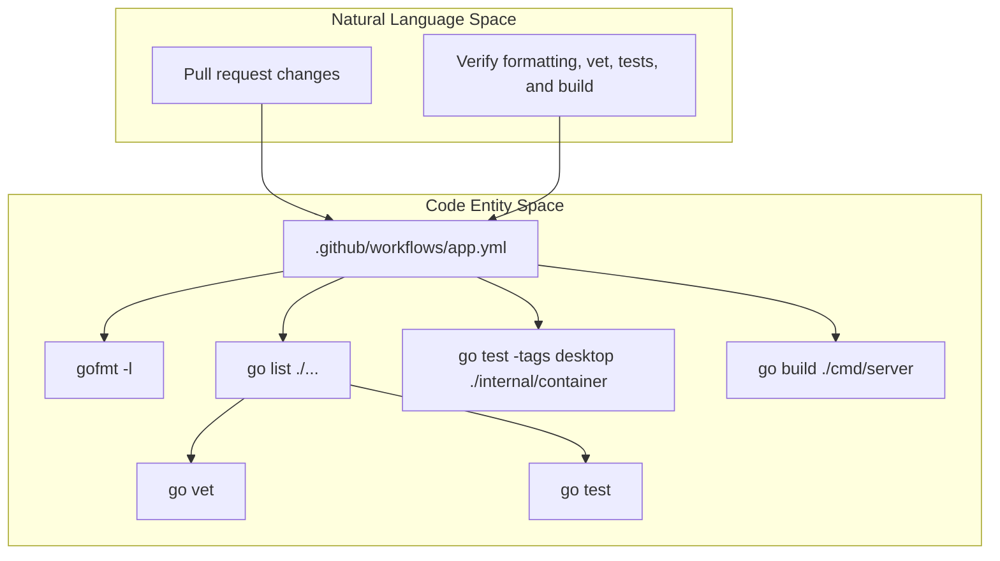
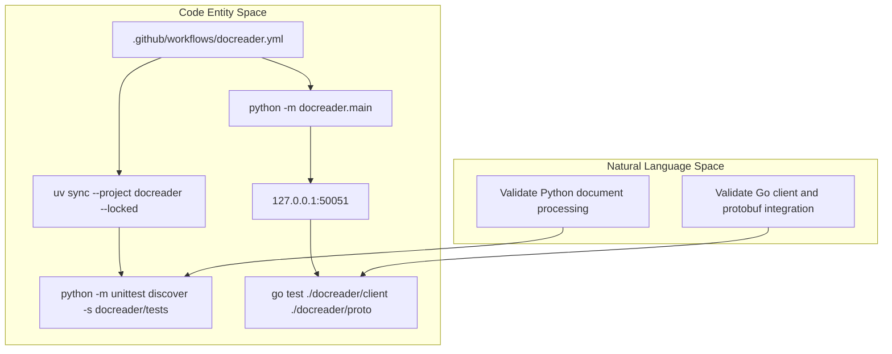
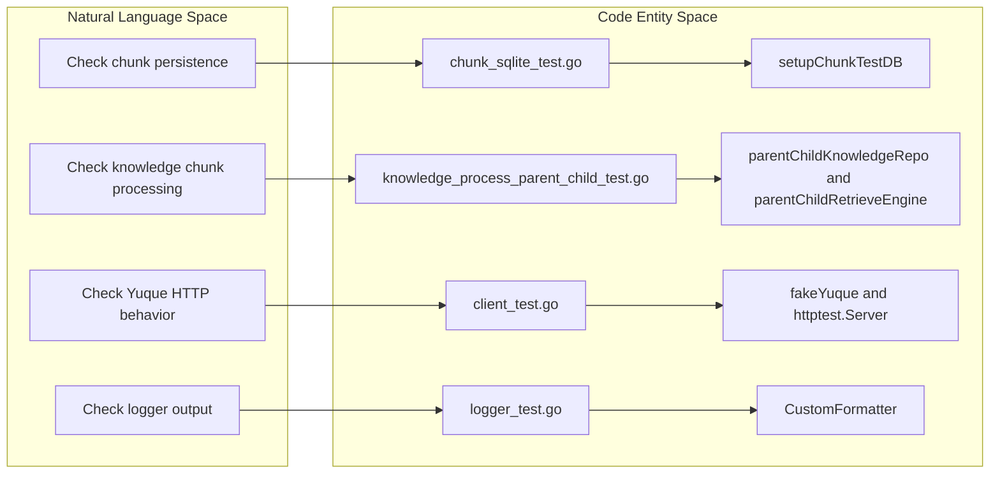

<!-- source: DeepWiki mcp.deepwiki.com · repo Tencent/WeKnora · page 10.4 Testing and Quality Assurance · fetched 2026-10-29 -->

# Testing and Quality Assurance

Relevant source files

The following files were used as context for generating this wiki page:

- [.github/workflows/anydoc.yml](.github/workflows/anydoc.yml)
- [.github/workflows/app.yml](.github/workflows/app.yml)
- [.github/workflows/docreader.yml](.github/workflows/docreader.yml)
- [.github/workflows/go-lint-cache.yml](.github/workflows/go-lint-cache.yml)
- [.github/workflows/go-lint.yml](.github/workflows/go-lint.yml)
- [.golangci.yml](.golangci.yml)
- [docs/swag.overrides](docs/swag.overrides)
- [frontend/src/views/knowledge/settings/chunkingSamples.ts](frontend/src/views/knowledge/settings/chunkingSamples.ts)
- [internal/application/repository/chunk_insert_test.go](internal/application/repository/chunk_insert_test.go)
- [internal/application/repository/chunk_sqlite_test.go](internal/application/repository/chunk_sqlite_test.go)
- [internal/application/service/knowledge_faq_import_enabled_test.go](internal/application/service/knowledge_faq_import_enabled_test.go)
- [internal/application/service/knowledge_multimodal_slot_release_test.go](internal/application/service/knowledge_multimodal_slot_release_test.go)
- [internal/application/service/knowledge_post_process_summary_test.go](internal/application/service/knowledge_post_process_summary_test.go)
- [internal/application/service/knowledge_process_embedding_failure_test.go](internal/application/service/knowledge_process_embedding_failure_test.go)
- [internal/application/service/knowledge_process_index_retry_test.go](internal/application/service/knowledge_process_index_retry_test.go)
- [internal/application/service/knowledge_process_parent_child_test.go](internal/application/service/knowledge_process_parent_child_test.go)
- [internal/application/service/knowledgebase_search_partial_test.go](internal/application/service/knowledgebase_search_partial_test.go)
- [internal/application/service/shell_job_followup_test.go](internal/application/service/shell_job_followup_test.go)
- [internal/datasource/connector/yuque/client_test.go](internal/datasource/connector/yuque/client_test.go)
- [internal/logger/logger.go](internal/logger/logger.go)
- [internal/logger/logger_test.go](internal/logger/logger_test.go)
- [scripts/git-hooks/common.sh](scripts/git-hooks/common.sh)
- [scripts/test-git-hooks.sh](scripts/test-git-hooks.sh)

## Purpose and Scope

This page describes the test and quality checks evidenced in the supplied codebase files: Go tests and CI verification, DocReader’s Python and Go client test workflow, Git hooks, linting, and representative test patterns. The supplied files do not show the `dataset/` sampling tool’s implementation or frontend Vitest configuration, so this page does not infer their commands or behavior. [ .github/workflows/app.yml:84-148 ]()

Sources: [.github/workflows/app.yml:84-147]()

---

## Testing Infrastructure and Execution

WeKnora’s supplied verification workflows cover Go application packages, the DocReader Python service and Go client, and Go linting. The workflows use path filters and separate jobs, so the checks run according to the files changed and the workflow selected. [.github/workflows/app.yml:6-68](), [.github/workflows/docreader.yml:3-23](), [.github/workflows/go-lint.yml:17-24]()

Sources: [.github/workflows/app.yml:6-68](), [.github/workflows/docreader.yml:3-23](), [.github/workflows/go-lint.yml:17-24]()

### Backend Testing (Go)

The application workflow downloads Go modules, checks formatting, runs `go vet` and `go test` against the package list from `go list ./...` after excluding `/docreader/`, runs a desktop-tagged container test, and builds `./cmd/server`. It also runs license-bundle checks, generated model-catalog verification, and Git-hook test coverage. [.github/workflows/app.yml:100-147]()

The workflow sets `WEKNORA_LOG_FORMAT` to an empty string so a developer’s custom log template does not affect test behavior. The Git-hook helper applies the same setting when running application tests, and uses `-count=1` to bypass Go’s test-result cache. [.github/workflows/app.yml:77-82](), [scripts/git-hooks/common.sh:148-188]()

A local run matching the application workflow’s core Go checks can use:

| Goal | Command / behavior |
|---|---|
| Enumerate packages | `go list ./...` |
| Vet application packages | `go vet` on the package list excluding `/docreader/` |
| Test application packages | `WEKNORA_LOG_FORMAT="" go test -count=1` on that package list |
| Exercise desktop build-tagged container code | `go test -tags desktop ./internal/container` |
| Build the server | `go build ./cmd/server` |

These commands correspond to the application workflow and the shared Git-hook helper; the package exclusion is applied to the application package list, not to all Go modules. [.github/workflows/app.yml:138-147](), [scripts/git-hooks/common.sh:148-188]()

The test files demonstrate several useful unit-test techniques:

- `chunk_sqlite_test.go` creates an in-memory SQLite database, migrates chunk, revision, and tag tables, and tests repository persistence behavior such as sequential IDs and cleaned context headers. [internal/application/repository/chunk_sqlite_test.go:18-25](), [internal/application/repository/chunk_sqlite_test.go:39-86]()
- `knowledge_process_parent_child_test.go` supplies interface-backed fakes for repositories, embedding, retrieval, and task enqueueing, then checks that processed text chunks are indexed and that superseded history is purged after successful indexing. [internal/application/service/knowledge_process_parent_child_test.go:14-48](), [internal/application/service/knowledge_process_parent_child_test.go:51-146](), [internal/application/service/knowledge_process_parent_child_test.go:148-208]()
- `knowledge_process_index_retry_test.go` injects an indexing failure and checks the distinction between a retryable attempt and the terminal retry attempt, including span status, parse status, and cleanup effects. [internal/application/service/knowledge_process_index_retry_test.go:14-49](), [internal/application/service/knowledge_process_index_retry_test.go:51-91](), [internal/application/service/knowledge_process_index_retry_test.go:94-141]()
- `client_test.go` for Yuque uses `httptest.Server` instances to exercise authentication, error mapping, token redaction, and retry behavior without relying on the live Yuque service. [internal/datasource/connector/yuque/client_test.go:22-51](), [internal/datasource/connector/yuque/client_test.go:63-117](), [internal/datasource/connector/yuque/client_test.go:119-189]()

**Diagram: Go application verification mapped to CI entities**

Sources: [.github/workflows/app.yml:84-88](), [.github/workflows/app.yml:108-147]()

Sources: [.github/workflows/app.yml:84-88](), [.github/workflows/app.yml:108-147]()

### DocReader Testing (Python and Go)

The dedicated DocReader workflow installs Python dependencies using the locked `docreader/uv.lock`, compiles the Python sources, installs Playwright WebKit, and runs Python `unittest` discovery over `docreader/tests` using the `test_*.py` pattern. It then starts the DocReader Python service, waits for port `50051`, runs the Go client and protobuf tests, and stops the service even when an earlier step fails. [.github/workflows/docreader.yml:45-73](), [.github/workflows/docreader.yml:83-105]()

The Go client tests therefore depend on a live DocReader gRPC service in this CI workflow; they are not run as part of the application workflow’s `go test` package list, which excludes `/docreader/`. [.github/workflows/docreader.yml:83-105](), [.github/workflows/app.yml:138-145]()

**Diagram: DocReader workflow mapped to test and service entities**

Sources: [.github/workflows/docreader.yml:45-73](), [.github/workflows/docreader.yml:83-105]()

Sources: [.github/workflows/docreader.yml:45-73](), [.github/workflows/docreader.yml:83-105]()

### Frontend Tests and Vitest

The supplied files do not include the frontend package manifest, Vitest configuration, or `scripts/verify_frontend_pr.sh` implementation. Consequently, they do not establish the frontend test command, test-file conventions, or whether Vitest is configured. The Git-hook helper does show that frontend verification is delegated to `scripts/verify_frontend_pr.sh`, described there as covering test, type-check, and build; the script’s details are not present in the supplied content. [scripts/git-hooks/common.sh:204-207]()

The supplied frontend file, `chunkingSamples.ts`, defines curated sample text presets for the knowledge chunking debug drawer. It is UI sample data, not evidence of a Vitest suite or of the `dataset/` QA sampling tool. [frontend/src/views/knowledge/settings/chunkingSamples.ts:1-11]()

Sources: [scripts/git-hooks/common.sh:204-207](), [frontend/src/views/knowledge/settings/chunkingSamples.ts:1-11]()

---

## Validation Matrix: Representative Test Organization

The available Go tests show package-local tests organized around the behavior under test. Repository tests exercise persistence using SQLite; service tests replace dependencies with fakes to isolate processing and retry behavior; connector tests use local HTTP test servers to validate protocol behavior. [internal/application/repository/chunk_sqlite_test.go:18-25](), [internal/application/service/knowledge_process_parent_child_test.go:14-48](), [internal/datasource/connector/yuque/client_test.go:22-51]()

| Test area | Test setup | Behavior checked |
|---|---|---|
| Chunk repository | In-memory SQLite database and GORM migrations | Chunk creation, sequence assignment, and context-header cleanup. [internal/application/repository/chunk_sqlite_test.go:18-25](), [internal/application/repository/chunk_sqlite_test.go:39-86]() |
| Knowledge processing | Fake repository, embedder, retrieval engine, graph repository, and task enqueuer | Text-child indexing and successful-processing cleanup. [internal/application/service/knowledge_process_parent_child_test.go:14-48](), [internal/application/service/knowledge_process_parent_child_test.go:51-146](), [internal/application/service/knowledge_process_parent_child_test.go:148-208]() |
| Index retry handling | Fake index engine that returns an error, plus span tracking | Retryable failure versus terminal failure and associated cleanup/status behavior. [internal/application/service/knowledge_process_index_retry_test.go:34-49](), [internal/application/service/knowledge_process_index_retry_test.go:94-141]() |
| Yuque connector | `httptest.Server` and handlers | Auth headers, credential error mapping, redaction, and rate-limit retry behavior. [internal/datasource/connector/yuque/client_test.go:22-51](), [internal/datasource/connector/yuque/client_test.go:63-117](), [internal/datasource/connector/yuque/client_test.go:119-189]() |
| Logger | Synthetic Logrus entries and captured output | Template resolution, placeholder substitution, ANSI stripping, and preservation of message and structured fields. [internal/logger/logger_test.go:15-100](), [internal/logger/logger_test.go:111-152](), [internal/logger/logger_test.go:154-201]() |

**Diagram: Test doubles and fixtures mapped to tested entities**

Sources: [internal/application/repository/chunk_sqlite_test.go:18-25](), [internal/application/service/knowledge_process_parent_child_test.go:14-48](), [internal/application/service/knowledge_process_parent_child_test.go:80-123](), [internal/datasource/connector/yuque/client_test.go:22-51](), [internal/logger/logger_test.go:15-24](), [internal/logger/logger_test.go:127-152]()

Sources: [internal/application/repository/chunk_sqlite_test.go:18-25](), [internal/application/service/knowledge_process_parent_child_test.go:14-48](), [internal/application/service/knowledge_process_parent_child_test.go:80-123](), [internal/datasource/connector/yuque/client_test.go:22-51](), [internal/logger/logger_test.go:15-24](), [internal/logger/logger_test.go:127-152]()

---

## Automated CI/CD Pipelines

The supplied workflows divide verification by component and changed-path scope:

| Workflow | Trigger scope | Main checks |
|---|---|---|
| **App** | Pushes to `main`, pull requests, or manual dispatch when configured paths change | License/source-bundle checks, changed-Go-file formatting, model-catalog verification, Git-hook test coverage, application `go vet` and `go test`, desktop-tagged container test, and server build. [.github/workflows/app.yml:6-68](), [.github/workflows/app.yml:103-147]() |
| **DocReader** | Pushes to `main`, pull requests, or manual dispatch for DocReader-related paths | Python dependency setup and compilation, Python `unittest`, then Go client/protobuf tests against a started DocReader service. [.github/workflows/docreader.yml:3-23](), [.github/workflows/docreader.yml:45-105]() |
| **Go Lint** | Pull requests affecting Go files, module manifests, lint config, or the workflow | Detects affected Go modules and runs `golangci-lint` using a merge-base diff filter. [.github/workflows/go-lint.yml:17-24](), [.github/workflows/go-lint.yml:38-44](), [.github/workflows/go-lint.yml:88-115]() |

The App workflow checks formatting only for changed Go files in its diff range, excluding `cli/**`. Its package-level vet/test step separately excludes `/docreader/`, which has its own workflow. [.github/workflows/app.yml:108-129](), [.github/workflows/app.yml:138-145]()

Sources: [.github/workflows/app.yml:6-68](), [.github/workflows/app.yml:103-147](), [.github/workflows/docreader.yml:3-23](), [.github/workflows/docreader.yml:45-105](), [.github/workflows/go-lint.yml:17-24](), [.github/workflows/go-lint.yml:38-44](), [.github/workflows/go-lint.yml:88-115]()

---

## Lint Configuration and Code Quality

The supplied Go lint workflow sets Go version `1.26` and `golangci-lint` version `v2.12.2`. It detects which of the root, `cli`, and `client` modules are affected; changes to `.golangci.yml` or the workflow trigger linting for all three modules. The job runs `golangci-lint` from each selected module’s working directory. [.github/workflows/go-lint.yml:33-36](), [.github/workflows/go-lint.yml:38-86](), [.github/workflows/go-lint.yml:88-115]()

The workflow intentionally filters findings to new issues using `--new-from-merge-base` and checks out full history so the merge base is available. Its comments explain that this avoids relying on GitHub’s pull-request patch API, which can fail on diffs over 20,000 lines. The actual rule settings in `.golangci.yml` were not included in the supplied file contents, so individual enabled or disabled linters cannot be enumerated here. [.github/workflows/go-lint.yml:3-15](), [.github/workflows/go-lint.yml:99-115]()

The shared Git-hook helper offers changed-file checks for whitespace and Go formatting, runs `golangci-lint` when installed, and invokes application, CLI, and frontend verification helpers. `SKIP_HOOKS=1` and `HOOK_SKIP_TEST=1` provide explicit hook/test skip controls in the helper. [scripts/git-hooks/common.sh:8-10](), [scripts/git-hooks/common.sh:74-90](), [scripts/git-hooks/common.sh:92-145](), [scripts/git-hooks/common.sh:148-207]()

Sources: [.github/workflows/go-lint.yml:3-15](), [.github/workflows/go-lint.yml:33-36](), [.github/workflows/go-lint.yml:38-115](), [scripts/git-hooks/common.sh:8-10](), [scripts/git-hooks/common.sh:74-90](), [scripts/git-hooks/common.sh:92-145](), [scripts/git-hooks/common.sh:148-207]()

---

## QA Dataset Sampling Tool (`dataset/`)

The supplied file contents do not include files from `dataset/`, so the sampling tool’s entry point, arguments, input format, sampling algorithm, and output format cannot be documented reliably. In particular, no command for running it is evidenced here.

Do not confuse the frontend chunking-debug presets with that tool: `chunkingSamples.ts` defines curated text samples for a UI debug drawer, including an interface with `id`, `labelKey`, and `text`; it does not establish the behavior or data flow of a tool under `dataset/`. [frontend/src/views/knowledge/settings/chunkingSamples.ts:1-11]()

Sources: [frontend/src/views/knowledge/settings/chunkingSamples.ts:1-11]()

---

## References

- Application Go verification workflow: [.github/workflows/app.yml:84-147]()
- DocReader Python and Go test workflow: [.github/workflows/docreader.yml:37-105]()
- Go lint workflow and module selection: [.github/workflows/go-lint.yml:33-115]()
- Git-hook verification helpers: [scripts/git-hooks/common.sh:74-207]()
- SQLite chunk repository tests: [internal/application/repository/chunk_sqlite_test.go:18-86]()
- Knowledge processing and indexing tests: [internal/application/service/knowledge_process_parent_child_test.go:14-208](), [internal/application/service/knowledge_process_index_retry_test.go:14-141]()
- Yuque connector tests: [internal/datasource/connector/yuque/client_test.go:22-189]()
- Logger tests: [internal/logger/logger_test.go:15-201]()
- Frontend chunking debug samples: [frontend/src/views/knowledge/settings/chunkingSamples.ts:1-11]()

---

