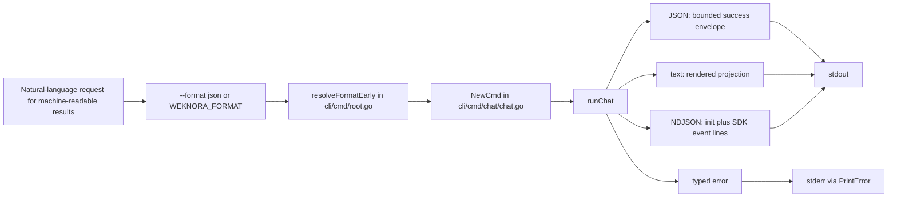
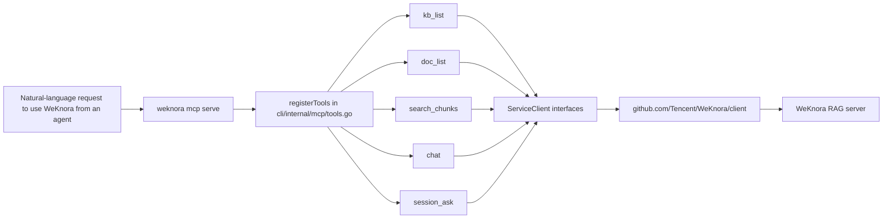

<!-- source: DeepWiki mcp.deepwiki.com · repo Tencent/WeKnora · page 10.5 CLI Tool · fetched 2026-10-29 -->

# CLI Tool

Relevant source files

The following files were used as context for generating this wiki page:

- [cli/AGENTS.md](cli/AGENTS.md)
- [cli/CHANGELOG.md](cli/CHANGELOG.md)
- [cli/README.md](cli/README.md)
- [cli/acceptance/e2e/e2e_test.go](cli/acceptance/e2e/e2e_test.go)
- [cli/cmd/chat/chat.go](cli/cmd/chat/chat.go)
- [cli/cmd/chat/chat_test.go](cli/cmd/chat/chat_test.go)
- [cli/cmd/doctor/doctor.go](cli/cmd/doctor/doctor.go)
- [cli/cmd/doctor/doctor_test.go](cli/cmd/doctor/doctor_test.go)
- [cli/cmd/mcp/mcp.go](cli/cmd/mcp/mcp.go)
- [cli/cmd/mcp/serve.go](cli/cmd/mcp/serve.go)
- [cli/cmd/root.go](cli/cmd/root.go)
- [cli/cmd/search/search.go](cli/cmd/search/search.go)
- [cli/cmd/search/search_test.go](cli/cmd/search/search_test.go)
- [cli/cmd/session/ask.go](cli/cmd/session/ask.go)
- [cli/cmd/session/ask_test.go](cli/cmd/session/ask_test.go)
- [cli/go.mod](cli/go.mod)
- [cli/go.sum](cli/go.sum)
- [cli/internal/mcp/tools.go](cli/internal/mcp/tools.go)
- [cli/internal/mcp/tools_test.go](cli/internal/mcp/tools_test.go)
- [cli/internal/sse/accumulator.go](cli/internal/sse/accumulator.go)
- [cli/internal/sse/agent_accumulator_test.go](cli/internal/sse/agent_accumulator_test.go)
- [cli/skills/weknora-rag-search/SKILL.md](cli/skills/weknora-rag-search/SKILL.md)
- [cli/skills/weknora-rag-search/references/chat.md](cli/skills/weknora-rag-search/references/chat.md)
- [cli/skills/weknora-shared/SKILL.md](cli/skills/weknora-shared/SKILL.md)

## Purpose and Scope

The `weknora` CLI, in the `cli/` Go module, is a command-line client for the WeKnora RAG server. It supports interactive use as well as agent-driven workflows, where structured output and stable error handling are part of the interface. [cli/go.mod:1-3](), [cli/cmd/root.go:137-146](), [cli/AGENTS.md:7-11]()

This parent page summarizes the CLI architecture, command groups, output contracts, and error-code model. For authentication and profile workflows, see [CLI Authentication and Profiles](#10.5.1). For knowledge base, document, search, session, chat, and MCP command details, see [CLI Document, KB and Chat Commands](#10.5.2).

Sources: [cli/go.mod:1-3](), [cli/cmd/root.go:137-146](), [cli/AGENTS.md:7-11]()

---

## Architecture and Command Structure

The CLI uses Cobra to build and dispatch its command tree. `NewRootCmd` assembles command groups from `cli/cmd/`; `Execute(ctx)` resolves the output format early, executes the root command with a context, and routes failures through error mapping and printing. [cli/go.mod:11-13](), [cli/cmd/root.go:11-33](), [cli/cmd/root.go:35-93]()

### Command Tree Overview

Root command groups are registered from separate packages, keeping command domains modular. The table summarizes the top-level surface; the child pages cover the selected command workflows in more detail. [cli/cmd/root.go:13-33](), [cli/README.md:13-37]()

| Command group | Responsibility |
|---|---|
| `agent` | Custom agent management |
| `api` | Raw API requests |
| `auth` | Authentication |
| `chat` | Streaming RAG questions |
| `chunk` | Document chunk management |
| `config` | Resolved CLI configuration |
| `doc` | Document management |
| `doctor` | Connection and credential checks |
| `kb` | Knowledge base management |
| `link` / `unlink` | Directory-to-knowledge-base binding |
| `mcp` | MCP server mode |
| `message` | Session message inspection and management |
| `model` | Model management |
| `profile` | Named connection profiles |
| `schema` | Machine-readable command contract |
| `search` | Search across CLI resource domains |
| `session` | Chat session management |
| `skills` | Bundled Agent Skills |
| `version` | CLI build metadata |

Sources: [cli/cmd/root.go:13-33](), [cli/README.md:13-37]()

### CLI Execution Flow and Natural Language Mapping

The command-line string is parsed by Cobra and dispatched to the corresponding command handler. For example, `weknora chat` is built by `NewRootCmd`, enters the `chat` command handler, resolves the knowledge base and SDK client, then calls `runChat`, which uses the chat service interface to create or continue a session and stream a response. [cli/cmd/root.go:75-93](), [cli/cmd/root.go:131-165](), [cli/cmd/chat/chat.go:67-110](), [cli/cmd/chat/chat.go:129-149]()

Title: CLI Command Execution Flow

```mermaid
flowchart LR
    Input["Natural-language request: weknora chat ..."] --> Cobra["NewRootCmd in cli/cmd/root.go"]
    Cobra --> EarlyFormat["resolveFormatEarly"]
    EarlyFormat --> Execute["ExecuteContext"]
    Execute --> ChatCommand["NewCmd in cli/cmd/chat/chat.go"]
    ChatCommand --> RunChat["runChat"]
    RunChat --> Factory["Factory.Client and ResolveKB"]
    Factory --> SDK["ChatService.KnowledgeQAStream"]
    SDK --> Server["WeKnora RAG server"]
```

Sources: [cli/cmd/root.go:35-93](), [cli/cmd/root.go:131-165](), [cli/cmd/chat/chat.go:67-110](), [cli/cmd/chat/chat.go:129-149]()

### Output Modes at a Glance

Output mode selection is shared across commands through `--format`; `WEKNORA_FORMAT` supplies a default when no explicit flag is provided. Chat illustrates the distinction: JSON returns a bounded answer projection, text renders the selected projection for people, and NDJSON emits an `init` event followed by SDK events. [cli/AGENTS.md:124-132](), [cli/cmd/root.go:42-69](), [cli/cmd/chat/chat.go:4-16](), [cli/cmd/chat/chat.go:73-85]()

Title: CLI Output Contract Mapped to Code Entities

Sources: [cli/AGENTS.md:13-45](), [cli/AGENTS.md:47-92](), [cli/cmd/root.go:42-69](), [cli/cmd/root.go:82-90](), [cli/cmd/chat/chat.go:4-16]()

---

## CLI Output Contracts for Agents

In JSON mode, successful commands use a common envelope: `ok` indicates success, `data` carries a resource or list when present, `meta` carries counters or batch results when populated, and `profile` echoes the resolved profile when configured. Mutation-only successes may omit `data`; optional fields are omitted when empty. [cli/AGENTS.md:13-45]()

Errors are written to `stderr`, keeping the success stream on `stdout` clean for pipelines. In JSON mode, errors use an envelope with an `error` object containing a typed `type`, message, optional hint and retry arguments, and structured details. Text mode emits prose with the code and any hint or retry guidance. [cli/AGENTS.md:47-76](), [cli/cmd/root.go:82-90]()

Chat and session streaming have a distinct line-oriented contract: `--format json` and `--format ndjson` emit one JSON event per line without a success envelope. The CLI injects one `init` event at the beginning; subsequent events pass through from the SDK. The CLI contract covers the envelope and passthrough behavior, not the server SDK’s specific event vocabulary or field shapes. [cli/AGENTS.md:78-92](), [cli/AGENTS.md:103-117]()

For authentication and profile output behavior, see [CLI Authentication and Profiles](#10.5.1). For command-specific output and streaming behavior, see [CLI Document, KB and Chat Commands](#10.5.2).

Sources: [cli/AGENTS.md:13-45](), [cli/AGENTS.md:47-76](), [cli/AGENTS.md:78-92](), [cli/AGENTS.md:103-117]()

---

## Command Subsystems and MCP Server Architecture

The CLI exposes an MCP server mode through the `mcp` command group. Its tool surface is curated separately from the full CLI command tree: `registerTools` registers ten tools, including `kb_list`, `doc_list`, `search_chunks`, `chat`, and `session_ask`. This separation means MCP is an agent-facing subset, not an automatic export of every CLI command. [cli/cmd/root.go:13-33](), [cli/internal/mcp/tools.go:125-148](), [cli/internal/mcp/tools.go:150-162]()

The MCP handlers use narrow service interfaces for knowledge bases, documents, chat, agents, and chunks, allowing the tool layer to depend on the client operations it needs. Success and error results expose structured content alongside a text fallback. [cli/internal/mcp/tools.go:60-75](), [cli/internal/mcp/tools.go:77-123]()

Title: CLI and MCP Subsystems Mapped to Code Entities

Sources: [cli/cmd/root.go:13-33](), [cli/internal/mcp/tools.go:19-75](), [cli/internal/mcp/tools.go:77-148]()

---

## Safety and Exit Codes

The CLI maps typed errors to process exit codes and prints errors through a centralized path. Cobra invocation errors such as unknown commands, unknown flags, and argument-count violations are mapped to `FlagError`; `Execute` then prints the mapped error to `stderr` and returns its exit code. [cli/cmd/root.go:95-129](), [cli/cmd/root.go:82-90]()

Destructive operations can require explicit confirmation. Exit code `10` corresponds to `input.confirmation_required`; `retry_argv` guidance in this case is informational, and a human must approve the write. The `weknora api` DELETE path is also documented as requiring this confirmation unless the user supplies `-y`/`--yes`. [cli/AGENTS.md:68-74](), [cli/AGENTS.md:153-158]()

### Exit Code Summary

| Exit code | Meaning |
|---:|---|
| `0` | Command succeeded. |
| `2` | CLI invocation error, such as an unknown command or flag, or invalid argument count. |
| `3`, `4`, `5`, `6`, `7` | Typed error classes returned by the CLI; consult `weknora exit-codes` for the action guidance. |
| `10` | `input.confirmation_required`; human confirmation is required for the destructive action. |

The root execution path explicitly identifies `3/4/5/6/7/10` as typed exit codes, while `MapCobraError` maps Cobra invocation errors into the flag-error category. The CLI also provides an `exit-codes` command for the full operational matrix and recommended agent actions. [cli/cmd/root.go:82-90](), [cli/cmd/root.go:95-129](), [cli/README.md:13-24](), [cli/AGENTS.md:68-74]()

Sources: [cli/cmd/root.go:82-90](), [cli/cmd/root.go:95-129](), [cli/README.md:13-24](), [cli/AGENTS.md:68-74](), [cli/AGENTS.md:153-158]()

---

## Child Pages

The child pages provide command-level guidance beyond this architecture overview:

- [CLI Authentication and Profiles](#10.5.1) — `auth`, `profile`, and `link` workflows, credential storage, token refresh, and multi-profile configuration.
- [CLI Document, KB and Chat Commands](#10.5.2) — `kb`, `doc`, `session`, `search`, `chat`, and `mcp` command reference, including upload and streaming output behavior.

Sources: [cli/cmd/root.go:13-33](), [cli/README.md:13-37]()

---

