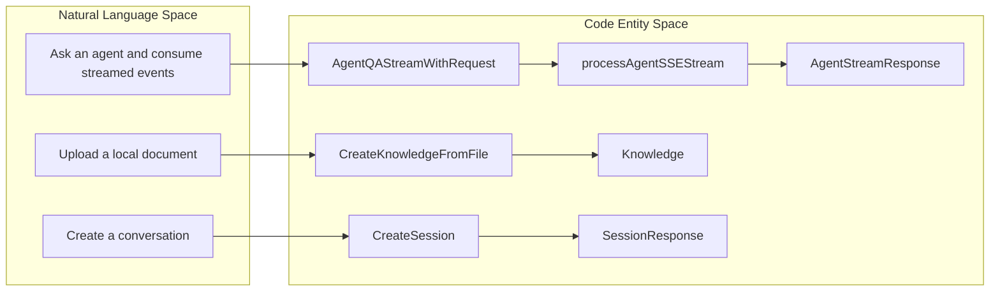
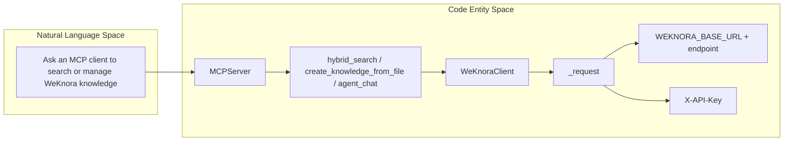

<!-- source: DeepWiki mcp.deepwiki.com · repo Tencent/WeKnora · page 10.6 Client SDK and MCP Server · fetched 2026-10-29 -->

# Client SDK and MCP Server

Relevant source files

The following files were used as context for generating this wiki page:

- [.github/workflows/mcp-server.yml](.github/workflows/mcp-server.yml)
- [cli/internal/sse/agent_accumulator.go](cli/internal/sse/agent_accumulator.go)
- [client/agent.go](client/agent.go)
- [client/auth.go](client/auth.go)
- [client/client.go](client/client.go)
- [client/example.go](client/example.go)
- [client/initialization.go](client/initialization.go)
- [client/knowledge.go](client/knowledge.go)
- [client/message.go](client/message.go)
- [client/model.go](client/model.go)
- [client/organization.go](client/organization.go)
- [client/session.go](client/session.go)
- [client/sse.go](client/sse.go)
- [client/streaming_test.go](client/streaming_test.go)
- [frontend/src/api/chat/streame.ts](frontend/src/api/chat/streame.ts)
- [internal/application/repository/knowledge_folder_move_test.go](internal/application/repository/knowledge_folder_move_test.go)
- [internal/application/repository/knowledge_folder_test.go](internal/application/repository/knowledge_folder_test.go)
- [internal/application/service/knowledge_create_folder_test.go](internal/application/service/knowledge_create_folder_test.go)
- [internal/handler/knowledge_folder_test.go](internal/handler/knowledge_folder_test.go)
- [internal/handler/session/types.go](internal/handler/session/types.go)
- [mcp-server/CHANGELOG.md](mcp-server/CHANGELOG.md)
- [mcp-server/EXAMPLES.md](mcp-server/EXAMPLES.md)
- [mcp-server/INSTALL.md](mcp-server/INSTALL.md)
- [mcp-server/MCP_CONFIG.md](mcp-server/MCP_CONFIG.md)
- [mcp-server/PROJECT_SUMMARY.md](mcp-server/PROJECT_SUMMARY.md)
- [mcp-server/README.md](mcp-server/README.md)
- [mcp-server/__init__.py](mcp-server/__init__.py)
- [mcp-server/check_imports.py](mcp-server/check_imports.py)
- [mcp-server/main.py](mcp-server/main.py)
- [mcp-server/pyproject.toml](mcp-server/pyproject.toml)
- [mcp-server/requirements.txt](mcp-server/requirements.txt)
- [mcp-server/run.py](mcp-server/run.py)
- [mcp-server/run_server.py](mcp-server/run_server.py)
- [mcp-server/setup.py](mcp-server/setup.py)
- [mcp-server/test_chat_async_preflight.py](mcp-server/test_chat_async_preflight.py)
- [mcp-server/test_chat_sse.py](mcp-server/test_chat_sse.py)
- [mcp-server/test_create_knowledge_from_text.py](mcp-server/test_create_knowledge_from_text.py)
- [mcp-server/test_mcp_transports.py](mcp-server/test_mcp_transports.py)
- [mcp-server/test_module.py](mcp-server/test_module.py)
- [mcp-server/test_update_knowledge_from_text.py](mcp-server/test_update_knowledge_from_text.py)
- [mcp-server/tests/test_kb_id_resolution.py](mcp-server/tests/test_kb_id_resolution.py)
- [mcp-server/uv.lock](mcp-server/uv.lock)
- [mcp-server/weknora_mcp_server.py](mcp-server/weknora_mcp_server.py)

## Purpose and scope

This page covers the Go client SDK, the legacy standalone Python MCP server, and the DeepSeek Harness and WeChat Mini Program clients requested for section 10.6. The available source excerpts describe the Go SDK’s knowledge and session interfaces and parts of its agent streaming API, as well as the Python MCP server’s client, transports, and authentication. They do not include DeepSeek Harness or Mini Program implementation files, so those components are identified below without inferring their design. The Python MCP package is retained for compatibility; WeKnora also provides a built-in MCP server configured through the application’s settings. [client/knowledge.go:1-5](), [client/session.go:1-5](), [client/agent.go:83-124](), [mcp-server/README.md:1-8]()

Sources: [client/knowledge.go:1-5](), [client/session.go:1-5](), [client/agent.go:83-124](), [mcp-server/README.md:1-8]()

---

## Go Client SDK

The Go package `client` provides interfaces for interacting with the WeKnora API. The supplied implementation excerpts cover knowledge records and uploads, session management, and agent Q&A over SSE. The SDK uses typed request and response structures at these boundaries. [client/knowledge.go:1-5](), [client/session.go:1-5](), [client/agent.go:1-3]()

### Client initialization and request context

The available example demonstrates constructing a client with `NewClient`, supplying a base URL and options including `WithToken`, `WithTimeout`, and `WithTenantID`. It also documents a per-request tenant override through a `TenantID` value in the context. The implementation of `NewClient`, the option functions, and the underlying request method is not included in the provided excerpts, so their internal behavior is not described here. [client/example.go:22-35]()

| SDK symbol | Role shown in supplied sources |
|---|---|
| `NewClient` | Constructs the client in the example. [client/example.go:22-30]() |
| `WithToken` | Supplies an authentication token in the example. [client/example.go:25-29]() |
| `WithTimeout` | Configures a timeout in the example. [client/example.go:25-29]() |
| `WithTenantID` | Sets the example client’s default tenant. [client/example.go:24-30]() |
| `CreateKnowledgeFromFile` | Uploads a local file as knowledge. [client/knowledge.go:100-112]() |
| `CreateSession` | Creates a session from a request object. [client/session.go:71-84]() |
| `AgentQAStreamWithRequest` | Starts agent Q&A and processes its SSE response. [client/agent.go:93-124]() |

Sources: [client/example.go:22-35](), [client/knowledge.go:100-112](), [client/session.go:71-84](), [client/agent.go:93-124]()

### Knowledge ingestion and data model

`Knowledge` represents a knowledge entry and includes identifiers, knowledge-base association, source and channel, parse and summary status, file metadata, extensible JSON metadata, timestamps, and processing error information. `KnowledgeResponse`, `KnowledgeListResponse`, and `KnowledgeBatchResponse` describe single-entry, paginated-list, and batch response shapes. [client/knowledge.go:23-73]()

`CreateKnowledgeFromFile` accepts a context, knowledge-base ID, local file path, optional string metadata, optional multimodal flag, custom filename, channel, and optional `KnowledgeProcessOverrides`. Its shown implementation opens and stats the file, constructs a multipart form, and copies file content into the `file` part. It can add `enable_multimodel`, JSON-encoded `metadata`, `fileName`, and `channel` fields when provided. The remainder of the function is not included in the supplied excerpt; the exact request endpoint and response handling are therefore not specified here. [client/knowledge.go:100-169]()

`KnowledgeProcessOverrides` exposes optional per-upload parser rules, chunking configuration, multimodal flag, VLM and ASR configuration, question generation configuration, graph enablement, and extraction configuration. The comment states that a nil value leaves the knowledge base defaults in effect. [client/knowledge.go:87-98]()

| Symbol | Data or behavior |
|---|---|
| `Knowledge` | Knowledge record fields, including status, file, metadata, and timestamps. [client/knowledge.go:23-50]() |
| `KnowledgeResponse` | Single-entry response envelope. [client/knowledge.go:52-58]() |
| `KnowledgeListResponse` | List response with pagination fields. [client/knowledge.go:60-67]() |
| `KnowledgeProcessOverrides` | Optional upload-specific processing configuration. [client/knowledge.go:87-98]() |
| `ErrDuplicateFile`, `ErrDuplicateURL` | Sentinel errors for duplicate file and URL creation. [client/knowledge.go:81-85]() |

Sources: [client/knowledge.go:23-98](), [client/knowledge.go:100-169]()

### Sessions and conversation requests

`CreateSessionRequest` contains an optional `Kind`, title, and description; the SDK comments describe sessions as knowledge-base-independent conversation containers, with configuration supplied at query time. `CreateSession` posts this request to `/api/v1/sessions`, parses a `SessionResponse`, and returns its `Data`. `GetSession`, `UpdateSession`, `DeleteSession`, and `BatchDeleteSessions` provide corresponding retrieval, update, and deletion operations. `GetSessionsByTenant` adds pagination parameters and optionally a session kind. [client/session.go:36-43](), [client/session.go:71-84](), [client/session.go:86-179]()

The chat request contract is broader than the session metadata. The backend’s `CreateKnowledgeQARequest` includes query text, knowledge-base and knowledge IDs, agent and web-search flags, selected agent, MCP service and skill selections, mentioned items, images, file attachments, channel, page context, and assistant access level. This handler type illustrates the server-side request fields; it is not itself a Go SDK method. [internal/handler/session/types.go:48-98]()

Sources: [client/session.go:36-43](), [client/session.go:71-179](), [internal/handler/session/types.go:48-98]()

### Agent Q&A streaming

`AgentQARequest` represents the agent-chat payload, with query, optional knowledge-base and knowledge IDs, agent-mode flag, agent ID, web-search setting, optional summary-model ID, mentions, image attachments, channel, question origin, and page context. `AgentQAStreamWithRequest` rejects a nil request and a whitespace-only query, posts to `/api/v1/agent-chat/{sessionID}`, checks for a successful HTTP status, and passes the response body to `processAgentSSEStream`. [client/agent.go:26-42](), [client/agent.go:93-124]()

`AgentStreamResponse` carries a response ID, event type, content fragment, completion flag, knowledge references, and additional data. The `AgentResponseType` constants include `thinking`, `tool_call`, `tool_result`, `references`, `answer`, `reflection`, `error`, `complete`, and `artifacts_pending`. A callback receives each parsed event; returning an error is documented as a way to stop processing. [client/agent.go:44-81]()

`processAgentSSEStream` scans SSE lines and raises its per-line scanner limit to 4 MiB to accommodate large event payloads. It uses blank lines as event boundaries and skips empty `data:` frames before JSON decoding. [client/agent.go:126-145]()

Sources: [client/agent.go:26-81](), [client/agent.go:93-145]()

### Go SDK data flow: request intent to implementation

This diagram maps common SDK tasks to the names visible in the supplied code. It is a code-navigation aid; the request/response pipeline beyond the shown function bodies is not implied.

**Diagram: Go SDK operation map**

Sources: [client/knowledge.go:23-50](), [client/knowledge.go:100-169](), [client/session.go:71-84](), [client/agent.go:69-81](), [client/agent.go:93-145]()

### SDK usage flow

The example demonstrates creating a knowledge base, uploading a local file, creating a session, and invoking `KnowledgeQAStream`. Its callback appends answer fragments and collects knowledge references when the stream marks completion. The example also shows listing models, reading recent messages, and listing knowledge chunks; the corresponding method implementations are not included in the supplied excerpts. [client/example.go:37-80](), [client/example.go:89-115](), [client/example.go:118-165](), [client/example.go:185-205]()

Sources: [client/example.go:37-80](), [client/example.go:89-115](), [client/example.go:118-165](), [client/example.go:185-205]()

---

## Python MCP Server

The standalone Python package in `mcp-server/` exposes WeKnora API operations as MCP tools. The package README marks it deprecated for new deployments: WeKnora’s built-in MCP server supports application-created endpoints, each with a token, knowledge-base scope, and tool list, accessed through Streamable HTTP at `/mcp/<endpoint_id>`. The Python package remains for compatibility with existing deployments. [mcp-server/README.md:1-8]()

### API client and request flow

`WeKnoraClient` stores the configured base URL and API key. SSL certificate verification is enabled by default and can be disabled with `WEKNORA_VERIFY_SSL=false`; the implementation logs a warning when verification is disabled. To support concurrent MCP tool handlers, it keeps a thread-local `requests.Session`. Each session is initialized with the configured SSL behavior and headers including `X-API-Key` and `Content-Type: application/json`. [mcp-server/weknora_mcp_server.py:129-164]()

`_request` joins the base URL and endpoint, issues the configured HTTP method through the thread-local session, raises for HTTP error responses, and returns the decoded JSON object. Request exceptions are logged and re-raised. [mcp-server/weknora_mcp_server.py:166-188]()

`_normalize_kb_entries` handles both owned knowledge-base list entries and shared knowledge-base rows by flattening nested `knowledge_base` objects when present. [mcp-server/weknora_mcp_server.py:105-126]()

Sources: [mcp-server/weknora_mcp_server.py:105-188]()

### MCP transports and startup

The main entry point accepts `stdio`, `sse`, and `http` transport choices, defaulting to `stdio`; host and port are configurable through command-line arguments or `MCP_HOST` and `MCP_PORT`. It selects `run_stdio`, `run_sse`, or `run_http` according to the parsed transport. For stdio, diagnostic output is directed to stderr so it does not corrupt the protocol stream on stdout. [mcp-server/main.py:11-13](), [mcp-server/main.py:91-109](), [mcp-server/main.py:138-155]()

The server module defines `/sse/messages/` as the SSE message path and enables stateless Streamable HTTP. The transport regression tests check the stateless setting and SSE message route. [mcp-server/weknora_mcp_server.py:43-45](), [mcp-server/test_mcp_transports.py:15-42]()

Sources: [mcp-server/main.py:11-13](), [mcp-server/main.py:91-109](), [mcp-server/main.py:138-155](), [mcp-server/weknora_mcp_server.py:43-45](), [mcp-server/test_mcp_transports.py:15-42]()

### Network transport authentication

For `sse` and `http`, `require_network_transport_auth` requires `MCP_SERVER_AUTH_TOKEN` and exits if it is unset. `MCPAuthMiddleware` checks HTTP requests for either a Bearer token in `Authorization` or a token in `X-MCP-Auth-Token`. It compares the supplied value using `secrets.compare_digest`; missing or incorrect credentials receive an HTTP 401 response. [mcp-server/weknora_mcp_server.py:48-64](), [mcp-server/weknora_mcp_server.py:67-103]()

The Python server’s WeKnora API credential and its network transport credential serve different connections: `WEKNORA_API_KEY` is sent to the WeKnora API as `X-API-Key`, while `MCP_SERVER_AUTH_TOKEN` gates incoming network MCP requests. [mcp-server/weknora_mcp_server.py:48-64](), [mcp-server/weknora_mcp_server.py:149-158]()

Sources: [mcp-server/weknora_mcp_server.py:48-64](), [mcp-server/weknora_mcp_server.py:67-103](), [mcp-server/weknora_mcp_server.py:149-158]()

### Tools, package, and configuration

The package README lists tools for tenant and knowledge-base management, knowledge creation and retrieval, model management, session management, chat, and chunk management. It specifically includes `create_knowledge_from_file`, `create_knowledge_from_url`, `create_knowledge_from_text`, `update_knowledge_from_text`, `hybrid_search`, `chat`, and `agent_chat`. The changelog documents migration to MCP 2.x’s high-level `MCPServer` API and function-style `@mcp.tool()` handlers; the available server excerpt does not show the individual tool definitions, so tool-specific argument schemas are not detailed here. [mcp-server/README.md:113-158](), [mcp-server/CHANGELOG.md:33-46]()

The documented configuration includes `WEKNORA_BASE_URL` and `WEKNORA_API_KEY`; the server code defaults the base URL to `http://localhost:8080/api/v1`. Network transports additionally require `MCP_SERVER_AUTH_TOKEN`. The README also documents `MCP_ALLOWED_UPLOAD_DIRS` as a comma-separated list of trusted absolute upload roots; paths resolving outside the selected roots are rejected. [mcp-server/README.md:20-33](), [mcp-server/weknora_mcp_server.py:30-38](), [mcp-server/weknora_mcp_server.py:48-64](), [mcp-server/README.md:171-177]()

The package metadata identifies the distribution as `tencent-weknora-mcp`, requires Python 3.10 or later, and registers the `weknora-mcp-server` and `weknora-server` console entry points. [mcp-server/setup.py:34-64]()

Sources: [mcp-server/README.md:20-33](), [mcp-server/README.md:113-158](), [mcp-server/README.md:171-177](), [mcp-server/weknora_mcp_server.py:30-38](), [mcp-server/weknora_mcp_server.py:48-64](), [mcp-server/CHANGELOG.md:33-46](), [mcp-server/setup.py:34-64]()

### MCP flow: tool intent to API client

**Diagram: Python MCP tool integration map**

Sources: [mcp-server/CHANGELOG.md:33-46](), [mcp-server/README.md:121-158](), [mcp-server/weknora_mcp_server.py:129-188]()

---

## Testing and harness framework

The supplied Python MCP transport tests cover stateless HTTP configuration, the SSE message route, per-thread `WeKnoraClient.session` isolation, stdio tool discovery, and an HTTP initialization smoke test that checks initialization without an MCP session-ID header. The stdio test asserts that `list_tools()` returns 31 tools. [mcp-server/test_mcp_transports.py:15-89](), [mcp-server/test_mcp_transports.py:92-163]()

These files describe an MCP transport regression suite. They do not provide implementation details for a package named DeepSeek Harness; that package’s location, APIs, and data flow cannot be established from the supplied excerpts. [mcp-server/test_mcp_transports.py:1-13]()

Sources: [mcp-server/test_mcp_transports.py:1-13](), [mcp-server/test_mcp_transports.py:15-89](), [mcp-server/test_mcp_transports.py:92-163]()

---

## DeepSeek Harness

No DeepSeek Harness source file or package definition is included in the supplied material. Its purpose, public interfaces, and relationship to the Go SDK or MCP server therefore cannot be documented reliably here. Add implementation-specific details when the package’s source files are available; this section does not infer behavior from the package name.

Sources: [mcp-server/README.md:1-8]()

---

## WeChat Mini Program Client and summary

No WeChat Mini Program source file is included in the supplied material. Its routes, authentication flow, API calls, and handling of attachments cannot be verified from the excerpts, so this page does not assert implementation details for the Mini Program.

| Component | Language / implementation detail available here | Source coverage |
|---|---|---|
| Go client SDK | Go package with knowledge, session, and agent-stream interfaces. [client/knowledge.go:1-5](), [client/session.go:1-5](), [client/agent.go:83-124]() | Partial implementation excerpts. |
| Python MCP server | Python MCP integration to the WeKnora API, with stdio, SSE, and HTTP transport selection. [mcp-server/main.py:91-109](), [mcp-server/main.py:138-155](), [mcp-server/weknora_mcp_server.py:129-188]() | Server client and startup excerpts; tool inventory in README. |
| DeepSeek Harness | Implementation details not present in the supplied material. | Not documented. |
| WeChat Mini Program | Implementation details not present in the supplied material. | Not documented. |

Sources: [client/knowledge.go:1-5](), [client/session.go:1-5](), [client/agent.go:83-124](), [mcp-server/main.py:91-109](), [mcp-server/main.py:138-155](), [mcp-server/weknora_mcp_server.py:129-188](), [mcp-server/README.md:113-158]()

---

