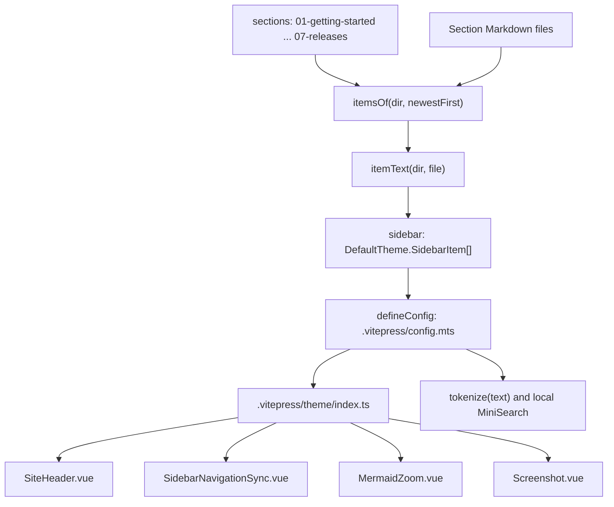
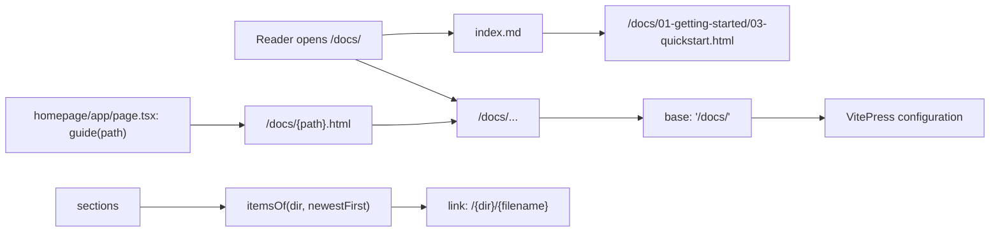
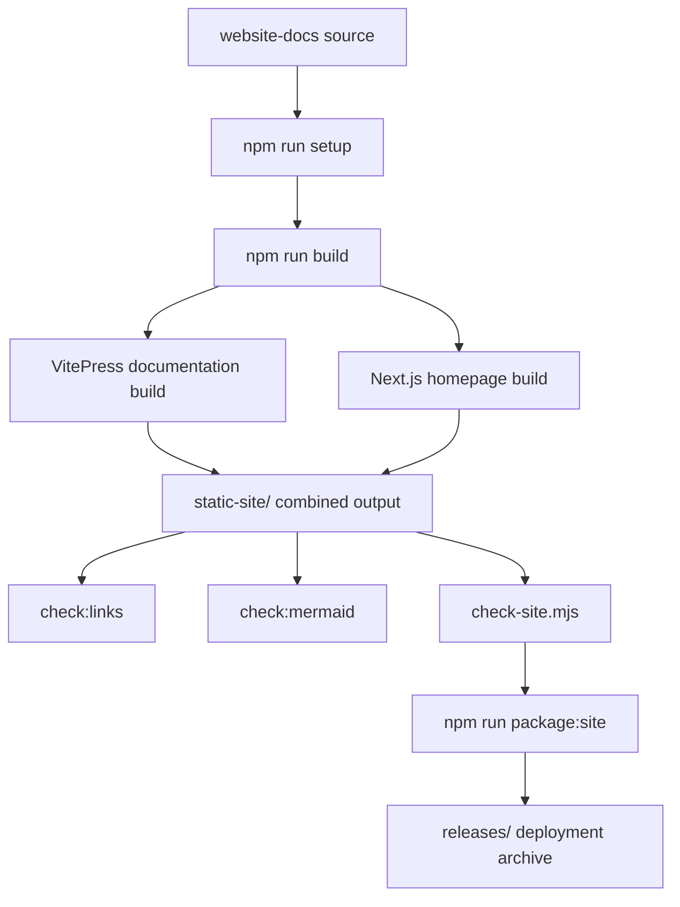
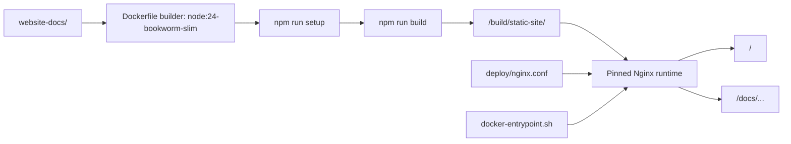

<!-- source: DeepWiki mcp.deepwiki.com · repo Tencent/WeKnora · page 10.7 Documentation Site (website-docs) · fetched 2026-10-29 -->

# Documentation Site (website-docs)

Relevant source files

The following files were used as context for generating this wiki page:

- [website-docs/.gitignore](website-docs/.gitignore)
- [website-docs/.vitepress/config.mts](website-docs/.vitepress/config.mts)
- [website-docs/.vitepress/screenshot-sizes.mjs](website-docs/.vitepress/screenshot-sizes.mjs)
- [website-docs/.vitepress/theme-config.d.ts](website-docs/.vitepress/theme-config.d.ts)
- [website-docs/.vitepress/theme/Screenshot.vue](website-docs/.vitepress/theme/Screenshot.vue)
- [website-docs/.vitepress/theme/index.ts](website-docs/.vitepress/theme/index.ts)
- [website-docs/.vitepress/theme/style.css](website-docs/.vitepress/theme/style.css)
- [website-docs/Dockerfile](website-docs/Dockerfile)
- [website-docs/README.md](website-docs/README.md)
- [website-docs/docker-entrypoint.sh](website-docs/docker-entrypoint.sh)
- [website-docs/homepage/app/page.tsx](website-docs/homepage/app/page.tsx)
- [website-docs/index.md](website-docs/index.md)
- [website-docs/package-lock.json](website-docs/package-lock.json)
- [website-docs/package.json](website-docs/package.json)
- [website-docs/scripts/check-site.mjs](website-docs/scripts/check-site.mjs)

## Purpose and scope

`website-docs/` contains the WeKnora product homepage, VitePress documentation, shared brand assets, and scripts and configuration for building and deploying the combined static site. This page describes the documentation source layout, VitePress configuration and theme, build and deployment flow, and the workflow for adding documentation pages. [website-docs/README.md:1-5]()

Sources: `website-docs/README.md`

---

## 1. Site structure and routing

The site is built as one deployment artifact containing both a homepage and documentation. Its public routes are `/` for the homepage and `/docs/…` for documentation; `/docs/` directs readers to the quick-start guide. The static site root is constrained to `index.html`, `404.html`, and `docs/`, while homepage assets are served beneath `/docs/_home/`. [website-docs/README.md:3-11]()

| Area | Role |
|---|---|
| `homepage/` | Next.js homepage source, brand assets, and its own dependency lock file. [website-docs/README.md:132-135]() |
| `01-getting-started/`–`06-development/` | Markdown documentation organized into topic directories. [website-docs/README.md:132-137]() |
| `07-releases/` | Release-note pages, discovered as a configured documentation section. [website-docs/.vitepress/config.mts:23-32]() |
| `.vitepress/` | VitePress configuration and theme. [website-docs/README.md:132-140]() |
| `public/` | Documentation public assets, including screenshots. [website-docs/README.md:136-140]() |
| `shared/` | Shared brand variables, masthead styles, and icons. [website-docs/README.md:136-140]() |
| `scripts/` | Unified build, validation, preview, and packaging scripts. [website-docs/README.md:138-141]() |
| `static-site/` | Generated deployment directory containing the combined site. [website-docs/README.md:138-141]() |
| `deploy/`, `Dockerfile` | Nginx and Docker deployment configuration. [website-docs/README.md:140-142]() |

`index.md` is the VitePress root page. Its front matter disables the sidebar, outline, footer, and search for that page, and its redirect sends readers to `01-getting-started/03-quickstart.html`. The client-side redirect preserves the current query string and fragment. [website-docs/index.md:1-22]()

Sources: `website-docs/README.md`, `website-docs/.vitepress/config.mts`, `website-docs/index.md`

### 1.1 VitePress configuration and generated sidebar

`.vitepress/config.mts` defines the VitePress site configuration and wraps it with `withMermaid`. It establishes the site title, Chinese language metadata, `/docs/` base path, clean URLs, last-updated metadata, and source exclusions. It also disables VitePress’s default page navbar through `transformPageData`, because the shared masthead supplies the site header. [website-docs/.vitepress/config.mts:1-10](), [website-docs/.vitepress/config.mts:84-101]()

The sidebar is generated from a fixed list of section directories. `itemsOf` scans each directory for Markdown files, sorts filenames, derives each item’s text from its first level-one heading through `itemText`, and constructs a route from the directory and filename. For `07-releases`, the configuration requests newest-first sorting; `compareVersions` compares numeric version components so that, for example, a larger minor version sorts after a smaller one before the list is reversed. [website-docs/.vitepress/config.mts:23-68]()

| Function or value | Responsibility |
|---|---|
| `sections` | Declares the sidebar groups and source directories, including release ordering. [website-docs/.vitepress/config.mts:23-32]() |
| `itemText(dir, file)` | Reads a Markdown file’s first `#` heading, falls back to its filename, and removes selected redundant heading text. [website-docs/.vitepress/config.mts:34-43]() |
| `compareVersions(a, b)` | Parses version components numerically for release-page ordering. [website-docs/.vitepress/config.mts:45-53]() |
| `itemsOf(dir, newestFirst)` | Finds Markdown files, sorts them, and maps them to sidebar text and links. [website-docs/.vitepress/config.mts:55-62]() |
| `sidebar` | Maps configured sections to expanded sidebar groups. [website-docs/.vitepress/config.mts:64-68]() |

The site uses a local search provider. Its `tokenize` function splits on whitespace and punctuation; when a token contains Chinese characters, it adds both the complete token and its individual characters. Search configuration also enables prefix and fuzzy matching and boosts title matches above body-text matches. [website-docs/.vitepress/config.mts:70-82](), [website-docs/.vitepress/config.mts:162-188]()

Markdown configuration selects light and dark syntax-highlighting themes, disables code line numbers, and sets the generated outline to heading levels 2 and 3. Its table renderer wraps each table in a `.wk-table` container, leaving horizontal scrolling to the wrapper rather than the table element. [website-docs/.vitepress/config.mts:117-127]()

Sources: `website-docs/.vitepress/config.mts`

### 1.2 Theme components and styling

The custom theme extends VitePress’s `DefaultTheme`. Its `Layout` adds `SiteHeader` at the top, `SidebarNavigationSync` before the sidebar navigation, and `MermaidZoom` at the bottom. `enhanceApp` registers `Screenshot` as a global Vue component, and the theme imports its stylesheet. [website-docs/.vitepress/theme/index.ts:1-20]()

| Theme entity | Role |
|---|---|
| `SiteHeader.vue` | Supplies the shared top masthead through the `layout-top` slot. [website-docs/.vitepress/theme/index.ts:4-15]() |
| `SidebarNavigationSync.vue` | Adds sidebar navigation synchronization through the `sidebar-nav-before` slot. [website-docs/.vitepress/theme/index.ts:5-16]() |
| `MermaidZoom.vue` | Is mounted at the bottom of the VitePress layout. [website-docs/.vitepress/theme/index.ts:6-14]() |
| `Screenshot.vue` | Is registered globally for use in documentation pages. [website-docs/.vitepress/theme/index.ts:7-19]() |
| `style.css` | Imports shared brand and masthead styles, then overrides VitePress theme variables and layout styling. [website-docs/.vitepress/theme/style.css:1-3](), [website-docs/.vitepress/theme/style.css:9-45]() |

The stylesheet binds VitePress font, brand, background, text, and divider variables to shared `wk-*` variables. It defines a dark-mode override, a 64-pixel navigation height, a 288-pixel sidebar width, and a full-viewport layout width. It also adjusts the sidebar and local navigation at desktop and intermediate screen widths, and increases the documentation content maximum width on wider screens. [website-docs/.vitepress/theme/style.css:9-54](), [website-docs/.vitepress/theme/style.css:70-158](), [website-docs/.vitepress/theme/style.css:221-233]()

The configuration provides screenshot-size metadata through `weknoraScreenshotSizes`, populated by `readScreenshotSizes` from `public/screenshots`. The theme’s TypeScript augmentation declares this field, along with `weknoraVersion`, on `ThemeConfig`. [website-docs/.vitepress/config.mts:7-8](), [website-docs/.vitepress/config.mts:130-139](), [website-docs/.vitepress/theme-config.d.ts:1-10]()

Sources: `website-docs/.vitepress/theme/index.ts`, `website-docs/.vitepress/theme/style.css`, `website-docs/.vitepress/config.mts`, `website-docs/.vitepress/theme-config.d.ts`

---

## 2. Documentation data flow and code entity mapping

The authoring flow links documentation concepts—sections, page titles, navigation, and search—to the functions and configuration that implement them. The sidebar is not a manually maintained page list: `sections` supplies directories, `itemsOf` scans files, and `itemText` derives labels from headings. [website-docs/.vitepress/config.mts:23-68]()

### Diagram: Markdown pages to sidebar and rendered theme

Sources: `website-docs/.vitepress/config.mts`, `website-docs/.vitepress/theme/index.ts`

The content path also connects user-facing destinations to code-level routes. The root Markdown page redirects to the quick-start route, while the homepage constructs documentation links using `/docs/` and `.html` URLs. [website-docs/index.md:8-22](), [website-docs/homepage/app/page.tsx:12-19]()

### Diagram: User-facing documentation routes to code entities

Sources: `website-docs/index.md`, `website-docs/homepage/app/page.tsx`, `website-docs/.vitepress/config.mts`

---

## 3. Build, validation, and packaging

The root `package.json` defines separate commands for documentation and homepage development and builds, plus unified build, checks, preview, packaging, and tests. The `setup` script installs the site dependencies and the homepage dependencies using their respective lock files. The package declares Node.js `^22.13.0 || >=24.0.0`; the README recommends Node.js 24 for local development and release preparation. [website-docs/package.json:5-35](), [website-docs/README.md:17-28](), [website-docs/README.md:108-130]()

| Command | Purpose |
|---|---|
| `npm run dev:docs` | Starts the VitePress development server. [website-docs/package.json:7-10]() |
| `npm run dev:homepage` | Starts the homepage development server. [website-docs/package.json:7-10]() |
| `npm run build:docs` | Builds documentation with VitePress. [website-docs/package.json:10-12]() |
| `npm run build:homepage` | Builds the homepage using its own package scripts. [website-docs/package.json:10-12]() |
| `npm run build` | Runs the unified site build script. [website-docs/package.json:10-12]() |
| `npm run check` | Runs documentation link and Mermaid checks, then the unified site check. [website-docs/package.json:14-18]() |
| `npm run preview` | Serves the combined site through `serve-site.mjs`. [website-docs/package.json:12-14]() |
| `npm run package:site` | Runs the site packaging script. [website-docs/package.json:17-20]() |
| `npm run test:integration` | Runs the site integration test script. [website-docs/package.json:19-21]() |
| `npm run test:docker` | Runs the Docker test script. [website-docs/package.json:19-21]() |

The README describes the release build as compiling the homepage and documentation, checking links and Mermaid, and validating the merged resource paths before updating `static-site/`; `package:site` then packages that output under `releases/`. [website-docs/README.md:15-28]()

The `check-site.mjs` validator checks that only `index.html`, `404.html`, and `docs/` are present at the site root. It walks generated HTML pages, checks local resource paths and fragment targets, rejects links outside `/` and `/docs/`, verifies screenshot image dimensions, and asserts that selected documentation routes exist. It also checks that documentation logos link to `/` in the same tab. [website-docs/scripts/check-site.mjs:8-22](), [website-docs/scripts/check-site.mjs:29-70]()

### Diagram: unified build and validation pipeline

Sources: `website-docs/package.json`, `website-docs/README.md`, `website-docs/scripts/check-site.mjs`

---

## 4. Deployment

### 4.1 Static files and Nginx

The documented static deployment flow builds and packages the site locally, then serves the extracted files using Nginx. The deployment host does not need Node.js, the WeKnora backend, or a separate documentation service. Each release should be extracted into a new directory, and the Nginx document root should point directly at that release directory. [website-docs/README.md:15-42]()

Nginx routing must preserve the documentation’s `.html` route resolution. The README cautions against routing every unknown path to the homepage `index.html` and states that the current build is deployed at the domain root rather than under a subdirectory. [website-docs/README.md:43-61](), [website-docs/README.md:63-74]()

### 4.2 Docker image

The Dockerfile uses a Node.js 24 builder stage to install both locked dependency sets and run the unified build. Its runtime stage uses a pinned Nginx image, copies the generated `static-site/` output into the Nginx document root, and configures the listening port through `WEBSITE_NGINX_PORT`. [website-docs/Dockerfile:8-21](), [website-docs/Dockerfile:28-48]()

`docker-entrypoint.sh` defaults `WEBSITE_NGINX_PORT` to `80`, substitutes only that variable into the Nginx template, and starts Nginx in the foreground. [website-docs/docker-entrypoint.sh:1-12]() The README documents publishing the image with the site’s Nginx configuration already included and describes port mapping and optional runtime port configuration. [website-docs/README.md:76-99]()

Sources: `website-docs/README.md`, `website-docs/Dockerfile`, `website-docs/docker-entrypoint.sh`

### Diagram: source-to-static deployment mapping

Sources: `website-docs/Dockerfile`, `website-docs/docker-entrypoint.sh`, `website-docs/README.md`

---

## 5. Adding and updating documentation pages

To add a page to an existing section, place a Markdown file in that section’s directory. The configured sidebar scans `.md` files in each section directory, orders them by filename except for release pages, and derives the sidebar label from the first level-one heading. A useful first heading therefore gives the page an explicit navigation label; the filename is used as a fallback if no such heading is present. [website-docs/.vitepress/config.mts:23-43](), [website-docs/.vitepress/config.mts:55-68]()

The configuration uses the section directory and filename without the `.md` suffix to construct the sidebar link. Homepage links are separately constructed with `.html` suffixes under `/docs/`, so when updating links between homepage and documentation, use the homepage’s established route convention. [website-docs/.vitepress/config.mts:55-62](), [website-docs/homepage/app/page.tsx:12-19]()

For a new section directory, updating only the Markdown content is insufficient: the README says to update the category lists in both `embed.go` and `internal/productdocs/library.go` as well. Those lists are used to embed documentation content for retrieval by the built-in WeKnora assistant. [website-docs/README.md:132-143]()

After authoring or changing content, run the available checks and build. The project exposes separate link and Mermaid checks, a combined documentation check, and a site check; the README recommends the unified build and preview for verifying full-site navigation. [website-docs/package.json:10-20](), [website-docs/README.md:108-130]()

Sources: `website-docs/.vitepress/config.mts`, `website-docs/homepage/app/page.tsx`, `website-docs/README.md`, `website-docs/package.json`

---

## 6. Operational notes

- The documentation configuration sets `base: '/docs/'`; deployment and reverse-proxy rules must preserve the `/docs/` prefix. [website-docs/.vitepress/config.mts:86-96]()
- The homepage and documentation share the same host, build, and deployment artifact. [website-docs/README.md:1-11]()
- The global docs masthead replaces VitePress’s default navbar, while the page sidebar and outline remain configured separately. [website-docs/.vitepress/config.mts:98-101](), [website-docs/.vitepress/config.mts:130-145]()
- Local search is configured for Chinese-aware tokenization and uses MiniSearch options with title and text boosts. [website-docs/.vitepress/config.mts:70-82](), [website-docs/.vitepress/config.mts:162-188]()
- The configuration conditionally includes `fastdom` dependencies in Vite’s `optimizeDeps` only when the modules can be resolved, avoiding an unconditional dependency on packages absent from the installed dependency set. [website-docs/.vitepress/config.mts:13-21](), [website-docs/.vitepress/config.mts:196-204]()

Sources: `website-docs/.vitepress/config.mts`, `website-docs/README.md`

---

