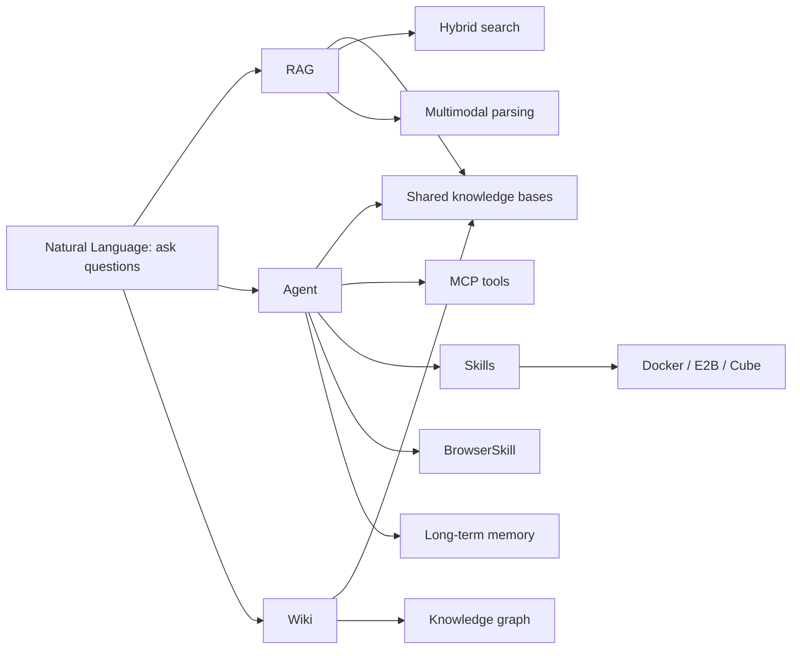
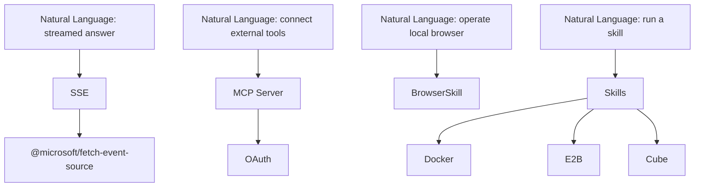

<!-- source: DeepWiki mcp.deepwiki.com · repo Tencent/WeKnora · page 11 Advanced Topics · fetched 2026-10-29 -->

# Advanced Topics

Relevant source files

The following files were used as context for generating this wiki page:

- [CHANGELOG.md](CHANGELOG.md)
- [README.md](README.md)
- [README_CN.md](README_CN.md)
- [README_JA.md](README_JA.md)
- [README_KO.md](README_KO.md)
- [VERSION](VERSION)
- [frontend/package-lock.json](frontend/package-lock.json)
- [frontend/package.json](frontend/package.json)
- [helm/Chart.yaml](helm/Chart.yaml)

## Purpose and Scope

This parent page orients readers to WeKnora’s advanced subsystems and how they fit together. It is a navigation page, not an implementation guide: use the linked child pages for subsystem details. WeKnora brings together RAG, agents, and Wiki capabilities over shared knowledge bases [README.md:41-53]().

Sources: [README.md:41-53]()

## Scope of Advanced Topics

| Subsystem | Child page | Role in the larger system |
|---|---|---|
| Knowledge graph and GraphRAG | [Knowledge Graph and GraphRAG](#11.1) | Adds graph-based organization and retrieval to knowledge work [README.md:51-53](). |
| Background processing | [Async Task Processing with Asynq](#11.2) | Supports asynchronous work; the project also describes a runtime task-queue dashboard and worker-pool governance [README.md:64](). |
| Events and streaming | [Event-Driven Architecture and Streaming](#11.3) | Connects real-time communication and streamed responses; the frontend includes an SSE client dependency [frontend/package.json:18-20](). |
| MCP integration | [MCP Server Integration](#11.4) | Connects external tools and AI clients through MCP, including OAuth-enabled services [README.md:56, 62](). |
| Multimodal processing | [Multimodal Document Processing](#11.5) | Extends document understanding and retrieval to images and other visual content [README.md:53, 61](). |
| Retrieval strategies | [Hybrid Retrieval Strategies](#11.6) | Covers hybrid search and retrieval behavior [README.md:53](). |
| Wiki generation | [Wiki Mode and Auto-Wiki Generation](#11.7) | Organizes knowledge into Wiki pages and supports graph-oriented knowledge organization [README.md:49-53](). |
| Desktop application | [Desktop Application (Wails)](#11.8) | Covers the native desktop distribution and Lite mode [README.md:149-155](). |
| Skills and sandbox execution | [Skills and Sandbox Execution](#11.9) | Runs agent skills in supported sandbox environments [README.md:56](). |
| Long-term memory and browser automation | [Long-Term Memory and Browser Skill](#11.10) | Extends agent work across sessions and enables interaction with a user’s local browser [README.md:56, 60](). |

Sources: [README.md:49-65](), [README.md:149-155](), [frontend/package.json:18-20]()

## How the Advanced Subsystems Relate

WeKnora’s RAG, agent, and Wiki capabilities share knowledge bases. The map below connects those user-facing concepts to named integrations and features documented in the repository; it is an orientation map, not a call graph [README.md:49-56]().

### Capability-to-Integration Map

Sources: [README.md:49-56]()

### Integration Names and Repository Anchors

This second map associates natural-language use cases with names that readers can search for in the repository or its package metadata. It does not imply undocumented internal call relationships [README.md:56, 62](), [frontend/package.json:18-20]().

Sources: [README.md:56, 62](), [frontend/package.json:18-20]()

## Knowledge Graph and GraphRAG

Knowledge graph capabilities complement document retrieval by organizing knowledge as connected concepts; the project describes Wiki organization alongside a knowledge graph [README.md:49-53](). For graph-store integration, extraction, relation mapping, and graph-based retrieval details, see [Knowledge Graph and GraphRAG](#11.1).

Sources: [README.md:49-53]()

## Async Task Processing with Asynq

Background work is part of the platform’s operational model: WeKnora describes a runtime task-queue dashboard and worker-pool governance [README.md:64](). For task types, worker pools, inspection, and progress tracking, see [Async Task Processing with Asynq](#11.2).

Sources: [README.md:64]()

## Event-Driven Architecture and Streaming

Streaming connects backend responses with interactive clients. The frontend declares `@microsoft/fetch-event-source` as a dependency [frontend/package.json:18-20](). For the event bus, SSE lifecycle, stream managers, and real-time communication details, see [Event-Driven Architecture and Streaming](#11.3).

Sources: [frontend/package.json:18-20]()

## MCP Server Integration

MCP provides an integration path between WeKnora agents and external tools. The project describes a built-in MCP Server for clients such as Cursor and Claude, as well as external MCP services with OAuth support [README.md:56, 62](). For transports, catalog and proxy internals, OAuth flows, and custom tool development, see [MCP Server Integration](#11.4).

Sources: [README.md:56, 62]()

## Multimodal Document Processing

WeKnora combines multimodal parsing with retrieval and supports formats including PDF, Word, images, Excel, and XMind; its capability overview also calls out image-aware processing [README.md:53, 61](). For OCR, VLM integration, captioning, parser behavior, and multimodal chunking, see [Multimodal Document Processing](#11.5).

Sources: [README.md:53, 61]()

## Hybrid Retrieval Strategies

Hybrid search is one of the retrieval capabilities highlighted for RAG [README.md:53](). For the retrieval algorithms and their configuration—including vector and lexical search, fusion, reranking, and score normalization—see [Hybrid Retrieval Strategies](#11.6).

Sources: [README.md:53]()

## Wiki Mode and Auto-Wiki Generation

Wiki is one of WeKnora’s three knowledge workflows, alongside RAG and agents, and uses the same knowledge bases [README.md:49-53](). For ingestion, page and folder management, editing tools, and link validation, see [Wiki Mode and Auto-Wiki Generation](#11.7).

Sources: [README.md:49-53]()

## Desktop Application (Wails)

The repository documents a Lite single-binary option for local or low-resource use, with SQLite and an in-memory queue, distinct from the standard multi-service deployment [README.md:149-155](). For the Wails application, packaging, and Lite-mode differences, see [Desktop Application (Wails)](#11.8).

Sources: [README.md:149-155]()

## Skills and Sandbox Execution

Agents can use skills installed from ClawHub, SkillHub, Git, or ZIP. The README describes session-persistent Docker, E2B, and Cube sandboxes, with an interactive terminal and graphical desktop [README.md:56](). For runtime configuration, tenant skill catalogs, tools, and artifacts, see [Skills and Sandbox Execution](#11.9), including its child pages:

- [Sandbox Runtimes and Configuration](#11.9.1)
- [Tenant Skill Catalog and Installation](#11.9.2)
- [Sandbox Tools and Artifacts](#11.9.3)

Sources: [README.md:56]()

## Long-Term Memory and Browser Skill

Long-term memory supports cross-session retention of user-confirmed information, while BrowserSkill connects agents to a user’s own Chrome or Edge browser [README.md:56, 60](). For memory extraction and recall, traces, and the browser extension integration, see [Long-Term Memory and Browser Skill](#11.10).

Sources: [README.md:56, 60]()

This page provides the overview and navigation for section 11. Follow the child-page links for subsystem-level explanations and implementation details.

Sources: [README.md:49-65]()

---

