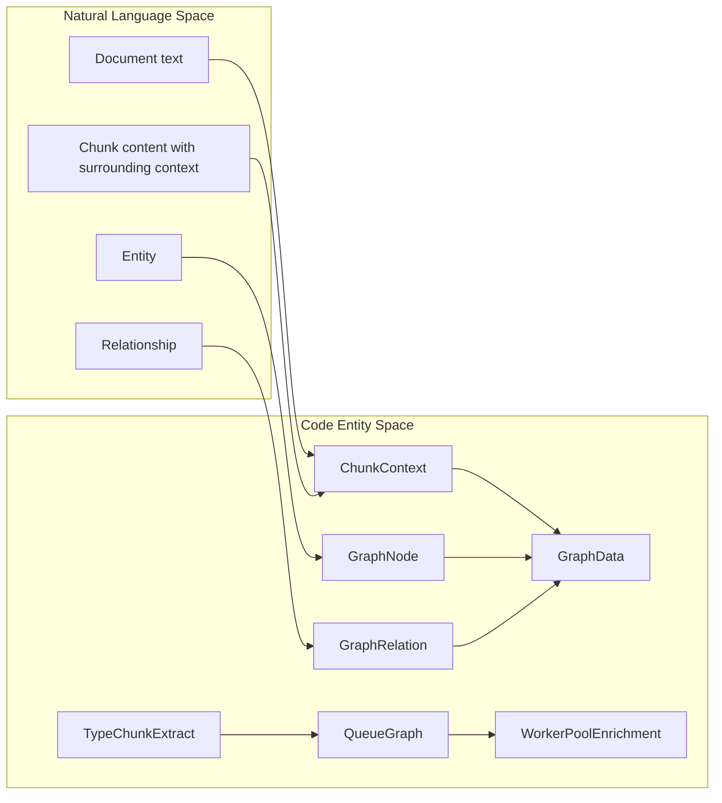
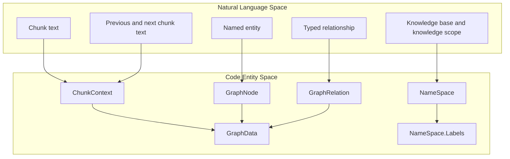
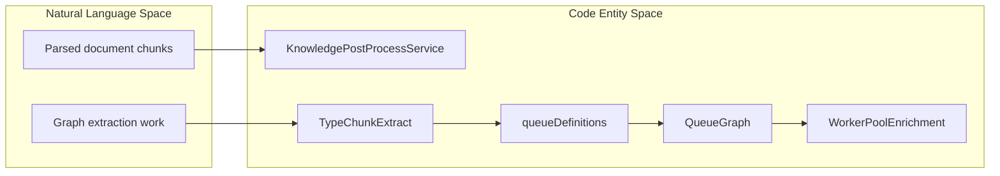
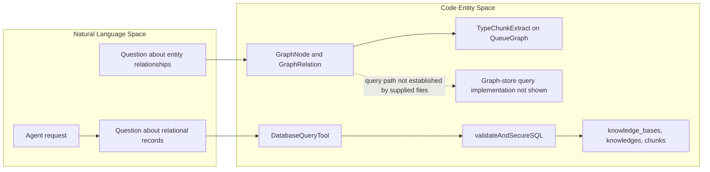

<!-- source: DeepWiki mcp.deepwiki.com · repo Tencent/WeKnora · page 11.1 Knowledge Graph and GraphRAG · fetched 2026-10-29 -->

# Knowledge Graph and GraphRAG

Relevant source files

The following files were used as context for generating this wiki page:

- [internal/agent/tools/data_analysis_query_test.go](internal/agent/tools/data_analysis_query_test.go)
- [internal/agent/tools/data_schema.go](internal/agent/tools/data_schema.go)
- [internal/agent/tools/database_query.go](internal/agent/tools/database_query.go)
- [internal/agent/tools/database_query_test.go](internal/agent/tools/database_query_test.go)
- [internal/agent/tools/scope_authorization.go](internal/agent/tools/scope_authorization.go)
- [internal/agent/tools/scope_authorization_test.go](internal/agent/tools/scope_authorization_test.go)
- [internal/application/repository/knowledge_span_repo.go](internal/application/repository/knowledge_span_repo.go)
- [internal/application/repository/knowledge_span_repo_test.go](internal/application/repository/knowledge_span_repo_test.go)
- [internal/application/service/knowledge_housekeeping.go](internal/application/service/knowledge_housekeeping.go)
- [internal/application/service/knowledge_housekeeping_test.go](internal/application/service/knowledge_housekeeping_test.go)
- [internal/application/service/knowledge_post_process.go](internal/application/service/knowledge_post_process.go)
- [internal/application/service/knowledge_span_tracker.go](internal/application/service/knowledge_span_tracker.go)
- [internal/application/service/knowledge_span_tracker_test.go](internal/application/service/knowledge_span_tracker_test.go)
- [internal/application/service/temporary_document_parse.go](internal/application/service/temporary_document_parse.go)
- [internal/common/tools.go](internal/common/tools.go)
- [internal/common/tools_test.go](internal/common/tools_test.go)
- [internal/common/truncate_utf8_test.go](internal/common/truncate_utf8_test.go)
- [internal/handler/knowledge_spans_test.go](internal/handler/knowledge_spans_test.go)
- [internal/router/sync_task.go](internal/router/sync_task.go)
- [internal/router/task.go](internal/router/task.go)
- [internal/types/extract_graph.go](internal/types/extract_graph.go)
- [internal/types/task.go](internal/types/task.go)
- [internal/utils/inject.go](internal/utils/inject.go)
- [internal/utils/inject_shared_tenant_test.go](internal/utils/inject_shared_tenant_test.go)
- [internal/utils/inject_test.go](internal/utils/inject_test.go)

## Purpose and Scope

This page documents the graph-related contracts visible in the supplied code: graph extraction data structures, the declared asynchronous queue for chunk extraction, and the post-processing service that runs after document parsing. The supplied files do not show a graph-store adapter, graph query implementation, or a `QueryKnowledgeGraphTool`; this page therefore does not assume a specific graph database, retrieval algorithm, or agent-facing graph API. [internal/types/extract_graph.go:1-60](), [internal/types/task.go:31-89](), [internal/application/service/knowledge_post_process.go:21-33]()

Sources: [internal/types/extract_graph.go:1-60](), [internal/types/task.go:31-89](), [internal/application/service/knowledge_post_process.go:21-33]()

## System Architecture and Component Overview

The code defines a graph-data model for representing text, nodes, and relations, and declares `TypeChunkExtract` on the `QueueGraph` queue in the enrichment worker pool. `KnowledgePostProcessService` is the post-parse orchestrator; the available excerpt establishes its role and dependencies, but does not show the complete graph-task enqueue path or where extracted graph data is persisted. [internal/types/extract_graph.go:18-42](), [internal/types/task.go:63-81](), [internal/application/service/knowledge_post_process.go:21-54]()

### Natural Language Space to Code Entity Space

This diagram maps document text and graph concepts to names present in the code. It depicts the data model and declared task routing—not an unverified end-to-end persistence or retrieval path. [internal/types/extract_graph.go:3-42](), [internal/types/task.go:63-81]()

**Diagram: Text and Graph Extraction Code Entities**

Sources: [internal/types/extract_graph.go:3-42](), [internal/types/task.go:63-81]()

### Graph Data Model

`ChunkContext` carries a chunk ID and content, with optional previous and next chunk content. `GraphData` groups text with node and relation slices. A `GraphNode` has a display name, chunk references, and attributes; a `GraphRelation` has endpoint names and a relation type. Both node and relation structs also contain identity fields excluded from JSON and YAML serialization. [internal/types/extract_graph.go:3-42]()

`NameSpace` represents a knowledge-base and knowledge namespace. Its `Labels` method returns the non-empty values in that order. [internal/types/extract_graph.go:44-60]()

| Type | Role in the declared contract |
|---|---|
| `ChunkContext` | Chunk ID and content, optionally accompanied by neighboring chunk content. [internal/types/extract_graph.go:3-9]() |
| `PromptTemplateStructured` | Description, tags, and example `GraphData` values for a structured prompt template. [internal/types/extract_graph.go:11-16]() |
| `GraphNode` | Named node with chunk references and attributes; `ID` and `KnowledgeID` are excluded from JSON and YAML. [internal/types/extract_graph.go:18-25]() |
| `GraphRelation` | Relation endpoints and type; `ID`, `SourceID`, and `TargetID` are excluded from JSON and YAML. [internal/types/extract_graph.go:27-36]() |
| `GraphData` | Container for text, nodes, and relations. [internal/types/extract_graph.go:38-42]() |
| `NameSpace` | Knowledge-base and knowledge labels; `Labels` omits empty values. [internal/types/extract_graph.go:44-60]() |

**Diagram: Graph Schema Field Mapping**

Sources: [internal/types/extract_graph.go:3-60]()

## Asynchronous Graph Extraction Pipeline

### Task Queue Topology

The queue registry declares `QueueGraph` in `WorkerPoolEnrichment`, with `TypeChunkExtract` as its task type. The registry also provides `QueueDefinitions`, `QueueForTaskType`, and `QueueWeightsForPool` for exposing or looking up queue topology. [internal/types/task.go:51-123]()

`KnowledgePostProcessService` is described as orchestrating post-processing after document parsing and chunk splitting. Its `Handle` method unmarshals a post-process payload, applies tenant and language context, fetches and validates the knowledge and knowledge base, and begins the post-process stage. The provided excerpt ends while discussing text-like chunk retrieval; it does not include the subsequent graph extraction enqueue logic, so that step cannot be documented from this excerpt. [internal/application/service/knowledge_post_process.go:21-33](), [internal/application/service/knowledge_post_process.go:82-175]()

**Diagram: Declared Graph Task Routing**

Sources: [internal/application/service/knowledge_post_process.go:21-33](), [internal/application/service/knowledge_post_process.go:82-175](), [internal/types/task.go:51-89]()

In the Redis-backed configuration, `internal/router/task.go` defines dependency-injected Asynq servers, including an `EnrichmentServer`; the excerpt also defines shared Redis client options and common server construction. The displayed lines do not show the server’s queue map or handler registration, so they do not establish which handler consumes `QueueGraph`. [internal/router/task.go:25-53](), [internal/router/task.go:73-93](), [internal/router/task.go:134-147]()

The Lite-mode `SyncTaskExecutor` is documented as a Redis-free task executor that dispatches registered task handlers to goroutines. Its shown implementation looks up a handler by task type when enqueuing; the supplied excerpt does not specifically connect this executor to `TypeChunkExtract`. [internal/router/sync_task.go:22-44](), [internal/router/sync_task.go:134-158]()

Sources: [internal/types/task.go:51-123](), [internal/application/service/knowledge_post_process.go:21-33](), [internal/application/service/knowledge_post_process.go:82-175](), [internal/router/task.go:25-53](), [internal/router/task.go:73-93](), [internal/router/task.go:134-147](), [internal/router/sync_task.go:22-44](), [internal/router/sync_task.go:134-158]()

## Graph-Based Retrieval and Agent Tooling

The supplied code establishes graph extraction types and an asynchronous task declaration, but does not include graph-store interfaces or implementations, graph query code, or a graph-specific agent tool. Consequently, it does not provide evidence for graph traversal behavior, multi-hop retrieval, vector-plus-graph fusion, or a particular graph database integration. [internal/types/extract_graph.go:18-42](), [internal/types/task.go:63-81]()

The available `DatabaseQueryTool` is a separate relational-database tool. Its description specifies read-only `SELECT` queries and identifies `knowledge_bases`, `knowledges`, and `chunks` as permitted tables; its `Execute` method validates and secures SQL before executing it. This is not evidence of graph-store querying. [internal/agent/tools/database_query.go:15-23](), [internal/agent/tools/database_query.go:95-116](), [internal/agent/tools/database_query.go:143-169]()

**Diagram: Evidence-Bounded Retrieval Tool Surface**

Sources: [internal/types/extract_graph.go:18-42](), [internal/types/task.go:63-81](), [internal/agent/tools/database_query.go:15-23](), [internal/agent/tools/database_query.go:95-116](), [internal/agent/tools/database_query.go:143-169]()

## User Interface and Settings

The supplied files do not include frontend settings or graph-configuration components. They therefore do not establish how graph extraction is configured in the UI, whether users can select a graph backend, or how graph results are presented. [internal/types/extract_graph.go:1-60](), [internal/types/task.go:51-89]()

Sources: [internal/types/extract_graph.go:1-60](), [internal/types/task.go:51-89]()

## Summary and Glossary

| Term | Meaning supported by the supplied code |
|---|---|
| `GraphData` | Text plus collections of `GraphNode` and `GraphRelation`. [internal/types/extract_graph.go:38-42]() |
| `GraphNode` | Graph data structure with a name, chunk references, attributes, and non-serialized retrieval identity fields. [internal/types/extract_graph.go:18-25]() |
| `GraphRelation` | Graph data structure with endpoint names, a relation type, and non-serialized identity fields. [internal/types/extract_graph.go:27-36]() |
| `TypeChunkExtract` | Task type declared on `QueueGraph` in the enrichment queue registry. [internal/types/task.go:75-81]() |
| `QueueGraph` | Queue registered in `WorkerPoolEnrichment` for `TypeChunkExtract`. [internal/types/task.go:63-81]() |
| `DatabaseQueryTool` | Relational SQL tool that validates and secures SQL before querying the database; it is distinct from a demonstrated graph query tool. [internal/agent/tools/database_query.go:95-116](), [internal/agent/tools/database_query.go:143-169]() |

Sources: [internal/types/extract_graph.go:18-42](), [internal/types/task.go:63-81](), [internal/agent/tools/database_query.go:95-116](), [internal/agent/tools/database_query.go:143-169]()

---

