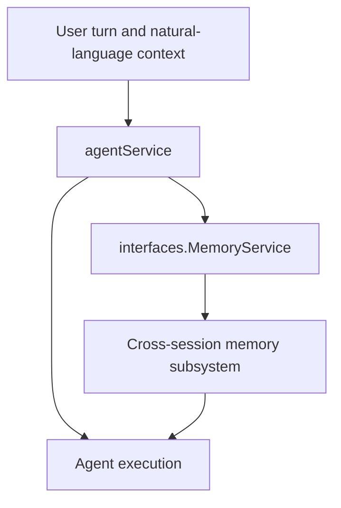
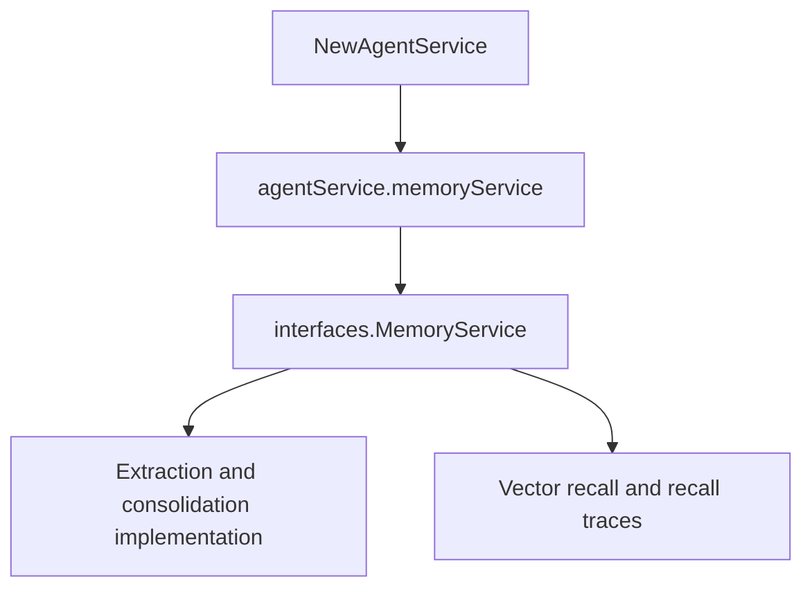
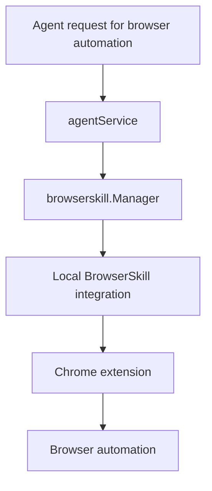

<!-- source: DeepWiki mcp.deepwiki.com · repo Tencent/WeKnora · page 11.10 Long-Term Memory and Browser Skill · fetched 2026-10-29 -->

# Long-Term Memory and Browser Skill

Relevant source files

The following files were used as context for generating this wiki page:

- [frontend/src/components/menu.vue](frontend/src/components/menu.vue)
- [frontend/src/i18n/locales/en-US.ts](frontend/src/i18n/locales/en-US.ts)
- [frontend/src/i18n/locales/ja-JP.ts](frontend/src/i18n/locales/ja-JP.ts)
- [frontend/src/i18n/locales/ko-KR.ts](frontend/src/i18n/locales/ko-KR.ts)
- [frontend/src/i18n/locales/ru-RU.ts](frontend/src/i18n/locales/ru-RU.ts)
- [frontend/src/i18n/locales/zh-CN.ts](frontend/src/i18n/locales/zh-CN.ts)
- [frontend/src/i18n/locales/zh-TW.ts](frontend/src/i18n/locales/zh-TW.ts)
- [frontend/src/views/agent/AgentEditorModal.vue](frontend/src/views/agent/AgentEditorModal.vue)
- [frontend/src/views/agent/AgentList.vue](frontend/src/views/agent/AgentList.vue)
- [frontend/src/views/knowledge/KnowledgeBase.vue](frontend/src/views/knowledge/KnowledgeBase.vue)
- [frontend/src/views/knowledge/KnowledgeBaseList.vue](frontend/src/views/knowledge/KnowledgeBaseList.vue)
- [frontend/src/views/knowledge/components/FAQEntryManager.vue](frontend/src/views/knowledge/components/FAQEntryManager.vue)
- [frontend/src/views/knowledge/settings/DataSourceEditorDialog.test.ts](frontend/src/views/knowledge/settings/DataSourceEditorDialog.test.ts)
- [frontend/src/views/knowledge/settings/DataSourceEditorDialog.vue](frontend/src/views/knowledge/settings/DataSourceEditorDialog.vue)
- [frontend/src/views/organization/OrganizationList.vue](frontend/src/views/organization/OrganizationList.vue)
- [internal/agent/const.go](internal/agent/const.go)
- [internal/agent/const_test.go](internal/agent/const_test.go)
- [internal/agent/engine.go](internal/agent/engine.go)
- [internal/agent/engine_test.go](internal/agent/engine_test.go)
- [internal/agent/finalize.go](internal/agent/finalize.go)
- [internal/agent/observe.go](internal/agent/observe.go)
- [internal/agent/observe_test.go](internal/agent/observe_test.go)
- [internal/agent/prompts.go](internal/agent/prompts.go)
- [internal/agent/think.go](internal/agent/think.go)
- [internal/application/service/agent_history.go](internal/application/service/agent_history.go)
- [internal/application/service/agent_history_test.go](internal/application/service/agent_history_test.go)
- [internal/application/service/agent_service.go](internal/application/service/agent_service.go)
- [internal/application/service/session_agent_qa.go](internal/application/service/session_agent_qa.go)
- [internal/models/api/anthropicmessages/anthropicmessages_test.go](internal/models/api/anthropicmessages/anthropicmessages_test.go)
- [internal/models/api/anthropicmessages/request.go](internal/models/api/anthropicmessages/request.go)
- [internal/models/api/compat_settings.go](internal/models/api/compat_settings.go)
- [internal/types/agent.go](internal/types/agent.go)
- [internal/types/chat.go](internal/types/chat.go)
- [internal/types/custom_agent.go](internal/types/custom_agent.go)
- [website-docs/03-features/10-datasource.md](website-docs/03-features/10-datasource.md)

## Purpose and Scope

This page documents two advanced subsystems: cross-session long-term memory for persistent user context, and the local `BrowserSkill` Chrome extension integration for browser automation. The agent service depends on both a `MemoryService` and a `browserskill.Manager`.[internal/application/service/agent_service.go:100-127]()

Sources: `[internal/application/service/agent_service.go:100-127]()`

---

## 1. Cross-Session Long-Term Memory Architecture

Long-term memory provides context that can persist across sessions. In the agent service, memory is represented by the `interfaces.MemoryService` dependency stored in `agentService.memoryService` and passed to `NewAgentService`.[internal/application/service/agent_service.go:100-127]()[internal/application/service/agent_service.go:149-182]()

The detailed memory kinds, storage schema, extraction and consolidation behavior, vector-recall algorithm, and recall-trace format are not shown in the provided source excerpts. They are therefore not specified here.

### Diagram: Natural Language to Code Entity Mapping (Memory Integration)

Sources: `[internal/application/service/agent_service.go:100-127]()`, `[internal/application/service/agent_service.go:149-182]()`

---

## 2. Memory Storage, Extraction, and Vector Recall

The agent service receives `memoryService` as an `interfaces.MemoryService` dependency. The provided excerpts do not include the memory repository, memory service implementation, extraction or consolidation functions, vector-query code, or recall-trace implementation; persistence and retrieval details cannot be established from the available code.[internal/application/service/agent_service.go:114-121]()[internal/application/service/agent_service.go:149-182]()

### Diagram: Memory Dependency Boundary

Sources: `[internal/application/service/agent_service.go:114-121]()`, `[internal/application/service/agent_service.go:149-182]()`

---

## 3. Local BrowserSkill Chrome Extension Integration

`agentService` holds a `*browserskill.Manager` in its `browserSkill` field. `NewAgentService` accepts the manager as a constructor dependency, placing the BrowserSkill integration at the agent-service boundary.[internal/application/service/agent_service.go:100-104]()[internal/application/service/agent_service.go:149-182]()

The available excerpt does not include the manager implementation, pairing protocol, WebSocket handlers, browser tool definitions, routes, or frontend preview components. Those mechanisms are not detailed here.

Sources: `[internal/application/service/agent_service.go:100-104]()`, `[internal/application/service/agent_service.go:149-182]()`

---

## 4. Tool Execution, Handoffs, and Error Recovery

The provided code establishes that `agentService` depends on `browserskill.Manager`, but does not show how browser commands are registered or executed, how user handoffs work, or how browser failures are represented and recovered. Those behaviors require the relevant BrowserSkill manager and tool implementation sources.[internal/application/service/agent_service.go:100-104]()[internal/application/service/agent_service.go:149-182]()

### Diagram: Natural Language to Code Mapping (Browser Integration Boundary)

Sources: `[internal/application/service/agent_service.go:100-104]()`, `[internal/application/service/agent_service.go:149-182]()`

---

