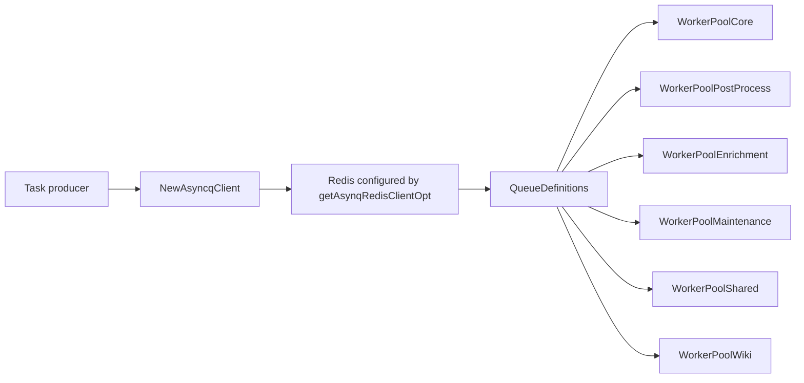
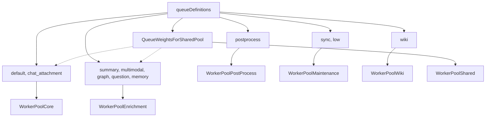
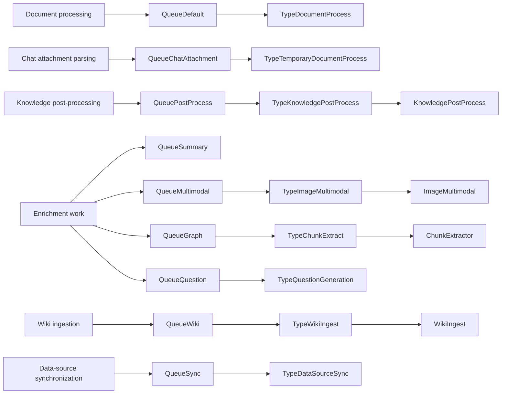
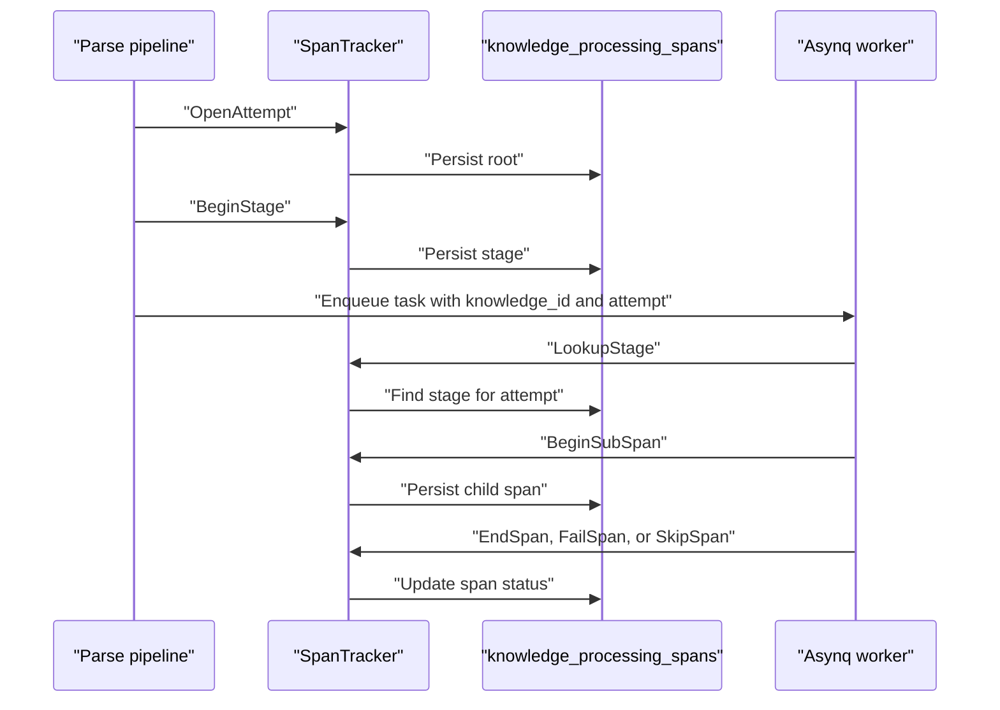

<!-- source: DeepWiki mcp.deepwiki.com · repo Tencent/WeKnora · page 11.2 Async Task Processing with Asynq · fetched 2026-10-29 -->

# Async Task Processing with Asynq

Relevant source files

The following files were used as context for generating this wiki page:

- [frontend/src/views/system/RuntimeQueues.vue](frontend/src/views/system/RuntimeQueues.vue)
- [internal/application/repository/knowledge_span_repo.go](internal/application/repository/knowledge_span_repo.go)
- [internal/application/repository/knowledge_span_repo_test.go](internal/application/repository/knowledge_span_repo_test.go)
- [internal/application/service/knowledge_housekeeping.go](internal/application/service/knowledge_housekeeping.go)
- [internal/application/service/knowledge_housekeeping_test.go](internal/application/service/knowledge_housekeeping_test.go)
- [internal/application/service/knowledge_post_process.go](internal/application/service/knowledge_post_process.go)
- [internal/application/service/knowledge_span_tracker.go](internal/application/service/knowledge_span_tracker.go)
- [internal/application/service/knowledge_span_tracker_test.go](internal/application/service/knowledge_span_tracker_test.go)
- [internal/application/service/temporary_document_parse.go](internal/application/service/temporary_document_parse.go)
- [internal/common/tools.go](internal/common/tools.go)
- [internal/common/tools_test.go](internal/common/tools_test.go)
- [internal/common/truncate_utf8_test.go](internal/common/truncate_utf8_test.go)
- [internal/handler/knowledge_spans_test.go](internal/handler/knowledge_spans_test.go)
- [internal/handler/system_runtime_test.go](internal/handler/system_runtime_test.go)
- [internal/router/sync_task.go](internal/router/sync_task.go)
- [internal/router/task.go](internal/router/task.go)
- [internal/router/task_inspector.go](internal/router/task_inspector.go)
- [internal/types/extract_graph.go](internal/types/extract_graph.go)
- [internal/types/interfaces/task_inspector.go](internal/types/interfaces/task_inspector.go)
- [internal/types/task.go](internal/types/task.go)

## Purpose and Scope

WeKnora uses Asynq with Redis to run background work, including document processing, enrichment, maintenance, and Wiki tasks. This page describes the queue topology and worker-pool model, task handling and inspection, Lite-mode execution, and persisted progress tracking. [internal/router/task.go:73-103]()[internal/types/task.go:3-49]()

Sources: `internal/router/task.go`, `internal/types/task.go`

---

## Architecture Overview

### System Components and Data Flow

Task producers submit typed tasks to queues; worker servers consume queues according to the topology defined by `types.QueueDefinitions`. The task router builds Redis options from environment variables and constructs Asynq clients and servers. [internal/router/task.go:73-103]()[internal/router/task.go:134-147]()[internal/types/task.go:51-88]()

**Diagram: Task topology mapped to code entities**

Sources: `internal/router/task.go:73-103`, `internal/types/task.go:3-13`, `internal/types/task.go:51-88`

The `AsynqTaskParams` dependency-injection input groups worker servers, task handlers, services, repositories, and a `SpanTracker`. The task router configures Redis address, credentials, database, TLS, and read/write timeouts; `NewAsyncqClient` creates a client and checks connectivity with `Ping`. [internal/router/task.go:25-53]()[internal/router/task.go:55-103]()

Sources: `internal/router/task.go`

### Redis Client and Retry Policy

`readRedisOpTimeoutMs` reads `WEKNORA_REDIS_OP_TIMEOUT_MS` and falls back to 500 ms for missing or invalid values. `getAsynqRedisClientOpt` uses that value for the read timeout and doubles it for writes, and reads `REDIS_DB`, `REDIS_ADDR`, `REDIS_USERNAME`, and `REDIS_PASSWORD`. [internal/router/task.go:55-94]()

`newAsynqServer` applies a shared Redis configuration, concurrency, queue weights, and `asynqRetryDelayFunc`. For `service.ErrWikiIngestConcurrent`, the retry delay is fixed at 15 seconds; other errors use Asynq’s default retry-delay function. [internal/router/task.go:106-147]()

Sources: `internal/router/task.go`

### Background Task Context

`backgroundTaskMiddleware` marks handler contexts with `types.WithBackgroundTask`. The router documents this as a way for background ingestion and enrichment model calls to participate in the per-model concurrency governor without treating them as interactive chat. [internal/router/task.go:149-158]()

Sources: `internal/router/task.go`

---

## Async Task Queues and Worker Pools

### Queue and Pool Definitions

`internal/types/task.go` is the source of truth for queue names, pool assignments, weights, and associated task types. Each `QueueDefinition` records the queue name, pool, normal weight, optional shared-pool weight, and task types. [internal/types/task.go:28-61]()[internal/types/task.go:63-88]()

| Pool | Default concurrency | Queue | Weight | Task types declared for the queue |
|---|---:|---|---:|---|
| `core` | 8 | `default` | 1 | `TypeDocumentProcess`, `TypeManualProcess` |
| `core` | 8 | `chat_attachment` | 3 | `TypeTemporaryDocumentProcess` |
| `postprocess` | 2 | `postprocess` | 1 | `TypeKnowledgePostProcess` |
| `enrichment` | 12 | `summary` | 2 | `TypeSummaryGeneration`, `TypeDataTableSummary`, `TypeKnowledgeAutoTag`, `TypeKnowledgeBaseProfile` |
| `enrichment` | 12 | `multimodal` | 1 | `TypeImageMultimodal` |
| `enrichment` | 12 | `graph` | 1 | `TypeChunkExtract` |
| `enrichment` | 12 | `question` | 1 | `TypeQuestionGeneration` |
| `enrichment` | 12 | `memory` | 1 | `TypeMemoryExtract` |
| `maintenance` | 4 | `sync` | 2 | `TypeDataSourceSync` |
| `maintenance` | 4 | `low` | 1 | FAQ import, KB clone/delete, index deletion, and related maintenance tasks |
| `wiki` | 8 | `wiki` | 1 | `TypeWikiIngest`, `TypeWikiFinalize` |

The `low` queue name is retained for compatibility with tasks enqueued by older releases. `chat_attachment` has a higher Core weight than `default`; the code comments identify this as protection against chat attachment parsing being starved by knowledge-base batch imports. [internal/types/task.go:28-49]()[internal/types/task.go:63-88]()

The Shared pool has a default concurrency of 6 and may consume Core and Enrichment queues using their `SharedWeight` values. Post-process and maintenance queues have no shared weight, so they are excluded from the elastic pool. [internal/types/task.go:14-25]()[internal/types/task.go:63-88]()[internal/types/task.go:126-138]()

Sources: `internal/types/task.go`

### Queue Mapping and Worker Capacity

`QueueForTaskType` searches the queue registry and returns the declared queue for a task type. `QueueWeightsForPool` derives a normal queue-weight map for a pool, while `QueueWeightsForSharedPool` returns queues whose `SharedWeight` is positive. These functions keep queue topology centralized rather than duplicating it in callers. [internal/types/task.go:90-138]()

The default concurrency values are declared individually in `types/task.go`; `DefaultWorkerPoolConcurrency` assembles them into a `WorkerPoolConcurrency` value. `resolveWorkerPoolConcurrency` in the router delegates setting lookup to `types.ResolveWorkerPoolConcurrency` and falls back to the defaults if the settings service is nil. [internal/types/task.go:14-25]()[internal/types/task.go:140-163]()[internal/router/task.go:161-170]()

Sources: `internal/types/task.go`, `internal/router/task.go`

**Diagram: Queue registry and elastic capacity**

Sources: `internal/types/task.go:51-88`, `internal/types/task.go:114-138`

---

## Task Types and Handlers

### Task Routing to Code Entities

The router’s `AsynqTaskParams` identifies injected `TaskHandler` dependencies for chunk extraction, data-table summaries, image multimodal work, knowledge post-processing, auto-tagging, knowledge-base profiling, and Wiki ingestion. It also receives the services and repositories needed by task handlers. [internal/router/task.go:25-53]()

**Diagram: Task categories bridged to queue and handler entities**

Sources: `internal/types/task.go:32-49`, `internal/types/task.go:63-88`, `internal/router/task.go:38-48`

### Post-Processing Orchestration

`KnowledgePostProcessService` implements an Asynq handler for `TypeKnowledgePostProcess`. Its `Handle` method decodes a `KnowledgePostProcessPayload`, establishes tenant and optional language context, fetches the knowledge and knowledge base, validates ownership and task write scope, and resolves the processing attempt. If the attempt has been superseded, it exits without starting post-processing. [internal/application/service/knowledge_post_process.go:21-54]()[internal/application/service/knowledge_post_process.go:82-138]()

Before post-processing begins, the service closes the multimodal stage only when that stage is still running. It then opens a post-process stage span. If the knowledge is cancelled or being deleted, it marks the post-process span skipped and returns rather than scheduling child work. [internal/application/service/knowledge_post_process.go:63-80]()[internal/application/service/knowledge_post_process.go:140-167]()

Sources: `internal/application/service/knowledge_post_process.go`

---

## Task Inspector and Cancellation

`NewAsynqInspector` creates an Asynq inspector from a Redis client. `NewAsynqTaskInspector` wraps that inspector in the `interfaces.TaskInspector` implementation; if either dependency is nil, it returns a no-op implementation. [internal/router/task_inspector.go:18-43]()

The inspector derives the queue names it scans from `types.QueueDefinitions`, and uses a payload probe containing `knowledge_id` to match relevant pipeline tasks. `CancelTasksForKnowledge` removes matching queued tasks and signals matching active work to stop. The cancellation task-type set is deliberately scoped to knowledge-level processing; it does not include FAQ import or knowledge-base-level tasks. [internal/router/task_inspector.go:45-95]()[internal/router/task_inspector.go:106-124]()

`CancelTasksForKnowledgeBase` handles knowledge-base deletion separately. Its matcher considers knowledge-base, knowledge, and data-source identifiers; the `kb:delete` task is intentionally excluded so durable storage cleanup can proceed. [internal/router/task_inspector.go:126-159]()

Cancellation is best-effort: the inspector’s documented behavior is to log and swallow scan or deletion errors so Redis problems do not prevent the cancellation API from returning success. [internal/router/task_inspector.go:24-42]()

Sources: `internal/router/task_inspector.go`

---

## Progress Tracking with SpanTracker

`SpanTracker` records per-attempt processing trees using root, stage/span, and generation concepts. Its operations are best-effort: tracker database errors are logged and swallowed so they do not break parsing, while `knowledge.parse_status` remains the authoritative completion state. [internal/application/service/knowledge_span_tracker.go:1-24]()

### Attempts, Stages, and Subspans

`OpenAttempt` creates a root span for a new parse or reparse and returns the attempt number. `BeginStage` creates a canonical processing stage under that root, while `BeginSubSpan` creates a child span under a stage or another subspan. `EndSpan`, `FailSpan`, and `SkipSpan` record terminal or intentional-skip outcomes. [internal/application/service/knowledge_span_tracker.go:86-127]()

The span handle carries the knowledge ID, attempt, span and parent IDs, name, kind, status, and start time. This allows completion or failure operations to refer to the span without re-querying it. [internal/application/service/knowledge_span_tracker.go:72-84]()

`LookupStage` and `LookupSpanByName` provide cross-process lookup. A worker can find a stage or grouping span created by an earlier pipeline step and attach its own subspans to the same attempt tree. [internal/application/service/knowledge_span_tracker.go:129-140]()

**Diagram: Progress tracking bridged across task workers**

Sources: `internal/application/service/knowledge_span_tracker.go:86-140`, `internal/application/service/knowledge_post_process.go:124-150`

### Post-Processing and Stage Completion

The post-processing handler resolves the attempt from its payload, falling back to the latest attempt for compatibility with older queued tasks when the payload has no positive attempt number. It skips work for superseded attempts. [internal/application/service/knowledge_post_process.go:124-138]()

The handler also uses the tracker to close a still-running multimodal stage and to begin the post-process stage. Cancelled or deleting knowledge is recorded as a skipped post-process span. [internal/application/service/knowledge_post_process.go:63-80]()[internal/application/service/knowledge_post_process.go:140-167]()

Sources: `internal/application/service/knowledge_post_process.go`, `internal/application/service/knowledge_span_tracker.go`

---

## Recovery of Stuck Work

`HousekeepingService` uses a periodic sweep as a safety net for processing rows left behind by worker termination or other failure paths. Its optional `TaskInspector` dependency lets a sweep distinguish an orphaned knowledge row from one that still has queued enrichment work. [internal/application/service/knowledge_housekeeping.go:1-18]()[internal/application/service/knowledge_housekeeping.go:42-57]()

`Start` registers a five-minute cron sweep unless housekeeping is disabled. The sweep uses both the knowledge row’s `updated_at` and the latest span row’s update time as liveness signals: a long-running stage may make progress without changing the knowledge row’s parse status. [internal/application/service/knowledge_housekeeping.go:108-134]()[internal/application/service/knowledge_housekeeping.go:155-175]()

Sources: `internal/application/service/knowledge_housekeeping.go`

---

## SyncTaskExecutor: Lightweight Task Execution

`SyncTaskExecutor` is a Lite-mode alternative to the Redis-backed Asynq client. It registers handlers by task type and dispatches enqueued tasks to goroutines instead of Redis. [internal/router/sync_task.go:22-44]()[internal/router/sync_task.go:134-146]()

It supports delay, maximum retries, timeout, and deadline options. When both task and enqueue options are supplied, enqueue options take precedence. The executor tags execution contexts as background tasks, recovers handler panics, retries failures with a capped linear delay, and stops retrying when the handler returns `asynq.SkipRetry`. [internal/router/sync_task.go:54-99]()[internal/router/sync_task.go:118-131]()[internal/router/sync_task.go:134-196]()

Sources: `internal/router/sync_task.go`

---

## Runtime Queue Monitoring UI

`RuntimeQueues.vue` presents runtime queue and worker-pool information, including aggregate active, pending, retry, and archived counts. It also displays pool capacity and queue details, with controls for manual refresh and auto-refresh. [frontend/src/views/system/RuntimeQueues.vue:1-31]()[frontend/src/views/system/RuntimeQueues.vue:73-129]()

The component includes loading, error, unavailable, and archived-task states, allowing operators to distinguish missing runtime data from a request failure or archived failures. [frontend/src/views/system/RuntimeQueues.vue:34-71]()[frontend/src/views/system/RuntimeQueues.vue:143-160]()

Sources: `frontend/src/views/system/RuntimeQueues.vue`

---

## Summary of Key Code Entities

| Code entity | Role |
|---|---|
| `AsynqTaskParams` | Dependency-injection inputs for worker servers, services, task handlers, repositories, and span tracking. [internal/router/task.go:25-53]() |
| `getAsynqRedisClientOpt` | Builds Redis options used by Asynq clients and servers. [internal/router/task.go:73-94]() |
| `NewAsyncqClient` | Creates an Asynq client and pings Redis. [internal/router/task.go:96-104]() |
| `newAsynqServer` | Creates a worker server with concurrency, queue weights, and retry policy. [internal/router/task.go:134-147]() |
| `queueDefinitions` | Central registry of queue names, pools, weights, and task types. [internal/types/task.go:51-88]() |
| `QueueForTaskType` | Looks up the declared queue for a task type. [internal/types/task.go:100-112]() |
| `QueueWeightsForPool` | Derives a queue-weight map for a worker pool. [internal/types/task.go:114-124]() |
| `QueueWeightsForSharedPool` | Derives the queue-weight map eligible for shared capacity. [internal/types/task.go:126-138]() |
| `KnowledgePostProcessService.Handle` | Validates and orchestrates a post-processing task. [internal/application/service/knowledge_post_process.go:82-150]() |
| `asynqTaskInspector` | Implements task inspection and cancellation using Asynq and Redis. [internal/router/task_inspector.go:24-43]() |
| `SpanTracker` | Interface for recording processing attempts, stages, and subspans. [internal/application/service/knowledge_span_tracker.go:86-149]() |
| `HousekeepingService` | Periodically checks for stale processing work. [internal/application/service/knowledge_housekeeping.go:42-57]()[internal/application/service/knowledge_housekeeping.go:108-134]() |
| `SyncTaskExecutor` | Executes registered task handlers asynchronously in-process for Lite mode. [internal/router/sync_task.go:22-44]()[internal/router/sync_task.go:134-146]() |

Sources: `internal/router/task.go`, `internal/types/task.go`, `internal/application/service/knowledge_post_process.go`, `internal/router/task_inspector.go`, `internal/application/service/knowledge_span_tracker.go`, `internal/application/service/knowledge_housekeeping.go`, `internal/router/sync_task.go`

---

