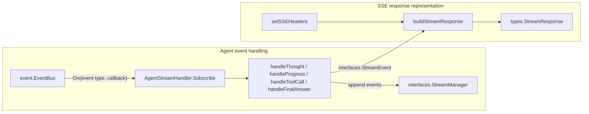
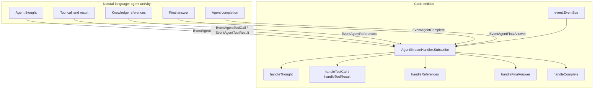
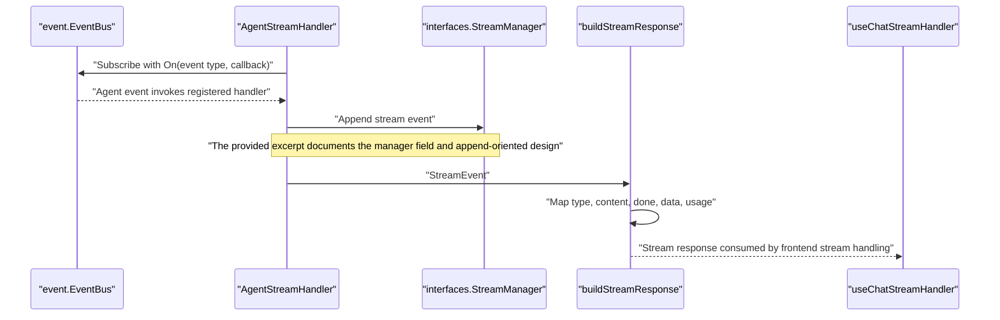
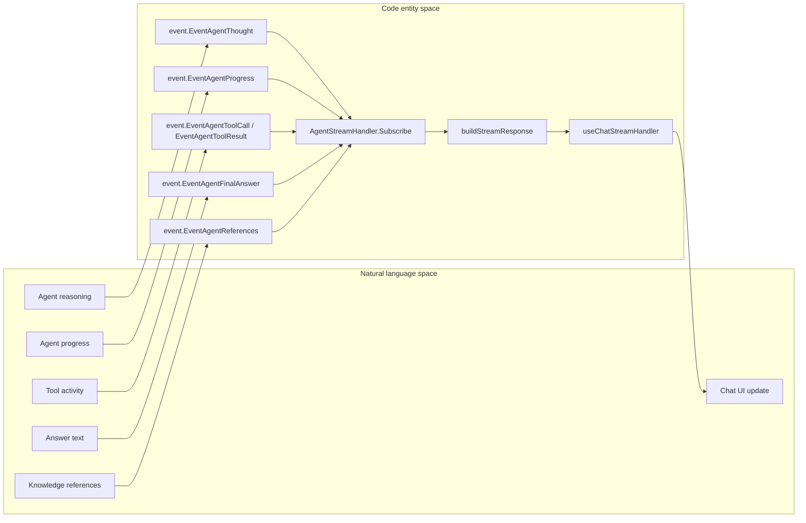

<!-- source: DeepWiki mcp.deepwiki.com · repo Tencent/WeKnora · page 11.3 Event-Driven Architecture and Streaming · fetched 2026-10-29 -->

# Event-Driven Architecture and Streaming

<details>
<summary>Relevant source files</summary>

The following files were used as context for generating this wiki page:

- [frontend/src/composables/useChatStreamHandler.test.mjs](frontend/src/composables/useChatStreamHandler.test.mjs)
- [frontend/src/composables/useChatStreamHandler.ts](frontend/src/composables/useChatStreamHandler.ts)
- [frontend/src/composables/useEmbedChatSession.ts](frontend/src/composables/useEmbedChatSession.ts)
- [frontend/src/composables/useStickyBottomOnResize.test.ts](frontend/src/composables/useStickyBottomOnResize.test.ts)
- [frontend/src/composables/useStickyBottomOnResize.ts](frontend/src/composables/useStickyBottomOnResize.ts)
- [frontend/src/composables/useTypewriter.test.ts](frontend/src/composables/useTypewriter.test.ts)
- [frontend/src/composables/useTypewriter.ts](frontend/src/composables/useTypewriter.ts)
- [frontend/src/utils/shellExecResult.test.ts](frontend/src/utils/shellExecResult.test.ts)
- [frontend/src/utils/shellExecResult.ts](frontend/src/utils/shellExecResult.ts)
- [internal/agent/tools/persist.go](internal/agent/tools/persist.go)
- [internal/agent/tools/persist_test.go](internal/agent/tools/persist_test.go)
- [internal/application/service/chat_pipeline/search_entity.go](internal/application/service/chat_pipeline/search_entity.go)
- [internal/application/service/chat_pipeline/search_entity_metadata_test.go](internal/application/service/chat_pipeline/search_entity_metadata_test.go)
- [internal/application/service/knowledgebase_search_results.go](internal/application/service/knowledgebase_search_results.go)
- [internal/event/event.go](internal/event/event.go)
- [internal/event/event_data.go](internal/event/event_data.go)
- [internal/handler/session/agent_stream_handler.go](internal/handler/session/agent_stream_handler.go)
- [internal/handler/session/helpers.go](internal/handler/session/helpers.go)
- [internal/handler/session/helpers_test.go](internal/handler/session/helpers_test.go)
- [internal/types/search.go](internal/types/search.go)

</details>


## Purpose and Scope

This page describes how WeKnora connects agent events to chat streaming: the request-scoped `EventBus`, the `AgentStreamHandler` subscribers, SSE response helpers, and the frontend stream handler. The available source excerpts do not include the `StreamManager` interface or its Redis and in-memory implementations, so this page limits claims about those backends to the evidence provided. [internal/handler/session/agent_stream_handler.go:32-50](), [internal/handler/session/helpers.go:182-199](), [internal/handler/session/helpers_test.go:60-64]()

Sources: [internal/handler/session/agent_stream_handler.go:32-50](), [internal/handler/session/helpers.go:182-199](), [internal/handler/session/helpers_test.go:60-64]()

---

## Architecture Overview

`AgentStreamHandler` documents a dedicated `EventBus` per request, subscribes to agent events, and appends events to a `StreamManager`. This arrangement separates the handler’s event processing from the SSE response representation. [internal/handler/session/agent_stream_handler.go:32-50](), [internal/handler/session/agent_stream_handler.go:124-153]()

The handler subscribes to event types including agent thought, progress, tool-call and tool-result events, references, final answers, errors, session titles, and completion. The frontend’s `useChatStreamHandler` is the UI-side consumer component; its options include callbacks for message updates, completion, errors, and injected user messages. [internal/handler/session/agent_stream_handler.go:155-172](), [frontend/src/composables/useChatStreamHandler.ts:24-55]()

### Components and Data Flow

| Component | Role |
|---|---|
| `EventBus` | Per-request event source held by `AgentStreamHandler`; the handler registers callbacks with `On`. [internal/handler/session/agent_stream_handler.go:50-50](), [internal/handler/session/agent_stream_handler.go:155-172]() |
| `AgentStreamHandler` | Subscribes to agent events and holds the `StreamManager` used to append stream events. [internal/handler/session/agent_stream_handler.go:32-50](), [internal/handler/session/agent_stream_handler.go:124-153]() |
| `StreamEvent` | Input to `buildStreamResponse`; its type, content, completion flag, data, and usage are copied to a `StreamResponse`. [internal/handler/session/helpers.go:190-199]() |
| `setSSEHeaders` | Sets the response content type to `text/event-stream` and disables caching and proxy buffering. [internal/handler/session/helpers.go:182-188]() |
| `useChatStreamHandler` | Frontend composable accepting message state and callbacks for handling stream-driven UI changes. [frontend/src/composables/useChatStreamHandler.ts:24-55](), [frontend/src/composables/useChatStreamHandler.ts:156-176]() |

Sources: [internal/handler/session/agent_stream_handler.go:32-50](), [internal/handler/session/agent_stream_handler.go:124-172](), [internal/handler/session/helpers.go:182-199](), [frontend/src/composables/useChatStreamHandler.ts:24-55](), [frontend/src/composables/useChatStreamHandler.ts:156-176]()

### System Event and Data Flow

This diagram maps the system concepts to the code entities visible in the supplied excerpts. It shows the handler subscription and response-conversion boundary, without assuming unshown transport or service call sites. [internal/handler/session/agent_stream_handler.go:124-172](), [internal/handler/session/helpers.go:190-199]()



Sources: [internal/handler/session/agent_stream_handler.go:124-172](), [internal/handler/session/helpers.go:182-199]()

---

## The Internal EventBus

`AgentStreamHandler` owns an `eventBus *event.EventBus` and documents its use of a dedicated bus per request to avoid filtering events by `SessionID`. Its `Subscribe` method registers handler methods with `On` for the event types shown in the excerpt. [internal/handler/session/agent_stream_handler.go:32-50](), [internal/handler/session/agent_stream_handler.go:155-172]()

The available excerpts show the subscription API and the handler’s event list, but not the implementation of `EventBus` itself. They therefore establish the handler’s use of `On`, not implementation details such as synchronization, callback ordering, or whether event delivery is synchronous. [internal/handler/session/agent_stream_handler.go:155-172]()

### Subscribed Events

| Event constant | Registered handler |
|---|---|
| `event.EventAgentThought` | `handleThought` [internal/handler/session/agent_stream_handler.go:157-160]() |
| `event.EventAgentProgress` | `handleProgress` [internal/handler/session/agent_stream_handler.go:159-161]() |
| `event.EventAgentToolCall` | `handleToolCall` [internal/handler/session/agent_stream_handler.go:160-162]() |
| `event.EventAgentToolResult` | `handleToolResult` [internal/handler/session/agent_stream_handler.go:161-163]() |
| `event.EventAgentCommandOutput` | `handleCommandOutput` [internal/handler/session/agent_stream_handler.go:162-164]() |
| `event.EventAgentReferences` | `handleReferences` [internal/handler/session/agent_stream_handler.go:163-165]() |
| `event.EventMemoryRecalled` | `handleMemoryRecalled` [internal/handler/session/agent_stream_handler.go:164-166]() |
| `event.EventContextCompacted` | `handleContextCompacted` [internal/handler/session/agent_stream_handler.go:165-167]() |
| `event.EventUserMessageInjected` | `handleUserMessageInjected` [internal/handler/session/agent_stream_handler.go:166-168]() |
| `event.EventAgentFinalAnswer` | `handleFinalAnswer` [internal/handler/session/agent_stream_handler.go:167-169]() |
| `event.EventAgentReflection` | `handleReflection` [internal/handler/session/agent_stream_handler.go:168-170]() |
| `event.EventError` | `handleError` [internal/handler/session/agent_stream_handler.go:169-171]() |
| `event.EventSessionTitle` | `handleSessionTitle` [internal/handler/session/agent_stream_handler.go:170-172]() |
| `event.EventAgentComplete` | `handleComplete` [internal/handler/session/agent_stream_handler.go:171-172]() |

Sources: [internal/handler/session/agent_stream_handler.go:155-172]()

### Event Data and Response Mapping

`event_data.go` defines payload structures for pipeline stages such as query, retrieval, reranking, merging, chat completion, errors, agent query, and agent completion. For example, `ChatData` includes `StreamChunk` and `IsStream`; `AgentCompleteData` includes final-answer, usage, duration, message/request identifiers, and suspension-related fields. [internal/event/event_data.go:8-74](), [internal/event/event_data.go:132-159]()

At the HTTP response-conversion boundary, `buildStreamResponse` copies the event type, content, done flag, data, and usage into `types.StreamResponse`. For `agent_query`, it extracts session and assistant-message IDs from `Data`; for `references`, it handles reference values in several representations, including serialized generic values. [internal/handler/session/helpers.go:190-222]()

### Code Entity Mapping: Events to Stream Handling



Sources: [internal/handler/session/agent_stream_handler.go:155-172]()

---

## Chat Pipeline and History Processing

The supplied excerpts establish the event payload types and the streaming handler’s event subscriptions, but do not include enough chat-pipeline code to document pipeline plugin ordering, history-loading behavior, or service invocation paths. The event payload definitions do identify useful observability fields: retrieval and reranking durations, counts and thresholds; chat stream chunks; and agent completion usage and total duration. [internal/event/event_data.go:19-64](), [internal/event/event_data.go:140-159]()

Sources: [internal/event/event_data.go:19-64](), [internal/event/event_data.go:140-159]()

---

## SSE Streaming Implementation

### SSE Headers

`setSSEHeaders` sets four headers: `Content-Type: text/event-stream`, `Cache-Control: no-cache`, `Connection: keep-alive`, and `X-Accel-Buffering: no`. These headers identify the response as an event stream, prevent caching, keep the connection open, and disable buffering by the named proxy behavior. [internal/handler/session/helpers.go:182-188]()

### Stream Response Construction

`buildStreamResponse` maps the `interfaces.StreamEvent` fields into a `types.StreamResponse`. It adds agent-query session and assistant-message identifiers when present, and has special handling for references, including a conversion path for generic `[]interface{}` data. [internal/handler/session/helpers.go:190-222]()

The `AgentStreamHandler` stores its stream manager and tracks answer segments, final-answer text, references, and event start times. Its segment helpers can recompose the final answer from non-superseded segments, allowing superseded streamed preambles to be excluded from the persisted answer. [internal/handler/session/agent_stream_handler.go:35-73](), [internal/handler/session/agent_stream_handler.go:75-122]()

### Backend-to-Frontend Event Path



Sources: [internal/handler/session/agent_stream_handler.go:32-50](), [internal/handler/session/agent_stream_handler.go:155-172](), [internal/handler/session/helpers.go:190-199](), [frontend/src/composables/useChatStreamHandler.ts:24-55]()

---

## Frontend Stream Handling

`useChatStreamHandler` receives the message list and reactive stream state, including `loading`, `isReplying`, `currentAssistantMessageId`, and `fullContent`. Its options expose callbacks for reply and turn completion, errors, message creation and updates, agent-query handling, agent-answer completion, and user-message injection. [frontend/src/composables/useChatStreamHandler.ts:24-55](), [frontend/src/composables/useChatStreamHandler.ts:156-176]()

The embed chat composable obtains `onChunk`, `error`, `startStream`, and `stopStream` from `useStream`, then wires its message state into `useChatStreamHandler`. The shown excerpt establishes this frontend composition, but does not show the `useStream` implementation or the complete event-to-message processing switch. [frontend/src/composables/useEmbedChatSession.ts:11-18](), [frontend/src/composables/useEmbedChatSession.ts:43-45](), [frontend/src/composables/useEmbedChatSession.ts:122-144]()

Sources: [frontend/src/composables/useChatStreamHandler.ts:24-55](), [frontend/src/composables/useChatStreamHandler.ts:156-176](), [frontend/src/composables/useEmbedChatSession.ts:11-18](), [frontend/src/composables/useEmbedChatSession.ts:43-45](), [frontend/src/composables/useEmbedChatSession.ts:122-144]()

---

## Stream Managers: Redis and Memory Backends

`AgentStreamHandler` holds a value of type `interfaces.StreamManager`; its comment says events are appended to the manager without accumulation in the handler. The supplied tests also describe a simulated Redis round trip for search-result data, but that test concerns serialization and reconstruction of search results—not the stream manager implementation. [internal/handler/session/agent_stream_handler.go:32-45](), [internal/handler/session/helpers_test.go:60-64]()

The provided content does not include the `StreamManager` interface definition, Redis stream manager, in-memory stream manager, or stream-replay endpoint. Consequently, backend selection, retention, event offsets, polling, reconnection semantics, and distributed-delivery guarantees cannot be documented from these excerpts. [internal/handler/session/agent_stream_handler.go:32-45](), [internal/handler/session/helpers_test.go:60-64]()

### Stream Manager Boundary

```mermaid
flowchart LR
    EVENT["Agent event"]
    HANDLER["AgentStreamHandler"]
    INTERFACE["interfaces.StreamManager"]
    REDIS["Redis implementation not shown"]
    MEMORY["Memory implementation not shown"]
    EVENT --> HANDLER
    HANDLER -->|"append events"| INTERFACE
    INTERFACE -.->|"implementation not present in supplied excerpts".-> REDIS
    INTERFACE -.->|"implementation not present in supplied excerpts".-> MEMORY
```

Sources: [internal/handler/session/agent_stream_handler.go:32-45](), [internal/handler/session/helpers_test.go:60-64]()

---

## Real-Time Communication and Code Entity Mapping

The following mapping connects user-visible real-time chat concepts to the named backend and frontend entities present in the excerpts. The frontend processing details are intentionally limited to the composable’s exposed state and callbacks. [internal/handler/session/agent_stream_handler.go:155-172](), [internal/handler/session/helpers.go:182-199](), [frontend/src/composables/useChatStreamHandler.ts:24-55]()



Sources: [internal/handler/session/agent_stream_handler.go:155-172](), [internal/handler/session/helpers.go:190-222](), [frontend/src/composables/useChatStreamHandler.ts:24-55]()

---

## Event Payload Sanitization for Tool Streaming

Tool payloads are prepared differently for clients and persistence. `SanitizeToolDataForClient` applies tool-specific omission rules and retains `data_change` only for tools listed as data-changing; `SanitizeToolDataForPersist` removes `data_change` and applies persistence omission rules. `SanitizeToolResultForClient` combines sanitized data with raw output only when `ShouldOmitRawToolOutput` allows it. [internal/agent/tools/persist.go:10-35](), [internal/agent/tools/persist.go:39-68](), [internal/agent/tools/persist.go:109-124]()

For sandbox content tools, the persistence logic compacts output and stream fields rather than storing unbounded output. The test demonstrates that shell output is capped and that `content` and `content_base64` are stripped while structured exit and stream metadata remain. [internal/agent/tools/persist.go:37-37](), [internal/agent/tools/persist.go:140-179](), [internal/agent/tools/persist_test.go:109-153]()

Sources: [internal/agent/tools/persist.go:10-35](), [internal/agent/tools/persist.go:39-68](), [internal/agent/tools/persist.go:109-124](), [internal/agent/tools/persist.go:140-179](), [internal/agent/tools/persist_test.go:109-153]()

---

## Summary

- `AgentStreamHandler` uses a dedicated `EventBus` per request and registers callbacks for agent streaming events. [internal/handler/session/agent_stream_handler.go:32-50](), [internal/handler/session/agent_stream_handler.go:155-172]()
- The handler stores an `interfaces.StreamManager`; the supplied excerpt describes event appending but does not show Redis or in-memory implementations. [internal/handler/session/agent_stream_handler.go:32-45]()
- `setSSEHeaders` configures the response for SSE, and `buildStreamResponse` maps stream-event fields into the response type with special handling for agent-query IDs and references. [internal/handler/session/helpers.go:182-222]()
- `useChatStreamHandler` exposes the frontend state and callbacks used to integrate stream-driven changes into chat messages. [frontend/src/composables/useChatStreamHandler.ts:24-55]()

Sources: [internal/handler/session/agent_stream_handler.go:32-50](), [internal/handler/session/agent_stream_handler.go:155-172](), [internal/handler/session/helpers.go:182-222](), [frontend/src/composables/useChatStreamHandler.ts:24-55]()

---

## Appendix: Key Types and Components

| Term | Role | Source |
|---|---|---|
| `AgentStreamHandler` | Request-scoped subscriber that holds event, stream-manager, and answer-tracking state. [internal/handler/session/agent_stream_handler.go:32-73]() | [internal/handler/session/agent_stream_handler.go:32-73]() |
| `NewAgentStreamHandler` | Initializes the handler with request/session identifiers, manager, bus, and optional sandbox-related services. [internal/handler/session/agent_stream_handler.go:124-153]() | [internal/handler/session/agent_stream_handler.go:124-153]() |
| `AgentStreamHandler.Subscribe` | Registers callbacks for the listed agent event types. [internal/handler/session/agent_stream_handler.go:155-172]() | [internal/handler/session/agent_stream_handler.go:155-172]() |
| `setSSEHeaders` | Sets standard event-stream and no-buffering headers. [internal/handler/session/helpers.go:182-188]() | [internal/handler/session/helpers.go:182-188]() |
| `buildStreamResponse` | Maps a `StreamEvent` to `types.StreamResponse`, including special agent-query and references handling. [internal/handler/session/helpers.go:190-222]() | [internal/handler/session/helpers.go:190-222]() |
| `useChatStreamHandler` | Frontend composable interface for stream-related message state and callbacks. [frontend/src/composables/useChatStreamHandler.ts:24-55]() | [frontend/src/composables/useChatStreamHandler.ts:24-55]() |
| `interfaces.StreamManager` | Handler dependency used to append events; implementation details are not shown in the supplied excerpts. [internal/handler/session/agent_stream_handler.go:32-45]() | [internal/handler/session/agent_stream_handler.go:32-45]() |

Sources: [internal/handler/session/agent_stream_handler.go:32-73](), [internal/handler/session/agent_stream_handler.go:124-172](), [internal/handler/session/helpers.go:182-222](), [frontend/src/composables/useChatStreamHandler.ts:24-55]()

---

