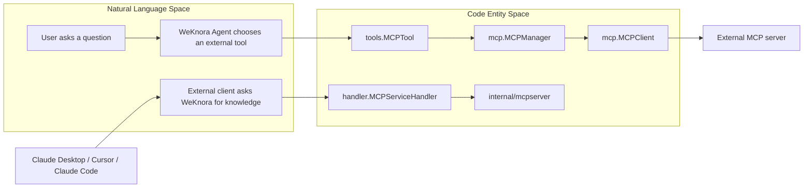
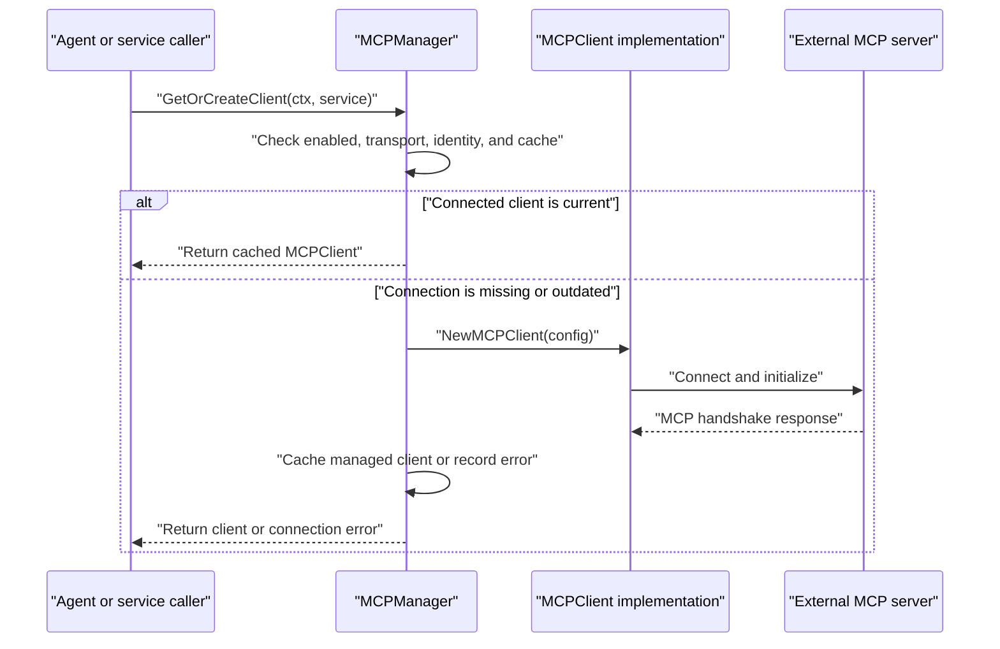
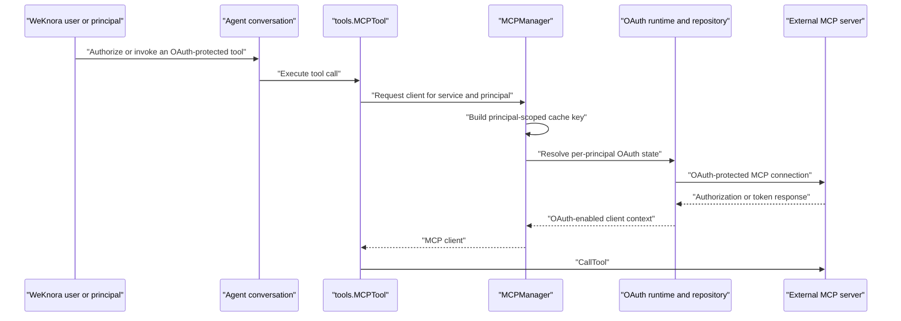
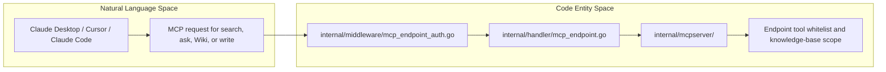
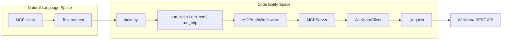

<!-- source: DeepWiki mcp.deepwiki.com · repo Tencent/WeKnora · page 11.4 MCP Server Integration · fetched 2026-10-29 -->

# MCP Server Integration

Relevant source files

The following files were used as context for generating this wiki page:

- [.github/workflows/mcp-server.yml](.github/workflows/mcp-server.yml)
- [frontend/src/api/mcp-service.ts](frontend/src/api/mcp-service.ts)
- [frontend/src/views/settings/components/McpServiceDialog.test.ts](frontend/src/views/settings/components/McpServiceDialog.test.ts)
- [frontend/src/views/settings/components/McpServiceDialog.vue](frontend/src/views/settings/components/McpServiceDialog.vue)
- [internal/agent/approval/gate.go](internal/agent/approval/gate.go)
- [internal/agent/approval/gate_test.go](internal/agent/approval/gate_test.go)
- [internal/agent/operations/infra_test.go](internal/agent/operations/infra_test.go)
- [internal/agent/tools/mcp_call_retry_test.go](internal/agent/tools/mcp_call_retry_test.go)
- [internal/agent/tools/mcp_oauth.go](internal/agent/tools/mcp_oauth.go)
- [internal/agent/tools/mcp_tool.go](internal/agent/tools/mcp_tool.go)
- [internal/application/repository/mcp_service_create_test.go](internal/application/repository/mcp_service_create_test.go)
- [internal/application/service/mcp_service.go](internal/application/service/mcp_service.go)
- [internal/application/service/mcp_service_test.go](internal/application/service/mcp_service_test.go)
- [internal/handler/mcp_service.go](internal/handler/mcp_service.go)
- [internal/handler/mcp_service_create_test.go](internal/handler/mcp_service_create_test.go)
- [internal/mcp/client.go](internal/mcp/client.go)
- [internal/mcp/client_call_error_test.go](internal/mcp/client_call_error_test.go)
- [internal/mcp/errors.go](internal/mcp/errors.go)
- [internal/mcp/errors_test.go](internal/mcp/errors_test.go)
- [internal/mcp/manager.go](internal/mcp/manager.go)
- [internal/mcp/manager_closeall_test.go](internal/mcp/manager_closeall_test.go)
- [internal/mcp/manager_disconnect_test.go](internal/mcp/manager_disconnect_test.go)
- [internal/mcpserver/server_test.go](internal/mcpserver/server_test.go)
- [internal/router/routes_mcp_endpoint_test.go](internal/router/routes_mcp_endpoint_test.go)
- [internal/types/interfaces/mcp_service.go](internal/types/interfaces/mcp_service.go)
- [internal/types/mcp.go](internal/types/mcp.go)
- [mcp-server/CHANGELOG.md](mcp-server/CHANGELOG.md)
- [mcp-server/EXAMPLES.md](mcp-server/EXAMPLES.md)
- [mcp-server/INSTALL.md](mcp-server/INSTALL.md)
- [mcp-server/MCP_CONFIG.md](mcp-server/MCP_CONFIG.md)
- [mcp-server/PROJECT_SUMMARY.md](mcp-server/PROJECT_SUMMARY.md)
- [mcp-server/README.md](mcp-server/README.md)
- [mcp-server/__init__.py](mcp-server/__init__.py)
- [mcp-server/check_imports.py](mcp-server/check_imports.py)
- [mcp-server/main.py](mcp-server/main.py)
- [mcp-server/pyproject.toml](mcp-server/pyproject.toml)
- [mcp-server/requirements.txt](mcp-server/requirements.txt)
- [mcp-server/run.py](mcp-server/run.py)
- [mcp-server/run_server.py](mcp-server/run_server.py)
- [mcp-server/setup.py](mcp-server/setup.py)
- [mcp-server/test_chat_async_preflight.py](mcp-server/test_chat_async_preflight.py)
- [mcp-server/test_chat_sse.py](mcp-server/test_chat_sse.py)
- [mcp-server/test_create_knowledge_from_text.py](mcp-server/test_create_knowledge_from_text.py)
- [mcp-server/test_mcp_transports.py](mcp-server/test_mcp_transports.py)
- [mcp-server/test_module.py](mcp-server/test_module.py)
- [mcp-server/test_update_knowledge_from_text.py](mcp-server/test_update_knowledge_from_text.py)
- [mcp-server/tests/test_kb_id_resolution.py](mcp-server/tests/test_kb_id_resolution.py)
- [mcp-server/uv.lock](mcp-server/uv.lock)
- [mcp-server/weknora_mcp_server.py](mcp-server/weknora_mcp_server.py)
- [website-docs/03-features/08-mcp.md](website-docs/03-features/08-mcp.md)

## Purpose and scope

This page describes WeKnora’s two MCP roles: connecting an Agent to external MCP servers, and exposing WeKnora capabilities to external MCP clients. It covers the visible configuration and implementation boundaries for transports, authentication, tool registration and execution, OAuth identity isolation, the built-in endpoint model, and the legacy Python server. [website-docs/03-features/08-mcp.md:3-10]()

Sources: [website-docs/03-features/08-mcp.md:3-10]()

## Architecture overview

WeKnora acts as an MCP client when an Agent uses tools discovered from an external server. The client-side code includes `MCPManager`, the `MCPClient` interface and its Go client implementation, and `tools.MCPTool`, which adapts a remote tool to the Agent tool interface. [internal/mcp/manager.go:15-23](), [internal/mcp/client.go:24-82](), [internal/agent/tools/mcp_tool.go:24-55]()

WeKnora also provides a built-in MCP server endpoint for external clients. The feature documentation describes Streamable HTTP endpoints that expose selected knowledge-base, retrieval, QA, Wiki, and write tools. It identifies the Python service in `mcp-server/` as a deprecated, older approach; this page therefore treats it as a separate legacy deployment option, not the built-in endpoint implementation. [website-docs/03-features/08-mcp.md:3-8]()

### MCP roles: natural-language concepts mapped to code entities

This diagram maps the user-visible MCP roles to the code entities and files documented for each role. [website-docs/03-features/08-mcp.md:3-8](), [internal/mcp/manager.go:15-23](), [internal/mcp/client.go:24-82](), [internal/agent/tools/mcp_tool.go:24-55](), [internal/handler/mcp_service.go:25-41]()

Sources: [website-docs/03-features/08-mcp.md:3-8](), [internal/mcp/manager.go:15-23](), [internal/mcp/client.go:24-82](), [internal/agent/tools/mcp_tool.go:24-55](), [internal/handler/mcp_service.go:25-41]()

### Main code paths

| Natural-language operation | Code entity | Responsibility |
|---|---|---|
| Configure an external MCP service | `handler.MCPServiceHandler` | Handles MCP service HTTP requests and is wired with service, approval, model, and shared-agent dependencies. [internal/handler/mcp_service.go:25-41]() |
| Persist and validate service configuration | `service.mcpServiceService` | Creates and updates service records; creation rejects stdio and validates outbound URLs. [internal/application/service/mcp_service.go:18-63]() |
| Reuse an external connection | `mcp.MCPManager` | Caches clients; OAuth connections are keyed by principal, while non-OAuth connections use the service ID. [internal/mcp/manager.go:15-23](), [internal/mcp/manager.go:73-88]() |
| Expose a remote tool to an Agent | `tools.MCPTool` | Wraps a service tool and provides its Agent-facing name, description, parameters, and execution behavior. [internal/agent/tools/mcp_tool.go:24-55](), [internal/agent/tools/mcp_tool.go:58-115]() |
| Expose WeKnora tools to an external client | `internal/mcpserver` | The feature documentation describes this built-in endpoint, including its tools, scopes, and supported client connection pattern. [website-docs/03-features/08-mcp.md:34-79]() |

Sources: [internal/handler/mcp_service.go:25-41](), [internal/application/service/mcp_service.go:18-63](), [internal/mcp/manager.go:15-23](), [internal/mcp/manager.go:73-88](), [internal/agent/tools/mcp_tool.go:24-115](), [website-docs/03-features/08-mcp.md:34-79]()

## Part 1: WeKnora as an MCP client

### Service configuration and transport support

`types.MCPService` carries the tenant, service name, enabled state, transport, URL, headers, authentication configuration, advanced configuration, and timestamps. `UsageInstructions` is maintained locally and is not overwritten by directory refresh; `EffectiveUsageInstructions` falls back to the service description when the instructions are empty. [internal/types/mcp.go:29-59]()

The declared transport types are `sse`, `http-streamable`, and `stdio`. However, the service layer rejects stdio on creation and update, and the manager also rejects it when asked to create a client. For configured external services, use SSE or Streamable HTTP. [internal/types/mcp.go:16-23](), [internal/application/service/mcp_service.go:38-46](), [internal/application/service/mcp_service.go:141-151](), [internal/mcp/manager.go:89-106]()

| Configuration item | Meaning |
|---|---|
| `Name` | Service name; the request requires it, and the model declares a tenant/name unique index. [internal/handler/mcp_service.go:105-120](), [internal/types/mcp.go:34-43]() |
| `TransportType` | `sse` or `http-streamable` are accepted by the service request; stdio is rejected in service operations. [internal/handler/mcp_service.go:105-120](), [internal/application/service/mcp_service.go:38-46]() |
| `URL` | Remote HTTP(S) service address. Service creation validates outbound URLs. [internal/handler/mcp_service.go:105-120](), [internal/application/service/mcp_service.go:38-46]() |
| `Headers` / `AuthConfig` | Additional request headers and an authentication strategy. [internal/handler/mcp_service.go:105-120](), [internal/types/mcp.go:80-121]() |
| `AdvancedConfig` | Timeout, retry count, and retry delay fields. [internal/types/mcp.go:128-133]() |
| `UsageInstructions` | Local guidance used to help an Agent decide when and how to use the service. [internal/types/mcp.go:29-59](), [internal/handler/mcp_service.go:105-120]() |

The settings UI presents service configuration as a two-step flow: connection details, followed by synchronized tools and usage instructions. It supports SSE and HTTP Streamable selections and allows users to import a standard `mcpServers` JSON configuration into the form; stdio-only `command`/`args` configurations are not supported by the external MCP client. [frontend/src/views/settings/components/McpServiceDialog.vue:32-50](), [frontend/src/views/settings/components/McpServiceDialog.vue:101-134](), [website-docs/03-features/08-mcp.md:25-30]()

Sources: [internal/types/mcp.go:16-59](), [internal/types/mcp.go:80-133](), [internal/handler/mcp_service.go:92-120](), [internal/application/service/mcp_service.go:38-46](), [internal/application/service/mcp_service.go:141-151](), [internal/mcp/manager.go:89-106](), [frontend/src/views/settings/components/McpServiceDialog.vue:32-50](), [frontend/src/views/settings/components/McpServiceDialog.vue:101-134](), [website-docs/03-features/08-mcp.md:25-30]()

### Connection lifecycle and cache behavior

`MCPManager.GetOrCreateClient` first checks the request context, service enabled state, and transport. For OAuth services, it obtains tenant and principal context and requires a valid OAuth principal before building the cache key. A connected cached client is reused unless its managed version differs from the service’s `UpdatedAt`; otherwise the manager coordinates a pending connection. [internal/mcp/manager.go:89-158]()

The manager performs connection work outside the lock. Its connection worker creates the client, connects, initializes it, and then either caches the managed client or records the error and disconnects the failed client. Initialization uses a default timeout of 30 seconds, adjusted by a positive configured service timeout and capped at 60 seconds in the shown implementation. [internal/mcp/manager.go:160-202](), [internal/mcp/manager.go:204-211]()

### External client connection lifecycle

Sources: [internal/mcp/manager.go:89-158](), [internal/mcp/manager.go:160-202](), [internal/mcp/manager.go:204-211](), [internal/mcp/client.go:24-52]()

### MCP protocol client and negotiation

The `MCPClient` interface defines connection, disconnection, initialization, tool and resource listing, tool invocation, resource reading, and connection/service identity queries. `mcpGoClient` wraps the `mark3labs/mcp-go` client and stores connection state, initialization state, server instructions, tool schemas, OAuth runtime state, and a probe factory. [internal/mcp/client.go:24-82]()

The `discoverTransport` wrapper tracks transport errors for server protocol discovery. Its `SendRequest` avoids opening a legacy session during a probe-only initialize attempt and records whether a `MethodServerDiscover` request failed. The code comments distinguish transport failures from JSON-RPC errors: a JSON-RPC response such as method-not-found is treated as a peer response rather than automatically as a transport failure. [internal/mcp/client.go:84-108]()

### Authentication strategies

The service model defines no authentication, API-key, bearer, and OAuth strategies. API-key configuration has a configurable header name with a documented default of `X-API-Key`; bearer credentials use an Authorization bearer header. Custom headers are also supported. [internal/types/mcp.go:64-77](), [internal/types/mcp.go:80-121]()

`applyAuthHeaders` injects the configured static strategy’s header. For `api_key`, it uses `APIKeyHeader` or `X-API-Key`; for `bearer`, it sets `Authorization: Bearer …`; for the no-auth compatibility case, it infers legacy static credentials. It then overlays custom headers, which can override a strategy header. OAuth is handled separately from this static-header path. [internal/mcp/client.go:127-164]()

The handler’s create request includes credential fields, while the update request separates secret changes into the `/credentials` subresource and carries structural OAuth fields such as scopes, metadata URL, and client ID. The model documentation states that secret fields are not returned through the main resource response and that OAuth tokens and registered clients are stored separately from the service’s non-secret OAuth configuration. [internal/handler/mcp_service.go:92-103](), [internal/handler/mcp_service.go:122-150](), [internal/types/mcp.go:80-121]()

### OAuth identity isolation and authorization flow

The model describes OAuth as an authorization-code strategy with discovery, dynamic client registration, and PKCE; it also allows a pre-registered client ID and optional authorization-server metadata URL. OAuth access and refresh tokens are stored per tenant, user, and service rather than in the service’s static credential fields. [internal/types/mcp.go:74-77](), [internal/types/mcp.go:88-120]()

`ClientConfig` carries `TenantID`, `Principal`, and an `MCPOAuthRepository`. `MCPManager` uses the principal-derived cache key for OAuth services, requiring a valid principal in context. This separates both token use and live connection reuse by caller identity. [internal/mcp/client.go:54-67](), [internal/mcp/manager.go:73-88](), [internal/mcp/manager.go:109-119]()

The feature documentation describes dynamic client registration and PKCE, pre-registered clients, JWT Bearer assertions for obtaining a token on behalf of a caller, and in-conversation OAuth authorization. It also distinguishes MCP tool approval from third-party OAuth: approval can be completed first, after which the conversation can present an OAuth authorization entry point if the service is not yet authorized or its authorization has expired. [website-docs/03-features/08-mcp.md:3-6](), [website-docs/03-features/08-mcp.md:30-32]()

#### OAuth request and execution path

Sources: [internal/types/mcp.go:74-120](), [internal/mcp/client.go:54-67](), [internal/mcp/manager.go:73-119](), [website-docs/03-features/08-mcp.md:3-6](), [website-docs/03-features/08-mcp.md:30-32]()

### Tool catalog, naming, and execution

The external service setup flow synchronizes tool descriptions and parameter definitions. The tool list is managed separately from the service’s usage instructions: instructions explain when to select a service, while individual tools are loaded as needed. The feature documentation says per-tool enabled and approval settings take effect immediately and are not overwritten by directory refresh. [website-docs/03-features/08-mcp.md:25-30]()

At the Agent boundary, `tools.MCPTool.Name` constructs a stable name in the form `mcp_<service_name>_<tool_name>`, sanitizes both names, and limits the result to the supported function-name length. Its description prefixes remote tool text with an external-service marker, and `Parameters` returns the remote input schema or a default empty-object schema. [internal/agent/tools/mcp_tool.go:58-115]()

At execution time, `MCPTool.Execute` re-checks the tool policy when a gate is configured, parses JSON arguments, and invokes a call guard before continuing. This runtime policy check prevents a tool disabled after Agent registration from remaining callable through a long-lived Agent instance. [internal/agent/tools/mcp_tool.go:145-174]()

The documented security controls include tool-level enablement, human approval before selected calls, and a prefix indicating that descriptions are externally sourced. The feature guide also identifies SSRF validation and DTO-level secret isolation as client-side protections. [internal/agent/tools/mcp_tool.go:95-103](), [internal/agent/tools/mcp_tool.go:145-174](), [website-docs/03-features/08-mcp.md:28-32](), [website-docs/03-features/08-mcp.md:74-79]()

### Custom tool development

For an external MCP server, implement the MCP server’s tool definitions and handlers according to the server SDK in use, then configure the service in WeKnora and synchronize its catalog. WeKnora’s client-side wrapper consumes each tool’s name, description, and input schema; it presents the remote tool to the Agent using a sanitized `mcp_<service>_<tool>` name and delegates execution through the MCP manager. [website-docs/03-features/08-mcp.md:25-30](), [internal/agent/tools/mcp_tool.go:58-115](), [internal/agent/tools/mcp_tool.go:145-174]()

The supplied code excerpts do not include the complete registration path for custom tools in the built-in `internal/mcpserver/` implementation or the complete `MCPTool.Execute` call path. Therefore, details such as individual built-in endpoint handler names and the exact custom-tool registration API are not specified here. [website-docs/03-features/08-mcp.md:68-79](), [internal/agent/tools/mcp_tool.go:145-185]()

Sources: [website-docs/03-features/08-mcp.md:25-32](), [website-docs/03-features/08-mcp.md:68-79](), [internal/agent/tools/mcp_tool.go:58-115](), [internal/agent/tools/mcp_tool.go:145-185]()

## Part 2: WeKnora as built-in MCP provider

### Endpoint configuration and exposure

The built-in MCP server is configured under Settings → Publishing Integrations → MCP Server. An endpoint has its own token, knowledge-base scope, and tool selection; an empty knowledge-base selection means all knowledge bases visible under the endpoint’s access rules. The endpoint address is `/mcp/<endpoint_id>`, and the documented protocol is Streamable HTTP. [website-docs/03-features/08-mcp.md:3-8](), [website-docs/03-features/08-mcp.md:34-45](), [website-docs/03-features/08-mcp.md:70-79]()

The endpoint can optionally select a default Agent for `ask`; without one, the built-in quick-answer path is used. The documented default rate limit is 60 calls per minute. Endpoints can be disabled, deleted, or have their tokens rotated. [website-docs/03-features/08-mcp.md:34-45]()

The documentation describes four tool groups:

| Group | Tools | Documented behavior |
|---|---|---|
| Retrieval and reading | `list_knowledge_bases`, `search_knowledge`, `grep_chunks`, `list_documents`, `read_document` | Search supports hybrid, semantic, or keyword mode; document reading supports paging or query-based matching. [website-docs/03-features/08-mcp.md:47-66]() |
| QA | `ask` | Uses the endpoint’s default Agent or built-in quick answer; returns a complete answer with references and a `session_id` for continuation. [website-docs/03-features/08-mcp.md:51-53]() |
| Wiki | `wiki_search`, `wiki_read_page`, `wiki_index` | Applies only to knowledge bases with Wiki enabled. [website-docs/03-features/08-mcp.md:51-54]() |
| Write | `add_document`, `update_document`, `delete_document` | Disabled by default; supports Markdown text or URL import. [website-docs/03-features/08-mcp.md:51-55]() |

Endpoints use a restricted-API-key-like scope model: the endpoint is translated into capabilities such as retrieve, chat, or ingest, together with its knowledge-base scope. The feature guide states that backend authorization checks then use the same model as restricted API keys. [website-docs/03-features/08-mcp.md:68-79]()

### Provider request flow: concepts mapped to code entities

The feature documentation names the built-in provider’s implementation areas as `internal/mcpserver/`, `internal/middleware/mcp_endpoint_auth.go`, and `internal/handler/mcp_endpoint.go`. It describes bearer-token authentication, endpoint tool whitelists, knowledge-base scope, and per-minute rate limiting. The supplied source excerpts do not show the definitions or call sites within these Go files, so the diagram shows the documented component boundary rather than unshown internal function behavior. [website-docs/03-features/08-mcp.md:68-79]()

Sources: [website-docs/03-features/08-mcp.md:34-38](), [website-docs/03-features/08-mcp.md:47-79]()

### Proxy and resource-link behavior

When a reverse proxy fronts the built-in endpoint, it must forward `/mcp/` to the backend, preserve `Authorization` and MCP protocol headers, disable response buffering, and allow sufficient read/write timeouts for long-lived connections. The feature documentation says the repository’s Nginx, Vite development, and preview configurations already include this proxy path. [website-docs/03-features/08-mcp.md:36-38]()

MCP tool results reuse the existing resource-link conversion behavior described for REST and IM responses. The conversion checks endpoint knowledge-base scope, sharing permissions, resource ownership, and document binding before producing accessible links. If a link cannot be produced, the original reference is retained without failing the text response. [website-docs/03-features/08-mcp.md:56-64]()

For local or private storage, external clients need an externally reachable `APP_EXTERNAL_URL` and a proxy route for `/r/`. Resource references may become time-limited `/r/<token>` links; other storage references use their storage service’s HTTP(S) URL generation. [website-docs/03-features/08-mcp.md:58-63]()

Sources: [website-docs/03-features/08-mcp.md:36-38](), [website-docs/03-features/08-mcp.md:56-64]()

## Part 3: Legacy Python MCP server

The standalone Python implementation in `mcp-server/` provides a separate MCP server that accesses the WeKnora REST API. The feature documentation marks it as the old solution and identifies the built-in endpoint as the current provider option. [mcp-server/weknora_mcp_server.py:1-6](), [website-docs/03-features/08-mcp.md:3-8]()

### API client and authentication

`WeKnoraClient` uses `WEKNORA_BASE_URL` and `WEKNORA_API_KEY`. It defaults the base URL to `http://localhost:8080/api/v1`, creates a `requests.Session` with `X-API-Key` and JSON content headers, and stores sessions in thread-local state because MCP tool handlers may execute on worker threads. SSL verification is enabled by default and can be disabled with `WEKNORA_VERIFY_SSL=false`; the implementation warns that disabling verification is insecure for production. [mcp-server/weknora_mcp_server.py:30-38](), [mcp-server/weknora_mcp_server.py:129-164]()

`WeKnoraClient._request` builds a URL from the configured base URL and endpoint, issues the HTTP request through the thread-local session, raises on HTTP error status, and returns the parsed JSON response. [mcp-server/weknora_mcp_server.py:166-188]()

### Network transport authentication

The Python service supports a shared network-transport secret through `MCP_SERVER_AUTH_TOKEN`. `require_network_transport_auth` exits if an SSE or HTTP transport starts without a configured token. `MCPAuthMiddleware` accepts either `Authorization: Bearer <token>` or `X-MCP-Auth-Token`, compares the supplied token using `secrets.compare_digest`, and returns HTTP 401 when authentication fails. [mcp-server/weknora_mcp_server.py:48-64](), [mcp-server/weknora_mcp_server.py:67-103]()

### Transport selection and startup

`main.py` accepts `stdio`, `sse`, or `http`; the default is stdio. It also accepts a host and port, with defaults of `127.0.0.1` and `8000`. The entry point dispatches to `run_stdio`, `run_sse`, or `run_http` based on the selected transport. [mcp-server/main.py:63-109](), [mcp-server/main.py:138-156]()

The Python server defines `/sse/messages/` as its SSE message path and configures Streamable HTTP as stateless. The transport regression tests verify the stateless HTTP session manager, the SSE message route, thread-local session isolation, and an HTTP initialize request without an MCP session ID. [mcp-server/weknora_mcp_server.py:40-46](), [mcp-server/test_mcp_transports.py:15-42](), [mcp-server/test_mcp_transports.py:44-66](), [mcp-server/test_mcp_transports.py:92-157]()

### Legacy Python server data flow

Sources: [mcp-server/main.py:112-156](), [mcp-server/weknora_mcp_server.py:48-103](), [mcp-server/weknora_mcp_server.py:129-188]()

## Configuration reference

### External MCP service configuration

The service creation request includes `name`, `transport_type`, and `url`, with optional headers, authentication configuration, advanced settings, and usage instructions. The frontend exposes SSE and HTTP Streamable transport choices and collects the URL and headers. [internal/handler/mcp_service.go:92-120](), [frontend/src/views/settings/components/McpServiceDialog.vue:101-149]()

The service model’s advanced configuration provides `timeout`, `retry_count`, and `retry_delay`. A positive service timeout is used by the manager to set initialization timeout, and `MCPTool` also uses the configured timeout when determining the tool-call execution window. [internal/types/mcp.go:128-133](), [internal/mcp/manager.go:204-211](), [internal/agent/tools/mcp_tool.go:117-143]()

Sources: [internal/handler/mcp_service.go:92-120](), [frontend/src/views/settings/components/McpServiceDialog.vue:101-149](), [internal/types/mcp.go:128-133](), [internal/mcp/manager.go:204-211](), [internal/agent/tools/mcp_tool.go:117-143]()

### Legacy Python server environment variables

| Variable | Purpose | Default or behavior |
|---|---|---|
| `WEKNORA_BASE_URL` | WeKnora REST API base URL. | `http://localhost:8080/api/v1`. [mcp-server/weknora_mcp_server.py:30-32]() |
| `WEKNORA_API_KEY` | API key used by the Python client. | Empty string if unset. [mcp-server/weknora_mcp_server.py:30-32]() |
| `WEKNORA_CHAT_TIMEOUT` | Chat SSE read timeout in seconds. | `300`; invalid integer values fall back to 300. [mcp-server/weknora_mcp_server.py:33-38]() |
| `WEKNORA_VERIFY_SSL` | Controls TLS certificate verification for the API client. | Enabled unless set to the case-insensitive string `false`. [mcp-server/weknora_mcp_server.py:136-144]() |
| `MCP_SERVER_AUTH_TOKEN` | Shared secret required for network transports. | Empty by default; SSE and HTTP startup require it. [mcp-server/weknora_mcp_server.py:48-64]() |
| `MCP_TRANSPORT` | Default transport when `--transport` is omitted. | `stdio`. [mcp-server/main.py:91-96]() |
| `MCP_HOST` | Default bind host for network transports. | `127.0.0.1`. [mcp-server/main.py:97-101]() |
| `MCP_PORT` | Default bind port for network transports. | `8000`. [mcp-server/main.py:102-106]() |

Sources: [mcp-server/weknora_mcp_server.py:30-38](), [mcp-server/weknora_mcp_server.py:48-64](), [mcp-server/weknora_mcp_server.py:136-144](), [mcp-server/main.py:91-106]()

## Key functions and classes

| Symbol | Role |
|---|---|
| `MCPClient` | Protocol-facing interface for connection lifecycle, tool/resource discovery, invocation, and resource reading. [internal/mcp/client.go:24-52]() |
| `mcpGoClient` | Wraps the `mark3labs/mcp-go` client and holds client state, metadata, schemas, and OAuth runtime information. [internal/mcp/client.go:69-82]() |
| `discoverTransport` | Wraps an HTTP connection to observe discovery transport failures and control probe-only initialization. [internal/mcp/client.go:84-108]() |
| `applyAuthHeaders` | Applies the selected static authentication strategy and overlays custom headers. [internal/mcp/client.go:127-164]() |
| `MCPManager.GetOrCreateClient` | Validates service availability and obtains or creates a cached client, using principal-scoped caching for OAuth. [internal/mcp/manager.go:73-119]() |
| `MCPServiceHandler` | HTTP handler dependency container for MCP service operations, approvals, model lookup, and shared-agent lookup. [internal/handler/mcp_service.go:25-41]() |
| `mcpServiceService.CreateMCPService` | Rejects stdio, validates outbound URLs, applies default advanced configuration, and persists the service. [internal/application/service/mcp_service.go:38-63]() |
| `MCPTool` | Adapts a remote MCP tool to the Agent tool interface. [internal/agent/tools/mcp_tool.go:24-55]() |
| `MCPTool.Name` | Generates the Agent-facing `mcp_<service>_<tool>` name. [internal/agent/tools/mcp_tool.go:58-93]() |
| `MCPTool.Execute` | Re-checks configured policy and parses and guards tool-call arguments before execution continues. [internal/agent/tools/mcp_tool.go:145-174]() |
| `WeKnoraClient` | Python REST client with thread-local sessions and configurable SSL verification. [mcp-server/weknora_mcp_server.py:129-164]() |
| `MCPAuthMiddleware` | Protects Python network transports using a shared bearer or custom-header token. [mcp-server/weknora_mcp_server.py:67-103]() |

Sources: [internal/mcp/client.go:24-108](), [internal/mcp/client.go:127-164](), [internal/mcp/manager.go:73-119](), [internal/handler/mcp_service.go:25-41](), [internal/application/service/mcp_service.go:38-63](), [internal/agent/tools/mcp_tool.go:24-55](), [internal/agent/tools/mcp_tool.go:58-93](), [internal/agent/tools/mcp_tool.go:145-174](), [mcp-server/weknora_mcp_server.py:129-164](), [mcp-server/weknora_mcp_server.py:67-103]()

---

