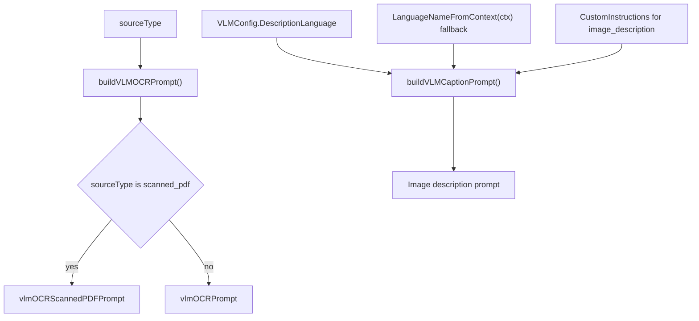
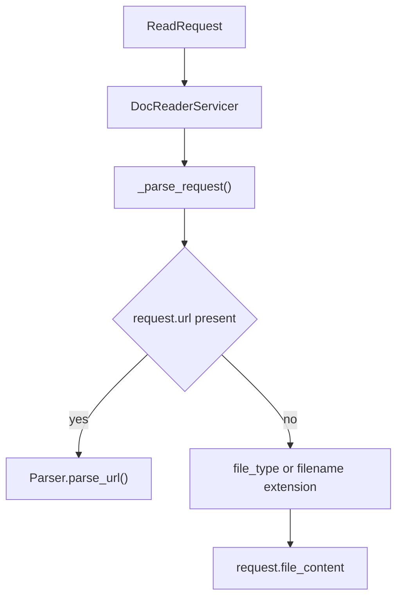
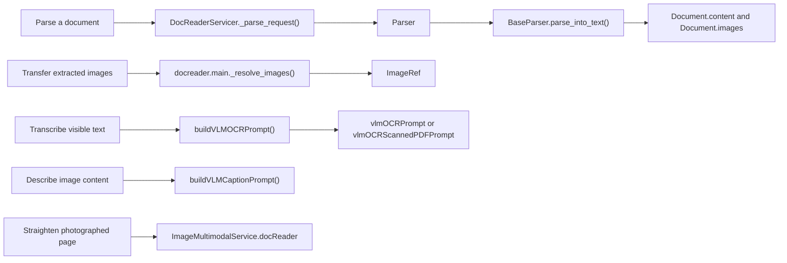
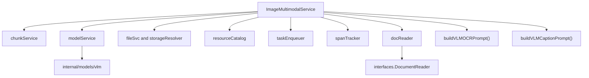

<!-- source: DeepWiki mcp.deepwiki.com · repo Tencent/WeKnora · page 11.5 Multimodal Document Processing · fetched 2026-10-29 -->

# Multimodal Document Processing

Relevant source files

The following files were used as context for generating this wiki page:

- [.env.lite.example](.env.lite.example)
- [docreader/auth.py](docreader/auth.py)
- [docreader/client/auth.go](docreader/client/auth.go)
- [docreader/client/client.go](docreader/client/client.go)
- [docreader/client/client_test.go](docreader/client/client_test.go)
- [docreader/main.py](docreader/main.py)
- [docreader/parser/base_parser.py](docreader/parser/base_parser.py)
- [docreader/parser/chain_parser.py](docreader/parser/chain_parser.py)
- [docreader/parser/doc_parser.py](docreader/parser/doc_parser.py)
- [docreader/parser/excel_parser.py](docreader/parser/excel_parser.py)
- [docreader/parser/image_parser.py](docreader/parser/image_parser.py)
- [docreader/parser/markdown_parser.py](docreader/parser/markdown_parser.py)
- [docreader/parser/markitdown_parser.py](docreader/parser/markitdown_parser.py)
- [docreader/parser/mhtml_parser.py](docreader/parser/mhtml_parser.py)
- [docreader/parser/parser.py](docreader/parser/parser.py)
- [docreader/parser/web_parser.py](docreader/parser/web_parser.py)
- [docreader/parser/xlsx_merge.py](docreader/parser/xlsx_merge.py)
- [docreader/parser/xlsx_repair.py](docreader/parser/xlsx_repair.py)
- [docreader/tests/test_docreader_memory.py](docreader/tests/test_docreader_memory.py)
- [docreader/tests/test_excel_parser.py](docreader/tests/test_excel_parser.py)
- [docreader/tests/test_markdown_table_util.py](docreader/tests/test_markdown_table_util.py)
- [docreader/tests/test_mhtml_parser.py](docreader/tests/test_mhtml_parser.py)
- [docreader/tests/test_ppt_convert.py](docreader/tests/test_ppt_convert.py)
- [docreader/tests/test_request_memory.py](docreader/tests/test_request_memory.py)
- [docreader/tests/test_sandbox_executor.py](docreader/tests/test_sandbox_executor.py)
- [docreader/tests/test_table_cell_pipes.py](docreader/tests/test_table_cell_pipes.py)
- [docreader/tests/test_xlsx_percent_format.py](docreader/tests/test_xlsx_percent_format.py)
- [docreader/tests/test_xlsx_styles_repair.py](docreader/tests/test_xlsx_styles_repair.py)
- [docreader/utils/request_memory.py](docreader/utils/request_memory.py)
- [internal/application/repository/chunk_empty_image_migration_test.go](internal/application/repository/chunk_empty_image_migration_test.go)
- [internal/application/service/image_input_validation_test.go](internal/application/service/image_input_validation_test.go)
- [internal/application/service/image_multimodal.go](internal/application/service/image_multimodal.go)
- [internal/application/service/image_multimodal_attrs_test.go](internal/application/service/image_multimodal_attrs_test.go)
- [internal/application/service/vectorstore_healthcheck_ssrf_test.go](internal/application/service/vectorstore_healthcheck_ssrf_test.go)
- [internal/infrastructure/docparser/grpc_parser.go](internal/infrastructure/docparser/grpc_parser.go)
- [internal/infrastructure/docparser/grpc_parser_resolver_test.go](internal/infrastructure/docparser/grpc_parser_resolver_test.go)
- [internal/infrastructure/docparser/markdown_image_scanner.go](internal/infrastructure/docparser/markdown_image_scanner.go)
- [internal/infrastructure/docparser/markdown_image_scanner_test.go](internal/infrastructure/docparser/markdown_image_scanner_test.go)
- [migrations/sqlite/000042_remove_empty_image_chunks.down.sql](migrations/sqlite/000042_remove_empty_image_chunks.down.sql)
- [migrations/sqlite/000042_remove_empty_image_chunks.up.sql](migrations/sqlite/000042_remove_empty_image_chunks.up.sql)
- [migrations/versioned/000125_remove_empty_image_chunks.down.sql](migrations/versioned/000125_remove_empty_image_chunks.down.sql)
- [migrations/versioned/000125_remove_empty_image_chunks.up.sql](migrations/versioned/000125_remove_empty_image_chunks.up.sql)
- [testdata/mhtml/titled-image-contract.json](testdata/mhtml/titled-image-contract.json)
- [testdata/mhtml/titled-image.mhtml](testdata/mhtml/titled-image.mhtml)

## Purpose and Scope

This section describes the document-parsing boundary between DocReader and the Go application, how parser outputs can include images, and the image-related OCR and caption prompts declared by `ImageMultimodalService`. The available code shows DocReader parsing and image-reference transport, plus the Go service’s dependencies and prompt construction; it does not expose the complete image-processing task implementation or the VLM client implementation. [docreader/parser/base_parser.py:13-61](), [docreader/main.py:61-110](), [internal/application/service/image_multimodal.go:31-115]()

Sources: [docreader/parser/base_parser.py:13-61](), [docreader/main.py:61-110](), [internal/application/service/image_multimodal.go:31-115]()

---

## 1. Parsing Boundary and Document Model

DocReader parsers implement `BaseParser` and return a `Document` from `parse_into_text`. The base parser describes the result as Markdown text with optional image references; its contract explicitly assigns chunking, image storage, OCR, and VLM captioning to the Go application. [docreader/parser/base_parser.py:13-61]()

The gRPC server constructs a `Parser` in `DocReaderServicer`. Its `_parse_request` method reads the parser engine and overrides from the request configuration, then chooses URL parsing when `request.url` is present. Otherwise, it determines the file type from the request or filename extension and obtains the file bytes. [docreader/main.py:153-198]()

### Parser Composition

DocReader provides two composition patterns:

- `FirstParser` tries configured parsers in order, returning the first valid document; if parsing raises an exception or produces an invalid document, it proceeds to the next parser. [docreader/parser/chain_parser.py:20-72]()
- `PipelineParser` passes each parser’s text output to the next parser and accumulates images and metadata into the final `Document`. [docreader/parser/chain_parser.py:94-151]()

`MarkitdownParser` is a `PipelineParser` configured with `StdMarkitdownParser` followed by `MarkdownParser`. The first parser converts supported document bytes to text; the pipeline then processes that text with the Markdown parser. [docreader/parser/markitdown_parser.py:26-82](), [docreader/parser/markitdown_parser.py:99-100]()

### Parser Examples

| Parser | Behavior visible in the supplied implementation |
|---|---|
| `ExcelParser` | Reads workbook sheets, skips empty rows and image-function strings, formats each retained row as comma-separated key-value text, and emits one `Chunk` per row with source-block sheet and row locators. [docreader/parser/excel_parser.py:49-169]() |
| `StdMarkitdownParser` | Wraps MarkItDown conversion and returns converted text; for PowerPoint files it can attach extracted media when the generated Markdown needs it. [docreader/parser/markitdown_parser.py:26-82]() |
| `MarkdownParser` | Provides Markdown table normalization utilities; the module describes a pipeline that includes table formatting and image processing. [docreader/parser/markdown_parser.py:1-12](), [docreader/parser/markdown_parser.py:38-55]() |
| `MHTMLParser` | Extracts HTML and, when enabled, image MIME parts; converts the selected HTML part to Markdown and returns image references and metadata in a `Document`. [docreader/parser/mhtml_parser.py:96-162]() |
| `StdWebParser` | Uses Playwright and Trafilatura for web content extraction; the visible implementation also defines SSRF URL checks and a route guard. [docreader/parser/web_parser.py:137-158](), [docreader/parser/web_parser.py:174-188]() |

Sources: [docreader/parser/base_parser.py:13-61](), [docreader/main.py:153-198](), [docreader/parser/chain_parser.py:20-72](), [docreader/parser/chain_parser.py:94-151](), [docreader/parser/markitdown_parser.py:26-82](), [docreader/parser/markitdown_parser.py:99-100](), [docreader/parser/excel_parser.py:49-169](), [docreader/parser/markdown_parser.py:1-12](), [docreader/parser/markdown_parser.py:38-55](), [docreader/parser/mhtml_parser.py:96-162](), [docreader/parser/web_parser.py:137-158](), [docreader/parser/web_parser.py:174-188]()

---

## 2. Image Extraction and Transfer

The parser contract allows a `Document` to include an `images` mapping from storage-relative paths to base64 data. The MHTML parser demonstrates this representation: it walks MIME parts, decodes image payloads, base64-encodes them into the image mapping, and returns that mapping with the Markdown content. [docreader/parser/base_parser.py:36-43](), [docreader/parser/mhtml_parser.py:103-162]()

At the gRPC boundary, `_resolve_images` converts image-map entries into `ImageRef` values. It decodes base64 data when possible, derives a filename and MIME type from the reference extension, and places the bytes, original reference, and metadata in each `ImageRef`. The function’s documented contract says that image persistence belongs to the Go application and that this function returns inline image bytes rather than an image directory path. [docreader/main.py:61-110]()

For streaming responses, `_iter_image_refs` removes entries from the source mapping as it yields each decoded image. Its docstring describes this as a way to avoid retaining every decoded image alongside its base64 source at the same time. [docreader/main.py:128-150]()

**Image-reference handoff**

Sources: [docreader/parser/base_parser.py:36-43](), [docreader/main.py:61-110]()

---

## 3. Image Multimodal Service and Prompt Construction

`ImageMultimodalService` is declared as the handler for `image:multimodal` asynq tasks. Its comments describe its role as reading images from storage, performing OCR and VLM captioning, and creating child chunks. The service is constructed with dependencies for chunk and model services, knowledge-base and repository access, retrieval-engine registration, task enqueuing, Redis, file storage, resource resolution, span tracking, and an optional `DocumentReader`. [internal/application/service/image_multimodal.go:80-115](), [internal/application/service/image_multimodal.go:117-151]()

The shown code defines two OCR prompt variants:

- `vlmOCRPrompt` requests transcription of visible text, preserves the original language, distinguishes real tables from scattered labels, and instructs the model not to guess unreadable text. If no text is recognizable, its specified response is `No text content`. [internal/application/service/image_multimodal.go:31-42]()
- `vlmOCRScannedPDFPrompt` is for scanned-PDF page images. It asks for Markdown extraction, preserves document hierarchy, represents tables as Markdown, and represents mathematical formulas with LaTeX delimiters. [internal/application/service/image_multimodal.go:43-54]()
- `buildVLMOCRPrompt` selects the scanned-PDF prompt when `sourceType` is `scanned_pdf`, otherwise returning the general OCR prompt. Its `VLMConfig` parameter is deliberately unused; the function’s comments say knowledge-base custom instructions must not be added to OCR prompts. [internal/application/service/image_multimodal.go:66-78]()

Captioning has a separate prompt builder. `buildVLMCaptionPrompt` uses the configured description language when present; otherwise it obtains a language name from the context. It builds a concise image-description prompt and appends custom instructions for the `image_description` scope. [internal/application/service/image_multimodal.go:57-64]()

The available code establishes the prompt-selection and service-wiring boundaries, but does not show the task handler’s full OCR/caption call sequence or the implementation of the VLM client. [internal/application/service/image_multimodal.go:80-151]()

Sources: [internal/application/service/image_multimodal.go:31-78](), [internal/application/service/image_multimodal.go:80-151]()

### Prompt-selection flow

Sources: [internal/application/service/image_multimodal.go:31-78]()

---

## 4. DocReader gRPC Service

`DocReaderServicer` owns a `Parser` and a `PreprocessRunner`. It exposes a `PreprocessImage` method backed by the runner and creates a dedicated thread pool sized from the configured preprocessing worker limit plus one admission thread. Its `close` method closes the preprocessing runner and shuts down that executor. [docreader/main.py:153-174]()

The shared `_parse_request` method reads parser-engine configuration and overrides. For URL requests it calls `self.parser.parse_url(...)`; for file requests it derives the file type, reads `request.file_content`, tracks its size, and logs the request. The supplied excerpt ends before the file-parse call and response construction, so those details are not specified here. [docreader/main.py:176-198]()

Sources: [docreader/main.py:153-198]()

### Request-to-parser mapping

Sources: [docreader/main.py:153-198]()

---

## 5. Multimodal Chunking Boundary

The available parser contract explicitly excludes chunking from DocReader: parsers return Markdown and optional image references, while the Go application owns chunking, image storage, OCR, and caption work. [docreader/parser/base_parser.py:13-19](), [docreader/parser/base_parser.py:36-49]()

`ImageMultimodalService` is documented as creating child chunks after OCR and VLM caption processing. Its fields include `chunkService`, `modelService`, storage and repository dependencies, and an optional `docReader` used by the pipeline to straighten a photographed page before OCR. The comment states that when `docReader` is unavailable, preprocessing reports unavailable and OCR reads the original bytes. [internal/application/service/image_multimodal.go:80-115]()

The supplied excerpt does not show the chunk creation implementation, chunk types, indexing sequence, or retrieval-time assembly. Those implementation details are therefore outside the scope of this page’s code-backed description. [internal/application/service/image_multimodal.go:80-115]()

Sources: [docreader/parser/base_parser.py:13-19](), [docreader/parser/base_parser.py:36-49](), [internal/application/service/image_multimodal.go:80-115]()

---

## 6. Natural Language Concepts Mapped to Code Entities

The diagrams below connect operational concepts—parsing, image transfer, OCR, captioning, and preprocessing—to the identifiers present in the implementation. [docreader/main.py:61-110](), [docreader/main.py:153-198](), [internal/application/service/image_multimodal.go:31-115]()

**Processing concepts to code entities**

Sources: [docreader/main.py:61-110](), [docreader/main.py:153-198](), [docreader/parser/base_parser.py:13-49](), [internal/application/service/image_multimodal.go:31-115]()

**Application components to declared dependencies**

Sources: [internal/application/service/image_multimodal.go:14-24](), [internal/application/service/image_multimodal.go:80-115](), [internal/application/service/image_multimodal.go:117-151]()

---

## 7. Operational Configuration Visible in the Supplied Files

The Lite environment example configures the DocReader address with `DOCREADER_ADDR` and selects `grpc` with `DOCREADER_TRANSPORT`. It also documents optional gRPC TLS and authentication-token settings. [ .env.lite.example:77-95]()

The same example documents chat-attachment OCR settings: `WEKNORA_CHAT_ATTACHMENT_OCR_CONCURRENCY` and `WEKNORA_CHAT_ATTACHMENT_OCR_MAX_PAGES`, with comments describing concurrency and page-limit defaults and agent-level override behavior. These settings are described specifically for chat attachments; the supplied code does not establish that they configure every knowledge-ingestion OCR path. [.env.lite.example:70-78]()

Sources: [.env.lite.example:70-95]()

---

## Summary

DocReader’s parser contract returns Markdown plus optional image references and leaves chunking, image storage, OCR, and captioning to the Go application. The gRPC server parses requests and converts parser image mappings into inline `ImageRef` values. In Go, `ImageMultimodalService` declares the dependencies for image tasks and defines separate OCR and caption prompt builders, including a scanned-PDF-specific OCR prompt and an optional document-preprocessing dependency. [docreader/parser/base_parser.py:13-49](), [docreader/main.py:61-110](), [docreader/main.py:153-198](), [internal/application/service/image_multimodal.go:31-115]()

Sources: [docreader/parser/base_parser.py:13-49](), [docreader/main.py:61-110](), [docreader/main.py:153-198](), [internal/application/service/image_multimodal.go:31-115]()

---

