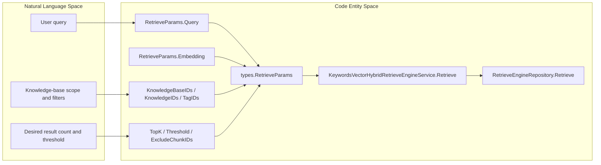
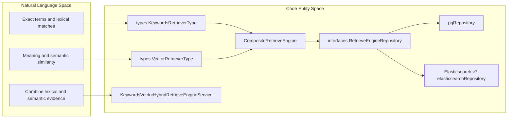
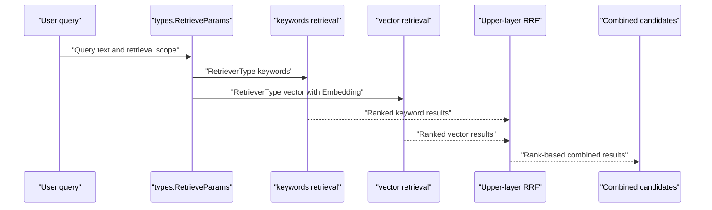

<!-- source: DeepWiki mcp.deepwiki.com · repo Tencent/WeKnora · page 11.6 Hybrid Retrieval Strategies · fetched 2026-10-29 -->

# Hybrid Retrieval Strategies

<details>
<summary>Relevant source files</summary>

The following files were used as context for generating this wiki page:

- [config/prompt_templates/generate_summary.yaml](config/prompt_templates/generate_summary.yaml)
- [internal/agent/tools/image_markdown_output_test.go](internal/agent/tools/image_markdown_output_test.go)
- [internal/application/repository/retriever/elasticsearch/structs.go](internal/application/repository/retriever/elasticsearch/structs.go)
- [internal/application/repository/retriever/elasticsearch/v7/repository.go](internal/application/repository/retriever/elasticsearch/v7/repository.go)
- [internal/application/repository/retriever/elasticsearch/v8/repository.go](internal/application/repository/retriever/elasticsearch/v8/repository.go)
- [internal/application/repository/retriever/postgres/keyword_score_integration_test.go](internal/application/repository/retriever/postgres/keyword_score_integration_test.go)
- [internal/application/repository/retriever/postgres/keyword_score_test.go](internal/application/repository/retriever/postgres/keyword_score_test.go)
- [internal/application/repository/retriever/postgres/repository.go](internal/application/repository/retriever/postgres/repository.go)
- [internal/application/repository/retriever/postgres/structs.go](internal/application/repository/retriever/postgres/structs.go)
- [internal/application/repository/retriever/qdrant/repository.go](internal/application/repository/retriever/qdrant/repository.go)
- [internal/application/repository/retriever/qdrant/repository_test.go](internal/application/repository/retriever/qdrant/repository_test.go)
- [internal/application/repository/retriever/qdrant/structs.go](internal/application/repository/retriever/qdrant/structs.go)
- [internal/application/service/chat_pipeline/filter_top_k.go](internal/application/service/chat_pipeline/filter_top_k.go)
- [internal/application/service/chat_pipeline/filter_top_k_test.go](internal/application/service/chat_pipeline/filter_top_k_test.go)
- [internal/application/service/chat_pipeline/into_chat_message.go](internal/application/service/chat_pipeline/into_chat_message.go)
- [internal/application/service/chat_pipeline/merge.go](internal/application/service/chat_pipeline/merge.go)
- [internal/application/service/chat_pipeline/merge_expand_edit_test.go](internal/application/service/chat_pipeline/merge_expand_edit_test.go)
- [internal/application/service/chat_pipeline/merge_parent_resolve_test.go](internal/application/service/chat_pipeline/merge_parent_resolve_test.go)
- [internal/application/service/chat_pipeline/merge_parent_shared_test.go](internal/application/service/chat_pipeline/merge_parent_shared_test.go)
- [internal/application/service/chat_pipeline/references.go](internal/application/service/chat_pipeline/references.go)
- [internal/application/service/chat_pipeline/references_test.go](internal/application/service/chat_pipeline/references_test.go)
- [internal/application/service/chat_pipeline/rerank.go](internal/application/service/chat_pipeline/rerank.go)
- [internal/application/service/chat_pipeline/rerank_test.go](internal/application/service/chat_pipeline/rerank_test.go)
- [internal/application/service/knowledge_bind_stored_images_test.go](internal/application/service/knowledge_bind_stored_images_test.go)
- [internal/application/service/retriever/composite.go](internal/application/service/retriever/composite.go)
- [internal/application/service/retriever/keywords_vector_hybrid_indexer.go](internal/application/service/retriever/keywords_vector_hybrid_indexer.go)
- [internal/application/service/retriever/keywords_vector_hybrid_indexer_test.go](internal/application/service/retriever/keywords_vector_hybrid_indexer_test.go)
- [internal/application/service/retriever/keywords_vector_hybrid_indexer_window_test.go](internal/application/service/retriever/keywords_vector_hybrid_indexer_window_test.go)
- [internal/infrastructure/docparser/resolve_remote_html_images_test.go](internal/infrastructure/docparser/resolve_remote_html_images_test.go)
- [internal/modelcontext/omitted_results_test.go](internal/modelcontext/omitted_results_test.go)
- [internal/searchutil/imageinfo.go](internal/searchutil/imageinfo.go)
- [internal/searchutil/imageinfo_disabled_test.go](internal/searchutil/imageinfo_disabled_test.go)
- [internal/searchutil/imageinfo_html_test.go](internal/searchutil/imageinfo_html_test.go)
- [internal/searchutil/imageinfo_match.go](internal/searchutil/imageinfo_match.go)
- [internal/searchutil/imageinfo_match_test.go](internal/searchutil/imageinfo_match_test.go)
- [internal/searchutil/textutil.go](internal/searchutil/textutil.go)
- [internal/types/interfaces/retriever.go](internal/types/interfaces/retriever.go)
- [internal/types/retriever.go](internal/types/retriever.go)
- [website-docs/03-features/05-retrieval-engines.md](website-docs/03-features/05-retrieval-engines.md)

</details>


## Purpose and Scope

This page describes how WeKnora combines vector and keyword retrieval, how retrieval engines expose those capabilities, and how the chat pipeline reranks and merges candidate chunks. It covers the implementation details visible in the repository sources: retrieval parameters, embedding and indexing, backend capabilities, RRF as the documented fusion strategy, reranking, and post-retrieval chunk processing. [internal/types/retriever.go:29-65]()[internal/application/service/retriever/keywords_vector_hybrid_indexer.go:41-83]()[website-docs/03-features/05-retrieval-engines.md:3-37]()[internal/application/service/chat_pipeline/rerank.go:13-41]()[internal/application/service/chat_pipeline/merge.go:12-43]()

---

## 1. Retrieval Engine Architecture and Target Resolution

WeKnora represents retrieval methods with `RetrieverType` values: `keywords`, `vector`, and `websearch`. A `RetrieveParams` carries the query text, an optional query embedding, scope filters such as knowledge-base, knowledge, and tag IDs, excluded IDs, `TopK`, a similarity `Threshold`, the knowledge type, additional backend-specific parameters, and the selected retrieval type. [internal/types/retriever.go:29-65]()

The repository documentation describes a layered design: backend repositories implement storage and retrieval; `KeywordsVectorHybridRetrieveEngineService` wraps a repository as a retrieval service and creates embeddings for vector indexing; `CompositeRetrieveEngine` routes retrieval by supported type and broadcasts writes; and `RetrieveEngineRegistry` provides engine lookup. Backend-specific repository behavior is not identical: for example, the PostgreSQL repository advertises both keyword and vector retrieval, while the documented Elasticsearch v7 capability is keywords only. [website-docs/03-features/05-retrieval-engines.md:60-66]()[internal/application/service/retriever/keywords_vector_hybrid_indexer.go:41-83]()[internal/application/repository/retriever/postgres/repository.go:65-73]()

### Natural-language query to retrieval entities

A user’s query becomes the `Query` field in `RetrieveParams`. For vector retrieval, the request can also carry its `Embedding`; scope, exclusions, result limit, and threshold are represented in the same parameter object. The hybrid retrieval service’s `Retrieve` method passes those parameters to its repository. [internal/types/retriever.go:39-65]()[internal/application/service/retriever/keywords_vector_hybrid_indexer.go:61-66]()

**Diagram: Query inputs mapped to retrieval code entities**



Sources: `internal/types/retriever.go:39-65`; `internal/application/service/retriever/keywords_vector_hybrid_indexer.go:61-66`

### Backend selection and capability boundaries

The documented registry distinguishes engines by engine type and supports environment-configured engines as well as database-backed vector-store instances. At query time, knowledge bases can be grouped by bound store, and engine capabilities are used to construct vector and keyword retrieval parameters. The documented hybrid design is an upper-layer RRF fusion: vector and keyword searches run independently, then results are combined by rank. [website-docs/03-features/05-retrieval-engines.md:37-37]()[website-docs/03-features/05-retrieval-engines.md:56-66]()[website-docs/03-features/05-retrieval-engines.md:83-92]()

**Diagram: Retrieval concepts mapped to engine and repository entities**



Sources: `internal/types/retriever.go:29-37`; `internal/application/service/retriever/keywords_vector_hybrid_indexer.go:41-66`; `internal/application/repository/retriever/postgres/repository.go:20-31`; `internal/application/repository/retriever/postgres/repository.go:65-73`; `internal/application/repository/retriever/elasticsearch/v7/repository.go:27-33`; `website-docs/03-features/05-retrieval-engines.md:60-66`

---

## 2. Hybrid Search, BM25, and RRF Fusion

The retrieval contract separates `keywords` and `vector` as retrieval types. The repository documentation identifies BM25 or backend-native keyword scoring for several engines, and states that WeKnora’s hybrid retrieval uses upper-layer RRF: keyword and vector retrieval execute independently, and their ranked results are combined. This makes engine-specific score scales less central to fusion than the relative rank of each result list. [internal/types/retriever.go:29-37]()[website-docs/03-features/05-retrieval-engines.md:24-37]()

Backend capabilities differ. PostgreSQL advertises keyword and vector support; Elasticsearch v8 advertises both; the documentation lists Elasticsearch v7 as keyword-only. Qdrant’s keyword path is described as full-text matching without a keyword score, so its results rely on rank for RRF fusion. [internal/application/repository/retriever/postgres/repository.go:65-73]()[internal/application/repository/retriever/elasticsearch/v8/repository.go:107-115]()[website-docs/03-features/05-retrieval-engines.md:24-37]()

`RetrieveParams` is the shared request shape passed to repositories. It includes `RetrieverType`, `Query`, and, for vector retrieval, `Embedding`; backend filters and limits travel in the same structure. The available files establish RRF as the documented fusion strategy, but do not show the implementation or formula for the fusion function itself. [internal/types/retriever.go:39-65]()[website-docs/03-features/05-retrieval-engines.md:37-37]()

| Retrieval path | Query evidence | Request fields | Backend variation |
|---|---|---|---|
| Keyword | Lexical / full-text match; backend may report BM25 or another keyword score | `Query`, `RetrieverType: keywords` | PostgreSQL and Elasticsearch support keyword retrieval; Qdrant keyword matching has no score according to the engine matrix. [internal/types/retriever.go:39-65]()[internal/application/repository/retriever/postgres/repository.go:65-73]()[website-docs/03-features/05-retrieval-engines.md:24-37]() |
| Vector | Similarity between query and indexed embedding | `Query`, `Embedding`, `RetrieverType: vector`, `Threshold` | Similarity metric and score representation depend on the backend. [internal/types/retriever.go:39-65]()[website-docs/03-features/05-retrieval-engines.md:24-37]() |
| Hybrid | Independent keyword and vector result lists combined by rank | Two retrieval requests with their respective retrieval types | Documented as upper-layer RRF, independent of whether a backend offers its own hybrid search. [website-docs/03-features/05-retrieval-engines.md:37-37]() |

**Diagram: Independent retrieval paths and documented fusion**



Sources: `internal/types/retriever.go:39-65`; `website-docs/03-features/05-retrieval-engines.md:24-37`

---

## 3. Embedding and Indexing for Vector Retrieval

`KeywordsVectorHybridRetrieveEngineService.Index` creates an embedding only when the requested retriever types include `VectorRetrieverType`. It sanitizes the content before embedding, associates the resulting vector with the source ID, and passes the embedding map as additional parameters to the repository’s `Save` method. When vector retrieval is not enabled, the indexing path still saves the index information without generating an embedding. [internal/application/service/retriever/keywords_vector_hybrid_indexer.go:68-84]()

For batch indexing, the service divides vector work into windows of up to `batchSize * maxConcurrency` items, with a batch size of 40 and maximum concurrency of 5. It sanitizes each input, calls `batchEmbedWithBackoff`, validates that the number of vectors matches the input count, and then saves chunks concurrently. The batch embedding helper retries up to five times with exponential delays beginning at 200 ms, while honoring context cancellation. [internal/application/service/retriever/keywords_vector_hybrid_indexer.go:86-153]()[internal/application/service/retriever/keywords_vector_hybrid_indexer.go:155-180]()

The repository receives `IndexInfo` plus additional parameters; the actual storage representation and vector indexing mechanics are backend-specific. For example, the PostgreSQL repository converts index information into a database vector record and saves it using an upsert keyed by source ID and source type. [internal/application/service/retriever/keywords_vector_hybrid_indexer.go:68-84]()[internal/application/repository/retriever/postgres/repository.go:114-137]()

**Diagram: Indexing flow from content to backend**

```mermaid
flowchart TD
    Content["IndexInfo.Content"]
    Service["KeywordsVectorHybridRetrieveEngineService.Index"]
    Check["retrieverTypes includes VectorRetrieverType"]
    Sanitize["sanitizeForEmbedding"]
    Embed["Embedder.Embed"]
    Params["embedding map keyed by SourceID"]
    Save["RetrieveEngineRepository.Save"]
    Stored["Backend index"]

    Content --> Service
    Service --> Check
    Check -->| "Yes" | Sanitize
    Sanitize --> Embed
    Embed --> Params
    Params --> Save
    Check -->| "No" | Save
    Save --> Stored
```

Sources: `internal/application/service/retriever/keywords_vector_hybrid_indexer.go:68-84`

---

## 4. Score Normalization and Backend Score Semantics

Retrieval engines may report different score types and scales. The engine capability matrix documents cosine or other vector metrics alongside keyword scoring such as BM25, and notes that some backends do not provide a keyword score. It also describes cross-engine result normalization when multiple store groups are queried. [website-docs/03-features/05-retrieval-engines.md:24-37]()[website-docs/03-features/05-retrieval-engines.md:83-92]()

The shared `IndexWithScore` type contains `Score`, `VectorScore`, and `MatchType`. Its comments specify that fusion can replace `Score` with a rank-based value while preserving the original vector similarity in `VectorScore`; keyword hits have zero `VectorScore`. This separation retains the original vector evidence even when the general score is used for fused ordering. [internal/types/retriever.go:75-109]()

The PostgreSQL repository resolves its keyword score function lazily, supporting either `paradedb.score` or `pgsearch.score` and caching a successful resolution per repository. This is backend compatibility handling for keyword retrieval; it is distinct from any later cross-engine score normalization. [internal/application/repository/retriever/postgres/repository.go:33-63]()

The available code excerpts do not include the implementation of an engine-aware normalizer or the RRF score calculation. Consequently, this page describes the documented behavior—cross-engine normalization and rank-based fusion—without asserting a specific normalization formula or numeric mapping. [website-docs/03-features/05-retrieval-engines.md:37-37]()[website-docs/03-features/05-retrieval-engines.md:83-92]()

| Score field | Meaning |
|---|---|
| `IndexWithScore.Score` | General result score; fusion may replace it with a rank-based score. [internal/types/retriever.go:93-99]() |
| `IndexWithScore.VectorScore` | Original vector similarity evidence retained when fusion changes `Score`; zero for keyword hits. [internal/types/retriever.go:95-99]() |
| Keyword backend score | Backend-specific keyword score where supported; not all keyword engines provide one. [website-docs/03-features/05-retrieval-engines.md:24-37]() |

Sources: `internal/types/retriever.go:75-109`; `internal/application/repository/retriever/postgres/repository.go:33-63`; `website-docs/03-features/05-retrieval-engines.md:24-37`; `website-docs/03-features/05-retrieval-engines.md:83-92`

---

## 5. Reranking and Candidate Selection

`PluginRerank` is registered for the `CHUNK_RERANK` event. It skips work when retrieval is not needed, there are no search candidates, or no rerank model ID is configured. If the model cannot be loaded, it records a diagnostic outcome and continues rather than failing the entire chat turn. [internal/application/service/chat_pipeline/rerank.go:13-41]()[internal/application/service/chat_pipeline/rerank.go:42-87]()

When a model is available, the plugin calls `reranking.Rerank` with the rewritten query and search candidates. Its `reranking.Options` include the configured threshold, top-K, a candidate cap, fallback minimum score, image keep score, optional image loading, and an optional FAQ score boost. The resulting diagnostics are stored on `ChatManage`; successful results are assigned to `RerankResult`. [internal/application/service/chat_pipeline/rerank.go:89-123]()[internal/application/service/chat_pipeline/rerank.go:141-150]()

If the rerank API reports a model error, the plugin uses the returned results as a fallback and continues. If reranking produces no candidates, the plugin returns `ErrSearchNothing`. When reranking removes candidates, it records a retrieval cut and emits truncation diagnostics. [internal/application/service/chat_pipeline/rerank.go:125-179]()

| Stage behavior | Implementation detail |
|---|---|
| No candidates or model | Records the relevant outcome and advances without invoking the reranker. [internal/application/service/chat_pipeline/rerank.go:60-73]() |
| Model unavailable | Records the error and proceeds with retrieval-order behavior. [internal/application/service/chat_pipeline/rerank.go:75-87]() |
| Rerank invocation | Uses `RewriteQuery`, `SearchResult`, and configured `reranking.Options`. [internal/application/service/chat_pipeline/rerank.go:89-123]() |
| API error | Falls back to `res.Results` and continues the pipeline. [internal/application/service/chat_pipeline/rerank.go:125-139]() |
| Candidate reduction | Records a rerank-stage retrieval cut when fewer results remain. [internal/application/service/chat_pipeline/rerank.go:161-174]() |

**Diagram: Candidate flow through reranking and merge selection**

```mermaid
flowchart TD
    Search["ChatManage.SearchResult"]
    Plugin["PluginRerank.OnEvent"]
    Model["ModelService.GetRerankModel"]
    Rerank["reranking.Rerank"]
    RerankResult["ChatManage.RerankResult"]
    Fallback["Retrieval results fallback"]
    Merge["PluginMerge.selectInputResults"]

    Search --> Plugin
    Plugin --> Model
    Model -->| "Available" | Rerank
    Model -->| "Unavailable" | Fallback
    Rerank -->| "Successful" | RerankResult
    Rerank -->| "API error" | Fallback
    RerankResult --> Merge
    Fallback --> Merge
```

Sources: `internal/application/service/chat_pipeline/rerank.go:38-87`; `internal/application/service/chat_pipeline/rerank.go:89-179`; `internal/application/service/chat_pipeline/merge.go:100-138`

---

## 6. Search Result Merging and Context Enrichment

`PluginMerge` handles `CHUNK_MERGE` events. It chooses reranked results when available; otherwise it sorts search results by score and applies `RerankTopK`. Graph matches are retained beyond the cut because graph hits have no retrieval score and are bounded separately. [internal/application/service/chat_pipeline/merge.go:12-43]()[internal/application/service/chat_pipeline/merge.go:100-138]()

After selection, the merge pipeline deduplicates results, injects relevant history references, resolves parent chunks, groups and merges current content by knowledge and chunk type, populates FAQ answers, expands short contexts with neighboring chunks, and performs final deduplication and overlap removal. The final result is stored in `ChatManage.MergeResult`. [internal/application/service/chat_pipeline/merge.go:33-43]()[internal/application/service/chat_pipeline/merge.go:55-97]()

This stage is not another retrieval-score fusion step: it prepares the selected candidates and their content for downstream use. Parent resolution and neighbor expansion are particularly relevant when retrieved chunks are smaller than the context needed for an answer. [internal/application/service/chat_pipeline/merge.go:76-93]()

Sources: `internal/application/service/chat_pipeline/merge.go:12-43`; `internal/application/service/chat_pipeline/merge.go:55-97`; `internal/application/service/chat_pipeline/merge.go:100-138`

---

