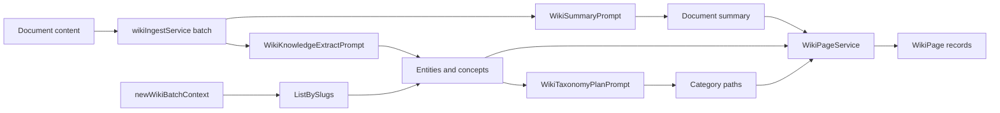
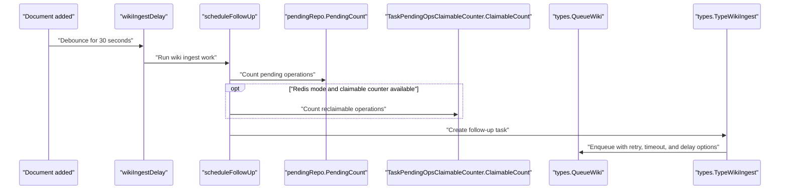
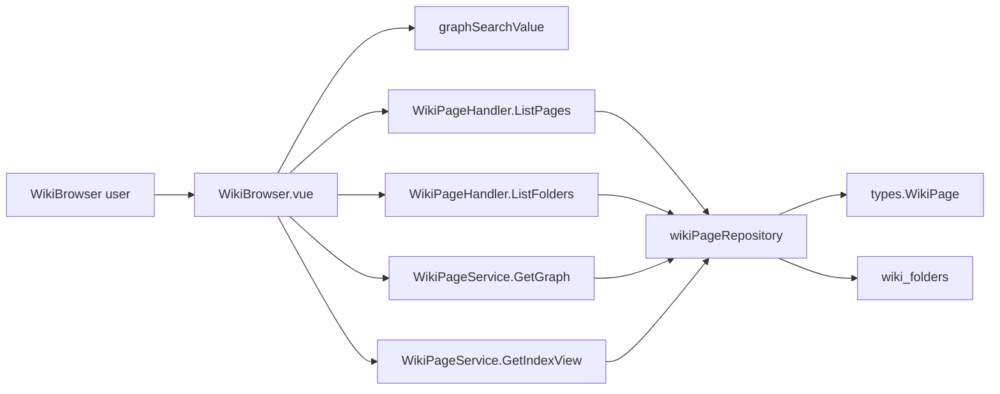
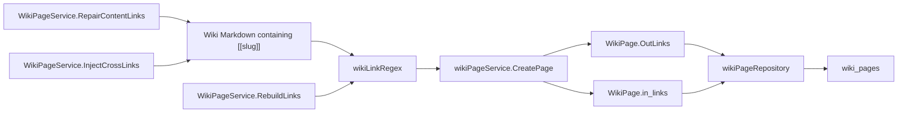

<!-- source: DeepWiki mcp.deepwiki.com · repo Tencent/WeKnora · page 11.7 Wiki Mode and Auto-Wiki Generation · fetched 2026-10-29 -->

# Wiki Mode and Auto-Wiki Generation

Relevant source files

The following files were used as context for generating this wiki page:

- [frontend/src/api/wiki/index.ts](frontend/src/api/wiki/index.ts)
- [frontend/src/views/knowledge/wiki/WikiBrowser.vue](frontend/src/views/knowledge/wiki/WikiBrowser.vue)
- [internal/agent/prompts_wiki.go](internal/agent/prompts_wiki.go)
- [internal/agent/tools/wiki_replace_text.go](internal/agent/tools/wiki_replace_text.go)
- [internal/agent/tools/wiki_replace_text_test.go](internal/agent/tools/wiki_replace_text_test.go)
- [internal/agent/tools/wiki_tools.go](internal/agent/tools/wiki_tools.go)
- [internal/agent/tools/wiki_write_page.go](internal/agent/tools/wiki_write_page.go)
- [internal/application/repository/task_queue.go](internal/application/repository/task_queue.go)
- [internal/application/repository/task_queue_test.go](internal/application/repository/task_queue_test.go)
- [internal/application/repository/wiki_page.go](internal/application/repository/wiki_page.go)
- [internal/application/repository/wiki_page_test.go](internal/application/repository/wiki_page_test.go)
- [internal/application/service/knowledge_post_process_wiki_enqueue_test.go](internal/application/service/knowledge_post_process_wiki_enqueue_test.go)
- [internal/application/service/knowledge_stuck_processing_test.go](internal/application/service/knowledge_stuck_processing_test.go)
- [internal/application/service/wiki_deleted_tenant_guard_test.go](internal/application/service/wiki_deleted_tenant_guard_test.go)
- [internal/application/service/wiki_ingest.go](internal/application/service/wiki_ingest.go)
- [internal/application/service/wiki_ingest_batch.go](internal/application/service/wiki_ingest_batch.go)
- [internal/application/service/wiki_ingest_test.go](internal/application/service/wiki_ingest_test.go)
- [internal/application/service/wiki_page.go](internal/application/service/wiki_page.go)
- [internal/application/service/wiki_page_test.go](internal/application/service/wiki_page_test.go)
- [internal/container/recover_pending_wiki_tasks.go](internal/container/recover_pending_wiki_tasks.go)
- [internal/container/reset_pending_tasks.go](internal/container/reset_pending_tasks.go)
- [internal/container/reset_pending_tasks_test.go](internal/container/reset_pending_tasks_test.go)
- [internal/handler/wiki_page.go](internal/handler/wiki_page.go)
- [internal/types/interfaces/task_queue.go](internal/types/interfaces/task_queue.go)
- [internal/types/interfaces/wiki_page.go](internal/types/interfaces/wiki_page.go)
- [internal/types/wiki_page.go](internal/types/wiki_page.go)
- [migrations/versioned/000041_task_queue_and_wiki_indexes.up.sql](migrations/versioned/000041_task_queue_and_wiki_indexes.up.sql)
- [website-docs/01-getting-started/01-introduction.md](website-docs/01-getting-started/01-introduction.md)
- [website-docs/03-features/14-wiki.md](website-docs/03-features/14-wiki.md)
- [website-docs/04-api/02-api-agent-mcp.md](website-docs/04-api/02-api-agent-mcp.md)
- [website-docs/06-development/03-extension-points.md](website-docs/06-development/03-extension-points.md)

## Purpose and Scope

Wiki Mode turns knowledge in a wiki-enabled knowledge base into persistent, interlinked Markdown pages. This page covers the automatic generation prompts, ingestion scheduling and concurrency controls, WikiBrowser’s visible graph features, page and folder data, editing semantics, and link maintenance. [internal/types/wiki_page.go:135-190]()

Sources: [internal/types/wiki_page.go:135-190]()

---

## Auto-Wiki Ingestion Pipeline

The ingestion service defines an asynchronous, batched workflow for wiki tasks. It debounces document activity, limits batch size, and schedules follow-up work when pending operations remain. The prompts define the generated content: document summaries, entity and concept extraction, and a shared taxonomy plan for a batch. [internal/application/service/wiki_ingest.go:128-150]()[internal/application/service/wiki_ingest_batch.go:27-44]()[internal/agent/prompts_wiki.go:3-46]()[internal/agent/prompts_wiki.go:48-113]()

### Prompt responsibilities

| Prompt or mechanism | Responsibility |
| --- | --- |
| `WikiSummaryPrompt` | Produces a Markdown summary from document content, beginning with a one-sentence `SUMMARY:` line. It instructs the model not to infer a topic from filenames, to use only supplied content, to link known pages using the provided slugs, and to avoid inventing a summary when content is empty or insubstantial. [internal/agent/prompts_wiki.go:52-85]() |
| `WikiKnowledgeExtractPrompt` | Extracts entities and concepts in one JSON response. It requires language-consistent output and directs the model to reuse prior slugs for continuing items and omit items no longer present. [internal/agent/prompts_wiki.go:87-113]() |
| `WikiTaxonomyPlanPrompt` | Assigns items from one batch to coherent directory paths. It tells the model to reuse exact existing folder labels where possible, group similar items consistently, and keep paths to at most two levels. [internal/agent/prompts_wiki.go:3-46]() |
| `maxContentForWiki` | Sets a 32,768-character limit for document content sent to the LLM for wiki generation. [internal/application/service/wiki_ingest.go:40-43]() |

### Scheduling and batch flow

`wikiIngestDelay` is 30 seconds, allowing rapid document additions to be debounced. Each batch is limited to five documents by `wikiMaxDocsPerBatch`; remaining operations can be handled by follow-up tasks. The follow-up scheduler counts pending work, uses claimable counts in Redis mode when supported, and enqueues tasks on the wiki queue with a 60-minute timeout. [internal/application/service/wiki_ingest.go:128-150]()[internal/application/service/wiki_ingest_batch.go:46-133]()

The batch context uses lazy, per-run lookups rather than loading every wiki page in advance. `newWikiBatchContext` caches slug-to-title and knowledge-ID-to-summary lookups, and resolves requested slugs through `ListBySlugs`. Archived pages and index pages are treated as unavailable for title resolution. [internal/application/service/wiki_ingest_batch.go:135-196]()

### Concurrency and recovery

| Mechanism | Behavior |
| --- | --- |
| Pending-row claims | In standard Redis mode, batches can run concurrently for one KB; row claiming prevents workers from processing the same pending items. Claims older than `wikiClaimStaleAfter` (90 minutes) can be reclaimed. [internal/application/service/wiki_ingest.go:44-58]() |
| Per-slug locking | `wikiSlugLockPrefix` protects read-modify-write operations on a page slug. Its lock TTL is five minutes; a contended reducer waits for a bounded period before falling back to best-effort skip behavior. [internal/application/service/wiki_ingest.go:60-63]()[internal/application/service/wiki_ingest.go:94-102]() |
| Identity claims | `wikiIdentityClaimPrefix` reserves the slug selected for a normalized page identity, avoiding divergent slugs for the same title when concurrent map phases run. Claims have a two-hour TTL. [internal/application/service/wiki_ingest.go:65-93]() |
| Per-KB in-flight cap | Standard Redis mode reserves batch slots in a per-KB sorted set. The default cap is four; slots expire after 90 seconds unless renewed every 30 seconds. [internal/application/service/wiki_ingest.go:104-123]() |
| Follow-up delays | The normal follow-up delay is five seconds; rate-limit failures use a 60-second delay. [internal/application/service/wiki_ingest.go:132-145]() |
| Lite-mode serialization | Lite mode uses an in-process per-KB lock. If another batch is active, the handler can return `ErrWikiIngestConcurrent`. [internal/application/service/wiki_ingest.go:31-38]()[internal/application/service/wiki_ingest.go:44-50]() |

Sources: [internal/application/service/wiki_ingest.go:31-150]()[internal/application/service/wiki_ingest_batch.go:27-133]()[internal/application/service/wiki_ingest_batch.go:135-196]()[internal/agent/prompts_wiki.go:3-113]()

### Diagram: From document content to wiki page services

This diagram connects the user-facing concepts of document summaries, extracted knowledge, and organized wiki pages to the prompt and service symbols shown in the code. The available excerpts define these prompts and the batch-context lookup behavior; they do not show every call site in the ingest handler. [internal/agent/prompts_wiki.go:3-113]()[internal/application/service/wiki_ingest_batch.go:135-196]()

Sources: [internal/agent/prompts_wiki.go:3-113]()[internal/application/service/wiki_ingest_batch.go:135-196]()

### Diagram: Task scheduling and code entities

The diagram bridges the operational language of debounced wiki ingestion to the queue and scheduler identifiers present in the code. `scheduleFollowUp` constructs `types.TypeWikiIngest` tasks and places them on `types.QueueWiki`. [internal/application/service/wiki_ingest.go:128-150]()[internal/application/service/wiki_ingest_batch.go:46-133]()

Sources: [internal/application/service/wiki_ingest.go:128-150]()[internal/application/service/wiki_ingest_batch.go:46-133]()

---

## WikiBrowser UI and Visualization

`WikiBrowser.vue` contains the graph-view template. It renders a graph canvas, an optional navigation hint, a focus bar for graph groups, a search overlay, a help popup, and a legend with page-type filters and graph actions. [frontend/src/views/knowledge/wiki/WikiBrowser.vue:1-123]()

### Graph controls visible in the template

- The graph search control is filterable, supports remote search, and handles selection and Enter-key actions. [frontend/src/views/knowledge/wiki/WikiBrowser.vue:31-40]()
- The legend exposes filters for `summary`, `entity`, `concept`, `synthesis`, and `comparison` page types. [frontend/src/views/knowledge/wiki/WikiBrowser.vue:72-99]()
- Graph actions include showing or hiding unlinked nodes, fitting the graph to view, and toggling arrows. [frontend/src/views/knowledge/wiki/WikiBrowser.vue:105-120]()
- When graph focus is active, the focus bar can switch groups and provides a back action with an Escape-key hint. [frontend/src/views/knowledge/wiki/WikiBrowser.vue:12-29]()
- The graph search overlay can open a global-issues drawer when `stats.pending_issues` is greater than zero. [frontend/src/views/knowledge/wiki/WikiBrowser.vue:31-70]()

The wiki service interface exposes `GetGraph`, whose request can describe a graph slice such as an overview or a neighborhood around a center slug. The interface also exposes `GetIndexView` for a structured, paginated directory response. [internal/types/interfaces/wiki_page.go:67-85]()

Sources: [frontend/src/views/knowledge/wiki/WikiBrowser.vue:1-123]()[internal/types/interfaces/wiki_page.go:67-85]()

---

## Wiki Page and Folder Management

A `types.WikiPage` represents a Markdown wiki page. The supported page types are `summary`, `entity`, `concept`, `index`, `synthesis`, and `comparison`; the supported statuses are `draft`, `published`, and `archived`. The type definitions mark synthesis and comparison pages as agent-created rather than automatically created by ingestion. [internal/types/wiki_page.go:135-185]()

### Page fields relevant to browsing and linking

| Field or concept | Role |
| --- | --- |
| `Slug` | Identifies a page within a KB and is used in wiki links. [internal/types/wiki_page.go:188-193]() |
| `Content` and `Summary` | Hold the page body and summary; these values are part of the page update path. [internal/application/repository/wiki_page.go:143-167]() |
| `OutLinks` and `in_links` | Store outbound and inbound link references. [internal/application/repository/wiki_page.go:143-167]() |
| `source_refs` and `chunk_refs` | Track source and chunk references associated with a page. [internal/application/repository/wiki_page.go:143-167]() |
| `FolderID`, `category_path`, `wiki_path`, `depth`, and `sort_order` | Represent folder placement and ordering information used by wiki listing and browsing. [internal/application/repository/wiki_page.go:143-167]() |
| `version` | Supports optimistic page updates and is written as part of the repository’s version-checked update. [internal/application/repository/wiki_page.go:136-183]() |

`WikiCategoryMaxDepth` caps normalized category paths at three levels. The taxonomy prompt requests no more than two levels, while the type-level cap provides a defensive limit. `CleanWikiCategoryPath` normalizes, deduplicates, and caps category paths; folder path segments use separate handling so valid folder labels are not treated as page-type noise. [internal/types/wiki_page.go:12-79]()

### Folder and page listing

The HTTP handler validates that the requested KB exists and has Wiki Mode enabled before serving wiki operations. `ListPages` parses page type, status, query, folder, category, pagination, and sort parameters, and caps the page size at 200. An explicitly supplied empty `folder_id` denotes the root; an omitted parameter means no folder filter. [internal/handler/wiki_page.go:48-68]()[internal/handler/wiki_page.go:79-155]()

`ListFolders` retrieves direct child folders using `parent_id`; an empty parent denotes the root level. [internal/handler/wiki_page.go:157-180]()

### Page creation and updates

`wikiPageService.CreatePage` requires a slug and KB ID, assigns defaults for status and version, records edit-source and editor context, strips internal chunk-citation markers, parses outbound links, applies folder placement, normalizes hierarchy, creates the record, and updates inbound links on targets. [internal/application/service/wiki_page.go:77-117]()

The service’s `UpdatePage` path loads the existing page and strips internal chunk citations before proceeding with its update checks. The repository’s `Update` path uses the expected page version in its `WHERE` clause, increments the version on a successful write, and returns `ErrWikiPageConflict` if the row exists but the expected version did not match. [internal/application/service/wiki_page.go:119-135]()[internal/application/repository/wiki_page.go:99-110]()[internal/application/repository/wiki_page.go:136-183]()

Sources: [internal/types/wiki_page.go:12-79]()[internal/types/wiki_page.go:135-193]()[internal/handler/wiki_page.go:48-180]()[internal/application/service/wiki_page.go:77-135]()[internal/application/repository/wiki_page.go:99-183]()

### Diagram: WikiBrowser concepts mapped to code entities

This diagram links browsing operations—finding a page, navigating folders, and inspecting graph relationships—to the corresponding UI, handler, service-interface, and repository symbols. [frontend/src/views/knowledge/wiki/WikiBrowser.vue:31-123]()[internal/handler/wiki_page.go:87-180]()[internal/types/interfaces/wiki_page.go:52-85]()

Sources: [frontend/src/views/knowledge/wiki/WikiBrowser.vue:31-123]()[internal/handler/wiki_page.go:87-180]()[internal/types/interfaces/wiki_page.go:52-85]()[internal/application/repository/wiki_page.go:27-34]()

---

## Wiki Editing Tools

The agent’s wiki tool package defines `wiki_read_page` functionality and scopes wiki access by KB, with optional document-ID and tag constraints. `NewWikiScopesFromSearchTargets` merges targets for a wiki KB and preserves whole-KB scope when a whole-KB target is present. [internal/agent/tools/wiki_tools.go:97-113]()[internal/agent/tools/wiki_tools.go:129-184]()

For `wiki_read_page('index')`, `renderIndexOverviewForAgent` formats a structured index response into compact Markdown. It includes a limited set of pages per type, emitting `[[slug|title]]` links and summaries where available; the per-type cap is `wikiIndexAgentTopK`, set to 20. [internal/agent/tools/wiki_tools.go:20-34]()[internal/agent/tools/wiki_tools.go:48-94]()

The `WikiPageService` interface documents operations available to higher-level callers, including page creation and updates, metadata-only updates, machine-only link decoration updates, and link repair. It distinguishes user-visible content changes from bookkeeping-only updates in its `UpdatePage` contract. [internal/types/interfaces/wiki_page.go:9-47]()

Sources: [internal/agent/tools/wiki_tools.go:20-34]()[internal/agent/tools/wiki_tools.go:48-113]()[internal/agent/tools/wiki_tools.go:129-184]()[internal/types/interfaces/wiki_page.go:9-47]()

---

## Link Maintenance and Linting

Wiki links use the `[[...]]` syntax. `wikiPageService` defines a regular expression for parsing these links, and page creation parses outbound links before persisting the page. The service interface describes the corresponding inbound-link update and chunk synchronization responsibilities. [internal/application/service/wiki_page.go:25-26]()[internal/application/service/wiki_page.go:98-116]()[internal/types/interfaces/wiki_page.go:12-23]()

The page service also strips generated inline chunk-citation handles such as `[c003]` from page content and summaries before storage. The stable source relationship is represented separately by page chunk references. [internal/application/service/wiki_page.go:28-44]()

Link-maintenance operations exposed by `WikiPageService` include:

- `RepairContentLinks`, documented as a best-effort rewrite of dead `[[slug]]` references to likely live targets; it rewrites but does not strip links. [internal/types/interfaces/wiki_page.go:39-47]()
- `RebuildLinks`, which re-parses pages and rebuilds bidirectional link references. [internal/types/interfaces/wiki_page.go:87-93]()
- `InjectCrossLinks`, which scans selected pages for other page titles or aliases and injects wiki links. [internal/types/interfaces/wiki_page.go:90-97]()

`WikiPageHandler` receives a `WikiLintService` dependency, and `WikiBrowser.vue` exposes a pending-issues indicator in graph search controls. The supplied excerpts establish these integration points but do not show the lint rules or the lint execution algorithm. [internal/handler/wiki_page.go:22-45]()[frontend/src/views/knowledge/wiki/WikiBrowser.vue:61-70]()

Sources: [internal/application/service/wiki_page.go:25-44]()[internal/application/service/wiki_page.go:98-116]()[internal/types/interfaces/wiki_page.go:9-47]()[internal/types/interfaces/wiki_page.go:87-97]()[internal/handler/wiki_page.go:22-45]()[frontend/src/views/knowledge/wiki/WikiBrowser.vue:61-70]()

### Diagram: Wiki links from Markdown to service and repository state

This diagram maps the reader-visible `[[slug]]` link syntax to the page-service operations and persisted inbound/outbound link fields. [internal/application/service/wiki_page.go:25-26]()[internal/application/service/wiki_page.go:98-116]()[internal/application/repository/wiki_page.go:143-167]()[internal/types/interfaces/wiki_page.go:87-97]()

Sources: [internal/application/service/wiki_page.go:25-26]()[internal/application/service/wiki_page.go:98-116]()[internal/application/repository/wiki_page.go:143-167]()[internal/types/interfaces/wiki_page.go:87-97]()

---

