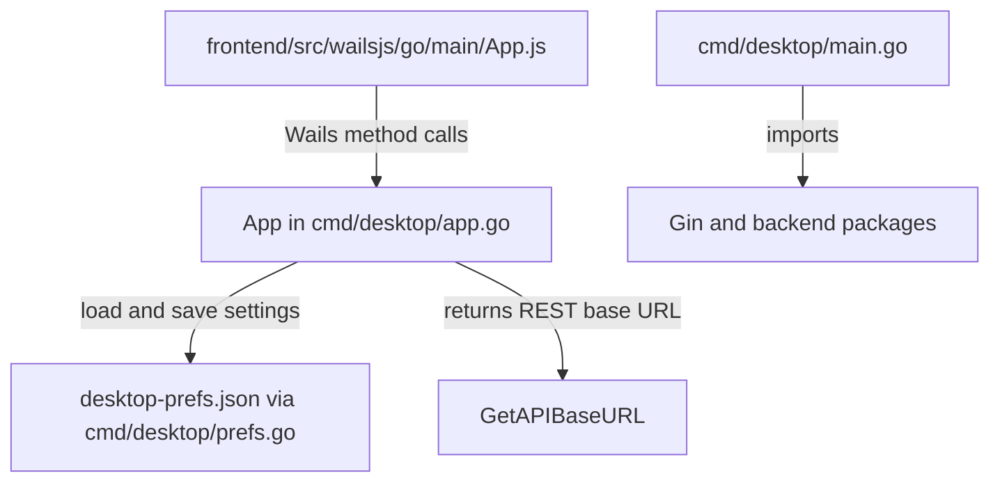
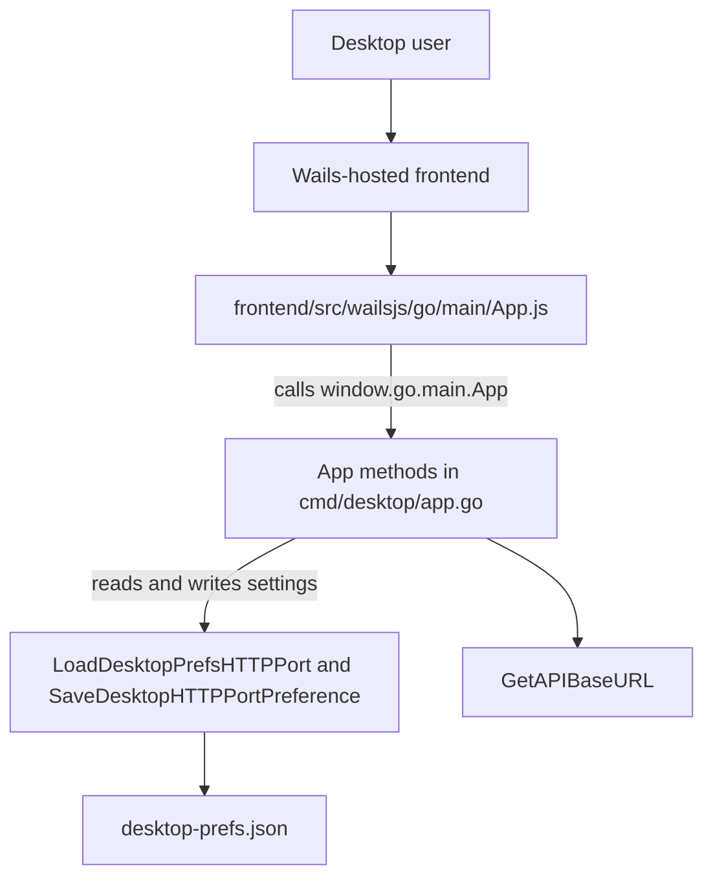
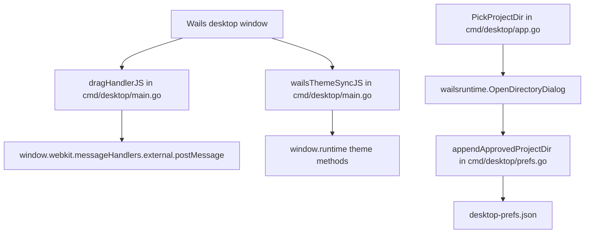

<!-- source: DeepWiki mcp.deepwiki.com · repo Tencent/WeKnora · page 11.8 Desktop Application (Wails) · fetched 2026-10-29 -->

# Desktop Application (Wails)

Relevant source files

The following files were used as context for generating this wiki page:

- [.air.toml](.air.toml)
- [cmd/desktop/app.go](cmd/desktop/app.go)
- [cmd/desktop/main.go](cmd/desktop/main.go)
- [cmd/desktop/prefs.go](cmd/desktop/prefs.go)
- [cmd/server/main.go](cmd/server/main.go)
- [docs/LITE.md](docs/LITE.md)
- [frontend/src/wailsjs/go/main/App.d.ts](frontend/src/wailsjs/go/main/App.d.ts)
- [frontend/src/wailsjs/go/main/App.js](frontend/src/wailsjs/go/main/App.js)
- [internal/common/redis_tls.go](internal/common/redis_tls.go)
- [internal/common/redis_tls_test.go](internal/common/redis_tls_test.go)
- [internal/middleware/recovery.go](internal/middleware/recovery.go)
- [internal/runtime/startup.go](internal/runtime/startup.go)
- [website-docs/01-getting-started/05-troubleshooting.md](website-docs/01-getting-started/05-troubleshooting.md)

## Purpose and scope

WeKnora’s desktop application is a Wails-based native shell for the Lite edition. This page documents the desktop interfaces and behavior evidenced by the supplied source: the Wails-bound `App`, its generated frontend bindings, local preferences, webview integrations, and Lite’s documented operating model. The available source excerpt does not include the remainder of `cmd/desktop/main.go` or release and packaging configuration, so it does not establish specific macOS installer steps or the build process for a single-binary distribution. [cmd/desktop/main.go:1-40]()[cmd/desktop/app.go:12-22]()[docs/LITE.md:1-16]()

Sources: `cmd/desktop/main.go:1-40`, `cmd/desktop/app.go:12-22`, `docs/LITE.md:1-16`

---

## Architecture Overview

The desktop shell uses Wails bindings to connect frontend code to Go methods on `App`. Separately, the desktop entry point imports Gin and the application’s configuration, container, handler, runtime, and stream packages. `App.GetAPIBaseURL` supplies the frontend with a local REST API base URL; the method’s comment clarifies that the webview’s `window.location.origin` is not the API host. [cmd/desktop/main.go:22-39]()[cmd/desktop/app.go:12-22]()[cmd/desktop/app.go:45-52]()

The source excerpt does not show the desktop entry point’s server startup or router wiring. The diagram therefore describes the evidenced Wails bridge, preference access, and API URL boundary without asserting unshown server internals. [cmd/desktop/main.go:1-40]()[cmd/desktop/app.go:45-72]()

### High-Level Component Interaction

- Generated frontend functions invoke methods on `window['go']['main']['App']`. [frontend/src/wailsjs/go/main/App.js:5-63]()
- `App` exposes the API base URL and desktop setting accessors to the Wails bridge. [cmd/desktop/app.go:45-80]()
- Desktop preferences are serialized to `desktop-prefs.json` under a configuration directory. [cmd/desktop/prefs.go:13-54]()[cmd/desktop/prefs.go:76-86]()

Sources: `frontend/src/wailsjs/go/main/App.js:5-63`, `cmd/desktop/app.go:45-80`, `cmd/desktop/prefs.go:13-54`, `cmd/desktop/prefs.go:76-86`, `cmd/desktop/main.go:22-39`

---

## Implementation Details

### Application Startup and Lifecycle

`cmd/desktop/main.go` is a Wails entry point: it imports Wails, its options and asset-server packages, macOS options, Gin, and backend packages. The available lines establish these dependencies but do not show the `main` function, Wails options, backend startup sequence, macOS bundle configuration, or shutdown wiring. [cmd/desktop/main.go:22-40]()

The visible `dragHandlerJS` is intended for injection into the webview on `DomReady`. It adds the `wails-desktop` class, disables overscroll and native drag-out, and detects draggable regions while excluding interactive elements. On macOS it sends a `drag` message through the WKWebView script-message bridge; it also includes a `WailsInvoke` fallback. External HTTP(S) links and `window.open` calls are routed to `window.runtime.BrowserOpenURL` when that runtime method is available. [cmd/desktop/main.go:42-176]()

The `wailsThemeSyncJS` snippet reads the `WeKnora_theme` local-storage value, resolves `system` using the system color preference, applies the theme to the document, and invokes Wails window theme and background-color methods when available. The supplied excerpt defines this script but does not show where it is registered or executed. [cmd/desktop/main.go:178-180]()

**Sources:** `cmd/desktop/main.go:22-40`, `cmd/desktop/main.go:42-176`, `cmd/desktop/main.go:178-180`

### The `App` Struct and IPC Bindings

`App` holds the Wails context, setup token, backend and LAN API URLs, public-listen state, shutdown channels, and an atomic directory-picker guard. `NewApp` creates the shutdown channels; `startup` stores the Wails context; `shutdown` signals shutdown and waits for completion. [cmd/desktop/app.go:12-43]()

The methods below form the desktop-facing API. Their generated JavaScript wrappers call `window['go']['main']['App'][method]`, and the TypeScript declarations describe the Promise-based return types. [frontend/src/wailsjs/go/main/App.js:5-63]()[frontend/src/wailsjs/go/main/App.d.ts:4-32]()

| Method | Role |
|---|---|
| `GetAPIBaseURL()` | Returns the backend URL with `/api/v1` appended, or an empty string when the backend URL is unset. [cmd/desktop/app.go:45-52]() |
| `GetDesktopHTTPPortSetting()` / `SetDesktopHTTPPortSetting(port)` | Read or persist the preferred local API port. [cmd/desktop/app.go:54-62]() |
| `GetDesktopHTTPBindPublicSetting()` / `SetDesktopHTTPBindPublicSetting(v)` | Read or persist whether the API should bind publicly. [cmd/desktop/app.go:64-72]() |
| `GetAPILanBaseURL()` / `GetDesktopListenPublicActive()` | Return the suggested LAN API URL and whether the current session is listening on all interfaces. [cmd/desktop/app.go:74-82]() |
| `CheckForUpdates()` / `AutoCheckForUpdates()` | Trigger manual or silent update-check behavior when the Wails context is set. [cmd/desktop/app.go:84-96]() |
| `GetAutoSetupToken()` | Exposes the per-process setup capability through the native bridge. [cmd/desktop/app.go:98-100]() |
| `GetApprovalMode()` / `SetApprovalMode(mode)` | Read or save the machine-local sandbox approval mode. [cmd/desktop/app.go:101-110]() |
| `GetProjectDirs()` / `RemoveProjectDir(dir)` | Read or remove user-approved project directories. [cmd/desktop/app.go:112-122]() |
| `PickProjectDir()` | Opens the native directory picker and appends the selected directory to the approved list; an atomic guard prevents multiple concurrent pickers. [cmd/desktop/app.go:124-141]() |

The generated wrapper and declaration files are marked as automatically generated and should be treated as bridge output rather than the implementation of the methods. [frontend/src/wailsjs/go/main/App.js:1-3]()[frontend/src/wailsjs/go/main/App.d.ts:1-2]()

**Sources:** `cmd/desktop/app.go:12-43`, `cmd/desktop/app.go:45-141`, `frontend/src/wailsjs/go/main/App.js:1-63`, `frontend/src/wailsjs/go/main/App.d.ts:1-33`

### Local Preferences and Project Directory Authorization

Preferences are stored as JSON in `desktop-prefs.json`. The preference structure includes `HTTPPort`, `HTTPBindPublic`, `ProjectDirs`, `ApprovalMode`, and `SessionRoot`. The preference directory is named `WeKnora Lite` beneath the user configuration directory; `XDG_CONFIG_HOME` is honored before `os.UserConfigDir()`. [cmd/desktop/prefs.go:13-54]()

Loading preferences returns zero-value settings if path lookup, file reading, or JSON decoding fails. Ports outside `0..65535` are reset to zero; port zero represents an ephemeral port on each launch. Saving preferences marshals indented JSON and writes the file with mode `0600`. [cmd/desktop/prefs.go:57-86]()[cmd/desktop/prefs.go:88-105]()

Project directory authorization is intentionally user-mediated: the UI’s native picker adds selected paths, and the agent is not allowed to widen its own directory access. The picker cleans and de-duplicates paths; removal is a no-op for empty or missing entries. [cmd/desktop/app.go:112-141]()[cmd/desktop/prefs.go:139-193]()

Approval-mode persistence checks the mode against `localsandbox.ApprovalMode`: unknown and known-but-unshipped modes are rejected rather than stored as if they were usable. [cmd/desktop/prefs.go:115-137]()

**Sources:** `cmd/desktop/prefs.go:13-54`, `cmd/desktop/prefs.go:57-105`, `cmd/desktop/prefs.go:115-193`, `cmd/desktop/app.go:101-141`

---

## Lite Mode vs. Standard Edition

The Lite documentation describes a single-space, local-first edition intended to minimize deployment complexity. Lite does not provide shared spaces or multi-space collaboration; its built-in parser is limited to the Simple engine, although other parsing capabilities may be connected through Cloud; and the documented deployment model does not depend on separate database or message-queue services. [docs/LITE.md:3-16]()

The desktop-specific preference code adds local settings for the API port and whether the API listens on all interfaces. The default public-bind preference is false because an unset JSON boolean is false; the actual listener setup is outside the supplied desktop source excerpt. [cmd/desktop/prefs.go:15-21]()[cmd/desktop/prefs.go:93-112]()

| Dimension | Lite | Standard edition |
|---|---|---|
| Collaboration | Single space; no shared spaces, member invitations, or cross-member sharing. [docs/LITE.md:6-9]() | Multi-space collaboration and shared-space capabilities. [docs/LITE.md:6-9]() |
| Document parsing | Built-in Simple parser; other capabilities can be connected through Cloud. [docs/LITE.md:10-10]() | Configurable parser engines, including higher-precision options. [docs/LITE.md:10-10]() |
| Deployment | Single application with no separate database or message-queue service dependency. [docs/LITE.md:11-11]() | Typically a multi-service deployment such as Docker Compose. [docs/LITE.md:11-11]() |
| Data and access | Data is stored and processed locally; access is local by default and can be configured. [docs/LITE.md:12-13]() | Data locality and network exposure depend on deployment and security configuration. [docs/LITE.md:12-13]() |
| Desktop API preferences | The desktop shell exposes port and public-bind preference methods. [cmd/desktop/app.go:54-72]() | Not described by the Lite comparison. [docs/LITE.md:6-16]() |

The supplied Lite comparison documents local storage and zero-dependency deployment, but it does not identify the database filename or establish that the desktop distribution uses a particular SQLite database file. [docs/LITE.md:6-13]()

**Sources:** `docs/LITE.md:3-16`, `cmd/desktop/app.go:54-72`, `cmd/desktop/prefs.go:15-21`, `cmd/desktop/prefs.go:93-112`

---

## Packaging and Distribution

The available source establishes that the desktop entry point depends on Wails and imports Wails’ macOS options package. The excerpt does not include Wails build options, macOS bundle metadata, installer scripts, release workflows, or a single-binary packaging definition. Consequently, specific macOS packaging commands and single-binary release artifacts cannot be documented from the supplied files. [cmd/desktop/main.go:22-29]()

Lite’s documented deployment model is a single application with no external database or message-queue service stack. This describes the deployment footprint, not the binary layout or release packaging mechanism. [docs/LITE.md:3-13]()

**Sources:** `cmd/desktop/main.go:22-29`, `docs/LITE.md:3-13`

---

## Natural Language Space to Code Entity Space Mappings

### Diagram 1: Desktop UI, Bridge, and Local Settings

This mapping connects the desktop UI and its Wails-generated bridge to the Go `App` methods and the JSON preference helpers. [frontend/src/wailsjs/go/main/App.js:5-63]()[cmd/desktop/app.go:45-72]()[cmd/desktop/prefs.go:13-21]()[cmd/desktop/prefs.go:88-112]()

Sources: `frontend/src/wailsjs/go/main/App.js:5-63`, `cmd/desktop/app.go:45-72`, `cmd/desktop/prefs.go:13-21`, `cmd/desktop/prefs.go:88-112`

### Diagram 2: Native Webview Behaviors and Directory Approval

`dragHandlerJS` sends the drag message through the WKWebView bridge, while `wailsThemeSyncJS` calls runtime theme methods when present. The native project picker passes its selected directory to `appendApprovedProjectDir`, which persists the approved directory list through the preferences helpers. [cmd/desktop/main.go:42-93]()[cmd/desktop/main.go:178-180]()[cmd/desktop/app.go:124-141]()[cmd/desktop/prefs.go:158-176]()

Sources: `cmd/desktop/main.go:42-93`, `cmd/desktop/main.go:178-180`, `cmd/desktop/app.go:124-141`, `cmd/desktop/prefs.go:158-176`

---

