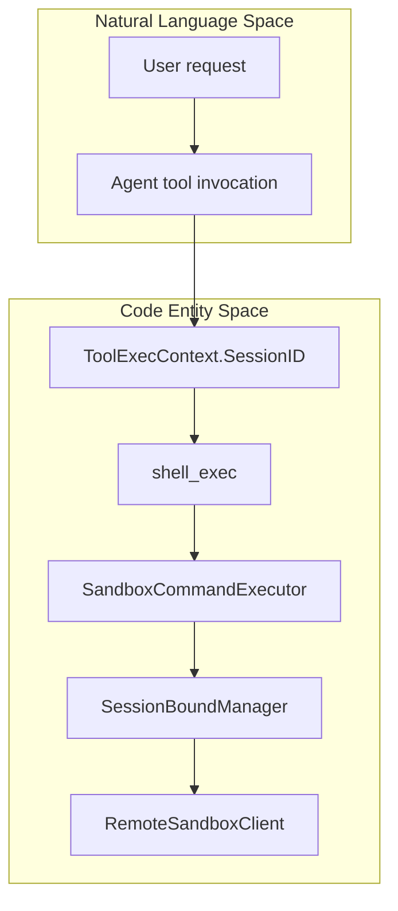
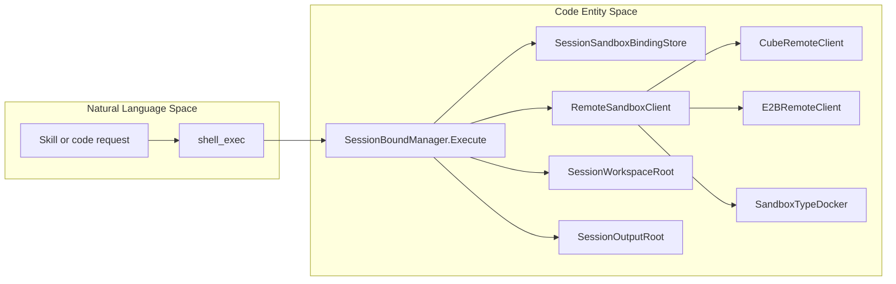

<!-- source: DeepWiki mcp.deepwiki.com · repo Tencent/WeKnora · page 11.9 Skills and Sandbox Execution · fetched 2026-10-29 -->

# Skills and Sandbox Execution

Relevant source files

The following files were used as context for generating this wiki page:

- [internal/agent/tools/shell_exec.go](internal/agent/tools/shell_exec.go)
- [internal/agent/tools/shell_exec_test.go](internal/agent/tools/shell_exec_test.go)
- [internal/application/service/sandboxalloc/service_test.go](internal/application/service/sandboxalloc/service_test.go)
- [internal/sandbox/cube_remote_client.go](internal/sandbox/cube_remote_client.go)
- [internal/sandbox/cube_template_catalog_test.go](internal/sandbox/cube_template_catalog_test.go)
- [internal/sandbox/e2b_remote_client.go](internal/sandbox/e2b_remote_client.go)
- [internal/sandbox/e2b_remote_client_test.go](internal/sandbox/e2b_remote_client_test.go)
- [internal/sandbox/remote_client.go](internal/sandbox/remote_client.go)
- [internal/sandbox/remote_fake_test.go](internal/sandbox/remote_fake_test.go)
- [internal/sandbox/sandbox.go](internal/sandbox/sandbox.go)
- [internal/sandbox/session_input_rebind_test.go](internal/sandbox/session_input_rebind_test.go)
- [internal/sandbox/session_lifecycle.go](internal/sandbox/session_lifecycle.go)
- [internal/sandbox/session_lifecycle_test.go](internal/sandbox/session_lifecycle_test.go)
- [internal/sandbox/session_manager.go](internal/sandbox/session_manager.go)
- [internal/sandbox/session_manager_test.go](internal/sandbox/session_manager_test.go)
- [internal/sandbox/template_catalog.go](internal/sandbox/template_catalog.go)
- [internal/sandbox/tenant_config.go](internal/sandbox/tenant_config.go)
- [internal/sandbox/tenant_config_test.go](internal/sandbox/tenant_config_test.go)
- [internal/types/config_redaction.go](internal/types/config_redaction.go)
- [internal/types/config_redaction_sandbox_test.go](internal/types/config_redaction_sandbox_test.go)
- [internal/types/config_redaction_test.go](internal/types/config_redaction_test.go)

## Purpose and scope

This page introduces how WeKnora connects skills and agent-driven code execution to sandbox runtimes. It covers the subsystem’s main boundaries: tenant sandbox configuration, session-bound execution environments, skill-related workspace paths, and agent tools. Detailed implementation guidance is in the child pages linked below. [internal/sandbox/session_manager.go:1-23](), [internal/agent/tools/shell_exec.go:1-21]()

Sources: [internal/sandbox/session_manager.go:1-23](), [internal/agent/tools/shell_exec.go:1-21]()

---

## Sandbox Runtimes and Configuration

The sandbox package defines Docker, Cube, E2B, host, and disabled modes. Docker, Cube, and E2B are named session-scoped backends; Cube and E2B use provider adapters behind a provider-neutral remote client contract. [internal/sandbox/sandbox.go:12-48](), [internal/sandbox/remote_client.go:1-12](), [internal/sandbox/cube_remote_client.go:25-28](), [internal/sandbox/e2b_remote_client.go:25-27]()

For remote execution, `SessionBoundManager` coordinates a session-to-sandbox binding and delegates provider-specific operations. A non-empty session ID resolves a persistent sandbox; an empty session ID uses a stateless sandbox that is torn down after execution. Tenant sandbox settings are resolved into an effective configuration, including provider selection and network policy. [internal/sandbox/session_manager.go:1-23](), [internal/sandbox/tenant_config.go:31-73]()

For details on backends, lifecycle, template catalogs, idle sweeping, and tenant policies, see [Sandbox Runtimes and Configuration](#11.9.1).

Sources: [internal/sandbox/sandbox.go:12-48](), [internal/sandbox/remote_client.go:1-12](), [internal/sandbox/session_manager.go:1-23](), [internal/sandbox/tenant_config.go:31-73]()

---

## Tenant Skill Catalog and Installation

The sandbox and configuration code exposes integration points for skills without defining the full tenant catalog or installation flow in the files shown here. For example, tenant configuration can select a skill image as a runtime template override, and the session manager defines workspace paths used for session inputs and skill outputs. [internal/sandbox/tenant_config.go:138-157](), [internal/sandbox/session_manager.go:48-69]()

For skill sources, installation, bundle verification, environment declarations, cleanup, and UI details, see [Tenant Skill Catalog and Installation](#11.9.2).

Sources: [internal/sandbox/tenant_config.go:138-157](), [internal/sandbox/session_manager.go:48-69]()

---

## Sandbox Tools and Artifacts

The agent’s `shell_exec` tool is a session-scoped command execution interface. It resolves the sandbox from the tool execution context’s session ID; the tool is registered when the backend exposes `SandboxCommandExecutor`. The tool applies command and output limits and rejects selected destructive command shapes, while treating a non-zero process exit as a result the agent can inspect. [internal/agent/tools/shell_exec.go:3-32](), [internal/agent/tools/shell_exec.go:53-67](), [internal/agent/tools/shell_exec.go:69-124]()

The session manager distinguishes durable inputs from generated outputs: `SessionInputRoot` is for restored user attachments, while `SessionOutputRoot` is where skill scripts write artifacts. Both paths are made available to sandbox commands through environment variables. [internal/sandbox/session_manager.go:48-69]()

For shell, file, analysis, database-query, authorization, and artifact-collection details, see [Sandbox Tools and Artifacts](#11.9.3).

Sources: [internal/agent/tools/shell_exec.go:3-32](), [internal/agent/tools/shell_exec.go:53-67](), [internal/agent/tools/shell_exec.go:69-124](), [internal/sandbox/session_manager.go:48-69]()

---

## System Interaction and Flow Overview

### Natural-language requests mapped to code entities

The code-level bridge shown here is the session ID: `shell_exec` uses the tool context’s session to reach a session-aware executor, while `SessionBoundManager` delegates remote-provider work through `RemoteSandboxClient`. [internal/agent/tools/shell_exec.go:10-17](), [internal/agent/tools/shell_exec.go:53-67](), [internal/sandbox/session_manager.go:96-109](), [internal/sandbox/remote_client.go:1-12]()

Sources: [internal/agent/tools/shell_exec.go:10-17](), [internal/agent/tools/shell_exec.go:53-67](), [internal/sandbox/session_manager.go:96-109](), [internal/sandbox/remote_client.go:1-12]()

### Session execution and runtime adapter mapping

The diagram associates a user-facing skill or code request with the concrete execution and runtime entities. `SessionBoundManager` owns the mapping between application-level execution and remote clients; the session manager also defines workspace, input, and output roots used by the execution environment. [internal/sandbox/session_manager.go:48-69](), [internal/sandbox/session_manager.go:96-109](), [internal/sandbox/sandbox.go:12-36](), [internal/sandbox/remote_client.go:1-12]()

Sources: [internal/sandbox/session_manager.go:48-69](), [internal/sandbox/session_manager.go:96-109](), [internal/sandbox/sandbox.go:12-36](), [internal/sandbox/remote_client.go:1-12]()

---

## Key Code Entities and Relationships

| Code entity | Role in the subsystem |
|---|---|
| `SessionBoundManager` | Binds remote sandboxes to tenant sessions and maps execution requests to the provider-neutral client. [internal/sandbox/session_manager.go:96-109]() |
| `RemoteSandboxClient` | Provider-neutral contract used by the session manager; adapters implement provider-specific operations. [internal/sandbox/remote_client.go:1-12]() |
| `CubeRemoteClient` | Cube adapter implementing the remote client contract. [internal/sandbox/cube_remote_client.go:1-7](), [internal/sandbox/cube_remote_client.go:25-28]() |
| `E2BRemoteClient` | E2B adapter implementing the remote client contract. [internal/sandbox/e2b_remote_client.go:1-5](), [internal/sandbox/e2b_remote_client.go:25-27]() |
| `SandboxCommandExecutor` | Narrow command-execution interface consumed by agent tools. [internal/agent/tools/shell_exec.go:53-67]() |
| `shell_exec` | Agent tool for executing commands in the session’s sandbox. [internal/agent/tools/shell_exec.go:1-6](), [internal/agent/tools/shell_exec.go:126-132]() |

Sources: [internal/sandbox/session_manager.go:96-109](), [internal/sandbox/remote_client.go:1-12](), [internal/sandbox/cube_remote_client.go:1-7](), [internal/sandbox/cube_remote_client.go:25-28](), [internal/sandbox/e2b_remote_client.go:1-5](), [internal/sandbox/e2b_remote_client.go:25-27](), [internal/agent/tools/shell_exec.go:1-6](), [internal/agent/tools/shell_exec.go:53-67](), [internal/agent/tools/shell_exec.go:126-132]()

---

## Summary

The subsystem connects agent tools to session-aware sandbox execution through a provider-neutral manager and runtime contract. Tenant skill configuration and sandbox execution meet at runtime selection and workspace paths; the child pages cover the catalog, runtime lifecycle, and tool/artifact behavior in detail. [internal/sandbox/session_manager.go:1-23](), [internal/sandbox/tenant_config.go:138-157](), [internal/agent/tools/shell_exec.go:10-17]()

- [Sandbox Runtimes and Configuration](#11.9.1) — Runtime backends, lifecycle, templates, sweeping, and tenant policies.
- [Tenant Skill Catalog and Installation](#11.9.2) — Skill sources, installation, verification, cleanup, and UI.
- [Sandbox Tools and Artifacts](#11.9.3) — Execution tools, authorization, and artifact collection.

Sources: [internal/sandbox/session_manager.go:1-23](), [internal/sandbox/tenant_config.go:138-157](), [internal/agent/tools/shell_exec.go:10-17]()

---

