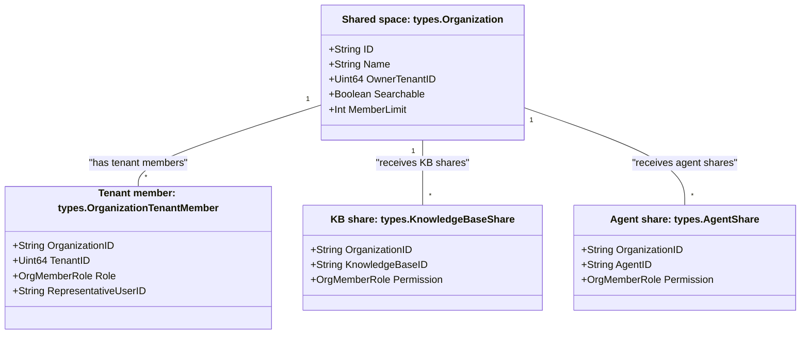
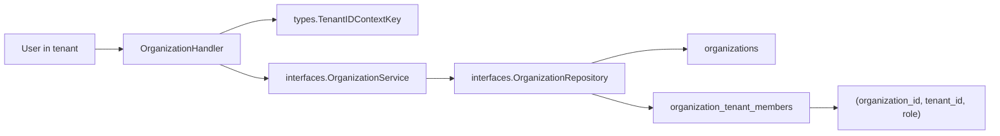
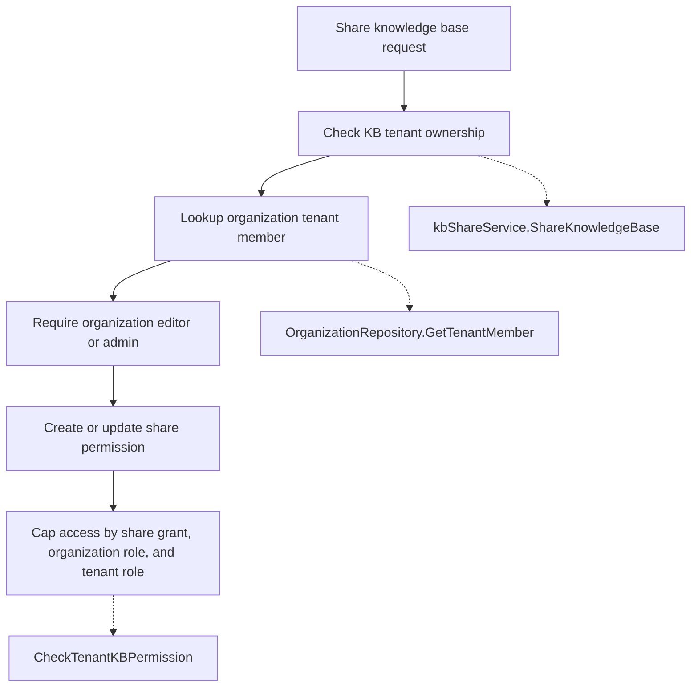

<!-- source: DeepWiki mcp.deepwiki.com · repo Tencent/WeKnora · page 12 Organization and Collaboration · fetched 2026-10-29 -->

# Organization and Collaboration

Relevant source files

The following files were used as context for generating this wiki page:

- [frontend/src/api/organization/index.ts](frontend/src/api/organization/index.ts)
- [frontend/src/views/organization/OrganizationSettingsModal.vue](frontend/src/views/organization/OrganizationSettingsModal.vue)
- [internal/application/repository/agent_share.go](internal/application/repository/agent_share.go)
- [internal/application/repository/kbshare.go](internal/application/repository/kbshare.go)
- [internal/application/repository/organization.go](internal/application/repository/organization.go)
- [internal/application/service/agent_rerank_requirement_test.go](internal/application/service/agent_rerank_requirement_test.go)
- [internal/application/service/agent_share.go](internal/application/service/agent_share.go)
- [internal/application/service/kbshare.go](internal/application/service/kbshare.go)
- [internal/application/service/organization.go](internal/application/service/organization.go)
- [internal/handler/organization.go](internal/handler/organization.go)
- [internal/types/interfaces/organization.go](internal/types/interfaces/organization.go)
- [internal/types/organization.go](internal/types/organization.go)

This page gives a high-level overview of WeKnora’s multi-tenant collaboration features: organizations as shared spaces, tenant membership, and cross-organization resource sharing. In the codebase, organization membership is keyed by tenant, with a representative user retained for display and audit purposes. [internal/types/organization.go:109-127]()

For general system architecture and multi-tenancy design, see [Security and Multi-Tenancy](#3.5). For detailed information on organization creation, membership, invitations, and roles, see [Organization Management](#12.1). For details on sharing knowledge bases and agents across organizations, see [Resource Sharing](#12.2).

Sources: [internal/types/organization.go:109-127]()

---

## Core Concepts

### Tenants and Organizations

An organization is a collaboration space represented by `types.Organization`; tenant participation is recorded in `types.OrganizationTenantMember`. A membership row identifies a tenant and its organization role. `RepresentativeUserID` is informational—it does not determine permissions. [internal/types/organization.go:60-78]()[internal/types/organization.go:109-127]()

The service creates an organization with its creator’s tenant enrolled as an administrator. The API handler reads the caller’s tenant ID from request context and passes it to the organization service. [internal/application/service/organization.go:77-80]()[internal/application/service/organization.go:121-145]()[internal/handler/organization.go:73-101]()

Sources: [internal/types/organization.go:60-78](), [internal/types/organization.go:109-127](), [internal/application/service/organization.go:77-80](), [internal/application/service/organization.go:121-145](), [internal/handler/organization.go:73-101]()

### Permission Roles

Organization roles are `admin`, `editor`, and `viewer`, ordered by permission level. Shared-resource access can be further limited by the resource’s share permission and the caller’s tenant-level role; for knowledge bases, the service documents this as an effective permission cap. [internal/types/organization.go:9-19]()[internal/application/service/kbshare.go:25-36]()

For role assignment, invitations, and permission-model details, see [Organization Management](#12.1). For resource-specific access behavior, see [Resource Sharing](#12.2).

Sources: [internal/types/organization.go:9-19](), [internal/application/service/kbshare.go:25-36]()

---

## Architecture and Data Models

### Bridging Shared Spaces to Code Entities

The natural-language concept of a “shared space” maps to organization and tenant-membership entities. Resource sharing is represented separately, allowing a space to include knowledge bases and agents shared by participating tenants. The model defines organization metadata and tenant membership; the handler is wired to organization, KB-share, and agent-share services. [internal/types/organization.go:60-102]()[internal/types/organization.go:109-131]()[internal/handler/organization.go:20-35]()

**Diagram: Shared Space Concepts and Code Entities**

Sources: [internal/types/organization.go:60-102](), [internal/types/organization.go:109-131](), [internal/handler/organization.go:20-35]()

### Request and Service Boundary

The organization handler obtains the caller’s tenant ID from request context and delegates organization operations to services. The repository persists organization records and lists organizations by joining against `organization_tenant_members`. [internal/handler/organization.go:73-101]()[internal/application/repository/organization.go:38-52]()[internal/application/repository/organization.go:70-84]()

**Diagram: Shared-Space Request Path**

Sources: [internal/handler/organization.go:20-35](), [internal/handler/organization.go:73-101](), [internal/application/repository/organization.go:23-40](), [internal/application/repository/organization.go:70-84](), [internal/types/organization.go:109-131]()

---

## Permission Resolution Flow

For shared knowledge bases, the service requires the caller’s tenant to own the KB and to hold at least the organization editor role to create a share. Effective access is constrained by the share grant, organization role, and tenant-role cap. [internal/application/service/kbshare.go:76-108]()[internal/application/service/kbshare.go:27-36]()

**Diagram: Knowledge-Base Sharing Gate**

Sources: [internal/application/service/kbshare.go:76-108](), [internal/application/service/kbshare.go:27-36](), [internal/types/interfaces/organization.go:69-77]()

For the full organization membership, invitation, and role-management flows, see [Organization Management](#12.1). For resource-specific permission checks and sharing workflows, see [Resource Sharing](#12.2).

Sources: [internal/application/service/kbshare.go:27-36](), [internal/application/service/kbshare.go:76-108](), [internal/types/interfaces/organization.go:69-77]()

---

## Resource Sharing Overview

Knowledge-base and agent sharing use separate services and share records. The knowledge-base service checks that the caller’s tenant owns the KB and has editor-or-higher organization membership before sharing. Agent sharing has its own service and includes handling for agent configuration and receiver-facing views. [internal/application/service/kbshare.go:76-120]()[internal/application/service/agent_share.go:17-30]()[internal/application/service/agent_share.go:89-115]()

The repositories associate shares with organizations and source tenants; their listing logic joins against organization tenant membership. This connects resource visibility to the organization’s membership state. [internal/application/repository/kbshare.go:106-145]()[internal/application/repository/agent_share.go:101-136]()

For sharing mechanics, access controls, and shared-space UI details, see [Resource Sharing](#12.2).

Sources: [internal/application/service/kbshare.go:76-120](), [internal/application/service/agent_share.go:17-30](), [internal/application/service/agent_share.go:89-115](), [internal/application/repository/kbshare.go:106-145](), [internal/application/repository/agent_share.go:101-136]()

---

## Summary and Child Pages

Organization collaboration connects tenant membership and roles with resource-specific sharing. Organization management defines who participates in a space and what role each tenant has; resource sharing determines which knowledge bases and agents are available through that space. [internal/types/organization.go:109-127]()[internal/application/service/kbshare.go:27-36]()

- **[Organization Management](#12.1)** — Organization creation, tenant membership, invitations, role assignment, and permission models.
- **[Resource Sharing](#12.2)** — Sharing knowledge bases and agents across organizations, access control, and shared-space UI.

Sources: [internal/types/organization.go:109-127](), [internal/application/service/kbshare.go:27-36]()

---

