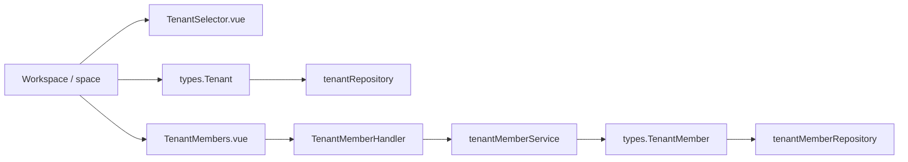
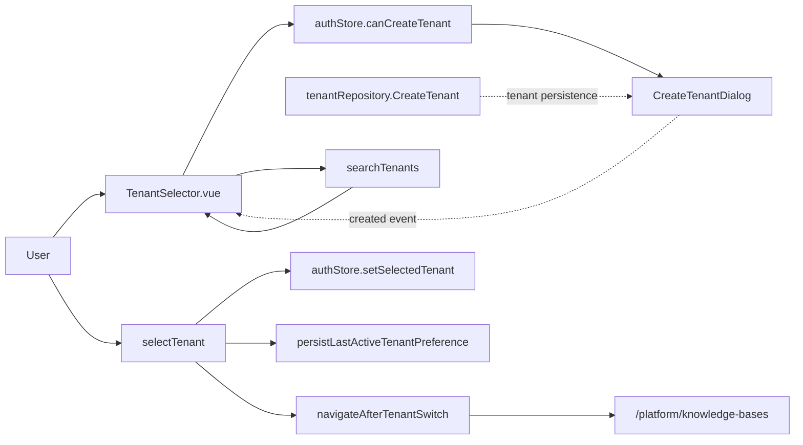
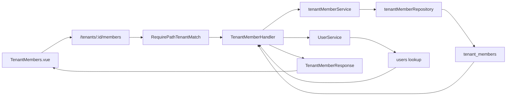
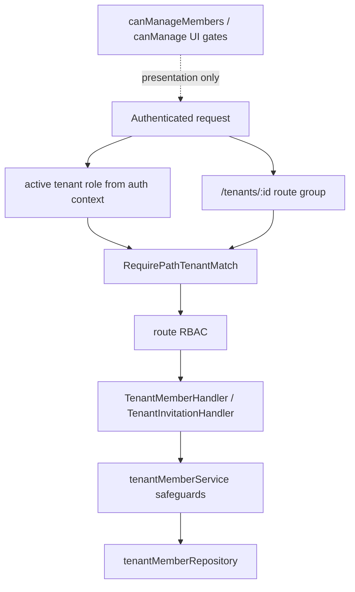

<!-- source: DeepWiki mcp.deepwiki.com · repo Tencent/WeKnora · page 12.1 Organization Management · fetched 2026-10-29 -->

# Organization Management

Relevant source files

The following files were used as context for generating this wiki page:

- [frontend/src/api/tenant/invitations.ts](frontend/src/api/tenant/invitations.ts)
- [frontend/src/api/tenant/members.ts](frontend/src/api/tenant/members.ts)
- [frontend/src/components/TenantSelector.vue](frontend/src/components/TenantSelector.vue)
- [frontend/src/components/UserMenu.vue](frontend/src/components/UserMenu.vue)
- [frontend/src/utils/tenantSwitch.ts](frontend/src/utils/tenantSwitch.ts)
- [frontend/src/views/settings/Settings.vue](frontend/src/views/settings/Settings.vue)
- [frontend/src/views/settings/TenantInfo.vue](frontend/src/views/settings/TenantInfo.vue)
- [frontend/src/views/settings/TenantMembers.vue](frontend/src/views/settings/TenantMembers.vue)
- [frontend/src/views/settings/settingsNavigation.test.ts](frontend/src/views/settings/settingsNavigation.test.ts)
- [internal/application/repository/tenant.go](internal/application/repository/tenant.go)
- [internal/application/repository/tenant_member.go](internal/application/repository/tenant_member.go)
- [internal/application/repository/tenant_test.go](internal/application/repository/tenant_test.go)
- [internal/application/service/tenant_invitation.go](internal/application/service/tenant_invitation.go)
- [internal/application/service/tenant_invitation_test.go](internal/application/service/tenant_invitation_test.go)
- [internal/application/service/tenant_member.go](internal/application/service/tenant_member.go)
- [internal/application/service/tenant_member_test.go](internal/application/service/tenant_member_test.go)
- [internal/application/service/user_provisioning_test.go](internal/application/service/user_provisioning_test.go)
- [internal/handler/tenant_invitation.go](internal/handler/tenant_invitation.go)
- [internal/handler/tenant_invitation_auto_accept_test.go](internal/handler/tenant_invitation_auto_accept_test.go)
- [internal/handler/tenant_invite_link.go](internal/handler/tenant_invite_link.go)
- [internal/handler/tenant_member.go](internal/handler/tenant_member.go)
- [internal/handler/tenant_member_test.go](internal/handler/tenant_member_test.go)
- [internal/middleware/access.go](internal/middleware/access.go)
- [internal/middleware/access_test.go](internal/middleware/access_test.go)
- [internal/types/interfaces/tenant_invitation_service.go](internal/types/interfaces/tenant_invitation_service.go)
- [internal/types/interfaces/tenant_member.go](internal/types/interfaces/tenant_member.go)
- [internal/utils/crypto_test.go](internal/utils/crypto_test.go)

**Purpose:** Document how WeKnora workspaces (tenants) are created and selected, how tenant members and invitations are managed, and where authorization is enforced.  
**Scope:** Covers tenant creation entry points, membership listing and changes, email and share-link invitations, role assignment, and tenant-scoped access checks. It does not cover sharing knowledge bases or agents between organizations; see **12.2 Resource Sharing**.

Sources: [frontend/src/components/TenantSelector.vue:56-69](), [internal/handler/tenant_member.go:21-34](), [internal/handler/tenant_invitation.go:22-26]()

---

## Tenant and Organization Terminology

In the management flows documented here, the backend entity is a **tenant**, and the frontend often presents it as a workspace or space. Membership and the active authorization context are tenant-scoped. The provided code does not establish a separate `Organization` entity or an organization-level membership model; the member and invitation handlers operate on tenant IDs and tenant-member records. [internal/handler/tenant_member.go:21-34](), [internal/handler/tenant_invitation.go:22-34]()

A user can choose an active tenant from the frontend selector. The selector derives the current tenant from the selected tenant ID, falling back to the user's default tenant ID, and uses the active tenant name in its display. [frontend/src/components/TenantSelector.vue:104-127]()

| Product concept | Code entity or component | Responsibility |
|---|---|---|
| Workspace / tenant | `types.Tenant` | Tenant record persisted by `tenantRepository`. [internal/application/repository/tenant.go:19-32]() |
| Tenant membership | `types.TenantMember` | Membership record read and written through the tenant-member repository. [internal/application/repository/tenant_member.go:29-49]() |
| Tenant role | `types.TenantRole` | Role carried by membership and invitation requests; the member service validates role values. [internal/application/service/tenant_member.go:42-68](), [internal/application/service/tenant_member.go:153-168]() |
| Email invitation | `types.TenantInvitation` | Invitation lifecycle managed by the tenant invitation handler and service. [internal/handler/tenant_invitation.go:22-34](), [internal/handler/tenant_invitation.go:59-67]() |
| Active tenant selector | `TenantSelector.vue` | Loads and selects tenants, and exposes tenant creation when `authStore.canCreateTenant` is true. [frontend/src/components/TenantSelector.vue:25-68]() |

Sources: [frontend/src/components/TenantSelector.vue:104-127](), [internal/application/repository/tenant.go:19-32](), [internal/application/repository/tenant_member.go:29-49](), [internal/application/service/tenant_member.go:42-68](), [internal/handler/tenant_invitation.go:22-34]()

### Natural-Language Concepts Mapped to Code

This diagram maps product language to searchable frontend and backend symbols. The available code identifies `Tenant` and tenant membership—not a separate organization model. [frontend/src/components/TenantSelector.vue:56-68](), [internal/application/repository/tenant.go:19-32](), [internal/application/repository/tenant_member.go:29-49]()

**Diagram: Workspace concepts and implementation symbols**

Sources: [frontend/src/components/TenantSelector.vue:56-68](), [frontend/src/views/settings/TenantMembers.vue:1-42](), [internal/handler/tenant_member.go:21-53](), [internal/application/service/tenant_member.go:76-109](), [internal/application/repository/tenant.go:19-32](), [internal/application/repository/tenant_member.go:29-49]()

---

## Tenant Creation and Switching

### Creation entry point

`TenantSelector.vue` renders the create-workspace action only when `authStore.canCreateTenant` is true. Selecting it opens the shared `CreateTenantDialog`; after creation, the component handles the `created` event. This identifies the UI gate and dialog wiring, but the provided excerpts do not show the dialog submission API or the backend tenant-creation handler. [frontend/src/components/TenantSelector.vue:56-69]()

At the persistence layer, `tenantRepository.CreateTenant` inserts a `types.Tenant` using the request context. The provided repository excerpt does not show what service or handler calls this method, nor how a newly created tenant is assigned an initial member. [internal/application/repository/tenant.go:19-32]()

### Tenant selection

When opened, `TenantSelector.vue` loads tenant results and supports searching and pagination. Each result is selectable; the current tenant is computed from the selected tenant ID or, if none is selected, the user's default tenant ID. [frontend/src/components/TenantSelector.vue:25-45](), [frontend/src/components/TenantSelector.vue:97-135]()

After selecting a tenant, the component stores the selected tenant and closes the dropdown. The shared `navigateAfterTenantSwitch` helper performs a full-page navigation to `/platform/knowledge-bases`; `persistLastActiveTenantPreference` updates the user preference through `updateMyPreferences`. [frontend/src/components/TenantSelector.vue:167-186](), [frontend/src/utils/tenantSwitch.ts:11-26](), [frontend/src/utils/tenantSwitch.ts:68-99]()

**Diagram: Tenant creation and switching code path**

The dotted connection from `CreateTenantDialog` to `tenantRepository.CreateTenant` is conceptual only: the provided excerpts show the dialog’s UI wiring and the repository method, but do not show a call chain connecting them. [frontend/src/components/TenantSelector.vue:56-69](), [frontend/src/components/TenantSelector.vue:72-83](), [frontend/src/components/TenantSelector.vue:167-186](), [frontend/src/utils/tenantSwitch.ts:11-26](), [frontend/src/utils/tenantSwitch.ts:68-99](), [internal/application/repository/tenant.go:19-32]()

Sources: [frontend/src/components/TenantSelector.vue:25-69](), [frontend/src/components/TenantSelector.vue:97-135](), [frontend/src/components/TenantSelector.vue:167-186](), [frontend/src/utils/tenantSwitch.ts:11-26](), [frontend/src/utils/tenantSwitch.ts:68-99](), [internal/application/repository/tenant.go:19-32]()

---

## Tenant Members and Roles

### Membership listing

`TenantMemberHandler.ListMembers` parses the tenant ID from the route, reads the optional `q` filter and pagination parameters, and delegates to `memberService.ListMembersPage`. It then batch-loads user records with `userService.GetUsersByIDs` and returns member fields such as user ID, role, status, inviter, and join time. If the batch user lookup fails, it still returns the membership rows without the user-facing fields. [internal/handler/tenant_member.go:88-162]()

At the repository layer, `ListPagedByTenant` filters by tenant ID, orders by join time and membership ID, and applies offset and limit. When a search term is supplied, it joins `users` and filters against email or username. `CountFilteredByTenant` applies the corresponding count query. [internal/application/repository/tenant_member.go:96-147]()

The frontend member screen displays a permission-matrix popover and conditionally renders member-management controls. Its visible invite form accepts an email and a role; the provided excerpt does not expose the full role matrix values or all member-list actions. [frontend/src/views/settings/TenantMembers.vue:3-36](), [frontend/src/views/settings/TenantMembers.vue:38-68]()

### Role assignment and invariants

The member service validates a requested role with `role.IsValid()` before adding a member. It rejects attempts by an API-key principal to assign the Owner role, and defines an `ErrLastOwner` condition for operations that would leave a tenant without an active Owner. [internal/application/service/tenant_member.go:42-68](), [internal/application/service/tenant_member.go:138-168]()

The repository provides `UpdateRole` for active membership records. Its owner-demotion and owner-removal helpers are designed to preserve the last-active-owner invariant atomically; the repository excerpt explains the locking approach for demotion. [internal/application/repository/tenant_member.go:150-165](), [internal/application/repository/tenant_member.go:176-190]()

`TenantMembers.vue` exposes the role selector in the invitation form, and `UserMenu.vue` only shows the member-management shortcut when `canManageMembers` is true. These are UI gates; the handler comments identify route-level RBAC as the server-side enforcement point. [frontend/src/views/settings/TenantMembers.vue:59-68](), [frontend/src/components/UserMenu.vue:99-108](), [internal/handler/tenant_member.go:21-34]()

### Direct addition versus invitations

The backend supports two distinct paths:

- `POST /tenants/:id/members` is the direct-add path. `TenantMemberHandler.AddMember` resolves the supplied email to an existing user and creates an active membership. The handler documents this path for automation, cross-tenant superuser orchestration, and external identity-provider synchronization; it also notes that the user must already have an account. [internal/handler/tenant_member.go:55-63](), [internal/handler/tenant_member.go:165-193]()
- `POST /tenants/:id/invitations` creates an invitation workflow rather than immediately adding a member. The request includes an email, role, and optional message. Tenant-scoped invitation mutations are Owner-gated at the route layer, while invitation inbox routes require authentication and the service checks that only the invitee acts. [internal/handler/tenant_invitation.go:22-26](), [internal/handler/tenant_invitation.go:59-67]()

The member-list screen includes an email-and-role invitation form and a separate share-link flow. Both controls are gated by `canManage`. [frontend/src/views/settings/TenantMembers.vue:38-68](), [frontend/src/views/settings/TenantMembers.vue:90-119]()

**Diagram: Member listing and role mutation code path**

The handler documents `RequirePathTenantMatch` as the route-group check that ensures the URL tenant ID matches the active tenant, except for the cross-tenant superuser bypass. It delegates list behavior to `ListMembersPage`, then hydrates user-facing fields in a batch. [internal/handler/tenant_member.go:21-34](), [internal/handler/tenant_member.go:100-162]()

Sources: [frontend/src/views/settings/TenantMembers.vue:3-68](), [frontend/src/views/settings/TenantMembers.vue:90-119](), [frontend/src/components/UserMenu.vue:99-108](), [internal/handler/tenant_member.go:21-34](), [internal/handler/tenant_member.go:88-162](), [internal/handler/tenant_member.go:165-193](), [internal/application/service/tenant_member.go:42-68](), [internal/application/service/tenant_member.go:138-168](), [internal/application/repository/tenant_member.go:96-147](), [internal/application/repository/tenant_member.go:150-190]()

---

## Invitations and Share Links

### Invitation management

`TenantInvitationHandler` handles tenant-scoped invitation operations and the authenticated user’s `/me/invitations` inbox. Its request type requires an email and role and permits an optional message. Invitation responses project fields such as tenant ID, invitee ID, inviter, role, status, message, expiration and response timestamps; share-link invitations are marked by an empty invitee user ID. [internal/handler/tenant_invitation.go:22-34](), [internal/handler/tenant_invitation.go:59-67](), [internal/handler/tenant_invitation.go:84-126]()

For invitation lists, the handler batches user lookups for invitees and inviters. Tenant names can also be hydrated for inbox views. Missing or failed hydration degrades to reduced identifying information rather than dropping the invitation response. [internal/handler/tenant_invitation.go:84-93](), [internal/handler/tenant_invitation.go:149-180]()

The handler’s route-level authorization comments distinguish tenant-scoped operations from inbox actions: tenant invitation creation and deletion are Owner-gated, listing is Viewer-gated, and inbox routes require authentication with invitee authorization enforced by the service. [internal/handler/tenant_invitation.go:22-26]()

### Share-link invitations

`TenantMembers.vue` presents a share-link generator alongside email invitations and allows the inviter to select a role. It describes the email path as the case where the inviter knows the recipient and the link path as the case where the inviter wants to distribute a link. [frontend/src/views/settings/TenantMembers.vue:90-119]()

On the backend, `projectInvitation` marks an invitation as a share link when `InviteeUserID` is empty. `projectInvitationWithLink` adds an `InviteURL` for pending invitations that have a token. The handler documents that the management view uses this projection for copy-link behavior, while the per-user inbox does not expose a token to copy. [internal/handler/tenant_invitation.go:84-93](), [internal/handler/tenant_invitation.go:129-147]()

**Diagram: Invitation creation and acceptance concepts mapped to handlers**

```mermaid
flowchart LR
    Owner["Tenant owner"]
    MembersUI["TenantMembers.vue"]
    CreateEmail["POST /tenants/:id/invitations"]
    CreateLink["share-link invitation"]
    InvitationHandler["TenantInvitationHandler"]
    InvitationService["TenantInvitationService"]
    InvitationRecord["types.TenantInvitation"]
    Inbox["/me/invitations"]
    Invitee["Invitee"]
    MemberService["TenantMemberService"]
    MemberRecord["types.TenantMember"]

    Owner --> MembersUI
    MembersUI --> CreateEmail
    MembersUI --> CreateLink
    CreateEmail --> InvitationHandler
    CreateLink --> InvitationHandler
    InvitationHandler --> InvitationService
    InvitationService --> InvitationRecord
    InvitationRecord --> Inbox
    Inbox --> Invitee
    Invitee --> MemberService
    MemberService --> MemberRecord
```

The diagram summarizes the documented invitation and membership components. The provided excerpts establish the handler’s inbox responsibility and service dependencies, but do not show the full service implementation of acceptance or the exact call sequence that turns an accepted invitation into a membership. [internal/handler/tenant_invitation.go:22-34](), [internal/handler/tenant_invitation.go:36-57](), [frontend/src/views/settings/TenantMembers.vue:90-119](), [internal/application/service/tenant_member.go:76-109]()

Sources: [frontend/src/views/settings/TenantMembers.vue:90-119](), [internal/handler/tenant_invitation.go:22-34](), [internal/handler/tenant_invitation.go:59-67](), [internal/handler/tenant_invitation.go:84-126](), [internal/handler/tenant_invitation.go:129-180]()

---

## Permission and Tenant-Isolation Model

### Route RBAC and active-tenant validation

The member handler explicitly relies on route-level RBAC: list operations are Viewer-accessible, while mutations require Owner. It does not repeat the role check inside each handler method. [internal/handler/tenant_member.go:21-24]()

The authorization role is resolved for the **active tenant** from the authentication context, which may be selected through JWT context, `X-Tenant-ID`, or an API key. Since a request URL can independently name a tenant, `RequirePathTenantMatch` is mounted on the `/tenants/:id` route group to prevent a role from one tenant being used to mutate another tenant. [internal/handler/tenant_member.go:25-34]()

For invitations, the handler documents Owner-gated tenant mutations and Viewer-gated reads. The `/me/invitations` inbox requires authentication, and the service enforces that only the invitee can act on an invitation. [internal/handler/tenant_invitation.go:22-26]()

### Service-layer safeguards

Authorization is not only a frontend concern. The member service rejects an API-key principal attempting to assign Owner, because the `manage_members` API-key capability does not grant ownership transfer. This check is shared across direct membership writes and invitation creation paths. [internal/application/service/tenant_member.go:57-63](), [internal/application/service/tenant_member.go:138-151]()

Role validation and membership uniqueness are enforced in the service/repository path. `AddMember` validates the role and checks for an existing membership; the service recognizes duplicate-key errors so handlers can translate concurrent duplicate inserts into a conflict instead of an opaque server error. [internal/application/service/tenant_member.go:17-40](), [internal/application/service/tenant_member.go:153-170]()

The repository implements soft deletion for memberships and role updates for existing membership rows. The service also documents best-effort cleanup after removal, including clearing stale user tenant pointers and revoking outstanding sessions when its optional repositories are available. [internal/application/repository/tenant_member.go:150-174](), [internal/application/service/tenant_member.go:76-97]()

### UI visibility is not authorization

The frontend hides management shortcuts based on capability state: `UserMenu.vue` renders the members shortcut only when `canManageMembers` is true, and `TenantMembers.vue` gates the invitation controls on `canManage`. The server-side route and service checks remain authoritative. [frontend/src/components/UserMenu.vue:99-108](), [frontend/src/views/settings/TenantMembers.vue:38-49](), [internal/handler/tenant_member.go:21-34](), [internal/handler/tenant_invitation.go:22-26]()

The settings view also has a role-denied fallback for sections that the current role cannot see, including when a user opens an old or deep-linked settings URL after a role change. This is a frontend safeguard and does not replace backend authorization. [frontend/src/views/settings/Settings.vue:67-77]()

**Diagram: Authorization boundaries**

The backend path-match and route-RBAC responsibilities are documented in the handlers; service-level role and API-key constraints are documented in `tenant_member.go`. The frontend capability gates control displayed controls and do not authorize requests. [internal/handler/tenant_member.go:21-34](), [internal/handler/tenant_invitation.go:22-26](), [internal/application/service/tenant_member.go:138-151](), [frontend/src/components/UserMenu.vue:99-108](), [frontend/src/views/settings/TenantMembers.vue:38-49]()

Sources: [internal/handler/tenant_member.go:21-34](), [internal/handler/tenant_invitation.go:22-26](), [internal/application/service/tenant_member.go:17-40](), [internal/application/service/tenant_member.go:57-68](), [internal/application/service/tenant_member.go:76-97](), [internal/application/service/tenant_member.go:138-170](), [internal/application/repository/tenant_member.go:150-174](), [frontend/src/components/UserMenu.vue:99-108](), [frontend/src/views/settings/Settings.vue:67-77](), [frontend/src/views/settings/TenantMembers.vue:38-49]()

---

## Tenant Profile and Persistence

`TenantInfo.vue` presents tenant ID, name, description, status, creation time, and storage quota when available. The name and description controls show edit actions only when `canEditTenant` is true. [frontend/src/views/settings/TenantInfo.vue:23-69](), [frontend/src/views/settings/TenantInfo.vue:71-109](), [frontend/src/views/settings/TenantInfo.vue:124-154]()

`tenantRepository` provides tenant creation, lookup, search, profile updates, and deletion. `UpdateTenantProfile` updates only the supplied name and description fields. `DeleteTenant` soft-deletes the tenant and its membership rows in one transaction. [internal/application/repository/tenant.go:19-32](), [internal/application/repository/tenant.go:34-44](), [internal/application/repository/tenant.go:76-117](), [internal/application/repository/tenant.go:125-150]()

`TenantInfo.vue` is the frontend profile surface, and `tenantRepository` is the persistence layer shown in the supplied code. The provided excerpts do not include the profile handler or service call chain connecting them. [frontend/src/views/settings/TenantInfo.vue:23-69](), [internal/application/repository/tenant.go:120-150]()

Sources: [frontend/src/views/settings/TenantInfo.vue:23-69](), [frontend/src/views/settings/TenantInfo.vue:71-109](), [frontend/src/views/settings/TenantInfo.vue:124-154](), [internal/application/repository/tenant.go:19-44](), [internal/application/repository/tenant.go:76-117](), [internal/application/repository/tenant.go:120-150]()

---

## Key Components

| Layer | Symbol | Responsibility |
|---|---|---|
| Frontend | `TenantSelector.vue` | Tenant search, selection, and conditional create-workspace entry point. [frontend/src/components/TenantSelector.vue:25-69]() |
| Frontend | `TenantMembers.vue` | Member screen, permission-matrix popover, email invitation form, and share-link form. [frontend/src/views/settings/TenantMembers.vue:3-36](), [frontend/src/views/settings/TenantMembers.vue:38-119]() |
| Frontend | `TenantInfo.vue` | Tenant profile display and conditional inline name/description editing. [frontend/src/views/settings/TenantInfo.vue:23-69](), [frontend/src/views/settings/TenantInfo.vue:71-109]() |
| Frontend | `UserMenu.vue` | Tenant identity display and capability-gated member-settings shortcut. [frontend/src/components/UserMenu.vue:10-25](), [frontend/src/components/UserMenu.vue:99-108]() |
| Frontend utility | `navigateAfterTenantSwitch` | Full navigation to the knowledge-base list after a tenant switch. [frontend/src/utils/tenantSwitch.ts:11-26]() |
| Backend handler | `TenantMemberHandler` | Tenant-member listing and mutation endpoints; relies on route RBAC and path-tenant matching. [internal/handler/tenant_member.go:21-53]() |
| Backend handler | `TenantInvitationHandler` | Tenant invitation operations and the `/me/invitations` inbox. [internal/handler/tenant_invitation.go:22-57]() |
| Application service | `tenantMemberService` | Role validation, membership safeguards, API-key Owner restriction, audit hook, and optional removal cleanup dependencies. [internal/application/service/tenant_member.go:42-68](), [internal/application/service/tenant_member.go:76-109]() |
| Repository | `tenantMemberRepository` | Membership persistence, search, pagination, role changes, soft deletion, and owner-count operations. [internal/application/repository/tenant_member.go:29-49](), [internal/application/repository/tenant_member.go:96-185]() |
| Repository | `tenantRepository` | Tenant persistence, profile updates, search, and deletion. [internal/application/repository/tenant.go:19-32](), [internal/application/repository/tenant.go:76-150]() |

Sources: [frontend/src/components/TenantSelector.vue:25-69](), [frontend/src/views/settings/TenantMembers.vue:3-119](), [frontend/src/views/settings/TenantInfo.vue:23-109](), [frontend/src/components/UserMenu.vue:10-25](), [frontend/src/components/UserMenu.vue:99-108](), [frontend/src/utils/tenantSwitch.ts:11-26](), [internal/handler/tenant_member.go:21-53](), [internal/handler/tenant_invitation.go:22-57](), [internal/application/service/tenant_member.go:42-109](), [internal/application/repository/tenant_member.go:29-49](), [internal/application/repository/tenant_member.go:96-185](), [internal/application/repository/tenant.go:19-32](), [internal/application/repository/tenant.go:76-150]()

---

