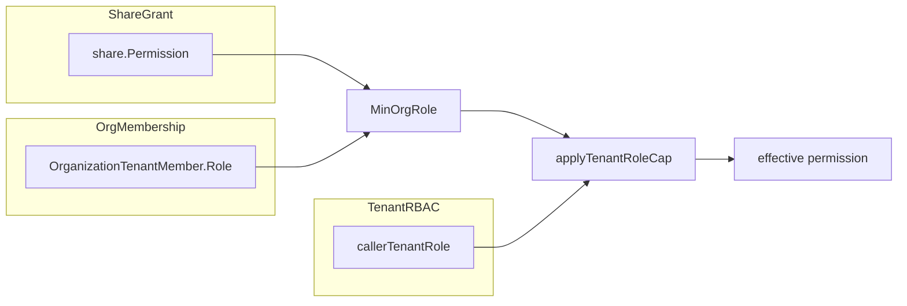
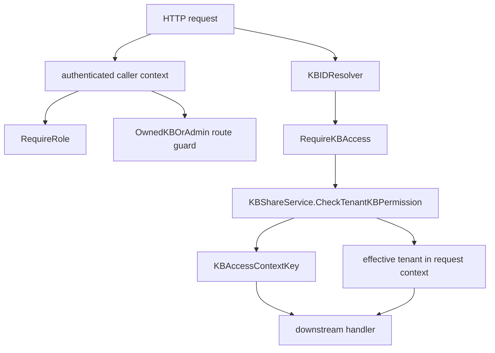
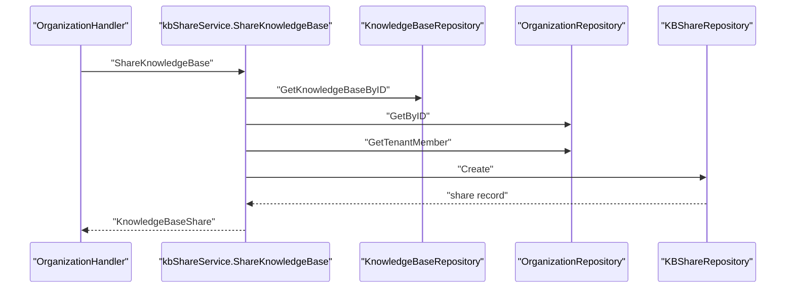
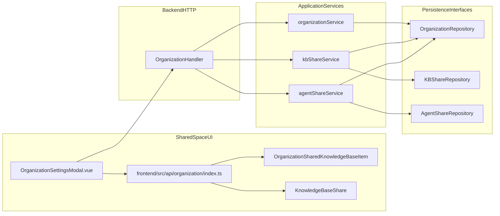
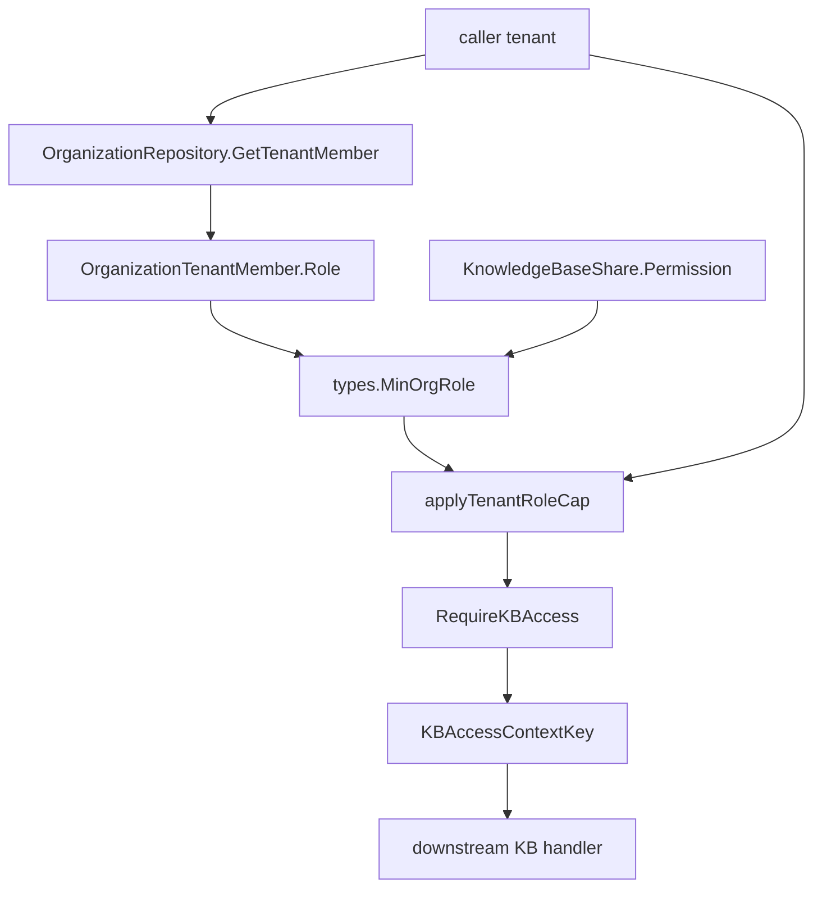

<!-- source: DeepWiki mcp.deepwiki.com · repo Tencent/WeKnora · page 12.2 Resource Sharing · fetched 2026-10-29 -->

# Resource Sharing

Relevant source files

The following files were used as context for generating this wiki page:

- [frontend/src/api/organization/index.ts](frontend/src/api/organization/index.ts)
- [frontend/src/components/Input-field.agent-switch.test.mjs](frontend/src/components/Input-field.agent-switch.test.mjs)
- [frontend/src/views/organization/OrganizationSettingsModal.vue](frontend/src/views/organization/OrganizationSettingsModal.vue)
- [internal/application/repository/agent_share.go](internal/application/repository/agent_share.go)
- [internal/application/repository/kbshare.go](internal/application/repository/kbshare.go)
- [internal/application/repository/organization.go](internal/application/repository/organization.go)
- [internal/application/service/agent_rerank_requirement_test.go](internal/application/service/agent_rerank_requirement_test.go)
- [internal/application/service/agent_share.go](internal/application/service/agent_share.go)
- [internal/application/service/kbshare.go](internal/application/service/kbshare.go)
- [internal/application/service/knowledge_delete_test.go](internal/application/service/knowledge_delete_test.go)
- [internal/application/service/knowledge_owner_chain_test.go](internal/application/service/knowledge_owner_chain_test.go)
- [internal/application/service/organization.go](internal/application/service/organization.go)
- [internal/errors/errors.go](internal/errors/errors.go)
- [internal/handler/organization.go](internal/handler/organization.go)
- [internal/handler/rbac_lookups.go](internal/handler/rbac_lookups.go)
- [internal/handler/rbac_lookups_test.go](internal/handler/rbac_lookups_test.go)
- [internal/handler/session/temporary_document.go](internal/handler/session/temporary_document.go)
- [internal/middleware/kb_access.go](internal/middleware/kb_access.go)
- [internal/middleware/kb_access_test.go](internal/middleware/kb_access_test.go)
- [internal/middleware/rbac.go](internal/middleware/rbac.go)
- [internal/middleware/rbac_test.go](internal/middleware/rbac_test.go)
- [internal/router/rbac.go](internal/router/rbac.go)
- [internal/types/agent_share_source.go](internal/types/agent_share_source.go)
- [internal/types/interfaces/organization.go](internal/types/interfaces/organization.go)
- [internal/types/organization.go](internal/types/organization.go)

## Purpose and scope

This page describes how WeKnora represents cross-organization knowledge-base and agent sharing, how access is constrained by organization and tenant roles, and how the supplied frontend and backend code connect. It focuses on resource sharing rather than organization creation, invitations, and membership workflows, which are covered in [Organization Management](12.1). [internal/application/service/kbshare.go:25-35](), [internal/application/service/agent_share.go:118-131](), [frontend/src/views/organization/OrganizationSettingsModal.vue:1-15]()

Sources: [internal/application/service/kbshare.go:25-35](), [internal/application/service/agent_share.go:118-131](), [frontend/src/views/organization/OrganizationSettingsModal.vue:1-15]()

---

## 1. Overview and Resource Types

WeKnora has separate sharing services for knowledge bases and agents: `kbShareService` implements the knowledge-base share policy, while `agentShareService` implements agent sharing and resolution. [internal/application/service/kbshare.go:25-44](), [internal/application/service/agent_share.go:118-131]()

A knowledge-base share grants an organization a role represented by `types.OrgMemberRole`; the defined roles are `admin`, `editor`, and `viewer`. The knowledge-base sharing service requires the caller’s tenant to belong to the target organization with at least the `editor` role before it creates a share. [internal/types/organization.go:9-39](), [internal/application/service/kbshare.go:76-108]()

The agent-sharing service defines restrictions for built-in agents and provides a receiver-facing representation that omits creator identity and selected prompt fields. The available source excerpt does not show the full `ShareAgent` implementation, so agent-sharing validation and grant behavior beyond these defined restrictions are not detailed here. [internal/application/service/agent_share.go:17-30](), [internal/application/service/agent_share.go:81-115]()

Sources: [internal/types/organization.go:9-39](), [internal/application/service/kbshare.go:76-108](), [internal/application/service/agent_share.go:17-30](), [internal/application/service/agent_share.go:81-115]()

---

## 2. Data Model

### Share records and organization membership

An organization is identified by `Organization.ID` and stores properties such as its name, owner tenant, discoverability setting, and member limit. Tenant membership is represented by `OrganizationTenantMember`, whose organization and tenant IDs identify the membership; its `Role` determines the tenant’s organization-level role. The representative user ID is informational rather than the identity used for permission checks. [internal/types/organization.go:60-102](), [internal/types/organization.go:109-132]()

The frontend API types distinguish direct knowledge-base shares from organization-scoped shared-resource list items. `KnowledgeBaseShare` includes the share permission and optional `my_role_in_org` and `my_permission` values; `OrganizationSharedKnowledgeBaseItem` adds `is_mine` and may identify a KB exposed through a shared agent. [frontend/src/api/organization/index.ts:63-116]()

| Concept | Relevant fields or code entity | Meaning |
|---|---|---|
| Organization membership | `OrganizationTenantMember.OrganizationID`, `TenantID`, `Role` | Organization membership and role are tenant-keyed. [internal/types/organization.go:109-127]() |
| Knowledge-base share | `KnowledgeBaseShare` | Frontend representation includes KB ID, organization ID, source tenant, share permission, and share metadata. [frontend/src/api/organization/index.ts:63-82]() |
| Shared knowledge-base list item | `OrganizationSharedKnowledgeBaseItem` | Organization-scoped entry can indicate whether the KB is mine or came from a shared agent. [frontend/src/api/organization/index.ts:103-116]() |
| Shared agent receiver view | `receiverAgentView` | Copies an agent representation and clears selected identity and prompt fields for receivers. [internal/application/service/agent_share.go:89-115]() |

Sources: [internal/types/organization.go:60-102](), [internal/types/organization.go:109-132](), [frontend/src/api/organization/index.ts:63-116](), [internal/application/service/agent_share.go:89-115]()

### Tenant-keyed organization membership

`organizationService` documents that organization membership is keyed by `(org_id, tenant_id)`. On organization creation, it stores the owner tenant and adds that tenant as an organization member with the `admin` role. [internal/application/service/organization.go:40-51](), [internal/application/service/organization.go:77-145]()

The data model keeps `OwnerTenantID` on the organization, while the owner tenant also has a membership row. This makes the tenant identity the durable organization-membership key; `RepresentativeUserID` is retained for display and audit purposes. [internal/types/organization.go:71-78](), [internal/types/organization.go:109-127]()

Sources: [internal/application/service/organization.go:40-51](), [internal/application/service/organization.go:77-145](), [internal/types/organization.go:71-78](), [internal/types/organization.go:109-127]()

---

## 3. Permission Resolution

Organization roles are ordered `admin > editor > viewer`. `OrgMemberRole.HasPermission` compares roles using that ordering, and `MinOrgRole` returns the lower of two non-empty roles. [internal/types/organization.go:9-58]()

The knowledge-base share service describes effective access as the minimum of three constraints: the share grant, the caller tenant’s role in the organization, and a cap derived from the caller’s tenant role. This prevents an organization-level grant from elevating a tenant-level `Viewer` to edit access. [internal/application/service/kbshare.go:25-35]()

`applyTenantRoleCap` specifically limits a tenant-level `Viewer` to `OrgRoleViewer` when the incoming permission would allow editing or more. The provided excerpt defines this cap function and documents the three-way policy; it does not show the complete permission-resolution implementation for every read path. [internal/application/service/kbshare.go:65-74]()

**Diagram: Role constraints mapped to permission code entities**

Sources: [internal/types/organization.go:31-58](), [internal/application/service/kbshare.go:25-35](), [internal/application/service/kbshare.go:65-74]()

### Tenant RBAC and resource ownership

Tenant RBAC and organization sharing are separate permission dimensions. The centralized router guidance distinguishes role-only guards from ownership guards: a mutation to a creator-owned resource should generally require its creator or an administrator, while an action that exposes a resource beyond its current scope is a public side effect and must use a sufficiently strong guard. [internal/router/rbac.go:16-69]()

`RequireRole` compares the caller’s tenant role with the route’s minimum role. When tenant RBAC enforcement is disabled, an insufficient role is logged and allowed through; when enforcement is enabled, the middleware returns `403 Forbidden`. [internal/middleware/rbac.go:48-112]()

For a KB route protected by `RequireKBAccess`, the middleware resolves the KB and shared-access policy, stores the resulting `KBAccess` in Gin context, and rewrites the request context to carry the effective tenant ID. This allows downstream handlers to continue using tenant context while the guard has resolved cross-tenant resource access. [internal/middleware/kb_access.go:17-35](), [internal/middleware/kb_access.go:158-169]()

**Diagram: Request access mapped to RBAC and KB-access code entities**

Sources: [internal/router/rbac.go:16-69](), [internal/middleware/rbac.go:48-112](), [internal/middleware/kb_access.go:17-35](), [internal/middleware/kb_access.go:158-169]()

---

## 4. Knowledge Base Sharing

### Service implementation — `KBShareService`

`kbShareService` is constructed with repositories for shares, organizations, knowledge bases, knowledge, and chunks, plus an audit service. Its `ShareKnowledgeBase` method loads the KB, checks that it belongs to the caller’s tenant, verifies the target organization exists, and requires the caller’s tenant to have at least the organization `editor` role. It rejects invalid share roles before creating a share record. [internal/application/service/kbshare.go:25-63](), [internal/application/service/kbshare.go:76-123]()

When creating a share encounters an already-existing KB/organization share, the service retrieves that share, updates its permission and timestamp, persists the update, and records an audit event. A newly created share also records an audit event. [internal/application/service/kbshare.go:125-148]()

`UpdateSharePermission` loads the share, validates the requested role, checks whether the caller may manage that share, updates its permission, persists the change, and records an audit event. The excerpt states that an organization administrator outside the source tenant may only lower the permission; the full `canManageShare` policy is not included in the supplied lines. [internal/application/service/kbshare.go:151-183]()

The service also defines `RemoveShare`, but its implementation is outside the supplied excerpt. [internal/application/service/kbshare.go:186-187]()

Sources: [internal/application/service/kbshare.go:25-63](), [internal/application/service/kbshare.go:76-148](), [internal/application/service/kbshare.go:151-187]()

### Share creation data flow

The HTTP layer’s `OrganizationHandler` receives the share service as a dependency alongside organization and agent-share services. Its constructor wires those dependencies into the handler. The service implementation then performs the source-tenant and target-organization checks before persistence. [internal/handler/organization.go:20-59](), [internal/application/service/kbshare.go:76-123]()

**Diagram: Knowledge-base share creation mapped to code entities**

Sources: [internal/handler/organization.go:20-59](), [internal/application/service/kbshare.go:76-148]()

---

## 5. Agent Sharing

### Service implementation — `agentShareService`

`agentShareService` depends on repositories for agent shares, tenant-disabled shared agents, organizations, custom agents, users, web-search providers, and knowledge bases. Its implementation comments state that visibility and access checks are keyed by the caller’s tenant and that the caller tenant role is carried through read paths. [internal/application/service/agent_share.go:118-151]()

The supplied code defines `agentRequiresRerankModel`, which returns whether an agent’s configured scope and effective allowed tools require a reranker. It returns false if the agent is nil or its `KBSelectionMode` is `"none"`; otherwise, it checks whether the effective allowed tools include `search_knowledge`. [internal/application/service/agent_share.go:33-60]()

The supplied code also defines `isBuiltinAgent`, which recognizes either the `IsBuiltin` flag or a built-in agent ID. The accompanying comment explains that built-in agents cannot be shared because every workspace has a copy under the same ID, making a shared copy ambiguous to the receiver. [internal/application/service/agent_share.go:81-87]()

`receiverAgentView` copies the agent and clears `CreatedBy`, system prompts, context templates, rewrite prompts, fallback prompts, intent prompts, and the additional instruction for follow-up suggestions. Its comments explain that receiver-visible capabilities and resource scope remain relevant, while the owner’s prompt content and source-workspace user identity are withheld. [internal/application/service/agent_share.go:89-115]()

The agent service defines errors for agents that are not fully configured and for organization roles that cannot share agents. The actual `ShareAgent` validation and persistence method is not shown in the supplied excerpt, so those error definitions alone do not establish the complete runtime sharing policy. [internal/application/service/agent_share.go:17-30]()

Sources: [internal/application/service/agent_share.go:17-30](), [internal/application/service/agent_share.go:33-60](), [internal/application/service/agent_share.go:81-115](), [internal/application/service/agent_share.go:118-151]()

---

## 6. Shared Space UI and Code Entity Architecture

### UI elements visible in the supplied source

`OrganizationSettingsModal.vue` uses `SettingsModalShell` with navigation groups and a current-section model. Its navigation icon slot uses an agent-specific image when the item key is `sharedAgents`, and a TDesign icon for other items. The visible excerpt also includes a tenant-role hint and organization basic-information fields; it does not show the full shared-resource panels or their event handlers. [frontend/src/views/organization/OrganizationSettingsModal.vue:1-20]()

The organization API types define data shapes used by organization and sharing views. In particular, `OrganizationSharedKnowledgeBaseItem` can mark an item as `is_mine` and optionally carry `source_from_agent` metadata, while `SharedKnowledgeBase` carries the organization, permission, and source-tenant fields. [frontend/src/api/organization/index.ts:84-116]()

The frontend API type `KnowledgeBaseShare` exposes both the assigned share permission and optional effective values (`my_role_in_org` and `my_permission`). The type comments define `my_permission` as the minimum of the share permission and current user’s organization role. [frontend/src/api/organization/index.ts:63-82]()

Sources: [frontend/src/views/organization/OrganizationSettingsModal.vue:1-20](), [frontend/src/api/organization/index.ts:63-116]()

### Backend handler and service composition

`OrganizationHandler` holds organization, KB-share, agent-share, custom-agent, user, tenant, KB, knowledge, and chunk service dependencies. `NewOrganizationHandler` receives and stores those dependencies. The handler excerpt shows organization creation, organization lookup, and listing; it does not include the share-specific handler methods, so their routes and response behavior are not inferred here. [internal/handler/organization.go:20-59](), [internal/handler/organization.go:62-102](), [internal/handler/organization.go:104-147](), [internal/handler/organization.go:149-183]()

`organizationService` depends on organization and user repositories plus KB-share and agent-share repositories. The KB and agent share services each have their own share repository and organization repository, which separates organization membership policy from resource-specific share persistence. [internal/application/service/organization.go:40-65](), [internal/application/service/kbshare.go:25-63](), [internal/application/service/agent_share.go:118-151]()

**Diagram: Natural-language shared-space concepts mapped to code entities**

Sources: [frontend/src/views/organization/OrganizationSettingsModal.vue:1-20](), [frontend/src/api/organization/index.ts:63-116](), [internal/handler/organization.go:20-59](), [internal/application/service/organization.go:40-65](), [internal/application/service/kbshare.go:25-63](), [internal/application/service/agent_share.go:118-151]()

**Diagram: Natural-language access control mapped to code entities**

Sources: [internal/types/organization.go:31-58](), [internal/application/service/kbshare.go:25-35](), [internal/application/service/kbshare.go:65-74](), [internal/middleware/kb_access.go:17-35](), [internal/middleware/kb_access.go:158-169]()

---

