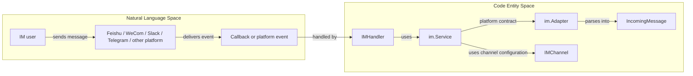
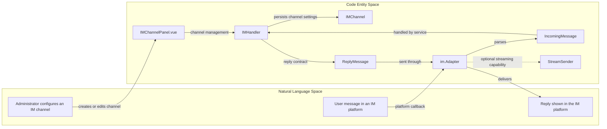

<!-- source: DeepWiki mcp.deepwiki.com · repo Tencent/WeKnora · page 13 Instant Messaging Integrations · fetched 2026-10-29 -->

# Instant Messaging Integrations

Relevant source files

The following files were used as context for generating this wiki page:

- [frontend/src/api/agent/index.ts](frontend/src/api/agent/index.ts)
- [frontend/src/components/IMChannelPanel.vue](frontend/src/components/IMChannelPanel.vue)
- [internal/application/service/resource_storage.go](internal/application/service/resource_storage.go)
- [internal/application/service/resource_storage_test.go](internal/application/service/resource_storage_test.go)
- [internal/handler/im.go](internal/handler/im.go)
- [internal/im/adapter.go](internal/im/adapter.go)
- [internal/im/content_rewrite_test.go](internal/im/content_rewrite_test.go)
- [internal/im/full_output_test.go](internal/im/full_output_test.go)
- [internal/im/global_resource_storage_test.go](internal/im/global_resource_storage_test.go)
- [internal/im/im_file_service_test.go](internal/im/im_file_service_test.go)
- [internal/im/resource_access.go](internal/im/resource_access.go)
- [internal/im/service.go](internal/im/service.go)
- [internal/im/types.go](internal/im/types.go)
- [internal/storageurl/resolver.go](internal/storageurl/resolver.go)

## Purpose and Scope

This page introduces how WeKnora connects agents to instant messaging platforms and where to find implementation and setup details. It covers the shared integration surface and channel management at a high level; for details, see [IM Integration Architecture](#13.1) and [Platform-Specific Adapters](#13.2).

Sources: [internal/im/adapter.go:10-26](), [internal/handler/im.go:17-21]()

## System Overview

An IM channel binds a platform and its credentials to an agent within a tenant. The backend represents that configuration with `IMChannel`; the shared `Adapter` interface represents platform-specific callback verification, message parsing, and replies. The platform callback is handled through `IMHandler`, which is constructed with an `im.Service`. [internal/im/types.go:16-34](), [internal/im/adapter.go:125-144](), [internal/handler/im.go:35-45]()

The platform adapter normalizes incoming events into `IncomingMessage`. Channel settings include the platform, agent, operating mode, output mode, locale, session mode, and credentials. For how these pieces interact—including session routing and output modes—see [IM Integration Architecture](#13.1). [internal/im/adapter.go:47-85](), [internal/im/types.go:16-34]()

### From IM Message to Code Entities

**IM request path: platform event to WeKnora entities**

Sources: [internal/handler/im.go:35-45](), [internal/im/adapter.go:47-85](), [internal/im/adapter.go:125-144](), [internal/im/service.go:1-38](), [internal/im/types.go:16-34]()

## Supported Platforms

The handler accepts these platform identifiers: `wecom`, `feishu`, `lark`, `slack`, `telegram`, `dingtalk`, `mattermost`, `wechat`, `qqbot`, and `yunzhijia`. `PlatformLark` is described as Feishu’s international edition and shares the Feishu adapter. The exact setup requirements and supported behavior vary by platform; see [Platform-Specific Adapters](#13.2). [internal/handler/im.go:17-21](), [internal/im/adapter.go:13-26]()

| Platform identifier | Notes |
|---|---|
| `feishu` | Feishu platform identifier. |
| `lark` | Feishu’s international edition; shares the Feishu adapter. |
| `wecom` | WeCom platform identifier. |
| `dingtalk` | DingTalk platform identifier. |
| `slack` | Slack platform identifier. |
| `telegram` | Telegram platform identifier. |
| `mattermost` | Mattermost platform identifier. |
| `qqbot` | QQBot platform identifier. |
| `yunzhijia` | Yunzhijia platform identifier. |
| `wechat` | WeChat platform identifier. |

Sources: [internal/handler/im.go:17-21](), [internal/im/adapter.go:13-26]()

### From Channel Configuration to Platform Behavior

**Channel settings and adapter contract**

Sources: [frontend/src/components/IMChannelPanel.vue:1-18](), [internal/handler/im.go:35-45](), [internal/im/types.go:16-34](), [internal/im/adapter.go:47-85](), [internal/im/adapter.go:113-163]()

## Channel Management

Administrators can use the frontend `IMChannelPanel.vue` to view channels, create a channel, and open a channel’s settings. The panel’s form includes a bound agent and platform selection; channel creation and updates are handled by `IMHandler`. [frontend/src/components/IMChannelPanel.vue:1-18](), [frontend/src/components/IMChannelPanel.vue:56-75](), [frontend/src/components/IMChannelPanel.vue:99-127](), [internal/handler/im.go:35-50]()

Channel records are stored as `IMChannel` entries in the `im_channels` table. List responses use `IMChannelSummary`, which omits credentials and reports whether credentials are configured. For configuration fields, API behavior, and platform setup, see [Platform-Specific Adapters](#13.2). [internal/im/types.go:16-39](), [internal/im/types.go:41-60](), [internal/handler/im.go:170-186]()

Sources: [frontend/src/components/IMChannelPanel.vue:1-18](), [frontend/src/components/IMChannelPanel.vue:56-75](), [frontend/src/components/IMChannelPanel.vue:99-127](), [internal/handler/im.go:35-50](), [internal/handler/im.go:170-186](), [internal/im/types.go:16-60]()

---

