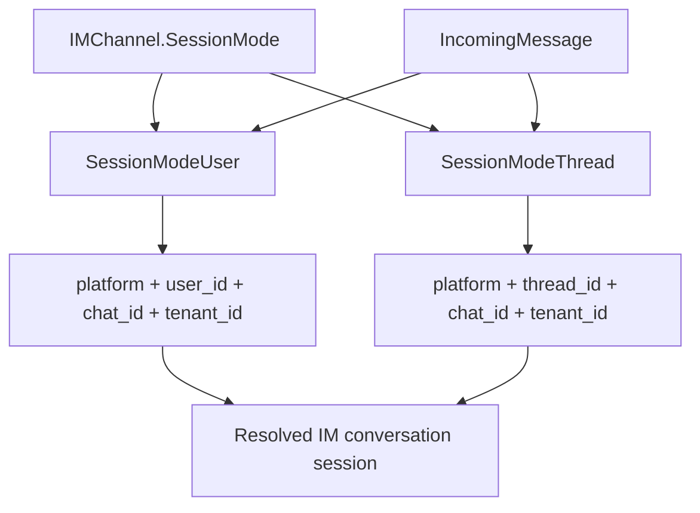
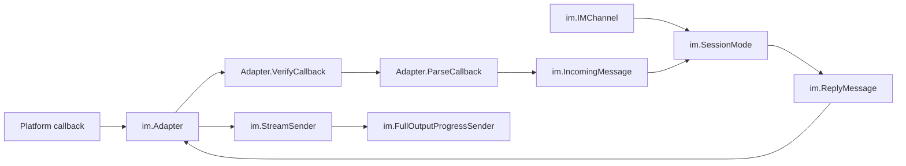
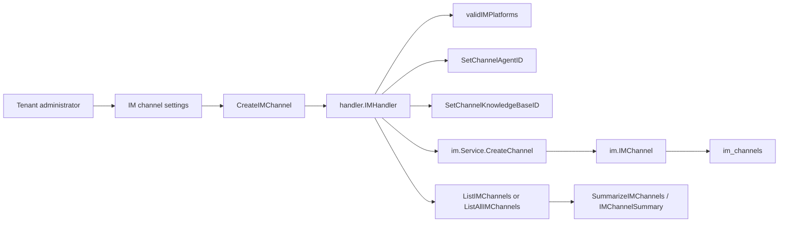

<!-- source: DeepWiki mcp.deepwiki.com · repo Tencent/WeKnora · page 13.1 IM Integration Architecture · fetched 2026-10-29 -->

# IM Integration Architecture

Relevant source files

The following files were used as context for generating this wiki page:

- [frontend/src/api/agent/index.ts](frontend/src/api/agent/index.ts)
- [frontend/src/components/IMChannelPanel.vue](frontend/src/components/IMChannelPanel.vue)
- [internal/application/service/resource_storage.go](internal/application/service/resource_storage.go)
- [internal/application/service/resource_storage_test.go](internal/application/service/resource_storage_test.go)
- [internal/handler/im.go](internal/handler/im.go)
- [internal/im/adapter.go](internal/im/adapter.go)
- [internal/im/content_rewrite_test.go](internal/im/content_rewrite_test.go)
- [internal/im/full_output_test.go](internal/im/full_output_test.go)
- [internal/im/global_resource_storage_test.go](internal/im/global_resource_storage_test.go)
- [internal/im/im_file_service_test.go](internal/im/im_file_service_test.go)
- [internal/im/resource_access.go](internal/im/resource_access.go)
- [internal/im/service.go](internal/im/service.go)
- [internal/im/types.go](internal/im/types.go)
- [internal/storageurl/resolver.go](internal/storageurl/resolver.go)

## Purpose and scope

This page describes the shared architecture for connecting WeKnora agents to instant messaging platforms. It covers the platform adapter contract, channel configuration, normalized messages and session modes, and the distinction between streaming and full-output replies. The available code excerpts show the adapter types, channel model, channel creation handler, and output-formatting helpers; they do not include the complete `im.Service` message-dispatch implementation, so service-internal routing details are limited to what those excerpts establish. [internal/im/adapter.go:10-174](); [internal/im/types.go:16-39](); [internal/handler/im.go:17-145](); [internal/im/service.go:40-175]()

Sources: [internal/im/adapter.go:10-174](); [internal/im/types.go:16-39](); [internal/handler/im.go:17-145](); [internal/im/service.go:40-175]()

---

## 1. Unified message-processing architecture

The integration separates platform-specific callback handling from the shared message representation and reply contract. An adapter verifies callbacks and parses message events into `IncomingMessage`; the shared contract also defines reply delivery through `SendReply`. The `IncomingMessage` fields carry platform identity, user and chat identifiers, message content or file metadata, thread information, quotes, and platform-specific `Extra` values. [internal/im/adapter.go:47-85](); [internal/im/adapter.go:113-144]()

**Diagram: Platform callback to unified message and reply contract**

Sources: [internal/im/adapter.go:47-85](); [internal/im/adapter.go:113-144]()

`Adapter` defines the platform-neutral operations: identifying the platform, verifying a callback, parsing it, sending a reply, and handling URL-verification challenges. `ParseCallback` can return no message for non-message events such as URL verification. Platform-specific protocol details therefore belong behind this interface rather than in the shared message shape. [internal/im/adapter.go:10-26](); [internal/im/adapter.go:125-144]()

Sources: [internal/im/adapter.go:10-26](); [internal/im/adapter.go:125-144]()

---

## 2. The IM adapter pattern and interfaces

The required interface is `Adapter`. Optional capability interfaces let the shared layer use streaming or attachment functionality when an adapter supports it, without making those capabilities mandatory for every platform. [internal/im/adapter.go:125-174]()

| Interface or type | Contract | Architectural role |
|---|---|---|
| `Adapter` | `Platform`, `VerifyCallback`, `ParseCallback`, `SendReply`, `HandleURLVerification` | Common callback, parsing, and reply contract for platform adapters. [internal/im/adapter.go:125-144]() |
| `StreamSender` | `StartStream`, `UpdateStreamContent`, `FinalizeStream`, `EndStream` | Optional replaceable-message or streaming lifecycle. [internal/im/adapter.go:146-164]() |
| `FullOutputProgressSender` | Embeds `StreamSender`; adds `SupportsFullOutputProgress` | Optional signal that a visible placeholder can be replaced with the final answer in full-output mode. [internal/im/adapter.go:166-172]() |
| `IncomingMessage` | Platform, identity, content, file, thread, quote, and extra fields | Normalized inbound event passed from an adapter to shared processing. [internal/im/adapter.go:47-85]() |
| `ReplyMessage` | `Content`, `IsStreaming`, `IsFinal`, `Extra` | Normalized outbound reply passed to an adapter. [internal/im/adapter.go:113-123]() |

Sources: [internal/im/adapter.go:47-85](); [internal/im/adapter.go:113-174]()

### Platform identity

The platform identifiers represented by `Platform` are `wecom`, `feishu`, `lark`, `slack`, `telegram`, `dingtalk`, `mattermost`, `wechat`, `qqbot`, and `yunzhijia`. `PlatformLark` is documented as Feishu’s international edition and shares the Feishu adapter, with the API host and tenant differing. The channel handler maintains a corresponding supported-platform allowlist for channel creation. [internal/im/adapter.go:10-26](); [internal/handler/im.go:17-21]()

Sources: [internal/im/adapter.go:10-26](); [internal/handler/im.go:17-21]()

---

## 3. Channel management and bot identity routing

`IMChannel` is the persisted configuration that binds a tenant and agent to a platform integration. Its fields include `TenantID`, `AgentID`, `Platform`, `Credentials`, `Enabled`, `Mode`, `OutputMode`, `Locale`, `KnowledgeBaseID`, `BotIdentity`, and `SessionMode`; the database table is `im_channels`. [internal/im/types.go:16-39]()

Sources: [internal/im/types.go:16-39]()

### Channel creation and defaults

`IMHandler.CreateIMChannel` reads the agent ID from the route and tenant ID from request context, validates the submitted platform and locale, builds an `IMChannel`, and delegates agent and knowledge-base checks to `SetChannelAgentID` and `SetChannelKnowledgeBaseID` before calling `CreateChannel`. [internal/handler/im.go:49-110](); [internal/handler/im.go:111-145]()

Creation defaults depend on platform:

- `wechat` is forced to `Mode: "longpoll"` and `OutputMode: "full"`.
- Otherwise, an empty mode becomes `"webhook"` for `mattermost` and `yunzhijia`, and `"websocket"` for other platforms.
- An empty output mode becomes `"stream"`.
- Missing credentials are initialized to `{}`.
- An optional `enabled` request field overrides the default enabled state. [internal/handler/im.go:89-132]()

The model hooks also supply defaults for empty `Mode`, `OutputMode`, and `SessionMode`, validate session mode and locale, and recompute `BotIdentity` on create and save. [internal/im/types.go:97-150]()

Sources: [internal/handler/im.go:49-145](); [internal/im/types.go:97-150]()

### Channel administration and credential exposure

The handler provides channel creation, per-agent listing, and tenant-wide listing in the shown code. Per-agent listing returns `SummarizeIMChannels` output. The tenant-wide listing explicitly excludes credentials. `IMChannelSummary` is the HTTP-safe list shape: it includes `CredentialsConfigured` rather than the credentials themselves. [internal/handler/im.go:147-187](); [internal/im/types.go:41-60](); [internal/im/types.go:62-95]()

Sources: [internal/handler/im.go:147-187](); [internal/im/types.go:41-95]()

### Bot identity

`computeBotIdentity` derives a platform-specific identity from channel credentials and mode; the channel model stores the result in `BotIdentity`, with a uniqueness constraint for non-empty identities among non-deleted channels. The available excerpt shows the start of the platform-specific derivation, including WeCom WebSocket identity `wecom:ws:<bot_id>`. Other per-platform identity formats are not detailed here. [internal/im/types.go:16-35](); [internal/im/types.go:120-121](); [internal/im/types.go:163-193]()

Sources: [internal/im/types.go:16-35](); [internal/im/types.go:120-121](); [internal/im/types.go:163-193]()

---

## 4. Session routing

`SessionMode` defines the supported IM conversation-key strategies:

- `SessionModeUser` (`"user"`) resolves a session by `(platform, user_id, chat_id, tenant_id)`.
- `SessionModeThread` (`"thread"`) resolves a session by `(platform, thread_id, chat_id, tenant_id)`. [internal/im/adapter.go:28-36]()

The normalized message provides the corresponding routing inputs: `Platform`, `UserID`, `ChatID`, and `ThreadID`. `ThreadID` documents platform-specific source values for Slack, Mattermost, Feishu/Lark, and Telegram; for platforms without thread support it is empty. In thread mode, a top-level message uses its own ID as its thread ID, creating a session key for that top-level message. [internal/im/adapter.go:47-85]()

`IMChannel.BeforeCreate` and `BeforeSave` default an unset session mode to `"user"` and validate that the value is either user or thread mode. [internal/im/types.go:97-138](); [internal/im/types.go:153-161]()

**Diagram: Session mode maps normalized message fields to a session key**

Sources: [internal/im/adapter.go:28-36](); [internal/im/adapter.go:47-85](); [internal/im/types.go:97-138](); [internal/im/types.go:153-161]()

---

## 5. Streaming and full-output modes

`IMChannel.OutputMode` configures how a channel presents an answer; the model’s default is `"stream"`. The channel-creation handler forces WeChat to `"full"` and defaults other channels with an empty output mode to `"stream"`. [internal/im/types.go:16-35](); [internal/handler/im.go:114-128]()

### Streaming mode

`StreamSender` defines a lifecycle with `StartStream`, zero or more `UpdateStreamContent` calls, a final replacement through `FinalizeStream`, and `EndStream`. `ReplyMessage` also carries `IsStreaming` and `IsFinal` flags for reply implementations. [internal/im/adapter.go:113-123](); [internal/im/adapter.go:146-164]()

The shared IM service defines `streamFlushInterval` as 300 milliseconds to batch content and reduce platform API rate limiting. Its stream helpers hold back a potentially incomplete storage reference or XML tag at the end of a chunk, so a split pattern is not sent before it can be completed. [internal/im/service.go:63-65](); [internal/im/service.go:111-141]()

### Full-output mode

`FullOutputProgressSender` indicates whether a platform can show a replaceable progress placeholder and then replace it with the completed answer. Its contract explicitly states that full-output mode does not call `UpdateStreamContent`. [internal/im/adapter.go:146-172]()

The full-output test establishes the successful lifecycle order as `StartStream`, QA, `FinalizeStream`, and `EndStream`; it also verifies zero intermediate updates and that the final answer is supplied to `FinalizeStream`. A cancellation test verifies that the placeholder is finalized with the cancellation fallback rather than left visible. [internal/im/full_output_test.go:179-204](); [internal/im/full_output_test.go:206-241]()

| Mode or capability | Behavior established by the contract and tests |
|---|---|
| `stream` | Supports incremental content replacement through `UpdateStreamContent`; service flush interval is 300 ms. [internal/im/adapter.go:146-164](); [internal/im/service.go:63-65]() |
| `full` | Can use a replaceable placeholder, skips intermediate updates, and finalizes once with the completed answer. [internal/im/adapter.go:166-172](); [internal/im/full_output_test.go:179-204]() |
| `wechat` channel default | Creation handler sets long-polling and full output. [internal/handler/im.go:114-118]() |

Sources: [internal/im/adapter.go:113-172](); [internal/im/service.go:63-65](); [internal/im/full_output_test.go:179-241](); [internal/handler/im.go:114-128]()

---

## 6. Content transformation and outbound compatibility

Before content is sent to an IM platform, the shared IM package has helpers to remove or rewrite constructs that are unsuitable for IM clients:

- `stripIMCitationTags` removes inline `<kb .../>` and `<web .../>` citation tags. [internal/im/service.go:71-79]()
- `stripImageXMLTags` replaces an `<image>...</image>` block with its nested `<image_original>` Markdown when present; otherwise it removes the block. [internal/im/service.go:81-99]()
- `rewriteStorageURLs` delegates storage-reference rewriting to `storageurl.Rewrite` using the `"IM"` context. The stated reason is that IM clients cannot attach WeKnora credentials when fetching an image. [internal/im/service.go:101-109]()
- `formatIMOutboundAnswer` applies final display formatting and content cleanup; `formatIMOutboundAnswerOrFallback` substitutes `imNoAnswerFallback` if cleanup yields empty content. [internal/im/service.go:143-162]()
- `imOutboundContext` drops cancellation while preserving context values, to allow outbound completion—such as replacing a Feishu CardKit placeholder—after a QA request is cancelled. [internal/im/service.go:164-169]()

The stream holdback logic combines `storageurl.HoldbackCutoff` with detection of incomplete XML tag openings. This prevents the end of a batch from exposing a truncated storage reference or a partial `<image>`, `<kb>`, or `<web>` tag. [internal/im/service.go:111-141]()

**Diagram: Outbound answer formatting and stream-safe delivery**

```mermaid
flowchart LR
    Raw["Agent answer content"]
    Display["FormatIMDisplayContent"]
    Citation["stripIMCitationTags"]
    Image["stripImageXMLTags"]
    Storage["rewriteStorageURLs"]
    Clean["cleanIMContent"]
    Holdback["holdbackCutoff"]
    Reply["ReplyMessage content"]
    Adapter["Adapter.SendReply or StreamSender"]

    Raw --> Display
    Display --> Citation
    Citation --> Image
    Image --> Storage
    Storage --> Clean
    Clean --> Holdback
    Holdback --> Reply
    Reply --> Adapter
```

Sources: [internal/im/service.go:71-109](); [internal/im/service.go:111-162](); [internal/im/adapter.go:113-164]()

---

## 7. Natural-language concepts mapped to code entities

This diagram associates the integration’s architecture concepts with the concrete Go types and functions used in the available code. It focuses on the callback boundary, normalized message, persisted channel, and outbound adapter capabilities. [internal/im/adapter.go:47-85](); [internal/im/adapter.go:113-172](); [internal/im/types.go:16-39]()

**Diagram: IM integration concepts to Go entities**

Sources: [internal/im/adapter.go:28-36](); [internal/im/adapter.go:47-85](); [internal/im/adapter.go:113-172](); [internal/im/types.go:16-39]()

---

## 8. Channel administration mapped to code entities

Channel management is exposed through `handler.IMHandler` and backed by `im.Service` operations. The shown creation path validates tenant context and platform, validates agent and knowledge-base references through the service, applies platform defaults, and persists via `CreateChannel`. Listing paths use service queries and return summarized channel data. [internal/handler/im.go:35-45](); [internal/handler/im.go:49-145](); [internal/handler/im.go:147-187]()

**Diagram: Channel-management concepts to handler, service, and model entities**

Sources: [internal/handler/im.go:17-45](); [internal/handler/im.go:49-145](); [internal/handler/im.go:147-187](); [internal/im/types.go:16-39](); [internal/im/types.go:41-89]()

---

