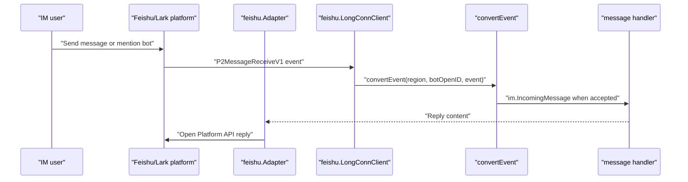
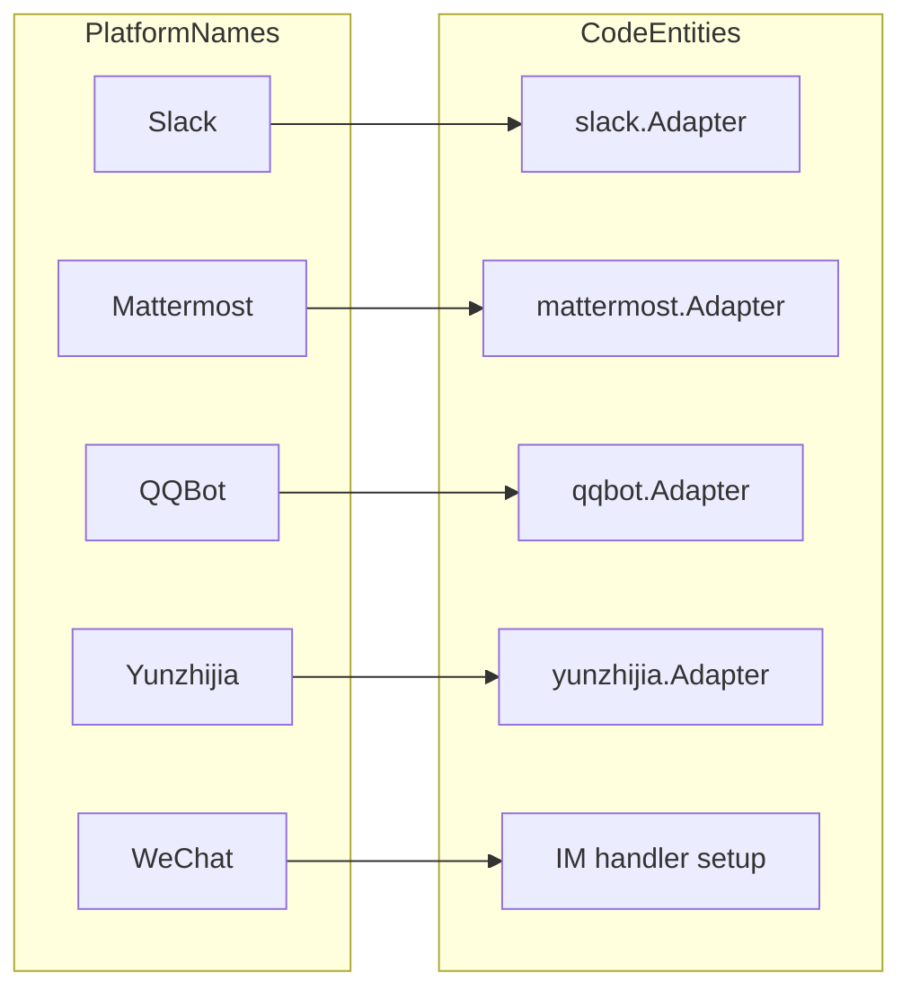
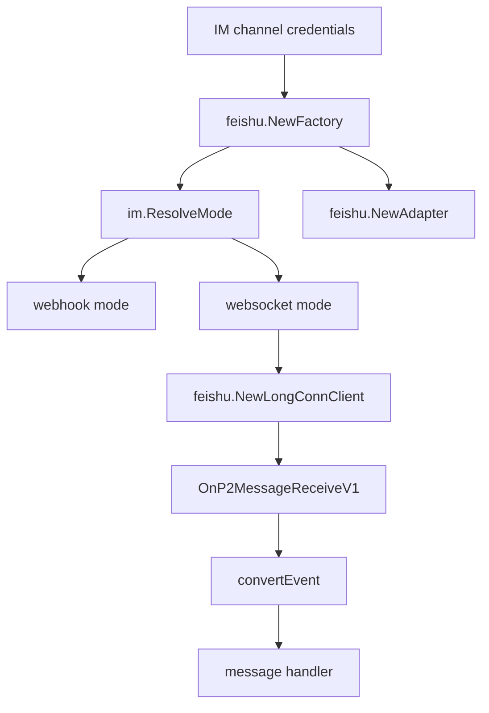

<!-- source: DeepWiki mcp.deepwiki.com · repo Tencent/WeKnora · page 13.2 Platform-Specific Adapters · fetched 2026-10-29 -->

# Platform-Specific Adapters

Relevant source files

The following files were used as context for generating this wiki page:

- [internal/background/listeners_test.go](internal/background/listeners_test.go)
- [internal/im/dingtalk/adapter.go](internal/im/dingtalk/adapter.go)
- [internal/im/dingtalk/adapter_test.go](internal/im/dingtalk/adapter_test.go)
- [internal/im/dingtalk/download_test.go](internal/im/dingtalk/download_test.go)
- [internal/im/dingtalk/longconn.go](internal/im/dingtalk/longconn.go)
- [internal/im/feishu/adapter.go](internal/im/feishu/adapter.go)
- [internal/im/feishu/adapter_test.go](internal/im/feishu/adapter_test.go)
- [internal/im/feishu/factory.go](internal/im/feishu/factory.go)
- [internal/im/feishu/longconn.go](internal/im/feishu/longconn.go)
- [internal/im/feishu/longconn_test.go](internal/im/feishu/longconn_test.go)
- [internal/im/feishu/stream_reaper_test.go](internal/im/feishu/stream_reaper_test.go)
- [internal/im/file_message_test.go](internal/im/file_message_test.go)
- [internal/im/mattermost/adapter.go](internal/im/mattermost/adapter.go)
- [internal/im/mattermost/webhook_body_limit_test.go](internal/im/mattermost/webhook_body_limit_test.go)
- [internal/im/qqbot/adapter.go](internal/im/qqbot/adapter.go)
- [internal/im/service_quote_test.go](internal/im/service_quote_test.go)
- [internal/im/session_test.go](internal/im/session_test.go)
- [internal/im/slack/adapter.go](internal/im/slack/adapter.go)
- [internal/im/stream_delivery_test.go](internal/im/stream_delivery_test.go)
- [internal/im/stream_display_test.go](internal/im/stream_display_test.go)
- [internal/im/stream_lifecycle_test.go](internal/im/stream_lifecycle_test.go)
- [internal/im/stream_section.go](internal/im/stream_section.go)
- [internal/im/stream_test.go](internal/im/stream_test.go)
- [internal/im/telegram/adapter.go](internal/im/telegram/adapter.go)
- [internal/im/think.go](internal/im/think.go)
- [internal/im/think_test.go](internal/im/think_test.go)
- [internal/im/webhook_body.go](internal/im/webhook_body.go)
- [internal/im/webhook_body_test.go](internal/im/webhook_body_test.go)
- [internal/im/wecom/endpoint_test.go](internal/im/wecom/endpoint_test.go)
- [internal/im/wecom/longconn.go](internal/im/wecom/longconn.go)
- [internal/im/wecom/mention_test.go](internal/im/wecom/mention_test.go)
- [internal/im/wecom/quote.go](internal/im/wecom/quote.go)
- [internal/im/wecom/quote_test.go](internal/im/wecom/quote_test.go)
- [internal/im/wecom/webhook_adapter.go](internal/im/wecom/webhook_adapter.go)
- [internal/im/wecom/ws_adapter.go](internal/im/wecom/ws_adapter.go)
- [internal/types/message_attachment_test.go](internal/types/message_attachment_test.go)

## Purpose and scope

This page documents how individual IM platform integrations connect platform-specific events and replies to WeKnora’s unified IM message model. It covers the Feishu/Lark, WeCom, DingTalk, Telegram, Mattermost, Slack, QQBot, Yunzhijia, and WeChat adapter entry points, plus the configuration and callback setup patterns visible in the supplied code references.

Sources: [internal/im/feishu/adapter.go:1-10](), [internal/im/dingtalk/adapter.go:47-79](), [internal/im/telegram/adapter.go:30-53]()

---

## 1. Adapter overview and code-entity mapping

An adapter translates platform payloads into WeKnora’s unified IM message representation and sends replies through the platform’s API or connection. The shown Feishu, DingTalk, and Telegram implementations expose platform-specific `Adapter` types; Feishu, WeCom, and DingTalk also have long-connection clients in the supplied references. [internal/im/feishu/adapter.go:53-64](), [internal/im/feishu/longconn.go:26-42](), [internal/im/wecom/longconn.go:129-151](), [internal/im/dingtalk/adapter.go:47-57](), [internal/im/dingtalk/longconn.go:16-42](), [internal/im/telegram/adapter.go:30-53]()

| Platform concept | Code entity | Adapter or event entry point |
|---|---|---|
| Feishu / Lark | `feishu.Adapter` | `NewAdapter`; `ParseCallback` [internal/im/feishu/adapter.go:53-97]() |
| Feishu / Lark long connection | `feishu.LongConnClient` | `NewLongConnClient`; `convertEvent` [internal/im/feishu/longconn.go:26-53](), [internal/im/feishu/longconn.go:144-177]() |
| WeCom webhook | `wecom.WebhookAdapter` | `NewWebhookAdapter`; `VerifyCallback` [internal/im/wecom/webhook_adapter.go:95-144](), [internal/im/wecom/webhook_adapter.go:151-180]() |
| WeCom intelligent-bot connection | `wecom.LongConnClient` | `NewLongConnClient`; `Start` [internal/im/wecom/longconn.go:129-175](), [internal/im/wecom/longconn.go:177-193]() |
| DingTalk | `dingtalk.Adapter` | `NewWebhookAdapter`, `NewAdapter`, `ParseCallback` [internal/im/dingtalk/adapter.go:47-79](), [internal/im/dingtalk/adapter.go:122-136]() |
| DingTalk Stream | `dingtalk.LongConnClient` | `NewLongConnClient`; `onChatBotMessage` [internal/im/dingtalk/longconn.go:16-42](), [internal/im/dingtalk/longconn.go:60-68]() |
| Telegram | `telegram.Adapter` | `NewWebhookAdapter`, `NewAdapter`, `ParseCallback` [internal/im/telegram/adapter.go:30-53](), [internal/im/telegram/adapter.go:116-130]() |
| Mattermost | `mattermost.Adapter` | Adapter implementation [internal/im/mattermost/adapter.go:1-26]() |
| Slack | `slack.Adapter` | Adapter implementation [internal/im/slack/adapter.go:1-26]() |
| QQBot | `qqbot.Adapter` | Adapter implementation [internal/im/qqbot/adapter.go:1-26]() |
| Yunzhijia | `yunzhijia.Adapter` | Adapter implementation [internal/im/yunzhijia/adapter.go:66-76]() |
| WeChat | WeChat IM integration | Handler setup [internal/handler/im.go:98-112]() |

The following diagram connects platform event names and adapter types to the unified message flow. The supplied excerpts show event conversion directly for Feishu, DingTalk, and Telegram; the other platform entities are included as integration entry points. [internal/im/feishu/longconn.go:144-177](), [internal/im/dingtalk/adapter.go:95-136](), [internal/im/telegram/adapter.go:74-137]()

### Platform event to code-entity map

```mermaid
graph TD
    subgraph "PlatformEvents"
        FeishuEvent["Feishu/Lark message event"]
        WeComWebhookEvent["WeCom encrypted callback"]
        WeComWSFrame["WeCom aibot_msg_callback"]
        DingTalkCallback["DingTalk callback message"]
        DingTalkStreamEvent["DingTalk Stream chatbot callback"]
        TelegramUpdate["Telegram update"]
        SlackEvent["Slack event"]
        MattermostEvent["Mattermost webhook event"]
        QQBotEvent["QQBot event"]
        YunzhijiaEvent["Yunzhijia event"]
        WeChatEvent["WeChat event"]
    end

    subgraph "AdapterCode"
        FeishuConvert["feishu.convertEvent"]
        WeComWebhook["wecom.WebhookAdapter"]
        WeComLongConn["wecom.LongConnClient"]
        DingTalkParse["dingtalk.ParseCallback"]
        DingTalkStream["dingtalk.LongConnClient.onChatBotMessage"]
        TelegramParse["telegram.ParseCallback"]
        SlackAdapter["slack.Adapter"]
        MattermostAdapter["mattermost.Adapter"]
        QQBotAdapter["qqbot.Adapter"]
        YunzhijiaAdapter["yunzhijia.Adapter"]
        WeChatHandler["IM handler setup"]
    end

    UnifiedMessage["im.IncomingMessage"]

    FeishuEvent --> FeishuConvert
    WeComWebhookEvent --> WeComWebhook
    WeComWSFrame --> WeComLongConn
    DingTalkCallback --> DingTalkParse
    DingTalkStreamEvent --> DingTalkStream
    TelegramUpdate --> TelegramParse
    SlackEvent --> SlackAdapter
    MattermostEvent --> MattermostAdapter
    QQBotEvent --> QQBotAdapter
    YunzhijiaEvent --> YunzhijiaAdapter
    WeChatEvent --> WeChatHandler

    FeishuConvert --> UnifiedMessage
    WeComWebhook --> UnifiedMessage
    WeComLongConn --> UnifiedMessage
    DingTalkParse --> UnifiedMessage
    DingTalkStream --> UnifiedMessage
    TelegramParse --> UnifiedMessage
    SlackAdapter --> UnifiedMessage
    MattermostAdapter --> UnifiedMessage
    QQBotAdapter --> UnifiedMessage
    YunzhijiaAdapter --> UnifiedMessage
    WeChatHandler --> UnifiedMessage
```

Sources: [internal/im/feishu/longconn.go:144-177](), [internal/im/wecom/webhook_adapter.go:95-99](), [internal/im/wecom/longconn.go:32-36](), [internal/im/dingtalk/adapter.go:95-136](), [internal/im/dingtalk/longconn.go:60-68](), [internal/im/telegram/adapter.go:74-137](), [internal/im/slack/adapter.go:1-26](), [internal/im/mattermost/adapter.go:1-26](), [internal/im/qqbot/adapter.go:1-26](), [internal/im/yunzhijia/adapter.go:66-76](), [internal/handler/im.go:98-112]()

---

## 2. Feishu and Lark

Feishu and Lark share one adapter implementation because they expose the same API surface on separate clouds. `Region` selects the cloud; `NewAdapter` accepts credentials and an optional API base URL. A custom URL is checked for an HTTP(S) scheme and SSRF safety before it is used. [internal/im/feishu/adapter.go:1-5](), [internal/im/feishu/adapter.go:53-97](), [internal/im/feishu/adapter.go:149-174]()

### Configuration and callback behavior

| Setting | Role |
|---|---|
| `app_id` | Application identity used by the adapter and long-connection client. [internal/im/feishu/factory.go:24-28](), [internal/im/feishu/longconn.go:34-41]() |
| `app_secret` | Credential used for platform API access and connection setup. [internal/im/feishu/factory.go:24-28](), [internal/im/feishu/longconn.go:34-41]() |
| `verification_token` | Webhook callback verification credential. [internal/im/feishu/factory.go:24-28]() |
| `encrypt_key` | Webhook message decryption credential. [internal/im/feishu/factory.go:24-28]() |
| `api_base_url` | Optional API origin override; defaults to the selected region’s Open Platform origin. [internal/im/feishu/factory.go:24-34](), [internal/im/feishu/adapter.go:61-64](), [internal/im/feishu/adapter.go:81-97]() |
| Mode | `webhook` uses the HTTP adapter; `websocket` starts a `LongConnClient`. [internal/im/feishu/factory.go:37-67]() |

In webhook mode, the adapter handles callback parsing and replies through the platform API. In WebSocket mode, the factory still creates the HTTP adapter for sending replies, then starts a `LongConnClient` to receive events. The factory’s stop function closes the SDK client and cancels its context. [internal/im/feishu/factory.go:15-18](), [internal/im/feishu/factory.go:30-63]()

For WebSocket events, `convertEvent` converts supported Feishu/Lark events to the unified message shape. Group messages are accepted only when the app’s own bot is mentioned; `BotOpenID` fetches and caches that identity for mention matching. [internal/im/feishu/longconn.go:144-177](), [internal/im/feishu/adapter.go:100-147]()

### Feishu/Lark event and reply flow

Sources: [internal/im/feishu/adapter.go:1-10](), [internal/im/feishu/adapter.go:100-147](), [internal/im/feishu/longconn.go:26-53](), [internal/im/feishu/longconn.go:144-177]()

---

## 3. WeCom (企业微信)

WeCom has two integration paths in the supplied code: a webhook adapter for encrypted HTTP callbacks and an intelligent-bot WebSocket client. [internal/im/wecom/webhook_adapter.go:1-9](), [internal/im/wecom/webhook_adapter.go:95-118](), [internal/im/wecom/longconn.go:1-12]()

### Webhook mode

`NewWebhookAdapter` accepts the corporate ID, agent secret, callback token, encoding AES key, agent ID, and optional API base URL. It decodes the AES key and validates a custom API endpoint as HTTPS with SSRF checks. [internal/im/wecom/webhook_adapter.go:116-144]()

`VerifyCallback` reads the callback timestamp, nonce, and signature. For GET URL verification it checks the encrypted `echostr`; for POST callbacks it reads the XML body’s `Encrypt` field and verifies the signature. `HandleURLVerification` decrypts `echostr` and returns the plaintext challenge response. [internal/im/wecom/webhook_adapter.go:151-204]()

### Intelligent-bot WebSocket mode

`LongConnClient` uses the default `wss://openws.work.weixin.qq.com` endpoint unless configured otherwise. Its protocol uses `aibot_subscribe`, receives message and event callback frames, responds with `aibot_respond_msg`, and maintains a heartbeat. [internal/im/wecom/longconn.go:6-12](), [internal/im/wecom/longconn.go:29-52]()

The client’s stream buffers are keyed by stream ID because the WeCom stream protocol replaces previously displayed content; updates therefore need to contain the accumulated text. [internal/im/wecom/longconn.go:142-146]()

### WeCom configuration and webhook setup

| Mode | Configuration / setup information in the supplied code |
|---|---|
| Webhook | Supply `corpID`, `agentSecret`, `token`, `encodingAESKey`, `corpAgentID`, and optionally `apiBaseURL` to `NewWebhookAdapter`. [internal/im/wecom/webhook_adapter.go:95-144]() |
| Webhook verification | Configure the callback URL in the platform and use the callback token and encoding AES key for signature verification and decryption. The adapter processes GET verification and POST encrypted XML callbacks. [internal/im/wecom/webhook_adapter.go:151-204]() |
| Intelligent-bot connection | Supply bot ID and secret; an empty endpoint selects the public WebSocket endpoint. [internal/im/wecom/longconn.go:29-41](), [internal/im/wecom/longconn.go:153-175]() |
| Custom endpoint safety | Custom endpoints must use the required scheme and pass SSRF validation; private deployment hosts can be allowed through `SSRF_WHITELIST`. [internal/im/wecom/webhook_adapter.go:63-93]() |

Sources: [internal/im/wecom/webhook_adapter.go:95-144](), [internal/im/wecom/webhook_adapter.go:151-204](), [internal/im/wecom/longconn.go:6-12](), [internal/im/wecom/longconn.go:29-52](), [internal/im/wecom/longconn.go:142-175]()

---

## 4. DingTalk (钉钉)

The DingTalk adapter supports HTTP callback parsing and reply delivery, while `LongConnClient` uses the DingTalk Stream SDK to receive chatbot messages. The adapter constructors accept `clientID`, `clientSecret`, and an optional `cardTemplateID`; the Stream connection is managed separately from the reply adapter. [internal/im/dingtalk/adapter.go:47-79](), [internal/im/dingtalk/longconn.go:16-42]()

### Callback parsing and message types

`ParseCallback` limits the webhook body, reads and restores it, decodes `callbackMessage`, and delegates conversion to `parseCallbackMessage`. The callback structure carries conversation, sender, message, mention, and `sessionWebhook` data. [internal/im/dingtalk/adapter.go:95-136]()

The parser has helpers for file, picture, rich-text, and audio payloads. Rich text preserves text fragments and retains the first picture download code because the unified message supports one downloadable file. [internal/im/dingtalk/adapter.go:138-196](), [internal/im/dingtalk/adapter.go:199-215]()

The legacy HTTP callback verification path is explicitly disabled: `VerifyCallback` returns an error directing callers to Stream mode. The constructors still include `NewWebhookAdapter` for the adapter’s HTTP callback mode, but the shown callback verification method refuses the legacy HTTP protocol. [internal/im/dingtalk/adapter.go:59-79](), [internal/im/dingtalk/adapter.go:85-93]()

### Stream mode and replies

`NewLongConnClient` creates a Stream SDK client with app credentials and registers `onChatBotMessage`. The callback converts the SDK payload with `streamToIncoming` and passes it to the configured handler. [internal/im/dingtalk/longconn.go:24-42](), [internal/im/dingtalk/longconn.go:60-68]()

If `cardTemplateID` is set, the adapter can use AI card streaming; consecutive card updates are throttled by a minimum interval of 500 ms. [internal/im/dingtalk/adapter.go:34-51]()

Sources: [internal/im/dingtalk/adapter.go:34-51](), [internal/im/dingtalk/adapter.go:59-93](), [internal/im/dingtalk/adapter.go:95-196](), [internal/im/dingtalk/longconn.go:24-68]()

---

## 5. Telegram

Telegram’s `Adapter` supports webhook construction and construction with a long-polling client. The webhook adapter requires a configured secret token: `VerifyCallback` checks `X-Telegram-Bot-Api-Secret-Token` using a constant-time comparison. Telegram does not use a URL verification challenge. [internal/im/telegram/adapter.go:30-72]()

`ParseCallback` limits and reads the request body, decodes a Telegram update, and converts its message into the unified representation. `parseTelegramMessage` maps sender, chat, message, and thread identifiers; documents become file messages, and the largest photo becomes an image message. In group chats it removes the leading bot mention or command token before forwarding the text. [internal/im/telegram/adapter.go:74-137](), [internal/im/telegram/adapter.go:139-206]()

For replies, `SendReply` resolves the destination chat ID, formats the final display content, and includes `message_thread_id` when the incoming message has a valid thread ID. [internal/im/telegram/adapter.go:208-232]()

### Telegram setup

| Mode | Setup |
|---|---|
| Webhook | Construct with `NewWebhookAdapter(botToken, secretToken)` and configure the webhook to send the secret-token header. Verification fails if the adapter has no secret token configured. [internal/im/telegram/adapter.go:37-44](), [internal/im/telegram/adapter.go:63-71]() |
| Long polling | Construct with `NewAdapter(client, botToken)`; the adapter retains the long-polling client. [internal/im/telegram/adapter.go:46-53]() |
| URL verification | No challenge handler is required; `HandleURLVerification` returns `false`. [internal/im/telegram/adapter.go:59-61]() |

Sources: [internal/im/telegram/adapter.go:30-72](), [internal/im/telegram/adapter.go:74-137](), [internal/im/telegram/adapter.go:139-232]()

---

## 6. Slack, Mattermost, QQBot, Yunzhijia, and WeChat

The supplied file list identifies adapter implementations for Slack, Mattermost, and QQBot, and an adapter for Yunzhijia. The supplied references do not include their implementation bodies, so detailed credential names, callback verification rules, message conversion behavior, and reply mechanics cannot be established here. [internal/im/slack/adapter.go:1-26](), [internal/im/mattermost/adapter.go:1-26](), [internal/im/qqbot/adapter.go:1-26](), [internal/im/yunzhijia/adapter.go:66-76]()

The prior page references indicate that WeChat is configured through the IM handler as a long-polling integration with full-output delivery. The detailed WeChat adapter implementation is not included in the supplied file contents. [internal/handler/im.go:98-112]()

| Platform | Code pointer | What is established by the supplied references |
|---|---|---|
| Slack | `internal/im/slack/adapter.go` | Adapter implementation exists; implementation details are not present in the supplied excerpt. [internal/im/slack/adapter.go:1-26]() |
| Mattermost | `internal/im/mattermost/adapter.go` | Adapter implementation exists; implementation details are not present in the supplied excerpt. [internal/im/mattermost/adapter.go:1-26]() |
| QQBot | `internal/im/qqbot/adapter.go` | Adapter implementation exists; implementation details are not present in the supplied excerpt. [internal/im/qqbot/adapter.go:1-26]() |
| Yunzhijia | `internal/im/yunzhijia/adapter.go` | `yunzhijia.Adapter` is the implementation entry point; further behavior is not present in the supplied excerpt. [internal/im/yunzhijia/adapter.go:66-76]() |
| WeChat | `internal/handler/im.go` | The prior page references handler setup for long-polling mode and full-output delivery; adapter internals are not shown. [internal/handler/im.go:98-112]() |

### Additional platform code map

Sources: [internal/im/slack/adapter.go:1-26](), [internal/im/mattermost/adapter.go:1-26](), [internal/im/qqbot/adapter.go:1-26](), [internal/im/yunzhijia/adapter.go:66-76](), [internal/handler/im.go:98-112]()

---

## 7. Configuration, callback setup, and delivery considerations

Platform credentials and callback settings are adapter-specific. For the shown integrations, Feishu/Lark credentials are read from channel credentials by `feishu.NewFactory`; the factory resolves `webhook` or `websocket` mode and starts a long connection only for WebSocket mode. [internal/im/feishu/factory.go:17-44](), [internal/im/feishu/factory.go:37-67]()

WeCom webhook setup requires a callback token and encoding AES key; the adapter validates callback signatures and decrypts the URL-verification challenge. Telegram webhook setup requires a secret-token header and does not use a verification challenge. DingTalk’s shown `VerifyCallback` rejects legacy HTTP callbacks and directs users to Stream mode. [internal/im/wecom/webhook_adapter.go:116-144](), [internal/im/wecom/webhook_adapter.go:151-204](), [internal/im/telegram/adapter.go:59-72](), [internal/im/dingtalk/adapter.go:85-93]()

Custom API and WebSocket endpoint configuration is security-sensitive. Feishu/Lark validates a custom API base URL against SSRF rules; WeCom validates custom endpoint schemes and applies SSRF checks, with `SSRF_WHITELIST` documented as the allowlist mechanism for private deployment hosts. [internal/im/feishu/adapter.go:149-168](), [internal/im/wecom/webhook_adapter.go:63-93]()

### Configuration-to-connection flow

Sources: [internal/im/feishu/factory.go:17-44](), [internal/im/feishu/factory.go:37-67](), [internal/im/feishu/longconn.go:34-53](), [internal/im/feishu/longconn.go:144-177]()

---

## 8. Cross-platform implementation notes

### Message normalization and attachments

The shown adapters normalize platform identifiers and content into common message fields. Telegram maps its chat, user, message, and thread IDs and represents documents and photos as file or image messages. DingTalk callback parsing reads message type and content into a common incoming message through `parseCallbackMessage`; Feishu’s WebSocket path similarly converts supported events through `convertEvent`. [internal/im/telegram/adapter.go:139-206](), [internal/im/dingtalk/adapter.go:122-136](), [internal/im/feishu/longconn.go:144-177]()

### Streaming and output

The adapters use platform-specific delivery mechanisms rather than assuming a shared streaming protocol. Feishu’s adapter advertises stream and full-output progress capabilities, and its comments describe CardKit streaming updates. DingTalk supports card streaming when a card template is configured. WeCom’s stream protocol is replace-based, so the client tracks accumulated text per stream. [internal/im/feishu/adapter.go:6-10](), [internal/im/feishu/adapter.go:41-45](), [internal/im/dingtalk/adapter.go:34-51](), [internal/im/wecom/longconn.go:142-146]()

Sources: [internal/im/telegram/adapter.go:139-206](), [internal/im/dingtalk/adapter.go:122-136](), [internal/im/feishu/longconn.go:144-177](), [internal/im/feishu/adapter.go:6-10](), [internal/im/feishu/adapter.go:41-45](), [internal/im/dingtalk/adapter.go:34-51](), [internal/im/wecom/longconn.go:142-146]()

---

