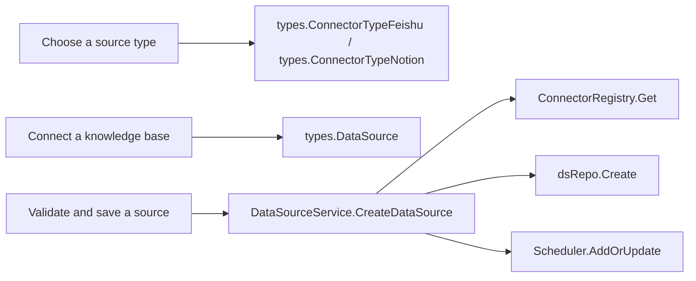
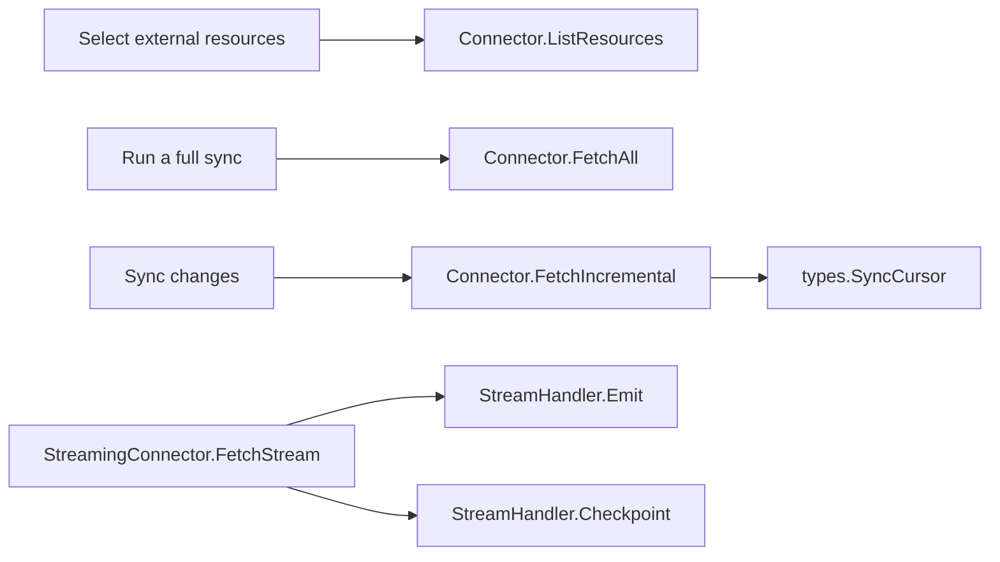

<!-- source: DeepWiki mcp.deepwiki.com · repo Tencent/WeKnora · page 14 Data Sources and Connectors · fetched 2026-10-29 -->

# Data Sources and Connectors

Relevant source files

The following files were used as context for generating this wiki page:

- [client/knowledgebase_duplicate_test.go](client/knowledgebase_duplicate_test.go)
- [internal/agent/tools/query_knowledge_graph_test.go](internal/agent/tools/query_knowledge_graph_test.go)
- [internal/application/service/datasource_service.go](internal/application/service/datasource_service.go)
- [internal/application/service/datasource_service_test.go](internal/application/service/datasource_service_test.go)
- [internal/datasource/connector.go](internal/datasource/connector.go)
- [internal/handler/knowledgebase_copy_preflight_test.go](internal/handler/knowledgebase_copy_preflight_test.go)
- [internal/types/datasource.go](internal/types/datasource.go)

## Purpose and Scope

Data sources connect external content platforms to a WeKnora knowledge base for ongoing ingestion. This page outlines the connector and synchronization concepts; it does not document individual setup steps. For configuration details, see [Data Source Configuration](#14.1). For platform-specific behavior, see [Connector Reference](#14.2).

Sources: [internal/application/service/datasource_service.go:67-119](), [internal/datasource/connector.go:9-52]()

### Overview of Ingestion Flow

A `DataSource` represents an external source configuration associated with a knowledge base. When creating one, `DataSourceService.CreateDataSource` validates the schedule, checks that the knowledge base belongs to the same tenant, looks up the connector type in `ConnectorRegistry`, validates the configuration, and persists the data source. If an active source has a schedule, the service also attempts to register it with the scheduler. [internal/types/datasource.go:69-103](), [internal/application/service/datasource_service.go:67-119]()

The connector interface separates platform-specific access from the service’s ingestion workflow. Connectors validate access, expose selectable resources, and fetch items either in full or incrementally. Some connectors can additionally stream items and checkpoints during a fetch. For setup and sync options, see [Data Source Configuration](#14.1); for platform-specific connector details, see [Connector Reference](#14.2). [internal/datasource/connector.go:9-52](), [internal/datasource/connector.go:54-93]()

Sources: [internal/types/datasource.go:69-103](), [internal/application/service/datasource_service.go:67-119](), [internal/datasource/connector.go:9-93]()

#### Natural Language to Code Entity Mapping: Configure a Source

The diagram maps common user tasks to the code entities that represent or implement them.

Sources: [internal/types/datasource.go:18-45](), [internal/application/service/datasource_service.go:26-38](), [internal/application/service/datasource_service.go:67-119]()

#### Natural Language to Code Entity Mapping: Fetch External Content

This diagram relates resource selection and synchronization concepts to the connector contract. The connector interface supports full and incremental fetching; optional streaming interfaces support item emission and cursor checkpoints. [internal/datasource/connector.go:19-51](), [internal/datasource/connector.go:54-93]()

Sources: [internal/datasource/connector.go:19-51](), [internal/datasource/connector.go:54-93]()

### Core Architecture and Components

#### Connectors and Resource Selection

Each connector implements `Connector`, which identifies its type, validates a configuration, lists resources for selection, resolves resource ancestors where needed, and fetches content. The optional `StreamingConnector` contract adds streamed item delivery and cursor checkpoints; connectors that do not implement it can use the batch fetch methods. See [Connector Reference](#14.2) for supported platforms and their behavior. [internal/datasource/connector.go:9-52](), [internal/datasource/connector.go:54-93]()

Sources: [internal/datasource/connector.go:9-93]()

#### Synchronization Settings and Status

`DataSource` records the target knowledge base, connector type, schedule, sync mode, status, conflict strategy, deletion behavior, cursor, and latest-result summary. The model defines incremental and full sync modes, active, paused, and error data-source statuses, and running, success, partial, failed, and canceled sync-log statuses. See [Data Source Configuration](#14.1) for configuration, schedule, credential, and log details. [internal/types/datasource.go:18-67](), [internal/types/datasource.go:69-118]()

Sources: [internal/types/datasource.go:18-67](), [internal/types/datasource.go:69-118]()

#### Sync Records

`SyncLog` represents an execution and includes its status, start and finish times, item counts, error message, and result. `DataSourceService.ListDataSources` attaches the latest available sync log to each returned data source. For operational guidance on sync history and logs, see [Data Source Configuration](#14.1). [internal/types/datasource.go:149-203](), [internal/application/service/datasource_service.go:131-148]()

Sources: [internal/types/datasource.go:149-203](), [internal/application/service/datasource_service.go:131-148]()

### Child Pages

Use the child pages for operational setup and connector-specific reference material:

- **[Data Source Configuration](#14.1)** — Configure connectors, schedules, credentials, and sync-log workflows.
- **[Connector Reference](#14.2)** — Review supported connectors—including Feishu Docs/Wiki, Confluence, GitLab, Notion, Yuque, IMA, DingTalk, RSS feeds, and web crawlers—and their authentication and sync behavior.

Sources: [internal/application/service/datasource_service.go:67-119](), [internal/datasource/connector.go:9-52](), [internal/types/datasource.go:18-45]()

---

