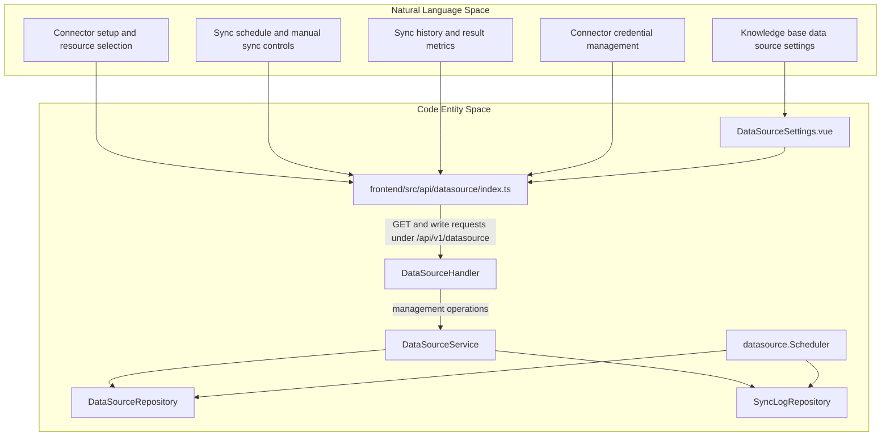
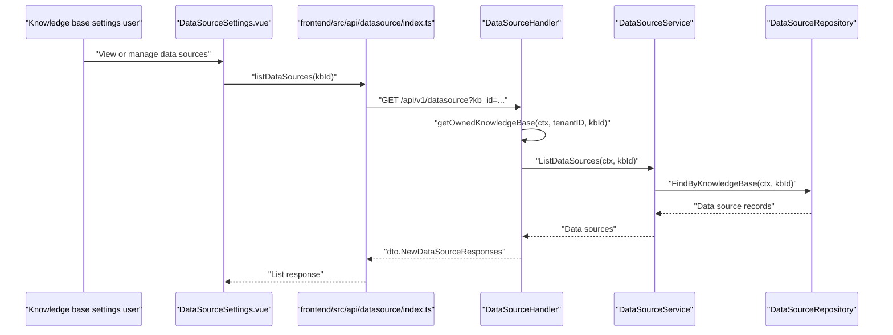
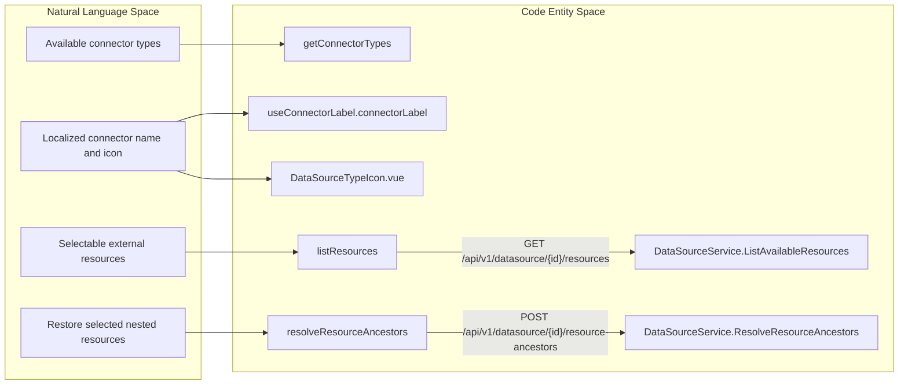
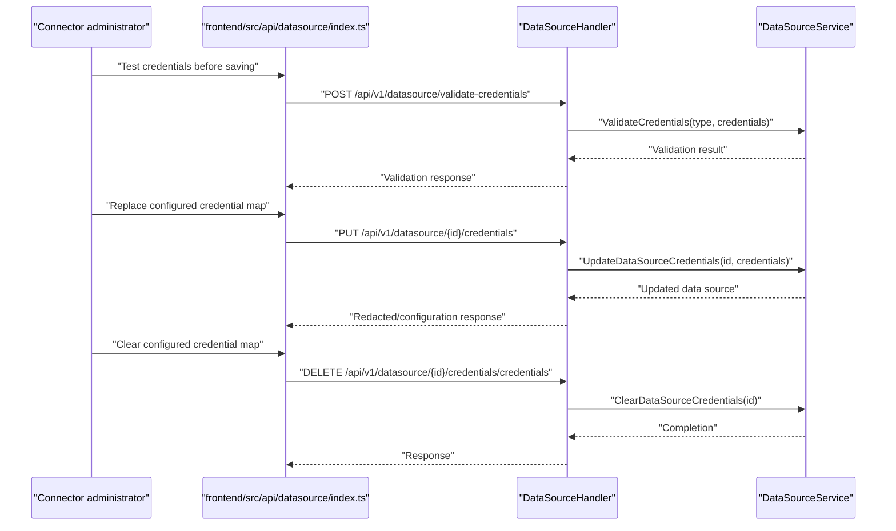
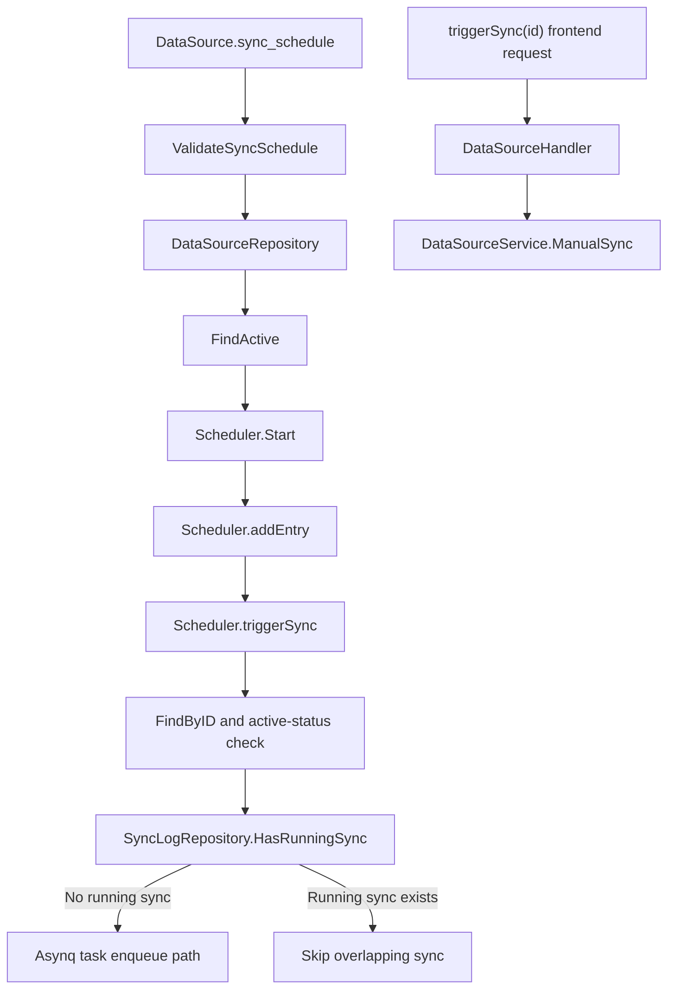
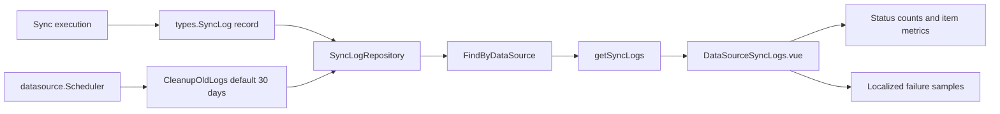

<!-- source: DeepWiki mcp.deepwiki.com · repo Tencent/WeKnora · page 14.1 Data Source Configuration · fetched 2026-10-29 -->

# Data Source Configuration

Relevant source files

The following files were used as context for generating this wiki page:

- [frontend/src/api/datasource/index.ts](frontend/src/api/datasource/index.ts)
- [frontend/src/assets/img/datasource-feishu.ico](frontend/src/assets/img/datasource-feishu.ico)
- [frontend/src/assets/img/datasource-notion.ico](frontend/src/assets/img/datasource-notion.ico)
- [frontend/src/assets/img/datasource-yuque.ico](frontend/src/assets/img/datasource-yuque.ico)
- [frontend/src/composables/useConnectorLabel.ts](frontend/src/composables/useConnectorLabel.ts)
- [frontend/src/views/knowledge/settings/DataSourceSettings.vue](frontend/src/views/knowledge/settings/DataSourceSettings.vue)
- [frontend/src/views/knowledge/settings/DataSourceSyncLogs.vue](frontend/src/views/knowledge/settings/DataSourceSyncLogs.vue)
- [frontend/src/views/knowledge/settings/DataSourceTypeIcon.test.ts](frontend/src/views/knowledge/settings/DataSourceTypeIcon.test.ts)
- [frontend/src/views/knowledge/settings/DataSourceTypeIcon.vue](frontend/src/views/knowledge/settings/DataSourceTypeIcon.vue)
- [internal/application/repository/datasource_repo.go](internal/application/repository/datasource_repo.go)
- [internal/application/repository/datasource_repo_test.go](internal/application/repository/datasource_repo_test.go)
- [internal/application/repository/datasource_retention_test.go](internal/application/repository/datasource_retention_test.go)
- [internal/application/service/datasource_delete_sqlite_test.go](internal/application/service/datasource_delete_sqlite_test.go)
- [internal/application/service/datasource_schedule_test.go](internal/application/service/datasource_schedule_test.go)
- [internal/datasource/scheduler.go](internal/datasource/scheduler.go)
- [internal/datasource/scheduler_retention_test.go](internal/datasource/scheduler_retention_test.go)
- [internal/datasource/scheduler_test.go](internal/datasource/scheduler_test.go)
- [internal/handler/datasource.go](internal/handler/datasource.go)
- [internal/handler/datasource_schedule_test.go](internal/handler/datasource_schedule_test.go)
- [internal/handler/datasource_test.go](internal/handler/datasource_test.go)
- [internal/types/interfaces/datasource.go](internal/types/interfaces/datasource.go)
- [website-docs/04-api/02-api-infra.md](website-docs/04-api/02-api-infra.md)

## Purpose and Scope

This page explains the data-source settings exposed for a knowledge base: connector configuration, resource selection, sync scheduling and controls, sync-history inspection, and credential management. It covers the frontend API contract and the backend ownership, service-interface, repository, and scheduler boundaries visible in the supplied code. [frontend/src/api/datasource/index.ts:5-25](); [internal/handler/datasource.go:15-30](); [internal/types/interfaces/datasource.go:10-81]()

Sources: [frontend/src/api/datasource/index.ts:5-25](); [internal/handler/datasource.go:15-30](); [internal/types/interfaces/datasource.go:10-81]()

---

## 1. System Architecture and Data Flow

A data source is associated with a knowledge base and has a connector `type`, connector-specific `config`, sync settings, status, and sync-state fields. The frontend API models these fields and calls the `/api/v1/datasource` endpoints. On the backend, `DataSourceHandler` delegates to the `DataSourceService` interface; the repository interfaces separate persistence of configuration, sync state, and log records. [frontend/src/api/datasource/index.ts:5-25](); [internal/handler/datasource.go:15-30](); [internal/types/interfaces/datasource.go:10-46](); [internal/types/interfaces/datasource.go:84-142]()

The handler checks that the knowledge base belongs to the authenticated tenant before creating or listing data sources. For data-source operations, it resolves the source’s knowledge base and applies the same ownership check. [internal/handler/datasource.go:32-79](); [internal/handler/datasource.go:91-121](); [internal/handler/datasource.go:165-190]()

### Data Source Architecture to Code Entity Mapping

Title: "Data Source Settings Mapped to Backend Entities"

Sources: [frontend/src/views/knowledge/settings/DataSourceSettings.vue:6-19](); [frontend/src/api/datasource/index.ts:89-177](); [internal/handler/datasource.go:15-30](); [internal/types/interfaces/datasource.go:10-46](); [internal/types/interfaces/datasource.go:84-142](); [internal/datasource/scheduler.go:35-52]()

### Management Request Flow

The frontend API client provides operations for listing, creating, updating, deleting, validating, selecting resources, triggering sync, pausing or resuming a source, retrieving logs, and managing credentials. The handler’s list and create methods validate the tenant context and knowledge-base ownership before calling the service. [frontend/src/api/datasource/index.ts:89-177](); [internal/handler/datasource.go:91-121](); [internal/handler/datasource.go:165-190]()

Title: "Data Source Management Request Path"

Sources: [frontend/src/views/knowledge/settings/DataSourceSettings.vue:54-72](); [frontend/src/api/datasource/index.ts:95-96](); [internal/handler/datasource.go:32-61](); [internal/handler/datasource.go:165-190](); [internal/types/interfaces/datasource.go:18-20](); [internal/application/repository/datasource_repo.go:64-78]()

---

## 2. Connector Configuration and Resource Selection

The frontend represents a connector through `DataSource.type`, `DataSource.config`, and the associated sync fields. The connector-type API can be queried through `getConnectorTypes()`. Resource discovery is exposed through `listResources(id, parentId?)`; passing a parent ID requests children for lazy resource-tree loading. `resolveResourceAncestors(id, resourceIds)` supports restoring the ancestor path for existing selections. [frontend/src/api/datasource/index.ts:5-25](); [frontend/src/api/datasource/index.ts:91-92](); [frontend/src/api/datasource/index.ts:124-137]()

The service interface defines matching operations for listing available resources and resolving ancestors. It describes an empty `parentID` as a request for top-level resources and a resource’s external ID as a request for its children. [internal/types/interfaces/datasource.go:55-63]()

Connector display labels are resolved through `useConnectorLabel()`. It checks whether the localized `datasource.connector.<type>` message exists and falls back to the connector type when no translation is available. `DataSourceTypeIcon.vue` uses that helper for icon alt text and falls back to a type-derived character when there is no mapped icon. [frontend/src/composables/useConnectorLabel.ts:25-33](); [frontend/src/views/knowledge/settings/DataSourceTypeIcon.vue:15-36](); [frontend/src/views/knowledge/settings/DataSourceTypeIcon.vue:40-55]()

Sources: [frontend/src/api/datasource/index.ts:5-25](); [frontend/src/api/datasource/index.ts:91-92](); [frontend/src/api/datasource/index.ts:124-137](); [internal/types/interfaces/datasource.go:55-63](); [frontend/src/composables/useConnectorLabel.ts:25-33](); [frontend/src/views/knowledge/settings/DataSourceTypeIcon.vue:15-55]()

### Connector Setup Mapped to Code

Title: "Connector Selection and Resource Discovery Mapped to Code Entities"

Sources: [frontend/src/api/datasource/index.ts:91-92](); [frontend/src/api/datasource/index.ts:124-137](); [internal/types/interfaces/datasource.go:55-63](); [frontend/src/composables/useConnectorLabel.ts:25-33](); [frontend/src/views/knowledge/settings/DataSourceTypeIcon.vue:15-55]()

---

## 3. Credential Lifecycle Management

The frontend exposes credentials as a single logical map for each data source. Its list/detail response shape indicates whether credentials are configured through `credentials.credentials.configured`; it does not define a per-credential-field response shape. [frontend/src/api/datasource/index.ts:20-22]()

Credential replacement and clearing have dedicated API functions. `putDataSourceCredentials(id, credentials)` sends the replacement map to `PUT /api/v1/datasource/{id}/credentials`; `deleteDataSourceCredentials(id)` deletes the credentials subresource at `/api/v1/datasource/{id}/credentials/credentials`. The service interface describes the update as replacing the connector credential map atomically and clearing it as idempotent when already empty. [frontend/src/api/datasource/index.ts:155-177](); [internal/types/interfaces/datasource.go:36-46]()

Credentials can be tested before persistence using `validateCredentials(type, credentials)`, which posts to `/api/v1/datasource/validate-credentials`. The service interface describes this operation as testing connectivity with raw credentials without persisting them. A separate `validateConnection(id)` operation tests a configured data source. [frontend/src/api/datasource/index.ts:115-122](); [internal/types/interfaces/datasource.go:48-53]()

The handler’s ownership checks are explicitly intended to protect data-source settings containing connector credentials. Before resolving a data source for an operation, `getOwnedDataSource` loads it and checks access through its knowledge base. [internal/handler/datasource.go:39-79]()

### Credential Validation and Management Mapped to Code

Title: "Credential Test and Replacement Paths"

Sources: [frontend/src/api/datasource/index.ts:115-122](); [frontend/src/api/datasource/index.ts:155-177](); [internal/types/interfaces/datasource.go:36-53](); [internal/handler/datasource.go:39-79]()

---

## 4. Sync Scheduling and Execution

`sync_schedule` stores the schedule string. The scheduler accepts the cron syntax configured by `syncScheduleParser`, which includes seconds, minutes, hours, day of month, month, day of week, and descriptors. An empty schedule is valid and disables automatic sync, allowing a manual-only source. [frontend/src/api/datasource/index.ts:12-16](); [internal/datasource/scheduler.go:19-33]()

At startup, `Scheduler.Start` loads active sources through `DataSourceRepository.FindActive`, skips sources with an empty schedule, registers the remaining schedules, and starts the cron runner. `FindActive` selects active, non-deleted records with a non-empty schedule. [internal/datasource/scheduler.go:71-99](); [internal/application/repository/datasource_repo.go:142-154]()

`Scheduler.AddOrUpdate` validates the schedule for active sources, removes any existing cron entry for that source, and registers a new entry only if the source remains active and has a non-empty schedule. `PauseDataSource` and `ResumeDataSource` are exposed in the service interface and frontend API. [internal/datasource/scheduler.go:128-150](); [internal/types/interfaces/datasource.go:68-72](); [frontend/src/api/datasource/index.ts:143-149]()

At each scheduled tick, `triggerSync` reloads the source and skips it if it is missing or not active. It also checks for an already-running sync log to prevent overlap. The scheduler’s documented deduplication design uses that running-log check plus a deterministic Asynq task ID per data source and minute, so multiple instances do not enqueue duplicate tasks for the same minute. [internal/datasource/scheduler.go:35-43](); [internal/datasource/scheduler.go:184-203]()

The frontend supports an immediate sync request through `triggerSync(id)`. `DataSourceSettings.vue` reloads the list silently after triggering a sync and schedules another list load three seconds later while a source’s latest log has status `running`. [frontend/src/api/datasource/index.ts:139-141](); [frontend/src/views/knowledge/settings/DataSourceSettings.vue:47-72](); [frontend/src/views/knowledge/settings/DataSourceSettings.vue:100-108]()

### Schedule and Sync Flow Mapped to Code

Title: "Sync Schedule From Persistent Source to Execution State"

Sources: [internal/datasource/scheduler.go:19-33](); [internal/datasource/scheduler.go:71-99](); [internal/datasource/scheduler.go:128-150](); [internal/datasource/scheduler.go:184-203](); [internal/application/repository/datasource_repo.go:142-154](); [internal/types/interfaces/datasource.go:65-81](); [frontend/src/api/datasource/index.ts:139-149]()

The repository writes the sync-produced status, last-sync timestamp, cursor, result, error message, and update time through `UpdateSyncState`. Its map-based update allows zero values, including clearing an error message, to be persisted. [internal/application/repository/datasource_repo.go:103-127]()

Sources: [internal/application/repository/datasource_repo.go:103-127]()

---

## 5. Monitoring and Sync Logs

The frontend `SyncLog` type defines statuses `running`, `success`, `partial`, `failed`, and `canceled`, along with start and finish timestamps, item counters, an overall error message, and optional result details. `SyncResultDetail` can include totals and per-item error samples; each `SyncItemError` can include a title, localization code, interpolation parameters, or fallback message. [frontend/src/api/datasource/index.ts:28-65]()

The repository supports creating and retrieving sync-log records. `FindByDataSource` orders a source’s logs by `started_at` descending and applies pagination, defaulting non-positive limits to 10 and negative offsets to 0. The repository interface also exposes latest-log retrieval, running-sync checks, result updates, cancellation of pending logs, and retention cleanup. [internal/application/repository/datasource_repo.go:156-215](); [internal/types/interfaces/datasource.go:111-142]()

The frontend log drawer requests 50 logs at a time, appending further pages using the current log count as the offset. It calculates summary counts, groups logs by date, and limits displayed per-item failure samples to 50. Error codes are localized using the viewer’s locale when a translation exists; otherwise the UI falls back to the provided message or code. [frontend/src/views/knowledge/settings/DataSourceSyncLogs.vue:13-56](); [frontend/src/views/knowledge/settings/DataSourceSyncLogs.vue:59-66](); [frontend/src/views/knowledge/settings/DataSourceSyncLogs.vue:134-156](); [frontend/src/views/knowledge/settings/DataSourceSyncLogs.vue:158-171]()

The scheduler registers daily log-retention cleanup. The cleanup job calls `SyncLogRepository.CleanupOldLogs` with a default retention of 30 days; the repository interface documents that failed logs for live sources are retained because they may be awaiting retry. [internal/datasource/scheduler.go:88-107](); [internal/types/interfaces/datasource.go:138-141]()

### Sync Log Data Flow Mapped to Code

Title: "Sync History From Backend Records to the Settings Drawer"

Sources: [frontend/src/api/datasource/index.ts:28-65](); [frontend/src/api/datasource/index.ts:151-153](); [frontend/src/views/knowledge/settings/DataSourceSyncLogs.vue:13-56](); [frontend/src/views/knowledge/settings/DataSourceSyncLogs.vue:59-66](); [frontend/src/views/knowledge/settings/DataSourceSyncLogs.vue:134-171](); [internal/application/repository/datasource_repo.go:156-215](); [internal/types/interfaces/datasource.go:111-142](); [internal/datasource/scheduler.go:88-107]()

`DataSourceSettings.vue` displays the latest sync state alongside each source. It polls the list every three seconds while any latest log is running and stops polling when none are running; the timer is also cleared when the component unmounts. [frontend/src/views/knowledge/settings/DataSourceSettings.vue:40-72](); [frontend/src/views/knowledge/settings/DataSourceSettings.vue:185-187]()

Sources: [frontend/src/views/knowledge/settings/DataSourceSettings.vue:40-72](); [frontend/src/views/knowledge/settings/DataSourceSettings.vue:185-187]()

### Access and Management Notes

The settings view uses `authStore.hasRole('admin')` to determine whether to expose management actions; its comments describe the intended distinction between read-only access and admin-level writes. The backend handler independently checks tenant identity and knowledge-base ownership, so frontend visibility is not the only access boundary. [frontend/src/views/knowledge/settings/DataSourceSettings.vue:26-29](); [internal/handler/datasource.go:32-79]()

Sources: [frontend/src/views/knowledge/settings/DataSourceSettings.vue:26-29](); [internal/handler/datasource.go:32-79]()

# End of page

---

