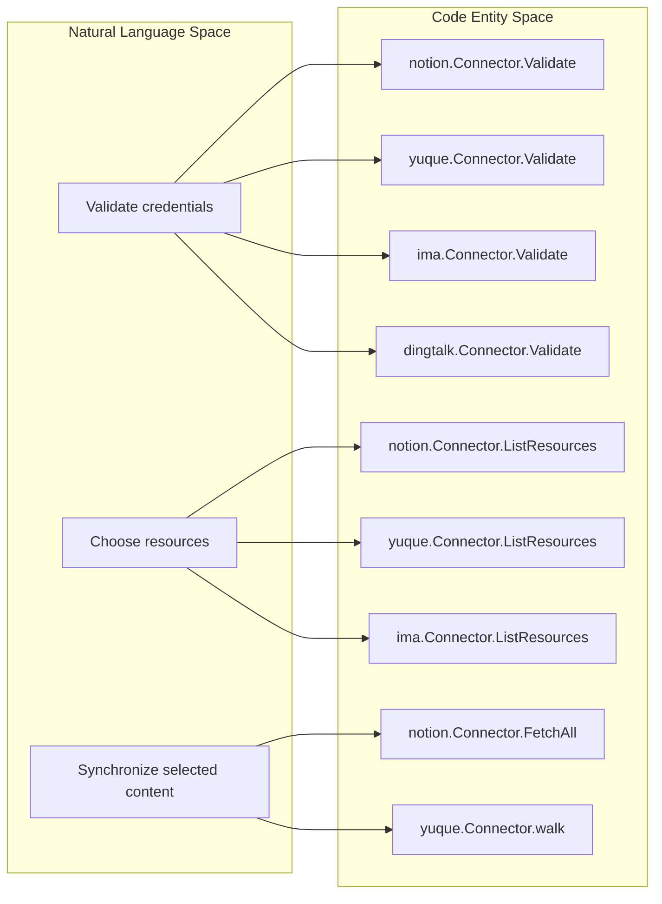
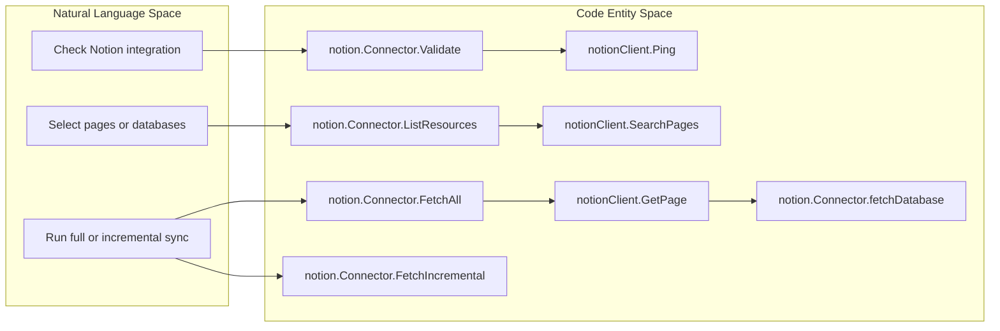
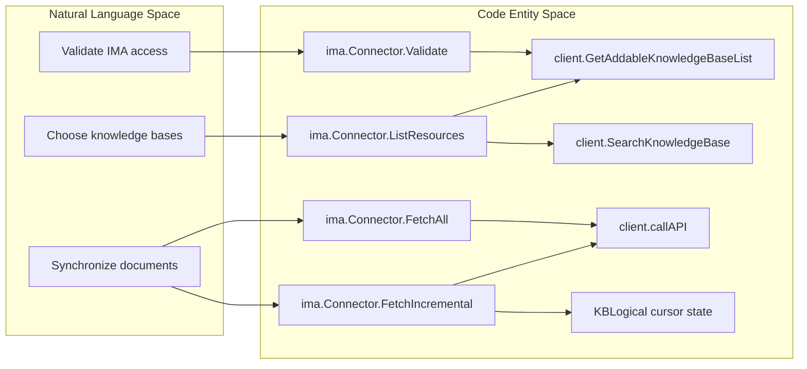

<!-- source: DeepWiki mcp.deepwiki.com · repo Tencent/WeKnora · page 14.2 Connector Reference · fetched 2026-10-29 -->

# Connector Reference

Relevant source files

The following files were used as context for generating this wiki page:

- [internal/datasource/connector/dingtalk/client.go](internal/datasource/connector/dingtalk/client.go)
- [internal/datasource/connector/dingtalk/client_test.go](internal/datasource/connector/dingtalk/client_test.go)
- [internal/datasource/connector/dingtalk/connector.go](internal/datasource/connector/dingtalk/connector.go)
- [internal/datasource/connector/dingtalk/connector_test.go](internal/datasource/connector/dingtalk/connector_test.go)
- [internal/datasource/connector/dingtalk/folder_path_settings_test.go](internal/datasource/connector/dingtalk/folder_path_settings_test.go)
- [internal/datasource/connector/dingtalk/folder_path_test.go](internal/datasource/connector/dingtalk/folder_path_test.go)
- [internal/datasource/connector/dingtalk/settings.go](internal/datasource/connector/dingtalk/settings.go)
- [internal/datasource/connector/dingtalk/validate_selection_test.go](internal/datasource/connector/dingtalk/validate_selection_test.go)
- [internal/datasource/connector/dingtalk/validate_test.go](internal/datasource/connector/dingtalk/validate_test.go)
- [internal/datasource/connector/feishu/core/client.go](internal/datasource/connector/feishu/core/client.go)
- [internal/datasource/connector/feishu/core/token_log_test.go](internal/datasource/connector/feishu/core/token_log_test.go)
- [internal/datasource/connector/feishu/core/truncate_utf8_test.go](internal/datasource/connector/feishu/core/truncate_utf8_test.go)
- [internal/datasource/connector/ima/client.go](internal/datasource/connector/ima/client.go)
- [internal/datasource/connector/ima/client_cap_test.go](internal/datasource/connector/ima/client_cap_test.go)
- [internal/datasource/connector/ima/connector.go](internal/datasource/connector/ima/connector.go)
- [internal/datasource/connector/ima/connector_test.go](internal/datasource/connector/ima/connector_test.go)
- [internal/datasource/connector/ima/fake_ima_test.go](internal/datasource/connector/ima/fake_ima_test.go)
- [internal/datasource/connector/ima/pagination_guard_test.go](internal/datasource/connector/ima/pagination_guard_test.go)
- [internal/datasource/connector/ima/truncate_utf8_test.go](internal/datasource/connector/ima/truncate_utf8_test.go)
- [internal/datasource/connector/ima/types.go](internal/datasource/connector/ima/types.go)
- [internal/datasource/connector/ima/types_test.go](internal/datasource/connector/ima/types_test.go)
- [internal/datasource/connector/notion/attachment_retry_test.go](internal/datasource/connector/notion/attachment_retry_test.go)
- [internal/datasource/connector/notion/block_retry_test.go](internal/datasource/connector/notion/block_retry_test.go)
- [internal/datasource/connector/notion/client.go](internal/datasource/connector/notion/client.go)
- [internal/datasource/connector/notion/client_test.go](internal/datasource/connector/notion/client_test.go)
- [internal/datasource/connector/notion/connector.go](internal/datasource/connector/notion/connector.go)
- [internal/datasource/connector/notion/connector_test.go](internal/datasource/connector/notion/connector_test.go)
- [internal/datasource/connector/notion/discovery_failure_test.go](internal/datasource/connector/notion/discovery_failure_test.go)
- [internal/datasource/connector/notion/empty_page_test.go](internal/datasource/connector/notion/empty_page_test.go)
- [internal/datasource/connector/notion/markdown.go](internal/datasource/connector/notion/markdown.go)
- [internal/datasource/connector/notion/markdown_test.go](internal/datasource/connector/notion/markdown_test.go)
- [internal/datasource/connector/notion/pagination_guard_test.go](internal/datasource/connector/notion/pagination_guard_test.go)
- [internal/datasource/connector/notion/query_truncation_test.go](internal/datasource/connector/notion/query_truncation_test.go)
- [internal/datasource/connector/notion/query_windowing_test.go](internal/datasource/connector/notion/query_windowing_test.go)
- [internal/datasource/connector/notion/truncation_test.go](internal/datasource/connector/notion/truncation_test.go)
- [internal/datasource/connector/notion/types.go](internal/datasource/connector/notion/types.go)
- [internal/datasource/connector/notion/types_test.go](internal/datasource/connector/notion/types_test.go)
- [internal/datasource/connector/yuque/client.go](internal/datasource/connector/yuque/client.go)
- [internal/datasource/connector/yuque/connector.go](internal/datasource/connector/yuque/connector.go)
- [internal/datasource/connector/yuque/connector_test.go](internal/datasource/connector/yuque/connector_test.go)
- [internal/datasource/connector/yuque/pagination_guard_test.go](internal/datasource/connector/yuque/pagination_guard_test.go)
- [internal/datasource/connector/yuque/truncate_utf8_test.go](internal/datasource/connector/yuque/truncate_utf8_test.go)
- [internal/datasource/connector/yuque/types.go](internal/datasource/connector/yuque/types.go)
- [internal/datasource/connector/yuque/types_test.go](internal/datasource/connector/yuque/types_test.go)
- [internal/datasource/filename.go](internal/datasource/filename.go)
- [internal/im/mattermost/client.go](internal/im/mattermost/client.go)
- [internal/im/mattermost/truncate_utf8_test.go](internal/im/mattermost/truncate_utf8_test.go)

## Purpose and scope

This page describes the connector implementations covered by the supplied source material: how they authenticate, expose selectable resources, and fetch or incrementally synchronize content. It also retains the connector catalog for Confluence, GitLab, RSS, and web crawlers; implementation details for those connectors are not included in the supplied files, so their behavior is not expanded here.

Sources: [internal/datasource/connector/feishu/core/client.go:21-39](), [internal/datasource/connector/notion/connector.go:25-35](), [internal/datasource/connector/yuque/connector.go:17-29](), [internal/datasource/connector/ima/connector.go:16-26](), [internal/datasource/connector/dingtalk/connector.go:79-107]()

---

## Architecture Overview

Connectors adapt external APIs to WeKnora’s data-source operations. The supplied implementations expose validation and resource discovery, and some also implement full or incremental fetching. Feishu’s API client handles token acquisition and API requests; Notion, Yuque, and IMA have connector-specific clients; DingTalk’s connector declares compatibility with both `datasource.Connector` and `datasource.FullSyncWithCursor`. [internal/datasource/connector/feishu/core/client.go:21-39](), [internal/datasource/connector/notion/connector.go:25-65](), [internal/datasource/connector/notion/connector.go:135-174](), [internal/datasource/connector/yuque/connector.go:17-32](), [internal/datasource/connector/ima/connector.go:16-32](), [internal/datasource/connector/dingtalk/connector.go:79-107]()

### Connector operations visible in the supplied implementations

| Operation | Implementation behavior |
|---|---|
| Validate | Notion parses configuration, constructs a client, and calls `Ping`; Yuque calls `Ping`; IMA calls `GetAddableKnowledgeBaseList`; DingTalk validates either selected resources or the tenant. [internal/datasource/connector/notion/connector.go:38-50](), [internal/datasource/connector/yuque/connector.go:31-42](), [internal/datasource/connector/ima/connector.go:28-42](), [internal/datasource/connector/dingtalk/connector.go:114-141]() |
| List resources | Notion returns a tree with parent links; Yuque returns a flat repository list; IMA returns a flat knowledge-base list. [internal/datasource/connector/notion/connector.go:61-132](), [internal/datasource/connector/yuque/connector.go:44-60](), [internal/datasource/connector/yuque/connector.go:52-140](), [internal/datasource/connector/ima/connector.go:44-50](), [internal/datasource/connector/ima/connector.go:79-196]() |
| Fetch | Notion’s `FetchAll` fetches selected page or database resources; Yuque’s `FetchAll` delegates to `walk`; IMA’s `FetchAll` is described as syncing selected knowledge bases; DingTalk’s connector imports native wiki documents and uploaded Office/PDF files. [internal/datasource/connector/notion/connector.go:135-169](), [internal/datasource/connector/yuque/connector.go:143-157](), [internal/datasource/connector/ima/connector.go:198-200](), [internal/datasource/connector/dingtalk/connector.go:86-90]() |

### Natural Language Space to Code Entity Space: Connector operations

The diagram maps operator actions to the connector methods and client functions visible in the supplied files. Not every connector has all of these methods in the supplied excerpts. [internal/datasource/connector/notion/connector.go:38-65](), [internal/datasource/connector/notion/connector.go:135-174](), [internal/datasource/connector/yuque/connector.go:31-56](), [internal/datasource/connector/ima/connector.go:28-42](), [internal/datasource/connector/dingtalk/connector.go:114-141]()

**Diagram: Operator actions mapped to connector entities**

Sources: [internal/datasource/connector/notion/connector.go:38-65](), [internal/datasource/connector/notion/connector.go:135-174](), [internal/datasource/connector/yuque/connector.go:31-56](), [internal/datasource/connector/yuque/connector.go:143-157](), [internal/datasource/connector/ima/connector.go:28-42](), [internal/datasource/connector/ima/connector.go:79-90](), [internal/datasource/connector/dingtalk/connector.go:114-141]()

---

## Feishu Docs and Wiki

`feishu/core.Client` wraps Feishu Open Platform document and wiki operations. `NewClient` takes a `Config`, obtains its base URL, app ID, app secret, and timezone, and creates an HTTP client with a 30-second timeout. [internal/datasource/connector/feishu/core/client.go:21-39](), [internal/datasource/connector/feishu/core/client.go:96-106]()

### Authentication and requests

`GetTenantAccessToken` requests a tenant access token using the app ID and app secret. It serializes token access with a mutex, returns a cached token while it remains valid, and applies a five-minute safety margin to the expiry interval when the returned TTL exceeds five minutes. The implementation logs token refresh metadata without logging token material. [internal/datasource/connector/feishu/core/client.go:108-159]()

Before a request proceeds through the Feishu request gate, `waitForRequestToken` obtains a token, waits for a request slot, and checks that the token is still current and unexpired. The client also caps JSON API response bodies at 16 MiB; an oversized body is rejected rather than truncated. [internal/datasource/connector/feishu/core/client.go:41-64](), [internal/datasource/connector/feishu/core/client.go:161-183]()

### Sync scope

The supplied Feishu source shows a shared client for document and wiki operations, token management, response-size handling, and request pacing. It does not include the Feishu connector implementation or its fetch methods, so resource traversal and sync-cursor behavior are not specified here. [internal/datasource/connector/feishu/core/client.go:21-39](), [internal/datasource/connector/feishu/core/client.go:161-207]()

Sources: [internal/datasource/connector/feishu/core/client.go:21-64](), [internal/datasource/connector/feishu/core/client.go:96-183](), [internal/datasource/connector/feishu/core/client.go:185-207]()

---

## Confluence Connector

The existing page identifies Confluence as a supported connector for spaces and pages and describes basic authentication and streaming behavior. The supplied source files do not include the Confluence connector or client implementation, so those details cannot be verified or elaborated in this revision.

Sources: [internal/datasource/connector/confluence/connector.go:1-301](), [internal/datasource/connector/confluence/client.go:80-110]()

---

## Notion Connector

`notion.Connector` implements Notion validation, resource discovery, full fetching, and incremental fetching. `Type` returns the Notion connector identifier. [internal/datasource/connector/notion/connector.go:25-36]()

### Authentication and API client

`Validate` parses the Notion configuration, constructs a `notionClient` using the API key and optional base URL, and calls `Ping`. `Ping` calls `GET /v1/users/me`. API requests carry the token as a bearer credential and include the Notion API version header. [internal/datasource/connector/notion/connector.go:38-50](), [internal/datasource/connector/notion/client.go:59-74](), [internal/datasource/connector/notion/client.go:90-112](), [internal/datasource/connector/notion/client.go:185-188]()

The client rate-limits requests and retries transport failures, HTTP 429 responses, and server errors. It returns credential errors for HTTP 401/403 and resource-not-found errors for HTTP 404. Responses are capped at 16 MiB, and oversized responses are rejected rather than indexed as truncated content. [internal/datasource/connector/notion/client.go:33-57](), [internal/datasource/connector/notion/client.go:76-88](), [internal/datasource/connector/notion/client.go:90-183]()

### Resource discovery and full sync

`ListResources` searches accessible pages and databases. It calculates effective parent IDs, excludes trashed objects, assigns each result a page or database type, and sets `HasChildren` from the discovered parent relationships. Because the search result already contains the hierarchy, a request for a specific `parentID` returns no additional resources. [internal/datasource/connector/notion/connector.go:61-71](), [internal/datasource/connector/notion/connector.go:74-132]()

`FetchAll` iterates selected resource IDs. It tries each ID as a page first; if that lookup fails, it treats the resource as a database or data source and calls `fetchDatabase`. [internal/datasource/connector/notion/connector.go:135-169]()

### Incremental sync

`FetchIncremental` requires configured resource IDs and reads connector state from `SyncCursor.ConnectorCursor`. If the cursor has no recorded page edit times, the connector delegates to `FetchAll` for the initial sync and builds edit-time state from fetched items. The shown code tracks page-level update times and documents database-container tracking as part of change detection. [internal/datasource/connector/notion/connector.go:172-215]()

**Diagram: Notion discovery and sync flow**

Sources: [internal/datasource/connector/notion/connector.go:38-50](), [internal/datasource/connector/notion/connector.go:61-132](), [internal/datasource/connector/notion/connector.go:135-215](), [internal/datasource/connector/notion/client.go:185-208]()

Sources: [internal/datasource/connector/notion/connector.go:25-50](), [internal/datasource/connector/notion/connector.go:61-215](), [internal/datasource/connector/notion/client.go:22-74](), [internal/datasource/connector/notion/client.go:90-208]()

---

## Yuque Connector

`yuque.Connector` exposes Yuque repositories as selectable resources and uses a shared `walk` implementation for full and incremental fetching. [internal/datasource/connector/yuque/connector.go:17-29](), [internal/datasource/connector/yuque/connector.go:143-157]()

### Authentication and client behavior

`Validate` parses the Yuque configuration, creates a client, and pings the current-user endpoint. The client sends the API token in the `X-Auth-Token` header. Its request handling applies retries for transient transport failures, rate limits, and server errors, and maps HTTP 401/403 responses to `ErrInvalidCredentials`. [internal/datasource/connector/yuque/connector.go:31-42](), [internal/datasource/connector/yuque/client.go:84-109](), [internal/datasource/connector/yuque/client.go:117-189]()

The Yuque client caps JSON responses at 16 MiB and limits offset-paginated walks to 10,000 hops. [internal/datasource/connector/yuque/client.go:19-36](), [internal/datasource/connector/yuque/client.go:62-82]()

### Resource discovery

`ListResources` returns a flat repository list; a request for children of a parent returns an empty list. It first fetches the current user. For a group token, it lists that group’s repositories directly. For a personal token, it combines the user’s repositories with repositories from joined groups, deduplicates by repository ID, and sorts the results by external ID. [internal/datasource/connector/yuque/connector.go:44-60](), [internal/datasource/connector/yuque/connector.go:63-140]()

### Fetching

`FetchAll` delegates to `walk` with incremental mode disabled. `walk` parses selected book IDs, lists each book’s documents, and optionally fetches the table of contents to derive folder paths according to folder settings. The supplied source shows that TOC failure is treated distinctly from a successfully fetched TOC that does not contain a document. [internal/datasource/connector/yuque/connector.go:143-196]()

Sources: [internal/datasource/connector/yuque/connector.go:17-60](), [internal/datasource/connector/yuque/connector.go:63-140](), [internal/datasource/connector/yuque/connector.go:143-196](), [internal/datasource/connector/yuque/client.go:19-36](), [internal/datasource/connector/yuque/client.go:84-189]()

---

## IMA Connector

`ima.Connector` integrates with Tencent IMA and exposes knowledge bases as flat selectable resources. Its client calls the IMA OpenAPI and uses separate HTTP clients for API requests and media downloads. [internal/datasource/connector/ima/connector.go:16-26](), [internal/datasource/connector/ima/client.go:1-4](), [internal/datasource/connector/ima/client.go:42-66]()

### Authentication and API requests

The IMA client authenticates requests with the `ima-openapi-clientid` and `ima-openapi-apikey` headers. `callAPI` sends POST requests to the wiki API namespace; `callAPIAt` also supports another API namespace for notes. It parses the standard response envelope and retries transient failures. Credentials are redacted in the client’s configuration log. [internal/datasource/connector/ima/client.go:91-115](), [internal/datasource/connector/ima/client.go:129-143]()

API responses are capped at 16 MiB. The client configures a 60-second API timeout, a separate 120-second download timeout, and a 200 MiB maximum download size. [internal/datasource/connector/ima/client.go:23-40](), [internal/datasource/connector/ima/client.go:57-67]()

### Validation and resource discovery

`Validate` parses the IMA configuration and calls `GetAddableKnowledgeBaseList`. `ListResources` returns no children for a non-empty parent ID. For a root listing, it pages through addable knowledge bases; if that list is empty, it falls back to `SearchKnowledgeBase` with an empty query. It enriches the results with details in batches of up to 20 IDs and returns them sorted by external ID. [internal/datasource/connector/ima/connector.go:28-50](), [internal/datasource/connector/ima/connector.go:79-90](), [internal/datasource/connector/ima/connector.go:108-150](), [internal/datasource/connector/ima/connector.go:152-196]()

The cursor-paginated discovery loops detect repeated cursors and stop at a 10,000-page limit. [internal/datasource/connector/ima/connector.go:53-77](), [internal/datasource/connector/ima/connector.go:108-125](), [internal/datasource/connector/ima/connector.go:129-149]()

### Incremental sync and failed items

IMA incremental-sync tests document an important cursor invariant: failed downloads must not be recorded as successfully seen, so a later sync can retry them. A still-listed item that fails to download is not treated as deleted; an item removed from the listing can be tombstoned. A same-name replacement with a new media ID is emitted as an update under the same logical external ID. [internal/datasource/connector/ima/connector_test.go:18-72](), [internal/datasource/connector/ima/connector_test.go:74-133](), [internal/datasource/connector/ima/connector_test.go:135-175]()

**Diagram: IMA resource discovery and sync state**

Sources: [internal/datasource/connector/ima/connector.go:28-42](), [internal/datasource/connector/ima/connector.go:79-196](), [internal/datasource/connector/ima/connector.go:198-200](), [internal/datasource/connector/ima/client.go:91-143](), [internal/datasource/connector/ima/connector_test.go:18-72]()

Sources: [internal/datasource/connector/ima/connector.go:16-26](), [internal/datasource/connector/ima/connector.go:28-196](), [internal/datasource/connector/ima/client.go:23-67](), [internal/datasource/connector/ima/client.go:91-199](), [internal/datasource/connector/ima/connector_test.go:18-175]()

---

## DingTalk Connector

`dingtalk.Connector` imports native DingTalk `adoc` documents through the blocks API and uploaded Office/PDF files through the 钉盘 download API. The connector declares that it implements `datasource.Connector` and `datasource.FullSyncWithCursor`. [internal/datasource/connector/dingtalk/connector.go:79-107]()

### Validation and selection

`Validate` parses the data-source configuration and uses `ResourceIDs`, when provided, to validate only the selected resources. Without a selection, it validates tenant credentials by listing workspaces. Validation samples for a readable document and limits document probes to five. [internal/datasource/connector/dingtalk/connector.go:109-141](), [internal/datasource/connector/dingtalk/connector.go:144-175]()

### Sync behavior and skips

The connector deterministically skips video and known media files. Uploaded binary files are skipped when `include_uploaded_files` is not enabled. DingTalk multi-dimensional tables, mind maps, presentations, and drawings are also identified as unsupported ingest types. These skips are distinguished from read failures that may need retrying. [internal/datasource/connector/dingtalk/connector.go:26-47](), [internal/datasource/connector/dingtalk/connector.go:48-64]()

The connector has a traversal-node limit of 1,000,000. Its cursor format version is 2. [internal/datasource/connector/dingtalk/connector.go:21-24]()

Sources: [internal/datasource/connector/dingtalk/connector.go:21-64](), [internal/datasource/connector/dingtalk/connector.go:79-107](), [internal/datasource/connector/dingtalk/connector.go:109-175]()

---

## GitLab Connector

The existing page identifies GitLab as a connector for repository files and describes token authentication, streaming, and commit-based incremental synchronization. GitLab implementation files are not included in the supplied source material, so those behaviors are retained only as catalog references here.

Sources: [internal/datasource/connector/gitlab/connector.go:16-218](), [internal/datasource/connector/gitlab/client.go:20-180]()

---

## RSS Feeds and Web Crawlers

The existing page lists RSS/Atom feeds and web crawling among the supported source types. The supplied files do not include their implementations, so their authentication, scheduling, and cursor behavior cannot be detailed here.

| Connector | Scope described in the existing page | Implementation detail available in supplied files |
|---|---|---|
| `rss` | RSS and Atom feed articles | No connector implementation supplied. |
| `web_crawler` | Web crawling and extraction | No connector implementation supplied. |

Sources: [internal/types/datasource.go:35-39](), [internal/datasource/connector/rss/...](), [internal/datasource/connector/crawler/...]()

---

## Authentication and Credentials Management

Authentication mechanisms differ by connector. The supplied code shows Feishu app credentials exchanged for a cached tenant access token; Notion bearer-token authentication; Yuque’s `X-Auth-Token` header; and IMA client ID and API key headers. [internal/datasource/connector/feishu/core/client.go:108-159](), [internal/datasource/connector/notion/client.go:90-112](), [internal/datasource/connector/yuque/client.go:101-109](), [internal/datasource/connector/ima/client.go:129-143]()

Notion and IMA clients classify some authentication failures as invalid credentials. Yuque maps HTTP 401/403 to `ErrInvalidCredentials`. Feishu’s shown client avoids logging token material, while the IMA client redacts credentials in its configuration log. [internal/datasource/connector/notion/client.go:140-148](), [internal/datasource/connector/yuque/client.go:169-173](), [internal/datasource/connector/feishu/core/client.go:155-158](), [internal/datasource/connector/ima/client.go:113-116]()

Sources: [internal/datasource/connector/feishu/core/client.go:108-159](), [internal/datasource/connector/notion/client.go:90-148](), [internal/datasource/connector/yuque/client.go:101-109](), [internal/datasource/connector/yuque/client.go:169-173](), [internal/datasource/connector/ima/client.go:113-143]()

---

## Summary Table of Connectors

| Connector type | Resource scope | Authentication / sync details visible here | Key implementation file |
|---|---|---|---|
| `feishu` | Feishu Docs and Wiki operations through a shared API client | App credentials obtain cached tenant access token; request pacing and response limits are shown. [internal/datasource/connector/feishu/core/client.go:96-183]() | `internal/datasource/connector/feishu/core/client.go` |
| `confluence` | Confluence spaces and pages, as described by the existing page | Implementation source not supplied. [internal/datasource/connector/confluence/connector.go:1-301]() | `internal/datasource/connector/confluence/connector.go` |
| `notion` | Pages and databases | Bearer token; full and incremental fetching are shown. [internal/datasource/connector/notion/client.go:90-112](), [internal/datasource/connector/notion/connector.go:135-215]() | `internal/datasource/connector/notion/connector.go` |
| `yuque` | Personal and team repositories | `X-Auth-Token`; shared full/incremental walk. [internal/datasource/connector/yuque/client.go:101-109](), [internal/datasource/connector/yuque/connector.go:143-157]() | `internal/datasource/connector/yuque/connector.go` |
| `ima` | IMA knowledge bases | Client ID/API key headers; resource listing and incremental-sync tests are shown. [internal/datasource/connector/ima/client.go:129-143](), [internal/datasource/connector/ima/connector.go:79-196]() | `internal/datasource/connector/ima/connector.go` |
| `dingtalk` | DingTalk Wiki documents and uploaded files | Connector type and validation behavior are shown; credential parsing is not included in the supplied excerpt. [internal/datasource/connector/dingtalk/connector.go:86-90](), [internal/datasource/connector/dingtalk/connector.go:114-141]() | `internal/datasource/connector/dingtalk/connector.go` |
| `gitlab` | Repository files, as described by the existing page | Implementation source not supplied. [internal/datasource/connector/gitlab/connector.go:16-218]() | `internal/datasource/connector/gitlab/connector.go` |
| `rss` | RSS and Atom feeds, as described by the existing page | Implementation source not supplied. [internal/datasource/connector/rss/...]() | `internal/datasource/connector/rss/` |
| `web_crawler` | Web crawling, as described by the existing page | Implementation source not supplied. [internal/datasource/connector/crawler/...]() | `internal/datasource/connector/crawler/` |

Sources: [internal/datasource/connector/feishu/core/client.go:96-183](), [internal/datasource/connector/notion/connector.go:135-215](), [internal/datasource/connector/yuque/connector.go:143-157](), [internal/datasource/connector/ima/connector.go:79-196](), [internal/datasource/connector/dingtalk/connector.go:86-141](), [internal/datasource/connector/confluence/connector.go:1-301](), [internal/datasource/connector/gitlab/connector.go:16-218](), [internal/datasource/connector/rss/...](), [internal/datasource/connector/crawler/...]()

---

## References

- Feishu API client and token handling: [internal/datasource/connector/feishu/core/client.go:21-207]()
- Notion connector and API client: [internal/datasource/connector/notion/connector.go:25-215](), [internal/datasource/connector/notion/client.go:22-208]()
- Yuque connector and API client: [internal/datasource/connector/yuque/connector.go:17-196](), [internal/datasource/connector/yuque/client.go:19-189]()
- IMA connector and API client: [internal/datasource/connector/ima/connector.go:16-200](), [internal/datasource/connector/ima/client.go:23-199]()
- DingTalk connector: [internal/datasource/connector/dingtalk/connector.go:21-175]()
- Confluence connector: [internal/datasource/connector/confluence/connector.go:1-301]()
- GitLab connector: [internal/datasource/connector/gitlab/connector.go:16-218]()

---

