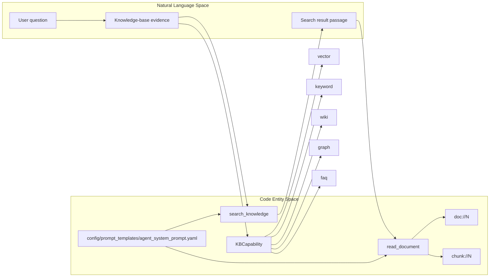
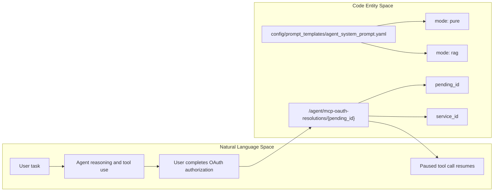
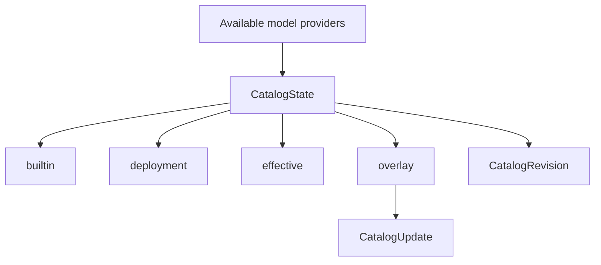

<!-- source: DeepWiki mcp.deepwiki.com · repo Tencent/WeKnora · page 15 Glossary · fetched 2026-10-29 -->

# Glossary

Relevant source files

The following files were used as context for generating this wiki page:

- [CHANGELOG.md](CHANGELOG.md)
- [README.md](README.md)
- [README_CN.md](README_CN.md)
- [README_JA.md](README_JA.md)
- [README_KO.md](README_KO.md)
- [VERSION](VERSION)
- [config/builtin_agents.yaml](config/builtin_agents.yaml)
- [config/prompt_templates/agent_system_prompt.yaml](config/prompt_templates/agent_system_prompt.yaml)
- [docs/docs.go](docs/docs.go)
- [docs/swagger.json](docs/swagger.json)
- [docs/swagger.yaml](docs/swagger.yaml)
- [frontend/package-lock.json](frontend/package-lock.json)
- [frontend/package.json](frontend/package.json)
- [helm/Chart.yaml](helm/Chart.yaml)
- [internal/agent/tools/definitions.go](internal/agent/tools/definitions.go)
- [internal/types/const.go](internal/types/const.go)
- [internal/types/context_clone.go](internal/types/context_clone.go)
- [internal/types/context_helpers.go](internal/types/context_helpers.go)
- [internal/types/context_helpers_test.go](internal/types/context_helpers_test.go)

This page defines WeKnora terms used across its knowledge, chat, agent, integration, and configuration surfaces. It connects user-facing concepts to code or API identifiers that engineers can search for in the repository. [README.md:41-65](), [config/prompt_templates/agent_system_prompt.yaml:1-24](), [docs/swagger.yaml:1-58]()

Sources: [README.md:41-65](), [config/prompt_templates/agent_system_prompt.yaml:1-24](), [docs/swagger.yaml:1-58]()

---

## Core Domain Concepts

### Knowledge Base (KB)

A **Knowledge Base** is a shared knowledge scope used by WeKnora’s RAG, Agent, and Wiki capabilities. A knowledge base can be selected as a source for retrieval; its description and generated profile help an agent choose a relevant source. [README.md:43-53](), [config/prompt_templates/agent_system_prompt.yaml:43-51]()

The API’s `KBCapability` enum names capability categories associated with a knowledge base: `vector`, `keyword`, `wiki`, `graph`, and `faq`. Agent tool requirements can express required capabilities through `all_of` and `any_of`. [docs/swagger.yaml:40-64]()

| Term | Meaning in this glossary |
|---|---|
| KB | Abbreviation for knowledge base. |
| Bound knowledge base | A knowledge base available to an agent for the current task; the RAG prompt refers to the “current runtime directory” and bound knowledge bases when describing source selection. |
| KB capability | A capability label such as `vector`, `keyword`, `wiki`, `graph`, or `faq`, used in tool requirement metadata. |

Sources: [README.md:43-53](), [config/prompt_templates/agent_system_prompt.yaml:43-51](), [docs/swagger.yaml:40-64]()

### Knowledge Item & Parsing

A **knowledge item** is a source of content supplied to a knowledge base, such as a document. Parsing turns supported source material into content that can be searched or used by other features. The README describes document understanding, multimodal parsing, and automatic synchronization from external data sources. [README.md:43-61]()

In agent workflows, the prompt distinguishes reading a document from reading a chunk: `read_document(id=doc://N)` addresses a document, while `read_document(id=chunk://N, context=k)` reads around a chunk. These are prompt-level tool conventions, not API route names. [config/prompt_templates/agent_system_prompt.yaml:47-50]()

Sources: [README.md:43-61](), [config/prompt_templates/agent_system_prompt.yaml:47-50]()

### Chunk

A **chunk** is a passage-sized retrieval unit. The RAG prompt describes searching for passages and then reading surrounding chunks when a returned passage is incomplete. The prompt’s `chunk://N` handle identifies a chunk for that read operation. [config/prompt_templates/agent_system_prompt.yaml:47-50]()

Sources: [config/prompt_templates/agent_system_prompt.yaml:47-50]()

### FAQ (Frequently Asked Questions)

**FAQ** means Frequently Asked Questions. In WeKnora’s API schema, `faq` is a named `KBCapability` value (`CapFAQ`), alongside `vector`, `keyword`, `wiki`, and `graph`. This identifies FAQ as a distinct capability category; the supplied schema excerpt does not specify FAQ storage or indexing behavior. [docs/swagger.yaml:51-64]()

Sources: [docs/swagger.yaml:51-64]()

### Wiki Mode

**Wiki** refers to a knowledge-organization capability that turns documents into linked summaries, entities, and concepts. The Wiki Researcher prompt describes locating pages with `wiki_search`, reading them with `wiki_read_page`, and consulting original documents when exact details need verification. The API capability enum also includes `wiki` and `graph`. [README.md:49-53](), [config/prompt_templates/agent_system_prompt.yaml:80-103](), [docs/swagger.yaml:51-64]()

Sources: [README.md:49-53](), [config/prompt_templates/agent_system_prompt.yaml:80-103](), [docs/swagger.yaml:51-64]()

---

## Technical Infrastructure

### Retrieve Engine Registry

**Retrieval engine** is the general term for the search capability used to find knowledge-base evidence. The provided code excerpts identify capability labels (`vector`, `keyword`, `wiki`, `graph`, `faq`) and the RAG prompt describes `search_knowledge` modes: default hybrid, `keyword`, and `semantic`. The supplied files do not identify a retrieval engine registry implementation, so this glossary does not assign one a specific class name. [docs/swagger.yaml:51-64](), [config/prompt_templates/agent_system_prompt.yaml:47-49]()

Sources: [docs/swagger.yaml:51-64](), [config/prompt_templates/agent_system_prompt.yaml:47-49]()

### MCP (Model Context Protocol)

**MCP** stands for Model Context Protocol. WeKnora describes MCP services as external integrations for Agent tools, and the API documentation includes an agent MCP OAuth resolution route. That route resumes a paused Agent tool call after the user completes authorization and the token is validated. [README.md:56-62](), [docs/swagger.yaml:170-187]()

Sources: [README.md:56-62](), [docs/swagger.yaml:170-187]()

### ReAct Agent Engine

**ReAct** is the reasoning-and-action workflow used by Agent mode. The prompt-template file labels its default Agent prompts as templates for a “ReAct workflow.” It defines distinct modes, including `pure` and `rag`; the RAG mode instructs the agent to select sources and use tools such as `search_knowledge` and `read_document` when evidence is needed. [config/prompt_templates/agent_system_prompt.yaml:1-3](), [config/prompt_templates/agent_system_prompt.yaml:4-6](), [config/prompt_templates/agent_system_prompt.yaml:26-51]()

Sources: [config/prompt_templates/agent_system_prompt.yaml:1-3](), [config/prompt_templates/agent_system_prompt.yaml:4-6](), [config/prompt_templates/agent_system_prompt.yaml:26-51]()

### Model Catalog

A **model catalog** is the set of model-provider and model definitions available to a deployment. The API schema represents catalog state with `builtin`, `deployment`, and `effective` provider views, plus `overlay`, `version`, and `history` fields. The README describes WeKnora as supporting multiple model vendors and swappable LLM and storage choices. [docs/swagger.yaml:65-142](), [README.md:63-65]()

| Catalog field | Glossary interpretation |
|---|---|
| `builtin` | Built-in provider view represented in catalog state. |
| `deployment` | Deployment provider view represented in catalog state. |
| `effective` | Effective provider view represented in catalog state. |
| `overlay` | Catalog overlay represented in state and update schemas. |
| `version` / `history` | Version and revision-history fields in the catalog state schema. |

These meanings describe the schema’s named fields; they do not imply a precedence order beyond what the schema excerpt states. [docs/swagger.yaml:101-151]()

Sources: [docs/swagger.yaml:65-151](), [README.md:63-65]()

---

## System Architecture Mapping

The diagrams below bridge user-facing concepts to identifiers present in the supplied prompts, API schema, and README. They show documented terminology and relationships, not unshown implementation call stacks. [config/prompt_templates/agent_system_prompt.yaml:43-51](), [docs/swagger.yaml:40-64](), [docs/swagger.yaml:170-187]()

Sources: [config/prompt_templates/agent_system_prompt.yaml:43-51](), [docs/swagger.yaml:40-64](), [docs/swagger.yaml:170-187]()

### Diagram 1: Knowledge Base Evidence to Prompt Tool Names

The diagram maps the RAG prompt’s user-facing evidence workflow to its named tool and handle conventions, and maps the capability concept to the API schema’s `KBCapability` enum values. [config/prompt_templates/agent_system_prompt.yaml:43-50](), [docs/swagger.yaml:40-64]()

Sources: [config/prompt_templates/agent_system_prompt.yaml:43-50](), [docs/swagger.yaml:40-64]()

### Diagram 2: Agent Mode and MCP Authorization Names

The Agent prompt file defines `pure` and `rag` modes. The documented MCP OAuth route accepts a `pending_id` path parameter and a request containing `service_id`; its description says that successful authorization resumes a paused Agent tool call. [config/prompt_templates/agent_system_prompt.yaml:4-6](), [config/prompt_templates/agent_system_prompt.yaml:26-45](), [docs/swagger.yaml:170-198]()

Sources: [config/prompt_templates/agent_system_prompt.yaml:4-6](), [config/prompt_templates/agent_system_prompt.yaml:26-45](), [docs/swagger.yaml:170-198]()

### Diagram 3: Catalog Vocabulary in the API Schema

This diagram maps the natural-language idea of an available model catalog to the API schema’s `CatalogState`, provider-view fields, revision type, and update type. It represents schema relationships only. [docs/swagger.yaml:65-151]()

Sources: [docs/swagger.yaml:65-151]()

---

## Key Abbreviations & Jargon

| Term | Full name / meaning | Context and code references |
|---|---|---|
| **Agent** | An assistant mode that can use knowledge and tools to complete tasks. | README distinguishes RAG, Agent, and Wiki capabilities. [README.md:49-56]() |
| **FAQ** | Frequently Asked Questions. | `faq` is a `KBCapability` enum value, also named `CapFAQ`. [docs/swagger.yaml:51-64]() |
| **Graph** | Knowledge-graph capability label. | `graph` is a `KBCapability` enum value, also named `CapGraph`. [docs/swagger.yaml:51-64]() |
| **KB** | Knowledge Base. | Used in the RAG prompt’s source-selection and retrieval instructions. [config/prompt_templates/agent_system_prompt.yaml:43-51]() |
| **MCP** | Model Context Protocol. | External tools/services are described in the README; OAuth resolution has a documented API route. [README.md:56-62](), [docs/swagger.yaml:170-187]() |
| **RAG** | Retrieval-augmented generation. | Prompt template `progressive_rag_agent` uses `mode: "rag"` and describes knowledge-base retrieval. [config/prompt_templates/agent_system_prompt.yaml:26-49]() |
| **ReAct** | Reasoning-and-action workflow. | The prompt-template file identifies Agent mode as a ReAct workflow. [config/prompt_templates/agent_system_prompt.yaml:1-3]() |
| **VLM** | Vision-language model. | The README describes multimodal processing and model options; the supplied excerpt does not define a specific VLM code symbol. [README.md:53-65]() |
| **Wiki** | Linked knowledge organization based on documents. | The Wiki Researcher prompt names `wiki_search` and `wiki_read_page`; `wiki` is also a `KBCapability`. [config/prompt_templates/agent_system_prompt.yaml:80-103](), [docs/swagger.yaml:51-64]() |
| **`chunk://N`** | Prompt-level handle for a chunk read. | Used by `read_document` with a `context` argument. [config/prompt_templates/agent_system_prompt.yaml:47-50]() |
| **`doc://N`** | Prompt-level handle for reading a document. | Used by `read_document` to read a document or locate a passage. [config/prompt_templates/agent_system_prompt.yaml:47-50]() |
| **`KBCapability`** | API schema enum naming supported knowledge-base capability labels. | Values are `vector`, `keyword`, `wiki`, `graph`, and `faq`. [docs/swagger.yaml:40-64]() |

Sources: [README.md:49-65](), [config/prompt_templates/agent_system_prompt.yaml:1-3](), [config/prompt_templates/agent_system_prompt.yaml:26-51](), [config/prompt_templates/agent_system_prompt.yaml:47-50](), [config/prompt_templates/agent_system_prompt.yaml:80-103](), [docs/swagger.yaml:40-64](), [docs/swagger.yaml:170-187]()