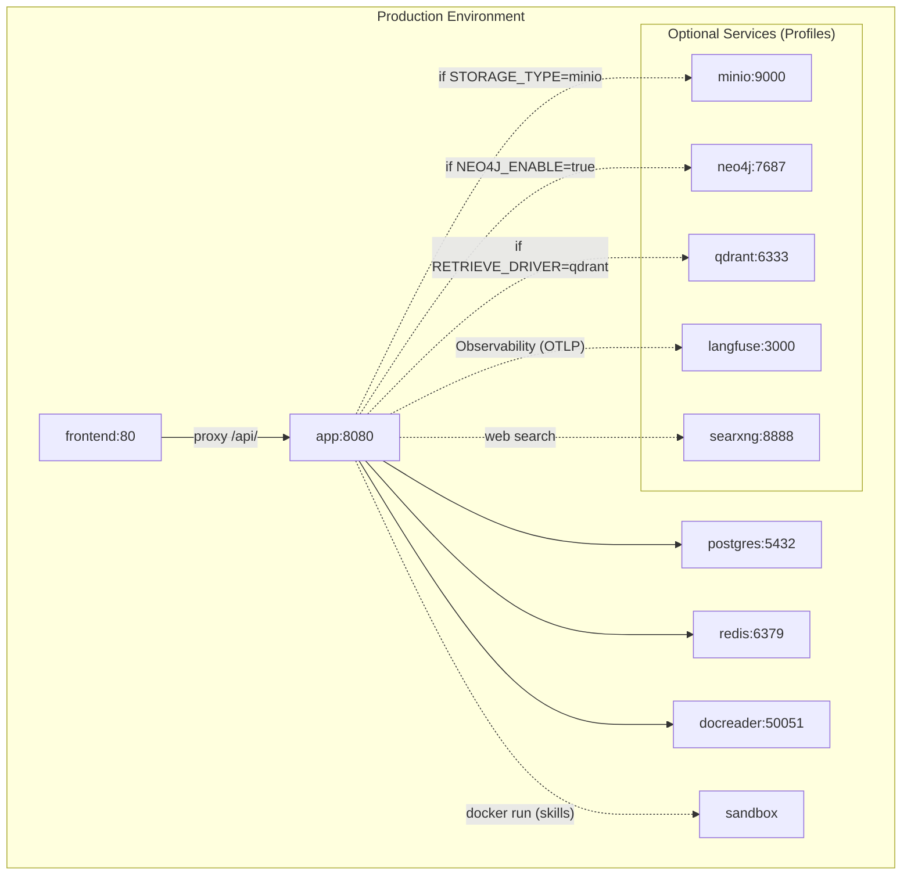
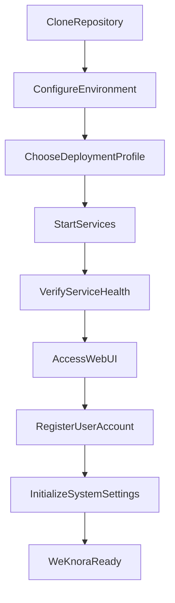
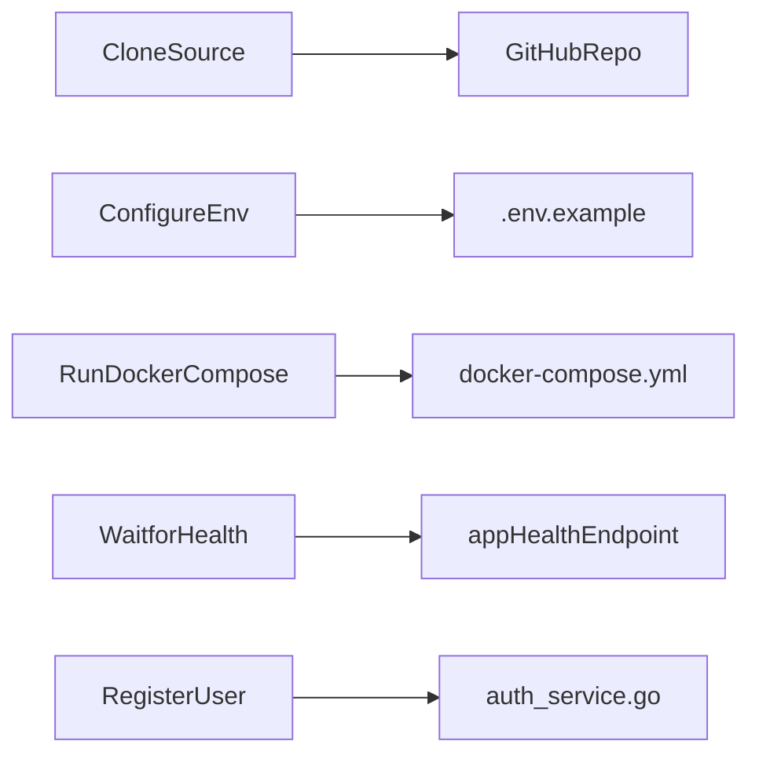
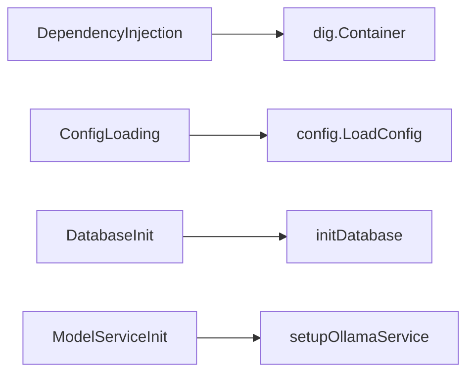

<!-- source: DeepWiki mcp.deepwiki.com · repo Tencent/WeKnora · page 2 Getting Started · fetched 2026-10-29 -->

# Getting Started

Relevant source files

The following files were used as context for generating this wiki page:

- [internal/database/migration_postgres_test.go](internal/database/migration_postgres_test.go)
- [migrations/mysql/README.md](migrations/mysql/README.md)
- [migrations/versioned/000099_pg_search_0226.up.sql](migrations/versioned/000099_pg_search_0226.up.sql)
- [migrations/versioned/000115_pg_search_02511.down.sql](migrations/versioned/000115_pg_search_02511.down.sql)
- [migrations/versioned/000115_pg_search_02511.up.sql](migrations/versioned/000115_pg_search_02511.up.sql)
- [scripts/test_paradedb_upgrade.py](scripts/test_paradedb_upgrade.py)
- [website-docs/01-getting-started/02-installation.md](website-docs/01-getting-started/02-installation.md)
- [website-docs/01-getting-started/06-paradedb-upgrade.md](website-docs/01-getting-started/06-paradedb-upgrade.md)
- [website-docs/02-architecture/01-overview.md](website-docs/02-architecture/01-overview.md)
- [website-docs/05-clients/01-frontend.md](website-docs/05-clients/01-frontend.md)
- [website-docs/05-clients/02-cli.md](website-docs/05-clients/02-cli.md)
- [website-docs/06-development/01-dev-guide.md](website-docs/06-development/01-dev-guide.md)
- [website-docs/06-development/02-database-schema.md](website-docs/06-development/02-database-schema.md)

This page serves as a high-level overview for setting up, deploying, and initializing WeKnora. It outlines the core workflows from environment preparation and Docker Compose orchestration to initial system configuration and account registration.

As a parent overview page, this document summarizes key setup phases. For comprehensive details, please refer to the dedicated child pages:
- **System Requirements and Prerequisites**: For hardware, software, and external service requirements, see [System Requirements and Prerequisites](#2.1).
- **Installation and Deployment**: For step-by-step installation instructions, profile selections, and environment configurations, see [Installation and Deployment](#2.2).
- **Quick Start Guide**: For a fast-track guide to running WeKnora and creating your first knowledge base, see [Quick Start Guide](#2.3).
- **System Initialization and Configuration**: For setup wizards, model integrations, and Ollama configurations, see [System Initialization and Configuration](#2.4).

Sources: [website-docs/01-getting-started/02-installation.md:1-14]()

## Deployment Architecture

WeKnora runs as a multi-container system orchestrated by Docker Compose, designed to support both production and development workflows. The main components include the frontend SPA served by an Nginx container, a Go-based backend `app` container, a PostgreSQL-based ParadeDB for data persistence, a Redis container for caching and streaming, and a gRPC-based `docreader` service for document parsing [website-docs/01-getting-started/02-installation.md:16-38](). Optional profiles enable additional services such as MinIO for object storage, Neo4j for graph database support, Qdrant or Milvus for vector search, and the Langfuse observability stack [website-docs/01-getting-started/02-installation.md:94-111]().

Diagram: Deployment Architecture

Sources: [website-docs/01-getting-started/02-installation.md:16-38](), [website-docs/01-getting-started/02-installation.md:86-111]()

| Service | Container Name | Ports | Profiles | Description |
|---|---|---|---|---|
| frontend | `wechatopenai/weknora-ui` | 80 | default | Nginx hosting SPA, reverse proxy to app [website-docs/01-getting-started/02-installation.md:88] |
| app | `wechatopenai/weknora-app` | 8080 | default | Main backend API server [website-docs/01-getting-started/02-installation.md:89] |
| postgres | `paradedb/paradedb:v0.25.11-pg17` | 5432 | default | ParadeDB (Postgres with pgvector extensions) [website-docs/01-getting-started/02-installation.md:91] |
| redis | `redis:7.0-alpine` | 6379 | default | Redis cache and streaming queue [website-docs/01-getting-started/02-installation.md:92] |
| docreader | `wechatopenai/weknora-docreader` | 50051 | default | Document parsing gRPC microservice [website-docs/01-getting-started/02-installation.md:90] |
| minio | `pgsty/minio` | 9000,9001 | minio, full | S3-compatible object storage [website-docs/06-development/01-dev-guide.md:88] |
| neo4j | `neo4j:latest` | 7474,7687 | neo4j, full | Graph database for knowledge graph (optional) [website-docs/06-development/01-dev-guide.md:93] |
| qdrant | `qdrant/qdrant` | 6333,6334 | qdrant, full | Vector search backend alternative [website-docs/06-development/01-dev-guide.md:89] |
| langfuse | `langfuse-web` | 3000 | langfuse | Observability stack with OTLP tracing [website-docs/06-development/01-dev-guide.md:95] |

Sources: [website-docs/01-getting-started/02-installation.md:86-111](), [website-docs/06-development/01-dev-guide.md:82-98]()

## Getting Started Workflow

The typical initial setup progresses through repository cloning, environment configuration, container orchestration, health verification, and browser-based initialization [website-docs/01-getting-started/02-installation.md:50-60]().

Diagram: Getting Started Workflow

Sources: [website-docs/01-getting-started/02-installation.md:50-60]()

## Environment Configuration Overview

WeKnora is configured primarily via a `.env` file loaded into containers at runtime to set operational parameters. Key configuration parameters include core system toggles, storage backends, database connections, and cache settings [.env.example:1-50]().

| Category | Key Variables | Default | Purpose |
|---|---|---|---|
| Core System | `GIN_MODE`, `LOG_LEVEL`, `AUTO_MIGRATE` | release, debug, true | Server mode, logging verbosity, auto DB migration control [.env.example:1-20] |
| Storage | `STORAGE_TYPE`, `LOCAL_STORAGE_BASE_DIR` | local, /data/files | File storage backend and paths [.env.example:21-40] |
| Database | `DB_DRIVER`, `DB_HOST`, `DB_PORT`, `DB_USER`, `DB_PASSWORD`, `DB_NAME` | postgres, postgres, 5432, postgres, (secret), weknora | RDBMS connection [.env.example:41-60] |
| Cache & Queue | `REDIS_ADDR`, `REDIS_PASSWORD` | redis:6379, (secret) | Redis for streaming and Asynq queue [.env.example:61-80] |
| Vector Store | `RETRIEVE_DRIVER` | postgres | User choice of embedding vector DB backend [.env.example:81-100] |

Sources: [.env.example:1-100]()

## Bridging Natural Language Space to Code Entity Space

### Deployment Step to Code Entity Mapping

This diagram maps natural language concepts of deployment steps to source code artifacts and files:

Diagram: Deployment Step to Code Entity Mapping

Sources: [website-docs/01-getting-started/02-installation.md:50-60](), [.env.example:1-25]()

### Container Initialization and Dependency Injection Mapping

Mapping core initialization stages in Go backend container to configuration and service setup code:

Diagram: Container Initialization and Dependency Injection Mapping

Sources: [internal/config/config.go:1-43]()

---

**Sources:**  
[website-docs/01-getting-started/02-installation.md:1-127](),  
[website-docs/06-development/01-dev-guide.md:82-98](),  
[.env.example:1-100](),  
[internal/config/config.go:1-43]()

---

