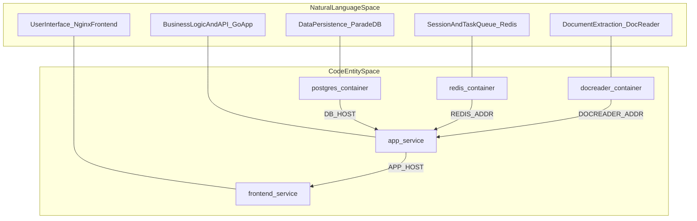
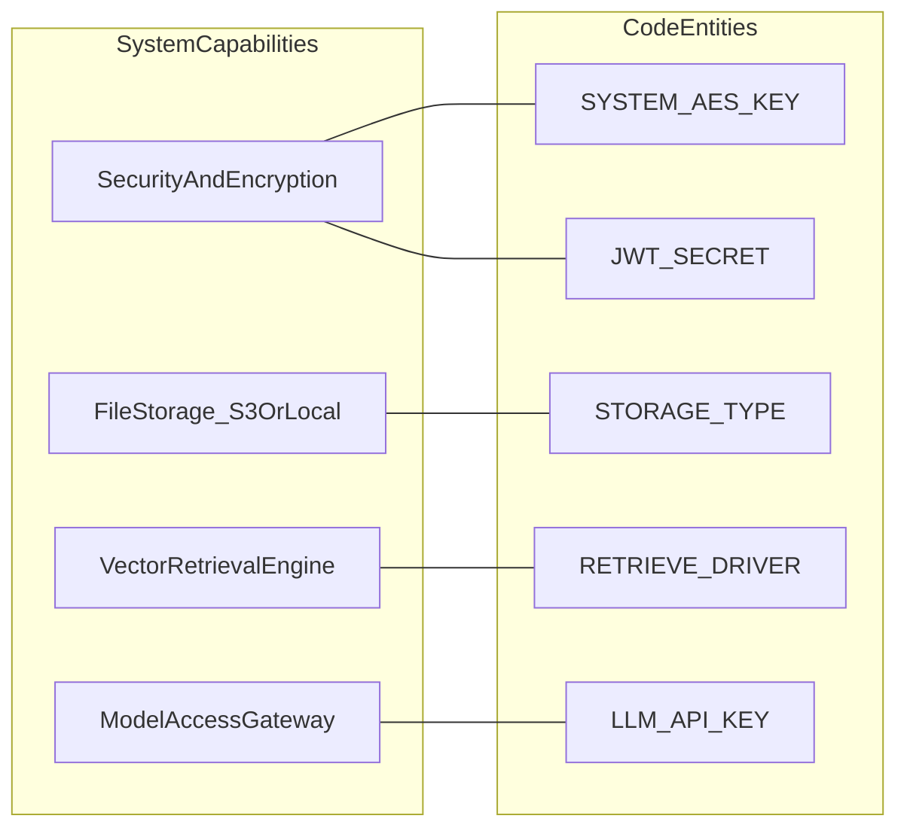

<!-- source: DeepWiki mcp.deepwiki.com · repo Tencent/WeKnora · page 2.1 System Requirements and Prerequisites · fetched 2026-10-29 -->

# System Requirements and Prerequisites

Relevant source files

The following files were used as context for generating this wiki page:

- [.env.example](.env.example)
- [config/config.yaml](config/config.yaml)
- [docker-compose.dev.yml](docker-compose.dev.yml)
- [docker-compose.yml](docker-compose.yml)
- [docreader/README.md](docreader/README.md)
- [docreader/config.py](docreader/config.py)
- [docreader/parser/docx_parser.py](docreader/parser/docx_parser.py)
- [docreader/parser/image_preprocess.py](docreader/parser/image_preprocess.py)
- [docreader/preprocess.py](docreader/preprocess.py)
- [docreader/preprocess_worker.py](docreader/preprocess_worker.py)
- [docreader/tests/test_config.py](docreader/tests/test_config.py)
- [docreader/tests/test_docx_tables.py](docreader/tests/test_docx_tables.py)
- [docreader/tests/test_preprocess_runner.py](docreader/tests/test_preprocess_runner.py)
- [go.mod](go.mod)
- [go.sum](go.sum)
- [internal/config/auth_legacy_env_test.go](internal/config/auth_legacy_env_test.go)
- [internal/config/config.go](internal/config/config.go)
- [internal/container/container.go](internal/container/container.go)
- [internal/database/migration_postgres_test.go](internal/database/migration_postgres_test.go)
- [migrations/mysql/README.md](migrations/mysql/README.md)
- [migrations/versioned/000099_pg_search_0226.up.sql](migrations/versioned/000099_pg_search_0226.up.sql)
- [migrations/versioned/000115_pg_search_02511.down.sql](migrations/versioned/000115_pg_search_02511.down.sql)
- [migrations/versioned/000115_pg_search_02511.up.sql](migrations/versioned/000115_pg_search_02511.up.sql)
- [scripts/dev.sh](scripts/dev.sh)
- [scripts/test_paradedb_upgrade.py](scripts/test_paradedb_upgrade.py)
- [website-docs/01-getting-started/02-installation.md](website-docs/01-getting-started/02-installation.md)
- [website-docs/01-getting-started/06-paradedb-upgrade.md](website-docs/01-getting-started/06-paradedb-upgrade.md)
- [website-docs/02-architecture/01-overview.md](website-docs/02-architecture/01-overview.md)
- [website-docs/05-clients/01-frontend.md](website-docs/05-clients/01-frontend.md)
- [website-docs/05-clients/02-cli.md](website-docs/05-clients/02-cli.md)
- [website-docs/06-development/01-dev-guide.md](website-docs/06-development/01-dev-guide.md)
- [website-docs/06-development/02-database-schema.md](website-docs/06-development/02-database-schema.md)

This page documents the hardware, software, and service requirements for running WeKnora. It details host-level prerequisites, Docker orchestration necessities, resource allocations based on deployment scale, and external service dependencies critical for full functionality.

---

## Overview

WeKnora is a modular LLM-powered knowledge framework primarily deployed through containerization. It offers flexible profiles from a minimal footprint for single users to a full enterprise-grade stack integrating distributed vector stores, graph databases, and observability tools.

The architecture follows a microservices pattern separating:
- Core backend services (`app`) `[docker-compose.yml:36-46]()`
- Frontend UI (`frontend`) `[docker-compose.yml:2-16]()`
- Document parsing engines (`docreader`) `[website-docs/02-architecture/01-overview.md:15-15]()`

It supports complex multi-tenant RBAC, fine-grained storage quotas, and secure encryption mechanisms for sensitive credentials configured via environment variables and configuration files `[.env.example:1-25]()`, `[internal/config/config.go:19-43]()`.

Sources: `[docker-compose.yml:2-46]`, `[.env.example:1-25]`, `[internal/config/config.go:19-43]`

---

## Host Software Requirements

Ensure the following software prerequisites are met on the host machine before deploying WeKnora.

### Required Tools

| Tool | Minimum Version | Purpose | Reference |
|---|---|---|---|
| **Docker** | 20.10+ | Container runtime for microservices | `[docker-compose.yml:1-34]()` |
| **Docker Compose** | v2.24+ (Recommended) | Multi-service orchestration with profile management | `[docker-compose.dev.yml:1-12]()` |
| **Git** | 2.x+ | Source code version control and repository management | `[scripts/dev.sh:11-14]()` |

### Development & Build Prerequisites

For building from source or extending, these environments are essential:

| Environment | Version | Purpose | Reference |
|---|---|---|---|
| **Go** | 1.26.0 | Backend application development and binary compilation | `[website-docs/06-development/01-dev-guide.md:10-11]()` |
| **Node.js** | 22+ | Frontend build system (Vite-based) | `[website-docs/06-development/01-dev-guide.md:12-13]()` |
| **Make** | 3.81+ | Build automation and task execution | `[scripts/dev.sh:80-83]()` |

Sources: `[docker-compose.yml:1-34]`, `[docker-compose.dev.yml:1-12]`, `[scripts/dev.sh:11-83]`, `[website-docs/06-development/01-dev-guide.md:5-15]`

---

## Hardware Recommendations

WeKnora's resource consumption depends on the number of users, scale of knowledge bases, and whether LLM inference runs locally.

### Resource Allocation Profiles

| Tier | RAM | CPU | Storage | Use Case Description | Reference |
|---|---|---|---|---|---|
| **Minimal** | 4 GB | 2 Cores | 20 GB | Single-user, basic RAG with cloud LLM | `[config/config.yaml:1-5]()` |
| **Standard** | 8 GB | 4 Cores | 50 GB | Small teams, local parsing, hybrid retrieval | `[website-docs/01-getting-started/02-installation.md:41-41]()` |
| **Enterprise** | 16+ GB | 8+ Cores | 100+ GB | Production, Wiki Mode at large scale | `[docker-compose.yml:77-105]()` |
| **Inference** | 32+ GB | 12+ Cores | 200+ GB | Local LLM (Ollama) hosting with multimodal | `[website-docs/01-getting-started/02-installation.md:42-42]()` |

### Hardware Notes

- **Disk I/O**: Use fast SSDs for `postgres` and vector stores for optimal low-latency retrieval and task queue handling.
- **Worker Pool Governance**: Asynq worker pools are configurable via environment variables (`WEKNORA_ASYNQ_CORE_CONCURRENCY`, `WEKNORA_ASYNQ_ENRICHMENT_CONCURRENCY`, etc.) to manage concurrency effectively `[.env.example:173-182]()`.
- **Architecture Support**: Supports `amd64` and `arm64` with automatic architecture detection during builds via Docker multi-stage builds.

Sources: `[docker-compose.yml:8-13]`, `[.env.example:173-182]`, `[website-docs/01-getting-started/02-installation.md:39-46]`, `[config/config.yaml:1-5]`

---

## Service Dependencies and Connectivity

WeKnora employs a microservice architecture orchestrated mostly through Docker Compose. The primary backend service (`app`) communicates with persistent stores, caching, parsing services, and frontends.

### Diagram: Natural Language Space to Code Entity Space (Service Mapping)

This diagram illustrates the mapping of natural language service requirements (data persistence, caching, extraction, core API, UI) onto precise Docker containers (`postgres`, `redis`, `docreader`, `app`, `frontend`) and environment variables (`DB_HOST`, `REDIS_ADDR`, `DOCREADER_ADDR`, `APP_HOST`) facilitating container-to-container service discovery and configuration.

Sources: `[docker-compose.yml:2-46]`, `[.env.example:76-131]`, `[website-docs/02-architecture/01-overview.md:10-21]`

---

## Advanced Feature Prerequisites

### Supported Vector and Graph Storage Backends

WeKnora can bind knowledge bases to multiple vector database engines for retrieval fan-out and supports graph databases for Wiki mode knowledge graphs.

| Component | Env Variable / Setting | Usage | Reference |
|---|---|---|---|
| PostgreSQL (pgvector) | `DB_DRIVER=postgres` | Default vector and relational backend | `[.env.example:130-138]()` |
| Apache Doris | `RETRIEVE_DRIVER=doris` | Stream-load and hybrid query backend | `[website-docs/02-architecture/01-overview.md:30-30]()` |
| Tencent VectorDB | `RETRIEVE_DRIVER=tencent_vectordb` | Enterprise vector search | `[website-docs/02-architecture/01-overview.md:35-35]()` |
| Neo4j | `NEO4J_AUTH` | Wiki Mode knowledge graph visualization | `[docker-compose.dev.yml:206-212]()` |
| Qdrant | `QDRANT_HOST` | Vector database | `[docker-compose.dev.yml:107-117]()` |
| Milvus | `MILVUS_PORT` | Vector database | `[docker-compose.dev.yml:177-195]()` |
| Weaviate | `RETRIEVE_DRIVER=weaviate` | Vector database | `[website-docs/01-getting-started/02-installation.md:105-105]()` |
| Elasticsearch | `ELASTICSEARCH_ADDR` | Vector database (v7/v8) | `[website-docs/02-architecture/01-overview.md:35-35]()` |
| SQLite (sqlite-vec) | `DB_DRIVER=sqlite` | Local vector storage | `[website-docs/06-development/02-database-schema.md:11-12]()` |

### Multi-Instance Storage Backends

Multiple object storage providers can be bound to tenants and knowledge bases through configuration settings.

| Storage Type | Environment Variables | Reference |
|---|---|---|
| Local Storage | `LOCAL_STORAGE_BASE_DIR` | `[docker-compose.yml:47-48]()` |
| MinIO | `MINIO_ROOT_USER` and related | `[docker-compose.dev.yml:84-93]()` |
| Tencent COS | `COS_SECRET_ID`, `COS_SECRET_KEY`, `COS_REGION`, etc. | `[docker-compose.yml:116-123]()` |

Sources: `[docker-compose.yml:47-123]`, `[docker-compose.dev.yml:84-212]`, `[website-docs/02-architecture/01-overview.md:25-36]`, `[website-docs/06-development/02-database-schema.md:7-14]`

---

## Environment and Security Configuration

### Diagram: System Capabilities to Code Entities (Configuration Mapping)

These environment variables configure critical aspects like credential encryption (`SYSTEM_AES_KEY`, `JWT_SECRET`), authenticated access, storage backend selection (`STORAGE_TYPE`), vector database choice (`RETRIEVE_DRIVER`), and LLM provider integration (`LLM_API_KEY`).

Sources: `[.env.example:126-184]`, `[docker-compose.yml:114-143]`

---

## Network and Port Requirements

- **Default Ports**  
  - Frontend UI: Port `80` (HTTP) or as configured via `FRONTEND_PORT` `[docker-compose.yml:16-16]`.  
  - Backend API Service (`app`): Port `8080` `[docker-compose.yml:46-46]`.  
  - DocReader gRPC Service: Port `50051` `[website-docs/02-architecture/01-overview.md:15-15]`.  
  - MCP Server (optional): Port `8082` `[.env.example:122-123]`.

- **Container Networking**  
  - All internal containers resolve each other by standardized service names within the Docker user-defined network `WeKnora-network` `[docker-compose.yml:32-33]`.

- **Outbound Connectivity**  
  - Access to LLM providers (OpenAI, Anthropic, DeepSeek, Zhipu, Ollama, etc.) over HTTPS.
  - Web Search providers and object storage endpoints.

- **Security Considerations**  
  - Redis TLS secured connections are supported and recommended for managed instances (`REDIS_USE_TLS`) `[.env.example:165-171]`.
  - Sensitive keys such as `JWT_SECRET` and `SYSTEM_AES_KEY` are required at deployment to enable encrypted credentials and secure authentication tokens `[website-docs/01-getting-started/02-installation.md:62-62]`.

Sources: `[docker-compose.yml:15-46]`, `[.env.example:94-171]`, `[website-docs/01-getting-started/02-installation.md:60-65]`, `[website-docs/02-architecture/01-overview.md:73-88]`

---

## References

- `[docker-compose.yml:1-150]()` — Base container image recipes and service setup  
- `[docker-compose.dev.yml:1-213]()` — Development infrastructure profiles and dependencies  
- `[scripts/dev.sh:11-83]()` — Orchestration script handling development lifecycle  
- `[frontend/vite.config.ts:1-191]()` — Frontend build tooling and proxy targets  
- `[.env.example:76-185]()` — Environment variable examples for service addresses and storage backends  
- `[internal/config/config.go:19-43]()` — Application configuration structures  
- `[website-docs/01-getting-started/02-installation.md:1-127]()` — Installation and deployment requirements guide  
- `[website-docs/02-architecture/01-overview.md:1-118]()` — Architecture overview and service components

---

