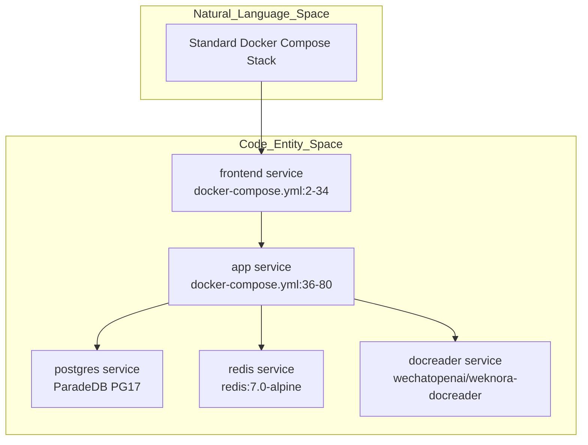
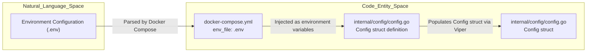
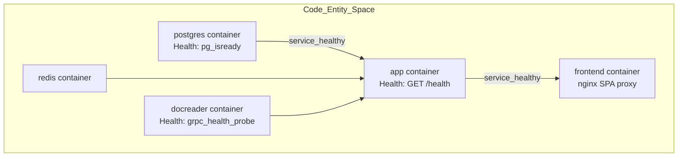

<!-- source: DeepWiki mcp.deepwiki.com · repo Tencent/WeKnora · page 2.2 Installation and Deployment · fetched 2026-10-29 -->

# Installation and Deployment

<details>
<summary>Relevant source files</summary>

The following files were used as context for generating this wiki page:

- [.env.example](.env.example)
- [.github/workflows/cli.yml](.github/workflows/cli.yml)
- [.github/workflows/docker-image.yml](.github/workflows/docker-image.yml)
- [.github/workflows/release-lite.yml](.github/workflows/release-lite.yml)
- [.gitignore](.gitignore)
- [Formula/weknora-lite.rb](Formula/weknora-lite.rb)
- [Makefile](Makefile)
- [cli/internal/cmdutil/errors_doc_test.go](cli/internal/cmdutil/errors_doc_test.go)
- [cli/scripts/check-skill-wire-vocab.sh](cli/scripts/check-skill-wire-vocab.sh)
- [config/config.yaml](config/config.yaml)
- [deploy/weknora-lite.service](deploy/weknora-lite.service)
- [docker-compose.dev.yml](docker-compose.dev.yml)
- [docker-compose.yml](docker-compose.yml)
- [docker/Dockerfile.app](docker/Dockerfile.app)
- [docker/Dockerfile.docreader](docker/Dockerfile.docreader)
- [docker/Dockerfile.sandbox](docker/Dockerfile.sandbox)
- [docreader/README.md](docreader/README.md)
- [docreader/config.py](docreader/config.py)
- [docreader/parser/docx_parser.py](docreader/parser/docx_parser.py)
- [docreader/parser/image_preprocess.py](docreader/parser/image_preprocess.py)
- [docreader/preprocess.py](docreader/preprocess.py)
- [docreader/preprocess_worker.py](docreader/preprocess_worker.py)
- [docreader/tests/test_config.py](docreader/tests/test_config.py)
- [docreader/tests/test_docx_tables.py](docreader/tests/test_docx_tables.py)
- [docreader/tests/test_preprocess_runner.py](docreader/tests/test_preprocess_runner.py)
- [frontend/.dockerignore](frontend/.dockerignore)
- [frontend/Dockerfile](frontend/Dockerfile)
- [go.mod](go.mod)
- [go.sum](go.sum)
- [internal/config/auth_legacy_env_test.go](internal/config/auth_legacy_env_test.go)
- [internal/config/config.go](internal/config/config.go)
- [internal/container/container.go](internal/container/container.go)
- [scripts/build_frontend_dist.sh](scripts/build_frontend_dist.sh)
- [scripts/build_images.sh](scripts/build_images.sh)
- [scripts/dev.sh](scripts/dev.sh)
- [scripts/get_version.sh](scripts/get_version.sh)
- [scripts/package-lite.sh](scripts/package-lite.sh)
- [scripts/start_all.sh](scripts/start_all.sh)
- [scripts/test-homebrew.sh](scripts/test-homebrew.sh)
- [scripts/update-homebrew-formula.sh](scripts/update-homebrew-formula.sh)
- [scripts/verify_frontend_pr.sh](scripts/verify_frontend_pr.sh)

</details>


## Purpose and Scope
This page provides detailed, step-by-step instructions for installing and deploying WeKnora using Docker Compose. It explains how to configure the environment with `.env`, select optional service profiles, understand container dependencies, and ensure the system starts in the correct order. The guide also clarifies how environment variables propagate into the application configuration and how container images are composed.

Sources: `[website-docs/01-getting-started/02-installation.md:1-46]()`, `[docker-compose.yml:1-35]()`

---

## Deployment Overview

WeKnora’s deployment consists of a set of containerized microservices orchestrated using Docker Compose. The core system includes:

- `frontend`: Vue.js SPA served via Nginx `[docker-compose.yml:2-34]()`
- `app`: Go backend application providing APIs and business logic `[docker-compose.yml:36-80]()`
- `postgres`: ParadeDB (PostgreSQL 17 + BM25/vector extensions) as main persistent store `[docker-compose.dev.yml:4-23]()`
- `redis`: Redis providing cache, streaming, and queue capabilities `[docker-compose.dev.yml:26-36]()`
- `docreader`: Document parser and extraction gRPC service `[docker/Dockerfile.docreader:164-168]()`

Additional optional components can be enabled by Docker Compose profiles to provide extended capabilities like vector search or knowledge graphs.

Title: "Standard Docker Compose Stack Architecture"


Sources: `[docker-compose.yml:2-34]()`, `[docker-compose.yml:36-80]`, `[website-docs/01-getting-started/02-installation.md:16-38]()`, `[docker-compose.dev.yml:4-36]()`

---

## Step 1: Clone the Repository

Start by obtaining WeKnora’s complete source code and Docker configurations from the official GitHub repository:

```bash
git clone https://github.com/Tencent/WeKnora.git
cd WeKnora
```

This step prepares your local environment for deployment or further build steps.

Sources: `[website-docs/01-getting-started/02-installation.md:51-54]()`

---

## Step 2: Environment Configuration

### Create and Customize `.env`

WeKnora uses a `.env` file to configure runtime environment variables injected into containers. This file controls database credentials, Redis settings, service URLs, feature toggles, and more critical options.

Create your `.env` from the example template:

```bash
cp .env.example .env
```

Edit `.env` to set at least:

- **Database**: `DB_USER`, `DB_PASSWORD`, `DB_NAME` `[.env.example:130-142]()`
- **Redis**: `REDIS_PASSWORD` `[.env.example:155]()`
- **JWT and AES secrets**: `JWT_SECRET`, `SYSTEM_AES_KEY` (generate securely) `[website-docs/01-getting-started/02-installation.md:62]()`
- **Network settings**: `APP_HOST`, `APP_PORT`, `FRONTEND_PORT` `[.env.example:87-96]()`
- Also consider setting localization and language preferences `[.env.example:67-74]()`

> **Security note:** Keep your `.env` private and do not commit it to version control as it contains secrets.

### Configuration Propagation Flow

Title: "Environment Configuration Propagation Flow"


- The `app` container references `env_file: .env` in `[docker-compose.yml:78-79]()`, automatically receiving the environment variables.
- The Go backend parses and loads these variables via Viper into the `Config` struct defined at `[internal/config/config.go:19-43]()`.
- This ensures consistent configuration access across all backend modules.

Sources: `[.env.example:1-150]()`, `[docker-compose.yml:78-79]()`, `[internal/config/config.go:19-43]()`

---

## Step 3: Service Profiles for Optional Components

WeKnora uses Docker Compose profiles feature to allow selective enabling of optional service components. This lets you add advanced capabilities or integrations without affecting the core stack.

| Profile    | Service(s)                               | Purpose                                |
|------------|----------------------------------------|--------------------------------------|
| `minio`    | `minio`                                | S3-compatible object storage `[docker-compose.dev.yml:84-105]()` |
| `qdrant`   | `qdrant`                               | Vector search engine `[docker-compose.dev.yml:107-121]()` |
| `milvus`   | `milvus`                               | Vector search engine `[docker-compose.dev.yml:177-205]()` |
| `neo4j`    | `neo4j`                               | Knowledge graph database `[docker-compose.dev.yml:206-212]()` |
| `searxng`  | `searxng-init`, `searxng`              | Web search proxy `[docker-compose.dev.yml:40-83]()` |
| `odl-hybrid`| `odl-hybrid`                         | OpenDataLoader hybrid document parser `[website-docs/01-getting-started/02-installation.md:109]()` |

Activate profiles at runtime:

```bash
docker compose --profile minio --profile qdrant up -d
```

The `docker-compose.dev.yml` file contains examples of these optional services and their default ports `[docker-compose.dev.yml:1-212]()`, and the main `docker-compose.yml` references profile usage. This modular system supports team flexibility and resource management.

Sources: `[docker-compose.yml:1-1067]()`, `[docker-compose.dev.yml:1-212]()`, `[website-docs/01-getting-started/02-installation.md:94-111]()`

---

## Step 4: Service Dependencies and Startup Order

To maintain a robust startup sequence, WeKnora uses Docker Compose's `depends_on` with health check conditions to ensure containers only start after their prerequisites are healthy.

Title: "Container Health and Dependency Graph"


- The `app` container waits for `postgres` to be healthy before starting `[docker-compose.yml:29-31]()`.
- The `frontend` container depends on `app`’s health `[docker-compose.yml:29-31]()`.
- Health checks measure readiness:
  - `postgres`: health command uses `pg_isready` `[docker-compose.dev.yml:18]()`
  - `docreader`: uses `grpc_health_probe` `[docker/Dockerfile.docreader:135]()`
  - `app`: HTTP GET `/health` endpoint `[docker-compose.yml:62-63]()`

This guarantees that the system components are fully initialized and available before dependent services start.

Sources: `[docker-compose.yml:29-67]()`, `[docker-compose.dev.yml:18]()`, `[docker/Dockerfile.docreader:135]()`, `[website-docs/01-getting-started/02-installation.md:79-88]()`

---

## Step 5: Starting the System

Two main methods exist for launching WeKnora using Docker Compose.

### Using Docker Compose CLI

Pull the latest container images according to the version set in `.env` (default `latest`):

```bash
docker compose pull
docker compose up -d
```

Check container status:

```bash
docker compose ps
```

### Using Orchestration Script

The repo includes a convenient script `scripts/start_all.sh` that wraps Docker Compose commands and adds extra checks (e.g., Ollama service detection), environment file guard, and sandbox image pre-pulling:

```bash
./scripts/start_all.sh --all
```

This script handles `.env` fallback from `.env.example` if needed and ensures smoother startup.

### Persistent Storage

The `app` container mounts persistent volumes for:

- User uploaded files (`data-files`)
- Docreader temporary storage (`docreader-tmp`)
- Optional configuration overlays (`config.yaml`)

```yaml
volumes:
  - data-files:/data/files
  - docreader-tmp:/tmp/docreader:ro
  - ./config/config.yaml:/app/config/config.yaml
```

These volumes ensure data persistence across container restarts or recreations.

Sources: `[docker-compose.yml:47-50]()`, `[website-docs/01-getting-started/02-installation.md:52-61]()`

---

# Summary of Key Files and Concepts

| Filename                   | Role in Installation and Deployment                      |
|----------------------------|---------------------------------------------------------|
| `docker-compose.yml`       | Main Docker Compose file defining services and profiles. `[docker-compose.yml:1-35]()` |
| `.env.example`              | Template for environment variables controlling config. `[.env.example:1-25]()` |
| `docker/Dockerfile.app`    | Dockerfile for building the backend container image. `[docker/Dockerfile.app:26-97]()` |
| `docker/Dockerfile.docreader` | Dockerfile for building the document reader service image. `[docker/Dockerfile.docreader:1-80]()` |
| `frontend/Dockerfile`      | Dockerfile to build the Vue.js frontend container image. `[frontend/Dockerfile:1-49]()` |
| `docker-compose.dev.yml`   | Development Docker Compose setup with optional services. `[docker-compose.dev.yml:1-50]()` |
| `Makefile`                 | Build commands, including Docker image build and run. `[Makefile:1-30]()` |

Sources: `[docker-compose.yml:1-35]()`, `[.env.example:1-25]()`, `[docker/Dockerfile.app:26-97]()`, `[docker/Dockerfile.docreader:1-80]()`, `[frontend/Dockerfile:1-49]()`, `[docker-compose.dev.yml:1-50]()`, `[Makefile:1-30]()`

---

