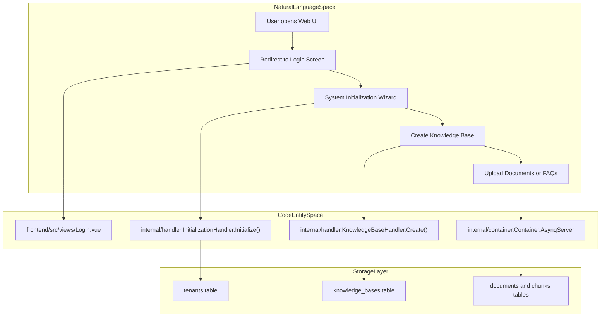
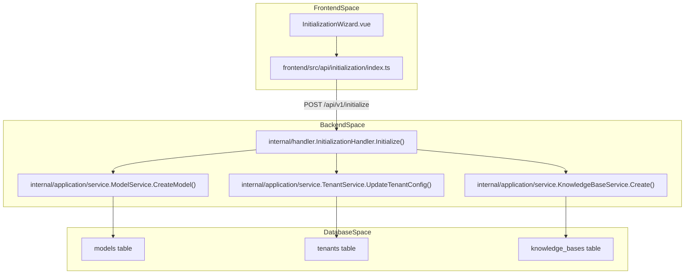
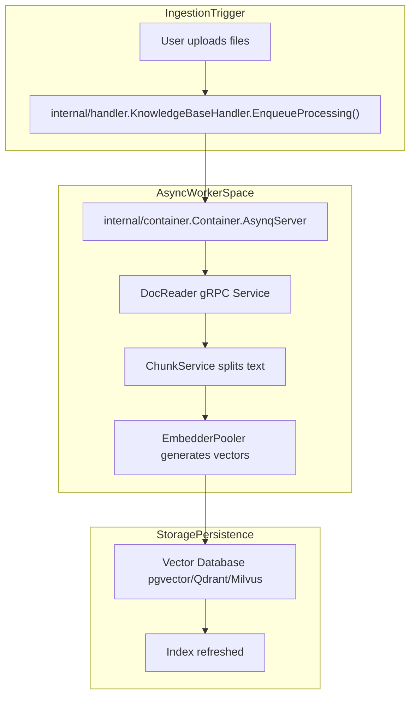

<!-- source: DeepWiki mcp.deepwiki.com · repo Tencent/WeKnora · page 2.3 Quick Start Guide · fetched 2026-10-29 -->

# Quick Start Guide

<details>
<summary>Relevant source files</summary>

The following files were used as context for generating this wiki page:

- [CHANGELOG.md](CHANGELOG.md)
- [README.md](README.md)
- [README_CN.md](README_CN.md)
- [README_JA.md](README_JA.md)
- [README_KO.md](README_KO.md)
- [VERSION](VERSION)
- [frontend/package-lock.json](frontend/package-lock.json)
- [frontend/package.json](frontend/package.json)
- [helm/Chart.yaml](helm/Chart.yaml)

</details>


This page provides a technical walkthrough to get WeKnora running with a basic setup, guiding through initial service startup, system initialization, model configuration, knowledge base creation, and first interaction.

**Purpose and Scope:** This guide assumes the user has already installed WeKnora and started the required backing services. For installation and container orchestration details, refer to the official installation instructions `[README.md:62-65]()`. This guide focuses on post-installation bootstrapping, system initialization via `InitializationHandler`, and executing the first RAG pipeline ingestion.

Sources:  
- `[README.md:62-65]()`

---

## Prerequisites and Infrastructure Setup

WeKnora is architected as a set of Docker containers orchestrated via Docker Compose. The system supports modular profiles enabling optional services like vector databases, knowledge graph stores, and object storage solutions `[README.md:120-134]()`.

You start the environment using direct Docker Compose commands `[README.md:95-105]()`:

```bash
# Start core services including postgres, redis, and docreader for parsing
docker compose pull
docker compose up -d

# Start with optional profiles for vector database and graph storage
docker compose --profile neo4j --profile minio up -d
```

### Core Service Mapping

| System Name / Component          | Host Endpoint      | Container Name         | Code / Config Reference          |
|---------------------------------|-------------------|-----------------------|---------------------------------|
| Web UI (frontend)                | `http://localhost:80` | `WeKnora-frontend`      | `[docker-compose.yml:2-34]()`       |
| Backend API (Gin web server)     | `http://localhost:8080` | `WeKnora-app`           | `[docker-compose.yml:36-104]()`     |
| PostgreSQL (Relational DB)       | `localhost:5432`     | `WeKnora-postgres`      | `[docker-compose.dev.yml:4-23]()`   |
| Redis (Cache & Async Queue Broker) | `localhost:6379`     | `WeKnora-redis`         | `[docker-compose.dev.yml:26-36]()`  |
| DocReader (gRPC Parser Engine)   | `localhost:50051`    | `WeKnora-docreader`     | `[docker-compose.yml:36-104]()`     |

This infrastructure enables WeKnora to run in its full capacity with asynchronous document parsing, embedding computation, vector indexing, and chat server operation `[README.md:60-65]()`.

Sources:  
- `[README.md:60-65]()`  
- `[docker-compose.yml:2-104]()`  
- `[docker-compose.dev.yml:4-36]()`

---

## Step-by-Step User Flow and Code Entity Mapping

The next diagram bridges the Natural Language Space to the Code Entity Space, mapping the user's onboarding and initial knowledge ingestion journey from the frontend UI through backend handlers to persistent database entities:



**Diagram: Natural Language to Code Entity Space - Quick Start Lifecycle**

Sources:  
- `[README.md:60-65]()`  
- `[CHANGELOG.md:9-25]()`

---

## 1. Register and Log In

- End-users first access the WeKnora frontend at `http://localhost` after deployment `[README.md:107]()`. If unauthenticated, the user is redirected to the login view `[frontend/src/views/Login.vue]()`.
- The initial registered user receives the `Owner` role on the default workspace tenant, enabling full control per the RBAC model `[README.md:64]()`.
- Upon first login, a guided onboarding experience helps configure the user's workspace and tenant settings `[README.md:107]()`.

Sources:  
- `[README.md:64-107]()`  
- `[frontend/package.json:1-49]()`

---

## 2. System Initialization

After login, the system initialization wizard guides creating the first knowledge base and configuring global parameters.

### Initialization Workflow



**Diagram: System Initialization Backend Workflow**

Key parameters configured during initialization include:

- **Model Provider Type:** Usually `remote` (API-based) or `local` (Ollama-based local model) `[README.md:63]()`.
- **Embedding Vector Dimension:** Must match the chosen vector model (e.g., 1536 for OpenAI, 1024 for BGE) `[CHANGELOG.md:9-11]()`.
- **Storage Backend:** Choose between local disk, MinIO object storage, or cloud provider `[README.md:60-65]()`.

Sources:  
- `[README.md:60-65]()`  
- `[CHANGELOG.md:9-25]()`

---

## 3. Configure AI Models

WeKnora requires both at least one embedding model for vectorization and one LLM for generation.

### Model Management Details

- The frontend dialog `ModelEditorDialog.vue` is used to register, edit, and validate AI model configurations `[CHANGELOG.md:16]()`.
- Connectivity to API-based models is verified via calls such as `checkRemoteAPI` before saving `[CHANGELOG.md:16]()`.
- Sensitive API keys are encrypted with AES-256-GCM at rest `[README.md:60-65]()`.
- The Ollama integration is handled via `OllamaService` initialized in the DI container `[README.md:63]()`.

Sources:  
- `[README.md:63-65]()`  
- `[CHANGELOG.md:16]()`

---

## 4. Create a Knowledge Base

The first knowledge base is created through the knowledge base management APIs and UI forms `[README.md:50-55]()`.

### Knowledge Base Configuration Options

| Parameter            | Description                                 | Example Values           |
|----------------------|---------------------------------------------|-------------------------|
| Base Type            | Defines knowledge base type                  | `document`, `faq`       |
| Vector Enabled       | Enable semantic vector search and embedding | `true` / `false`        |
| Wiki Enabled         | Enable knowledge graph or Wiki mode         | `true` / `false`        |
| Chunk Size           | Size of text chunks for embedding           | 512, 1024               |
| Chunk Overlap        | Overlap length between chunks                | 50, 100                 |
| Parent-Child Chunking| Enable hierarchical chunk structure          | `true` / `false`        |

These options determine how documents are processed and indexed, influencing retrieval quality `[README.md:50-55]()`.

Sources:  
- `[README.md:50-55]()`  
- `[CHANGELOG.md:9-25]()`

---

## 5. Upload and Process Documents

Uploading documents triggers asynchronous ingestion pipelines to parse, chunk, embed, and index content `[README.md:60-65]()`.

### Ingestion Pipeline Overview



**Diagram: Asynchronous Document Ingestion Pipeline**

- File uploads occur via REST endpoints in the KnowledgeBase API `[README.md:60-65]()`.
- Background tasks are enqueued using the Asynq queue broker (Redis-based) `[README.md:64]()`.
- The DocReader service (gRPC) parses PDFs, Word files, and images asynchronously `[README.md:61]()`.
- Text is chunked into segments suitable for vector embedding `[README.md:60-65]()`.
- Embeddings are stored in configured vector databases allowing semantic similarity retrieval `[README.md:65]()`.

Sources:  
- `[README.md:60-65]()`  
- `[CHANGELOG.md:9-25]()`  

---

## 6. Interaction Modes

After setup, users can interact with the system in multiple modes `[README.md:49-55]()`:

| Mode           | Description                                         | Key Backend Components                  |
|----------------|-----------------------------------------------------|----------------------------------------|
| **Knowledge QA** | Search and retrieval over knowledge bases using RAG | ChatHandler, Retriever Plugins, LLM API |
| **Agent Mode**  | Multi-step reasoning with tool usage and skills    | ReAct Loop Engine, MCP Server, Skill Runtime |
| **Wiki Mode**   | Auto-generated Wiki pages with knowledge graph relations | AutoWiki Pipeline, Graph store (Neo4j) |

Additional features include temporary attachment handling directly in chat sessions, and scoped invocation of agent capabilities via `@Skill` or `@MCP` annotations `[README.md:56-62]()`.

Sources:  
- `[README.md:49-62]()`  
- `[CHANGELOG.md:9-25]()`

---

## Troubleshooting and Tips

| Symptom                                  | Possible Cause                                      | Resolution Steps                                  |
|------------------------------------------|---------------------------------------------------|--------------------------------------------------|
| Document parsing "Processing" stuck      | Worker queue saturation or dead worker process    | Inspect Runtime Queues, restart workers          |
| Model connection failures                 | Incorrect or invalid API credentials               | Validate credentials in `ModelEditorDialog.vue`  |
| Ollama local model unreachable            | Ollama service not running or API URL misconfigured | Start Ollama locally, set `OLLAMA_API_BASE_URL` in `.env` |
| Startup environment variables ignored    | Missing or invalid `.env` file                     | Copy `.env.example` to `.env` and update values  |

Sources:  
- `[README.md:62-111]()`  
- `[CHANGELOG.md:9-25]()`

---

# Summary

Getting WeKnora operational entails:

1. Deploying core services with Docker Compose (`WeKnora-frontend`, `WeKnora-app`, `postgres`, `redis`, `docreader`, optional vector/graph stores) `[README.md:95-135]()`.
2. Logging into the Web UI and completing the initialization wizard handled by `InitializationHandler` `[README.md:107]()`.
3. Configuring AI models including embedding and generation providers `[README.md:63]()`.
4. Creating a knowledge base with chunking and indexing parameters `[README.md:50-55]()`.
5. Uploading documents which are asynchronously parsed and embedded `[README.md:60-61]()`.
6. Interacting with knowledge bases via chat in Knowledge QA or Agent modes `[README.md:49-56]()`.

This technical quick start provides a foundation for understanding WeKnora's key runtime components and orchestration.

Sources:  
- `[README.md:49-135]()`  
- `[CHANGELOG.md:9-25]()`  
- `[docker-compose.yml:1-104]()`  
- `[docker-compose.dev.yml:1-36]()`

---

