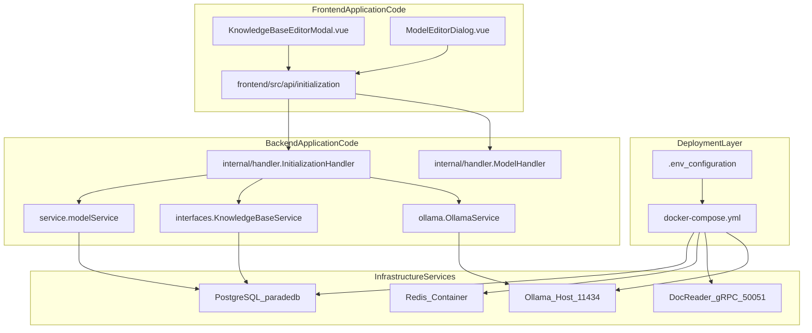
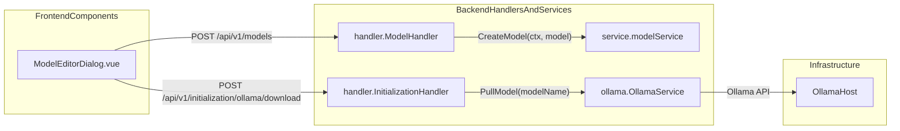

<!-- source: DeepWiki mcp.deepwiki.com · repo Tencent/WeKnora · page 2.4 System Initialization and Configuration · fetched 2026-10-29 -->

# System Initialization and Configuration

<details>
<summary>Relevant source files</summary>

The following files were used as context for generating this wiki page:

- [frontend/src/api/initialization/index.ts](frontend/src/api/initialization/index.ts)
- [frontend/src/api/model/index.ts](frontend/src/api/model/index.ts)
- [frontend/src/components/ModelEditorDialog.vue](frontend/src/components/ModelEditorDialog.vue)
- [frontend/src/components/VectorStoreBadge.vue](frontend/src/components/VectorStoreBadge.vue)
- [frontend/src/components/modelSelectorClearability.test.ts](frontend/src/components/modelSelectorClearability.test.ts)
- [frontend/src/views/knowledge/KnowledgeBaseEditorModal.vue](frontend/src/views/knowledge/KnowledgeBaseEditorModal.vue)
- [frontend/src/views/knowledge/settings/GraphSettings.vue](frontend/src/views/knowledge/settings/GraphSettings.vue)
- [frontend/src/views/knowledge/settings/KBAdvancedSettings.vue](frontend/src/views/knowledge/settings/KBAdvancedSettings.vue)
- [frontend/src/views/knowledge/settings/KBChunkingSettings.vue](frontend/src/views/knowledge/settings/KBChunkingSettings.vue)
- [frontend/src/views/knowledge/settings/KBModelConfig.vue](frontend/src/views/knowledge/settings/KBModelConfig.vue)
- [frontend/src/views/knowledge/settings/KBStorageSettings.vue](frontend/src/views/knowledge/settings/KBStorageSettings.vue)
- [frontend/src/views/knowledge/settings/KBVectorStoreSettings.vue](frontend/src/views/knowledge/settings/KBVectorStoreSettings.vue)
- [frontend/src/views/settings/McpSettings.vue](frontend/src/views/settings/McpSettings.vue)
- [frontend/src/views/settings/ModelSettings.vue](frontend/src/views/settings/ModelSettings.vue)
- [frontend/src/views/settings/VectorStoreSettings.vue](frontend/src/views/settings/VectorStoreSettings.vue)
- [frontend/src/views/settings/WebSearchSettings.vue](frontend/src/views/settings/WebSearchSettings.vue)
- [internal/application/service/model.go](internal/application/service/model.go)
- [internal/application/service/weknoracloud.go](internal/application/service/weknoracloud.go)
- [internal/handler/initialization.go](internal/handler/initialization.go)
- [internal/handler/model.go](internal/handler/model.go)
- [internal/types/model.go](internal/types/model.go)
- [internal/types/weknoracloud.go](internal/types/weknoracloud.go)

</details>


## Purpose and Scope

This page documents the WeKnora system initialization and configuration process. It covers system startup infrastructure, Ollama local model management, AI model registration, the knowledge base setup wizard, document chunking and storage configuration, and knowledge graph extraction setup.

WeKnora uses a layered architecture:
- Deployment environment variables and Docker Compose launch system services `[docker-compose.yml:1-160]`.
- Ollama hosts local LLM models with a dedicated API service `[internal/handler/initialization.go:29]`, `[internal/models/chat/ollama.go:20-34]`.
- Backend services provide model and knowledge base management via `InitializationHandler` and `ModelHandler` `[internal/handler/initialization.go:56-96]`, `[internal/handler/model.go:28-42]`.
- Frontend components provide rich UI wizards to configure knowledge bases and models `[frontend/src/views/knowledge/KnowledgeBaseEditorModal.vue:1-35]`, `[frontend/src/components/ModelEditorDialog.vue:1-7]`.

Sources: `[docker-compose.yml:1-160]`, `[internal/handler/initialization.go:29]`, `[internal/handler/initialization.go:56-96]`, `[internal/handler/model.go:28-42]`, `[frontend/src/views/knowledge/KnowledgeBaseEditorModal.vue:1-35]`, `[frontend/src/components/ModelEditorDialog.vue:1-7]`, `[internal/models/chat/ollama.go:20-34]()`

---

## System Architecture Overview

The initialization system integrates deployment-level services, backend business logic, and frontend configuration, coordinated mainly by the backend `InitializationHandler` and `ModelHandler`.

### System Component Interaction (Natural Language to Code Entity Space)



- The **deployment layer** configures environment variables and Docker Compose files that launch infrastructure services and application containers.
- Key **services include** PostgreSQL for persistence, Redis for stream management and caching, DocReader for document parsing, and Ollama for local LLM hosting.
- The **backend container** bootstraps core services coordinating system and knowledge base initialization.
- The **frontend** provides Vue.js components (`KnowledgeBaseEditorModal.vue` and `ModelEditorDialog.vue`) that call initialization and model REST APIs.

Sources: `[docker-compose.yml:1-160]`, `[internal/handler/initialization.go:56-96]`, `[frontend/src/api/initialization/index.ts:1-93]`, `[frontend/src/views/knowledge/KnowledgeBaseEditorModal.vue:1-35]`, `[frontend/src/components/ModelEditorDialog.vue:1-7]()`

---

## Initialization Workflow Overview

WeKnora’s initialization is composed of three main stages managed by the backend and surfaced to users via frontend UI:

1. **Infrastructure Setup**  
   - Core services like PostgreSQL, Redis, DocReader, and Ollama are launched via Docker Compose with configured `.env` files.  
   - The system automatically performs database migrations on startup if `AUTO_MIGRATE` is enabled.

2. **Model Registration and Ollama Setup**  
   - Models are registered via `ModelHandler` and `modelService` including LLMs, embedding engines, and reranking models `[internal/handler/model.go:28-123]`, `[internal/application/service/model.go:28-54]`.  
   - If Ollama is enabled, users can manage local models via `OllamaService` `[internal/models/utils/ollama/ollama.go]`.  
   - Ollama service status can be checked and models downloaded asynchronously by the frontend `[frontend/src/api/initialization/index.ts:198-209]()`.

3. **Knowledge Base Configuration**  
   - Each knowledge base configures AI models (LLM, embedding, VLM, ASR), document chunking, storage backends (e.g., `StorageBackendID`), and optional features like graph extraction and question generation `[internal/types/knowledgebase.go:59-122]`, `[internal/handler/initialization.go:98-150]`.  
   - This configuration is submitted via the knowledge base setup wizard and applied through the backend’s `InitializationHandler` `[internal/handler/initialization.go:56-96]`, `[frontend/src/api/initialization/index.ts:167-180]()`.

Sources: `[internal/handler/initialization.go:98-150]`, `[frontend/src/views/knowledge/KnowledgeBaseEditorModal.vue:1-134]`, `[docker-compose.yml:1-160]`, `[frontend/src/api/initialization/index.ts:198-209]`, `[internal/handler/model.go:28-123]`, `[internal/types/knowledgebase.go:59-122]()`

---

## Configuration Sections Summary

The knowledge base setup UI and backend handle multiple configuration domains, summarized as:

| Section               | UI Panel Key  | Backend Struct/Field                     | Purpose                                                                                  |
|-----------------------|--------------|-----------------------------------------|------------------------------------------------------------------------------------------|
| Basic info            | `basic`       | `formData.type`, `name`                 | Metadata and knowledge base type selection (Document, FAQ, Wiki)                        |
| Indexing strategy     | `basic`       | `indexingStrategy`                      | Enable vector indexing and/or wiki indexing modes                                       |
| Model selection       | `models`      | `LLMModelID`, `EmbeddingModelID`       | Selecting core AI models for LLM and embedding                                         |
| Chunking              | `chunking`    | `DocumentSplitting`                     | Document chunking parameters: sizes, overlap, parent-child chunking                     |
| Parser engine rules   | `parser`      | `ParserEngineRules`                     | File type to parser engine mappings                                                    |
| Storage provider      | `storage`     | `StorageProvider`, `StorageBackendId`   | Select storage backend instance for document/image persistence                          |
| Graph extraction      | `graph`       | `NodeExtract`                          | Knowledge graph entity and relation extraction configuration                            |
| Question generation   | `question`    | `QuestionGeneration`                   | Enable/disable automatic question generation                                          |

Sources: `[frontend/src/views/knowledge/KnowledgeBaseEditorModal.vue:1-134]`, `[internal/handler/initialization.go:98-150]`, `[frontend/src/api/initialization/index.ts:107-165]()`

---

## Model Management and Registration

WeKnora supports heterogeneous AI models registered via `modelService` (`[internal/application/service/model.go:28-54]`) and handled by `ModelHandler` (`[internal/handler/model.go:28-42]()`).

Supported model types include Chat LLMs, Embedding models, Reranking models, Vision Language Models (VLM), and ASR models (`[internal/types/model.go:14-23]()`).

### Model Sources
- **Local Ollama Models:** Hosted locally, managed through `OllamaService` (`[internal/types/model.go:93-115]`).  
- **Remote Providers:** Models provided by OpenAI, Aliyun, DeepSeek, SiliconFlow, and others configured via remote model parameters (`[internal/types/model.go:124-138]()`).

### Model Lifecycle and Registration Flow (Code Entities and System Components)



- `ModelEditorDialog.vue` provides the UI for selecting between remote and local model sources and triggers model creation or download via backend APIs `[frontend/src/components/ModelEditorDialog.vue:45-114]`.
- `ModelHandler` and `modelService` implement model CRUD operations, SSRF validation, and persist metadata (`[internal/handler/model.go:71-123]`, `[internal/application/service/model.go:101-141]`).
- `InitializationHandler` manages Ollama model downloads through `OllamaService`.

Sources: `[internal/handler/initialization.go:56-96]`, `[frontend/src/api/initialization/index.ts:107-119]`, `[frontend/src/components/ModelEditorDialog.vue:45-114]`, `[internal/handler/model.go:71-123]`, `[internal/application/service/model.go:101-141]`, `[internal/types/model.go:14-23]()`

---

## Document Chunking and Storage Configuration

The retrieval-augmented generation (RAG) pipeline requires detailed chunking and storage configuration per knowledge base.

### Chunking Configuration

- **Chunk Size & Overlap:** Defines the size of document chunks and overlap for retrieval context (`[internal/handler/initialization.go:106-107]`).
- **Splitting Strategy:** Supports `"auto"`, `"heading"`, `"heuristic"`, and legacy modes using pointer types (`[internal/handler/initialization.go:119-121]`).
- **Parent-Child Chunking:** Optional parent chunking feature (`EnableParentChild`, `ParentChunkSize`, `ChildChunkSize`) (`[internal/handler/initialization.go:111-113]`).
- **Token Limits:** Approximate per-chunk token budgets (`TokenLimit`) (`[internal/handler/initialization.go:120]`).
- **Parser Engine Rules:** Mapping of file types to specific parser engines (`ParserEngineRules`) (`[internal/handler/initialization.go:110]()`).
  
### Storage Engines

- Supports backends like local filesystem, MinIO, and COS configurable per knowledge base (`[internal/types/knowledgebase.go:90-96]`).  
- Selection is bound via `StorageBackendID` and `StorageProvider` fields (`[internal/types/knowledgebase.go:91-94]`).
- UI components such as `KBStorageSettings.vue` allow users to select active storage backend instances (`[frontend/src/views/knowledge/settings/KBStorageSettings.vue:33-64]()`).  

Sources: `[internal/handler/initialization.go:98-123]`, `[internal/types/knowledgebase.go:90-96]`, `[frontend/src/views/knowledge/settings/KBStorageSettings.vue:33-64]()`

---

## Backend: InitializationHandler Logic

The `InitializationHandler` struct manages the initialization workflow with dependencies injected via constructor (`[internal/handler/initialization.go:57-96]()`):

```go
type InitializationHandler struct {
	config           *config.Config
	tenantService    interfaces.TenantService
	modelService     interfaces.ModelService
	kbService        interfaces.KnowledgeBaseService
	kbRepository     interfaces.KnowledgeBaseRepository
	knowledgeService interfaces.KnowledgeService
	ollamaService    *ollama.OllamaService
	documentReader   interfaces.DocumentReader
	pooler           embedding.EmbedderPooler
	storageResolver  interfaces.StorageBackendResolver
}
```

- It handles requests to update knowledge base configuration with the `KBModelConfigRequest` type, which encapsulates model IDs, chunking settings, storage selections, and optional features (`[internal/handler/initialization.go:98-150]`).
- Maintains a global map `downloadTasks` protected by `tasksMutex` to track progress on asynchronous Ollama model downloads (`[internal/handler/initialization.go:40-55]()`).

Sources: `[internal/handler/initialization.go:39-96]`, `[internal/handler/initialization.go:98-150]()`

---

## Ollama Service Setup and Model Management

WeKnora integrates Ollama local LLM hosting, enabling users to manage models installed on the Ollama server (`[internal/models/chat/ollama.go:20-34]()`).

### Ollama Model Download and Status Tracking

- The backend tracks model download tasks asynchronously using `DownloadTask` structs stored in the `downloadTasks` map (`[internal/handler/initialization.go:40-49]`).
- `OllamaService` is the client interface for Ollama API operations such as listing available models and downloading them.
- Chat message conversion and image resolution are handled by `OllamaChat.convertMessages` and `resolveImageForOllama` (`[internal/models/chat/ollama.go:36-111]`).
- The frontend checks Ollama status and download progress via REST APIs (`[frontend/src/api/initialization/index.ts:198-209]()`).

### Ollama Integration Code & UI Mapping

| Code Entity                      | File                                    | Role                                          |
|---------------------------------|----------------------------------------|-----------------------------------------------|
| `OllamaChat`                    | `internal/models/chat/ollama.go`       | Chat execution and message conversion         |
| `DownloadTask`, `downloadTasks` | `internal/handler/initialization.go`   | Asynchronous model download task tracking     |
| `checkOllamaStatus()`            | `frontend/src/api/initialization/index.ts`| Frontend Ollama service health check           |

Sources: `[internal/handler/initialization.go:40-55]`, `[frontend/src/api/initialization/index.ts:198-209]`, `[internal/models/chat/ollama.go:20-111]()`

---

## Knowledge Base Setup Wizard

The frontend Vue component `KnowledgeBaseEditorModal.vue` manages the knowledge base configuration wizard UI, organized in multiple sections (`[frontend/src/views/knowledge/KnowledgeBaseEditorModal.vue:1-134]()`):

- **Basic info**: Knowledge base type (`document`, `faq`, `wiki`), name, description.
- **Indexing strategy**: Enable/disable vector and wiki indexing (`[frontend/src/views/knowledge/KnowledgeBaseEditorModal.vue:43-81]`).
- **Model selection**: Choose LLM and embedding models.
- **Chunking options**: Configure document chunk size, overlap, and splitting strategy.
- **Storage**: Select storage backends for document and image persistence via `KBStorageSettings.vue` (`[frontend/src/views/knowledge/settings/KBStorageSettings.vue:1-30]`).
- **Graph extraction**: Enable and configure entity and relation extraction settings via `GraphSettings.vue` (`[frontend/src/views/knowledge/settings/GraphSettings.vue:1-43]()`).

The wizard submits configuration changes via REST APIs (`[frontend/src/api/initialization/index.ts:167-180]()`).

Sources: `[frontend/src/views/knowledge/KnowledgeBaseEditorModal.vue:1-134]`, `[frontend/src/api/initialization/index.ts:167-180]`, `[frontend/src/views/knowledge/settings/KBStorageSettings.vue:1-30]`, `[frontend/src/views/knowledge/settings/GraphSettings.vue:1-43]()`

---

## Graph Extraction Configuration

WeKnora supports knowledge graph extraction during document ingestion, configured via the `NodeExtract` field in `KBModelConfigRequest` (`[internal/handler/initialization.go:135-142]()`).

- Users may enable entity-relation extraction features (`[frontend/src/views/knowledge/settings/GraphSettings.vue:30-43]`).
- Customize tags, entity nodes, relationships, and extraction instructions to tailor knowledge graph construction.
- Backend persists and applies configuration for structured graph extraction as part of knowledge base setup.

### Entity-Relation Configuration Fields

| Field                 | Description                                               |
| --------------------- | ---------------------------------------------------------|
| `enabled`             | Toggle graph entity and relation extraction feature      |
| `text`                | Text snippet example used during extraction              |
| `tags`                | Tags to label and filter entities                         |
| `nodes`               | List of entity types with attributes                      |
| `relations`           | Relationship types connecting nodes                       |
| `customInstructions`  | Custom LLM instructions for graph extraction             |

Sources: `[internal/handler/initialization.go:135-142]`, `[frontend/src/views/knowledge/settings/GraphSettings.vue:30-43]`, `[frontend/src/api/initialization/index.ts:151-164]()`

---

# Summary

System initialization and configuration in WeKnora encompass setting up deployment infrastructure, managing AI models (including Ollama local models), and user-guided knowledge base setup through a comprehensive wizard. The backend exposes REST APIs handled by `InitializationHandler` and `ModelHandler` to ensure secure, multi-tenant operation with a focus on document chunking, embedding model usage, storage engine selection, and knowledge graph extraction capabilities.

Sources: All above-cited files and code ranges

---

