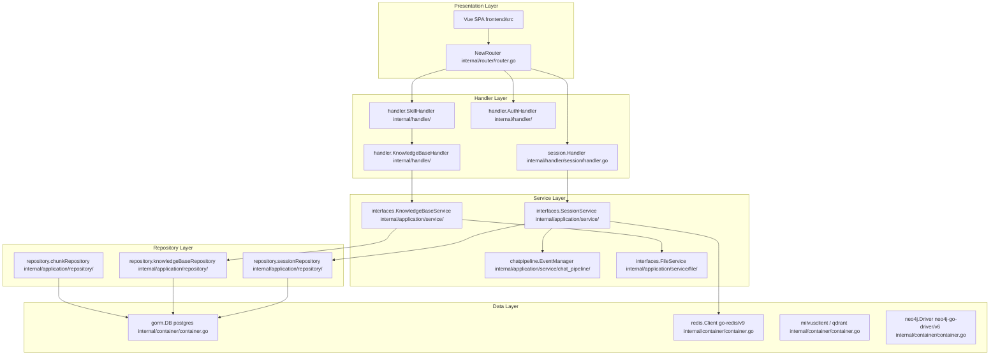
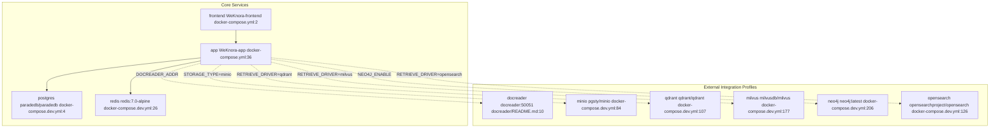
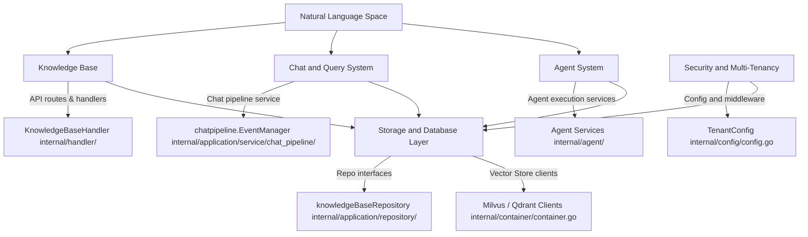
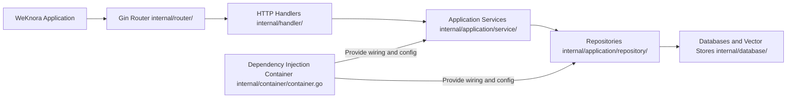

<!-- source: DeepWiki mcp.deepwiki.com · repo Tencent/WeKnora · page 3 System Architecture · fetched 2026-10-29 -->

# System Architecture

Relevant source files

The following files were used as context for generating this wiki page:

- [.env.example](.env.example)
- [config/config.yaml](config/config.yaml)
- [docker-compose.dev.yml](docker-compose.dev.yml)
- [docker-compose.yml](docker-compose.yml)
- [docreader/README.md](docreader/README.md)
- [docreader/config.py](docreader/config.py)
- [docreader/parser/docx_parser.py](docreader/parser/docx_parser.py)
- [docreader/parser/image_preprocess.py](docreader/parser/image_preprocess.py)
- [docreader/preprocess.py](docreader/preprocess.py)
- [docreader/preprocess_worker.py](docreader/preprocess_worker.py)
- [docreader/tests/test_config.py](docreader/tests/test_config.py)
- [docreader/tests/test_docx_tables.py](docreader/tests/test_docx_tables.py)
- [docreader/tests/test_preprocess_runner.py](docreader/tests/test_preprocess_runner.py)
- [go.mod](go.mod)
- [go.sum](go.sum)
- [internal/config/auth_legacy_env_test.go](internal/config/auth_legacy_env_test.go)
- [internal/config/config.go](internal/config/config.go)
- [internal/container/container.go](internal/container/container.go)
- [scripts/dev.sh](scripts/dev.sh)

## Purpose and Scope

This document provides a comprehensive overview of WeKnora's technical architecture, design patterns, and component interactions. It focuses on the high-level system structure, architectural decisions, and how major subsystems work together to process documents into interactive knowledge.

As a parent page, this section introduces the core architectural foundations and links to dedicated child pages for deep technical dives into specific layers:

- **Service Architecture and Container Orchestration** ([Service Architecture and Container Orchestration](#3.1)) — Microservices architecture, Docker Compose setup, service dependencies, and container communication.
- **RAG Pipeline Architecture** ([RAG Pipeline Architecture](#3.2)) — Document ingestion, chunking, embedding, indexing, retrieval, and generation pipeline.
- **Agent System and ReAct Engine** ([Agent System and ReAct Engine](#3.3)) — Agent execution model, ReAct pattern, tool registry, and iterative reasoning.
- **Storage and Database Layer** ([Storage and Database Layer](#3.4)) — Multi-database architecture including PostgreSQL, Redis, vector stores, graph databases, and file storage.
- **Security and Multi-Tenancy** ([Security and Multi-Tenancy](#3.5)) — Tenant isolation, RBAC access control, organization sharing, SSRF protection, and best practices.
- **Dependency Injection and Service Layer** ([Dependency Injection and Service Layer](#3.6)) — Dependency injection container, service registration, and layered architecture.
- **Event-Driven Architecture and Chat Pipeline** ([Event-Driven Architecture and Chat Pipeline](#3.7)) — Event bus system, chat pipeline plugins, streaming architecture, and event types.

Sources: [internal/container/container.go:113-145]()

---

## Architectural Overview

WeKnora follows a **layered microservices-inspired architecture**, deployed via Docker Compose (`docker-compose.yml`). This enables easy startup and management of core services and optional components configured via profiles.

The backend is implemented in Go using a clean architecture approach with separation into HTTP handlers, application services, and repositories [internal/container/container.go:113-137](). Persistent storage uses multiple database backends, including relational (PostgreSQL), Redis, vector stores, and graph databases [internal/container/container.go:23-53](). 

### Application Layering and Code Entity Mapping

The following diagram bridges natural language architectural layers to specific code entities and packages in the codebase, enabling precise navigation:

For detailed information on DI and service layers, see [Dependency Injection and Service Layer](#3.6).

Sources: [internal/container/container.go:23-137]()

### Deployment Architecture

WeKnora is deployed as containerized microservices orchestrated by Docker Compose (`docker-compose.yml`). Profiles enable optional services and infrastructure components such as vector databases, document parsers, and observability tools.

The high-level deployment topology is structured as follows:

For details on service orchestration, profiles, and inter-container communication, see [Service Architecture and Container Orchestration](#3.1).

Sources: [docker-compose.yml:1-67](), [docker-compose.dev.yml:1-212](), [docreader/README.md:1-15]()

---

## Core Architectural Patterns

### Dependency Injection with uber-go/dig

WeKnora leverages the `uber-go/dig` library for dependency injection and inversion of control [internal/container/container.go:33](). The container setup and service wiring are centralized in `internal/container/container.go` via `BuildContainer` [internal/container/container.go:113-137](). This modularizes application construction and supports lifecycle management of components such as database clients, repositories, services, and handlers.

For in-depth coverage, see [Dependency Injection and Service Layer](#3.6).

Sources: [internal/container/container.go:33-137]()

### Multi-Tenant Role-Based Access Control (RBAC)

WeKnora implements security by enforcing tenant isolation and role-based access control at the middleware and domain handler layers. Tenant-aware service interfaces and handlers verify permissions on every request, configured via environment defaults and database state.

For security details, see [Security and Multi-Tenancy](#3.5).

Sources: [internal/config/config.go:19-43]()

### Asynchronous Task and Event-Driven Pipeline

Background processing for document parsing, enrichment, vector embedding, and chunk indexing utilizes an asynchronous task queue backed by Redis and the `hibiken/asynq` Go library [go.mod:32](). An event bus propagates domain events and supports extensible chat pipeline plugins and streaming response mechanisms.

For further elaboration, see [Event-Driven Architecture and Chat Pipeline](#3.7) and [Async Task Processing with Asynq](#11.2).

Sources: [.env.example:147-182](), [go.mod:32-32]()

---

## Component Layers Detailed Overview

- **HTTP Handler Layer**  
  WeKnora uses the Gin web framework (`github.com/gin-gonic/gin`) to implement HTTP routing, request validation, authentication enforcement, and response formatting [go.mod:23](). Handlers are defined under `internal/handler/` and include domain-specific subpackages [internal/container/container.go:77-88]().

- **Service Layer**  
  Application business logic resides here, handling session orchestration, RAG workflows, chat pipelines, agent execution, and skill management. These services coordinate with repositories and infrastructure components [internal/container/container.go:54-60]().

- **Repository Layer & Storage**  
  Data persistence abstracts over multiple backends:  
  - Relational: PostgreSQL accessed through GORM [internal/container/container.go:35-37]()  
  - Key-Value and caching: Redis [internal/container/container.go:32-32]()  
  - Vector Stores: Qdrant, Milvus, Weaviate, Tencent VectorDB, SQLite-Vec [internal/container/container.go:23-53]()  
  - Graph DB: Neo4j [internal/container/container.go:29-29]()  
  - Object Storage: MinIO, S3, COS, OSS  
  Retrieval engines are abstracted behind a common repository interface, allowing pluggable drivers [internal/container/container.go:43-53]().  
  For details, see [Storage and Database Layer](#3.4).

Sources: [internal/container/container.go:23-88](), [go.mod:23-23]()

---

## Bridging Natural Language Concepts to Code Entities

The following diagrams map abstract domain concepts to concrete code artifacts in the repository.

### From Natural Language System to Code Entities (High-Level)

Sources: [internal/container/container.go:28-53](), [internal/config/config.go:19-25]()

### Mapping Service Names to Concrete Code Entities

Sources: [internal/container/container.go:113-137](), [internal/database/databasemigration.go:1-1]()

---

## Further Reading

Explore detailed architecture and design in the related child pages:

- [Service Architecture and Container Orchestration](#3.1)
- [RAG Pipeline Architecture](#3.2)
- [Agent System and ReAct Engine](#3.3)
- [Storage and Database Layer](#3.4)
- [Security and Multi-Tenancy](#3.5)
- [Dependency Injection and Service Layer](#3.6)
- [Event-Driven Architecture and Chat Pipeline](#3.7)

---

## Summary

WeKnora's architecture bridges modern LLM-powered RAG concepts with well-established backend engineering practices:

- Modular layers spanning from frontend single-page applications to backend handlers, services, repositories, and multi-database persistence [internal/container/container.go:23-53]().
- Containerized microservices with profile configurations for optional auxiliary components [docker-compose.yml:1-67]().
- Robust multi-tenancy controls and asynchronous task processing pipelines.
- Dependency injection via `uber-go/dig` ensuring clean service separation and lifecycle management [internal/container/container.go:33-33]().

Sources: [internal/container/container.go:23-137](), [docker-compose.yml:1-67]()

---

