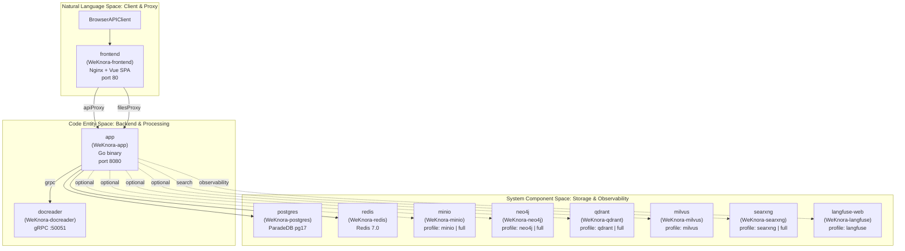
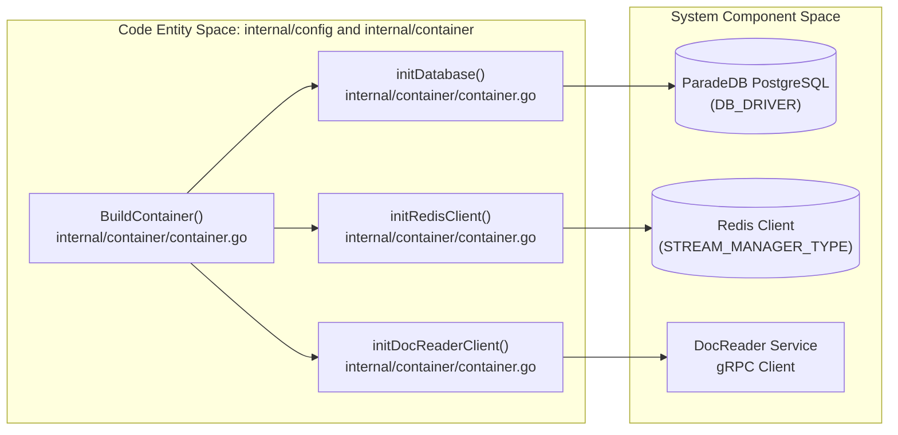
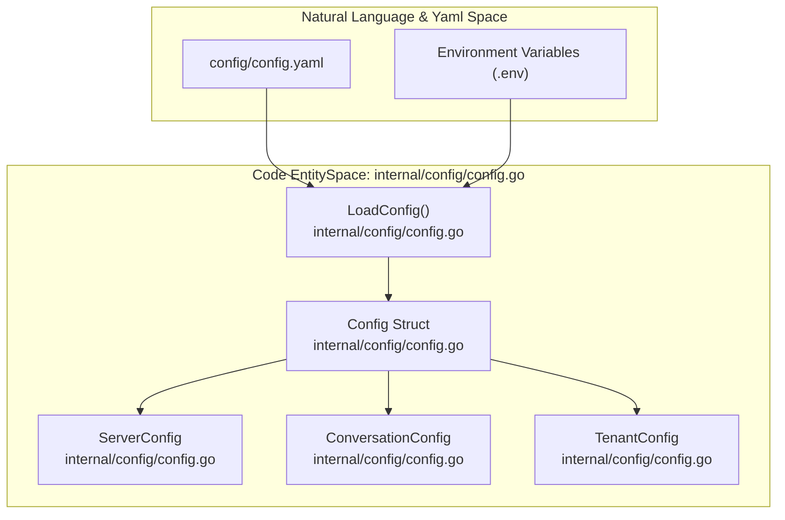

<!-- source: DeepWiki mcp.deepwiki.com · repo Tencent/WeKnora · page 3.1 Service Architecture and Container Orchestration · fetched 2026-10-29 -->

# Service Architecture and Container Orchestration

Relevant source files

The following files were used as context for generating this wiki page:

- [.env.example](.env.example)
- [.github/workflows/cli.yml](.github/workflows/cli.yml)
- [.github/workflows/docker-image.yml](.github/workflows/docker-image.yml)
- [.github/workflows/release-lite.yml](.github/workflows/release-lite.yml)
- [.gitignore](.gitignore)
- [Formula/weknora-lite.rb](Formula/weknora-lite.rb)
- [Makefile](Makefile)
- [cli/internal/cmdutil/errors_doc_test.go](cli/internal/cmdutil/errors_doc_test.go)
- [cli/scripts/check-skill-wire-vocab.sh](cli/scripts/check-skill-wire-vocab.sh)
- [config/config.yaml](config/config.yaml)
- [deploy/weknora-lite.service](deploy/weknora-lite.service)
- [docker-compose.dev.yml](docker-compose.dev.yml)
- [docker-compose.yml](docker-compose.yml)
- [docker/Dockerfile.app](docker/Dockerfile.app)
- [docker/Dockerfile.docreader](docker/Dockerfile.docreader)
- [docker/Dockerfile.sandbox](docker/Dockerfile.sandbox)
- [docreader/README.md](docreader/README.md)
- [docreader/config.py](docreader/config.py)
- [docreader/parser/docx_parser.py](docreader/parser/docx_parser.py)
- [docreader/parser/image_preprocess.py](docreader/parser/image_preprocess.py)
- [docreader/preprocess.py](docreader/preprocess.py)
- [docreader/preprocess_worker.py](docreader/preprocess_worker.py)
- [docreader/tests/test_config.py](docreader/tests/test_config.py)
- [docreader/tests/test_docx_tables.py](docreader/tests/test_docx_tables.py)
- [docreader/tests/test_preprocess_runner.py](docreader/tests/test_preprocess_runner.py)
- [frontend/.dockerignore](frontend/.dockerignore)
- [frontend/Dockerfile](frontend/Dockerfile)
- [go.mod](go.mod)
- [go.sum](go.sum)
- [internal/config/auth_legacy_env_test.go](internal/config/auth_legacy_env_test.go)
- [internal/config/config.go](internal/config/config.go)
- [internal/container/container.go](internal/container/container.go)
- [scripts/build_frontend_dist.sh](scripts/build_frontend_dist.sh)
- [scripts/build_images.sh](scripts/build_images.sh)
- [scripts/dev.sh](scripts/dev.sh)
- [scripts/get_version.sh](scripts/get_version.sh)
- [scripts/package-lite.sh](scripts/package-lite.sh)
- [scripts/start_all.sh](scripts/start_all.sh)
- [scripts/test-homebrew.sh](scripts/test-homebrew.sh)
- [scripts/update-homebrew-formula.sh](scripts/update-homebrew-formula.sh)
- [scripts/verify_frontend_pr.sh](scripts/verify_frontend_pr.sh)

## Purpose and Scope

This page details the microservices architecture of WeKnora, highlighting its Docker Compose-based container orchestration setup, service dependencies, and inter-container communication mechanisms. It explains the multiple containerized service roles, startup ordering through health checks, and how configuration via environment variables and `spf13/viper` drives deployments.

For detailed explanations of underlying subsystems, including the RAG pipeline, agent system, storage layer, and more, consult related architectural pages.

Sources: `docker-compose.yml:1-35`, `internal/config/config.go:19-43`

---

## Multi-Service Layout

WeKnora employs a microservices architecture with multiple containerized components orchestrated using Docker Compose. The main orchestration definition is in `docker-compose.yml`, which configures essential runtime services plus optional profile-activated extras [docker-compose.yml:1-35]().

Key services include:
- **Frontend:** A Vue.js SPA served via Nginx (`wechatopenai/weknora-ui`) [docker-compose.yml:2-16]().
- **App:** The main Go backend API/service binary (`wechatopenai/weknora-app`) [docker-compose.yml:36-46]().
- **DocReader:** A Python-based gRPC document parsing service (`wechatopenai/weknora-docreader`) [docker/Dockerfile.docreader:160-170]().
- **Postgres (ParadeDB):** The primary relational metadata store (`paradedb/paradedb:v0.25.11-pg17`) [docker-compose.dev.yml:4-5]().
- **Redis:** Caching, session state, and streaming message broker [docker-compose.dev.yml:26-37]().
- **Optional services:** Vector stores (Qdrant, Milvus, Weaviate, OpenSearch), graph DB (Neo4j), object storage (MinIO), search (SearxNG), and observability (Langfuse) [docker-compose.dev.yml:84-212]().

### Service Topology Diagram

**Explanation:**
- The `frontend` container serves the Vue SPA on port 80 and proxies API/file requests to the `app` container via environment-configured host and port variables [docker-compose.yml:2-26]().
- The `app` container listens on port 8080 exposing REST API endpoints and integrates with databases, caching, and parsing services [docker-compose.yml:36-46]().
- `docreader` listens on gRPC port 50051, processing documents asynchronously for ingestion [docker/Dockerfile.docreader:160-170]().
- Storage includes the ParadeDB-backed `postgres` container for relational data and `redis` for caching, streams, and queues [docker-compose.dev.yml:4-37]().
- Optional services are enabled via Docker Compose profiles, modularizing the deployment footprint [docker-compose.dev.yml:103-120]().

Sources: `docker-compose.yml:1-35`, `docker-compose.dev.yml:4-212`, `.env.example:1-183`, `docker/Dockerfile.docreader:160-170`

---

## Core Services and Profiles

WeKnora's deployment distinguishes core services required in every setup from optional services activated via Docker Compose profiles [docker-compose.dev.yml:103-120]().

### Core Services

| Service | Container Name | Image | Default Port | Description |
|:---|:---|:---|:---|:---|
| `frontend` | WeKnora-frontend | `wechatopenai/weknora-ui` | 80 | Nginx serving Vue SPA; proxies API calls to app [docker-compose.yml:2-16]() |
| `app` | WeKnora-app | `wechatopenai/weknora-app` | 8080 | Main Go backend handling API and internal logic [docker-compose.yml:36-46]() |
| `docreader` | WeKnora-docreader | `wechatopenai/weknora-docreader` | 50051 (gRPC) | Python document parser service [docker/Dockerfile.docreader:160-170]() |
| `postgres` | WeKnora-postgres-dev | `paradedb/paradedb:v0.25.11-pg17` | 5432 | Relational metadata storage (ParadeDB, PostgreSQL) [docker-compose.dev.yml:4-8]() |
| `redis` | WeKnora-redis-dev | `redis:7.0-alpine` | 6379 | Session/state cache and streaming backend [docker-compose.dev.yml:26-30]() |

### Profile-Activated Optional Services

| Service | Profile(s) | Purpose | Activation Command |
|:---|:---|:---|:---|
| `minio` | minio, full | S3-compatible object storage [docker-compose.dev.yml:84-105]() | `docker compose --profile minio up` |
| `neo4j` | neo4j, full | Graph database for KG [docker-compose.dev.yml:206-212]() | `docker compose --profile neo4j up` |
| `qdrant` | qdrant, full | Vector database for embeddings [docker-compose.dev.yml:107-121]() | `docker compose --profile qdrant up` |
| `milvus` | milvus, full | High-performance vector store [docker-compose.dev.yml:177-204]() | `docker compose --profile milvus up` |
| `searxng` | searxng, full | Web meta-search service [docker-compose.dev.yml:40-83]() | `docker compose --profile searxng up` |

Sources: `docker-compose.yml:1-46`, `docker-compose.dev.yml:4-212`, `docker/Dockerfile.docreader:160-170`

---

## Startup Dependencies and Health Checks

To ensure smooth deployment, WeKnora uses Docker Compose's `depends_on` with health checks to orchestrate container startup order and readiness [docker-compose.yml:29-67]().

### Dependency Enforcement
- The `frontend` container depends on `app` being healthy before accepting traffic, preventing failed proxies at startup via `depends_on.app.condition: service_healthy` [docker-compose.yml:29-34]().
- The `app` container defines a health check hitting its health endpoint [docker-compose.yml:62-67]().

### Health Checks
Services expose endpoints serving as readiness probes, monitored by Docker Compose:

| Service | Check Command | Interval | Retries | Remarks |
|:---|:---|:---|:---|:---|
| `app` | `curl -f http://localhost:8080/health` [docker-compose.yml:63]() | 30s [docker-compose.yml:64]() | 3 [docker-compose.yml:66]() | `app` readiness endpoint |
| `postgres` | `pg_isready -U ${DB_USER} -d ${DB_NAME}` [docker-compose.dev.yml:18]() | 10s [docker-compose.dev.yml:19]() | 3 [docker-compose.dev.yml:21]() | ParadeDB/Postgres standard probe |
| `minio` | `curl -f http://localhost:9000/minio/health/live` [docker-compose.dev.yml:97]() | 30s [docker-compose.dev.yml:98]() | 3 [docker-compose.dev.yml:100]() | Object storage health |
| `milvus` | `curl -f http://localhost:9091/healthz` [docker-compose.dev.yml:189]() | 30s [docker-compose.dev.yml:190]() | 3 [docker-compose.dev.yml:193]() | Vector store health probe |

Sources: `docker-compose.yml:29-67`, `docker-compose.dev.yml:17-204`

---

## Backend Dependency Injection and Initialization

The `app` backend service relies on modular wiring and container initialization patterns to manage infrastructure components and services. The configuration and container bootstrapping handle database drivers, Redis connections, gRPC clients for `DocReader`, and model providers within `BuildContainer` [internal/container/container.go:113-137]().

### Initialization and Service Map Diagram

Sources: `internal/config/config.go:19-43`, `internal/container/container.go:113-137`

---

## Configuration Architecture and Binding

WeKnora's configuration framework leverages `spf13/viper` and `yaml.v3` for flexible file-based and environment variable-driven configuration [internal/config/config.go:13-16]().

### Core Config Struct
The main `Config` struct aggregates configuration for all subsystems [internal/config/config.go:19-43]():
- `Conversation`: conversation service parameters [internal/config/config.go:21]()
- `Server`: server ports and binding [internal/config/config.go:22]()
- `KnowledgeBase`: knowledge base parameters [internal/config/config.go:23]()
- `Tenant`, `Auth`, `Audit`, `OIDCAuth`: tenant, auth, audit, and OIDC configurations [internal/config/config.go:24-27]()
- `Models`: registered models [internal/config/config.go:28]()
- `VectorDatabase`: vector database drivers [internal/config/config.go:29]()
- `DocReader`, `StreamManager`: DocReader and stream manager options [internal/config/config.go:30-31]()
- `IM`, `Agent`: IM integration and agent settings [internal/config/config.go:35-36]()
- `FrontendBaseURL`: frontend base URL for sharing [internal/config/config.go:42]()

### Configuration Mapping Diagram

Sources: `internal/config/config.go:13-43`

---

## Environment Variable Reference

The interaction and setup of these services is heavily influenced by environment variables defined primarily in `.env` (template at `.env.example`) [`.env.example:1-25`]().

### Key Environment Variables

| Variable | Default | Purpose / Notes |
|:---|:---|:---|
| `DB_DRIVER` | `postgres` [.env.example:132]() | Selects relational DB driver (`postgres` or `sqlite`) |
| `DB_HOST` | `postgres` [.env.example:134]() | Hostname of PostgreSQL container |
| `DB_PORT` | `5432` [.env.example:136]() | Port for PostgreSQL |
| `DB_USER` | — [.env.example:138]() | DB username |
| `DB_PASSWORD` | — [.env.example:140]() | DB user password |
| `DB_NAME` | — [.env.example:142]() | Database name |
| `REDIS_ADDR` | `redis:6379` [.env.example:151]() | Redis host and port |
| `REDIS_PASSWORD` | — [.env.example:155]() | Redis access password |
| `APP_HOST` | `app` [.env.example:87]() | Hostname for frontend proxy to backend (`app`) |
| `APP_PORT` | `8080` [.env.example:89]() | Backend API service port |
| `DOCREADER_ADDR` | `docreader:50051` [.env.example:98]() | gRPC address for docreader |
| `FRONTEND_PORT` | `80` [.env.example:96]() | Port exposed for frontend service |
| `WEKNORA_VERSION` | `latest` [.env.example:34]() | Image tag for WeKnora images |
| `WEKNORA_SANDBOX_DOCKER_ENABLED` | `false` [docker-compose.yml:101]() | Whether Docker sandbox enabled on app container |
| `COS_SECRET_ID` | — [docker-compose.yml:116]() | Tencent Cloud Object Storage (COS) credentials |
| `DISABLE_REGISTRATION` | `false` [docker-compose.yml:127]() | Disable open user registration |

These environment variables are injected into containers via `env_file` directives or explicit environment settings in `docker-compose.yml` [docker-compose.yml:17-130](), ensuring runtime configuration consistency.

Sources: `.env.example:1-183`, `docker-compose.yml:1-130`

---

# Summary

WeKnora's architecture follows a modular microservices model containerized with Docker Compose. Core containers serve the frontend, backend API, document parsing, and data stores, with optional services added through profiles.

Startup order and health are managed with Docker Compose's `depends_on` and health checks, ensuring smooth system bring-up. The backend app utilizes configuration binding via `spf13/viper` (`internal/config/config.go`) for clean initialization of services like databases, Redis, parsing clients, and model providers.

Configuration is unified through YAML files layered with environment variables. This supports flexible deployment and operational tuning across environments.

Sources:
- `docker-compose.yml:1-67`
- `docker-compose.dev.yml:4-212`
- `.env.example:1-183`
- `internal/config/config.go:13-43`
- `internal/container/container.go:113-137`

---

