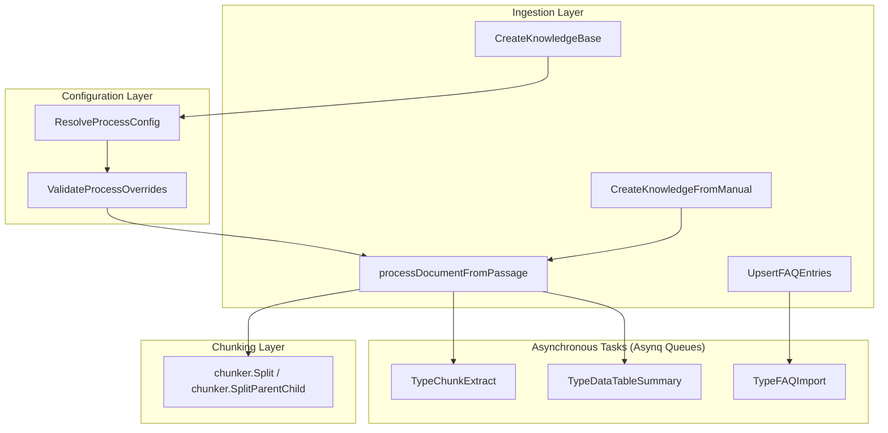
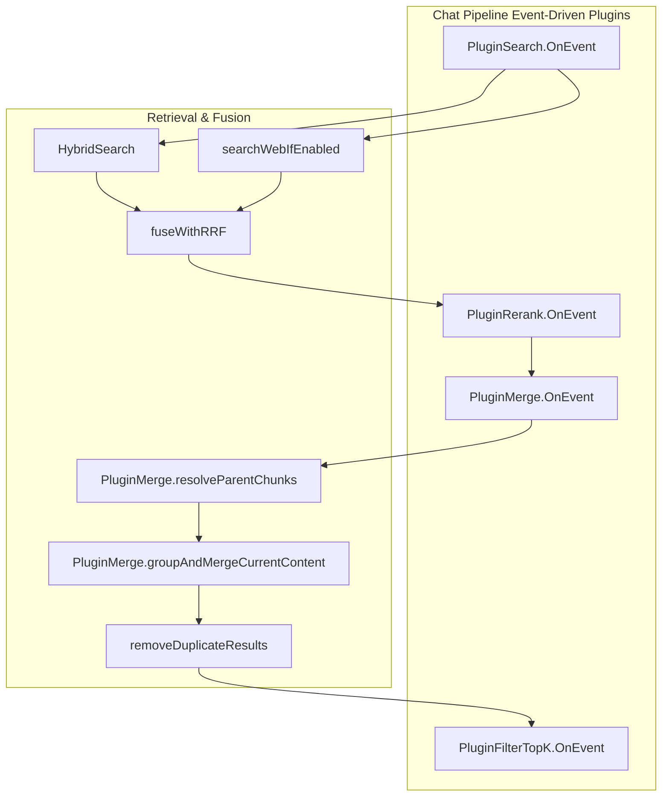
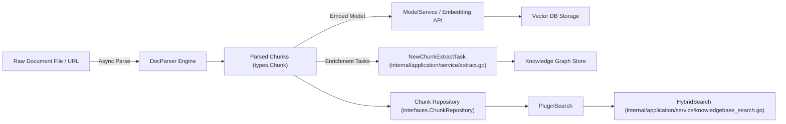

<!-- source: DeepWiki mcp.deepwiki.com · repo Tencent/WeKnora · page 3.2 RAG Pipeline Architecture · fetched 2026-10-29 -->

# RAG Pipeline Architecture

Relevant source files

The following files were used as context for generating this wiki page:

- [client/retrieval.go](client/retrieval.go)
- [cmd/download/duckdb/duckdb.go](cmd/download/duckdb/duckdb.go)
- [config/prompt_templates/generate_summary.yaml](config/prompt_templates/generate_summary.yaml)
- [internal/agent/tools/data_analysis.go](internal/agent/tools/data_analysis.go)
- [internal/agent/tools/data_analysis_legacy_xls_test.go](internal/agent/tools/data_analysis_legacy_xls_test.go)
- [internal/agent/tools/data_analysis_storage_test.go](internal/agent/tools/data_analysis_storage_test.go)
- [internal/agent/tools/data_analysis_test.go](internal/agent/tools/data_analysis_test.go)
- [internal/agent/tools/image_markdown_output_test.go](internal/agent/tools/image_markdown_output_test.go)
- [internal/agent/tools/search_knowledge.go](internal/agent/tools/search_knowledge.go)
- [internal/agent/tools/search_knowledge_rerank_test.go](internal/agent/tools/search_knowledge_rerank_test.go)
- [internal/agent/tools/search_knowledge_test.go](internal/agent/tools/search_knowledge_test.go)
- [internal/application/repository/knowledgebase.go](internal/application/repository/knowledgebase.go)
- [internal/application/service/chat_pipeline/common.go](internal/application/service/chat_pipeline/common.go)
- [internal/application/service/chat_pipeline/data_analysis.go](internal/application/service/chat_pipeline/data_analysis.go)
- [internal/application/service/chat_pipeline/data_analysis_storage_test.go](internal/application/service/chat_pipeline/data_analysis_storage_test.go)
- [internal/application/service/chat_pipeline/extract_entity.go](internal/application/service/chat_pipeline/extract_entity.go)
- [internal/application/service/chat_pipeline/extract_entity_test.go](internal/application/service/chat_pipeline/extract_entity_test.go)
- [internal/application/service/chat_pipeline/filter_top_k.go](internal/application/service/chat_pipeline/filter_top_k.go)
- [internal/application/service/chat_pipeline/filter_top_k_test.go](internal/application/service/chat_pipeline/filter_top_k_test.go)
- [internal/application/service/chat_pipeline/into_chat_message.go](internal/application/service/chat_pipeline/into_chat_message.go)
- [internal/application/service/chat_pipeline/merge.go](internal/application/service/chat_pipeline/merge.go)
- [internal/application/service/chat_pipeline/merge_expand_edit_test.go](internal/application/service/chat_pipeline/merge_expand_edit_test.go)
- [internal/application/service/chat_pipeline/merge_history.go](internal/application/service/chat_pipeline/merge_history.go)
- [internal/application/service/chat_pipeline/merge_parent_resolve_test.go](internal/application/service/chat_pipeline/merge_parent_resolve_test.go)
- [internal/application/service/chat_pipeline/merge_parent_shared_test.go](internal/application/service/chat_pipeline/merge_parent_shared_test.go)
- [internal/application/service/chat_pipeline/query_understand.go](internal/application/service/chat_pipeline/query_understand.go)
- [internal/application/service/chat_pipeline/query_understand_test.go](internal/application/service/chat_pipeline/query_understand_test.go)
- [internal/application/service/chat_pipeline/references.go](internal/application/service/chat_pipeline/references.go)
- [internal/application/service/chat_pipeline/references_test.go](internal/application/service/chat_pipeline/references_test.go)
- [internal/application/service/chat_pipeline/rerank.go](internal/application/service/chat_pipeline/rerank.go)
- [internal/application/service/chat_pipeline/rerank_test.go](internal/application/service/chat_pipeline/rerank_test.go)
- [internal/application/service/chat_pipeline/search.go](internal/application/service/chat_pipeline/search.go)
- [internal/application/service/chat_pipeline/search_error_test.go](internal/application/service/chat_pipeline/search_error_test.go)
- [internal/application/service/chat_pipeline/shared_chat_model_test.go](internal/application/service/chat_pipeline/shared_chat_model_test.go)
- [internal/application/service/extract.go](internal/application/service/extract.go)
- [internal/application/service/extract_graph_declined_test.go](internal/application/service/extract_graph_declined_test.go)
- [internal/application/service/knowledge_bind_stored_images_test.go](internal/application/service/knowledge_bind_stored_images_test.go)
- [internal/application/service/knowledgebase.go](internal/application/service/knowledgebase.go)
- [internal/application/service/knowledgebase_search.go](internal/application/service/knowledgebase_search.go)
- [internal/application/service/knowledgebase_search_embedding_dimension_test.go](internal/application/service/knowledgebase_search_embedding_dimension_test.go)
- [internal/application/service/session_knowledge_qa.go](internal/application/service/session_knowledge_qa.go)
- [internal/application/service/session_knowledge_qa_test.go](internal/application/service/session_knowledge_qa_test.go)
- [internal/application/service/session_model_requirement_test.go](internal/application/service/session_model_requirement_test.go)
- [internal/application/service/session_qa_helpers.go](internal/application/service/session_qa_helpers.go)
- [internal/application/service/session_shared_chat_model_test.go](internal/application/service/session_shared_chat_model_test.go)
- [internal/handler/initialization_extract_relations_test.go](internal/handler/initialization_extract_relations_test.go)
- [internal/handler/knowledgebase.go](internal/handler/knowledgebase.go)
- [internal/infrastructure/docparser/resolve_remote_html_images_test.go](internal/infrastructure/docparser/resolve_remote_html_images_test.go)
- [internal/modelcontext/omitted_results_test.go](internal/modelcontext/omitted_results_test.go)
- [internal/models/chat/ollama.go](internal/models/chat/ollama.go)
- [internal/models/chat/ollama_test.go](internal/models/chat/ollama_test.go)
- [internal/searchutil/imageinfo.go](internal/searchutil/imageinfo.go)
- [internal/searchutil/imageinfo_disabled_test.go](internal/searchutil/imageinfo_disabled_test.go)
- [internal/searchutil/imageinfo_html_test.go](internal/searchutil/imageinfo_html_test.go)
- [internal/searchutil/imageinfo_match.go](internal/searchutil/imageinfo_match.go)
- [internal/searchutil/imageinfo_match_test.go](internal/searchutil/imageinfo_match_test.go)
- [internal/searchutil/textutil.go](internal/searchutil/textutil.go)
- [internal/types/chat_manage.go](internal/types/chat_manage.go)
- [internal/types/interfaces/knowledgebase.go](internal/types/interfaces/knowledgebase.go)
- [internal/types/knowledgebase.go](internal/types/knowledgebase.go)

## Purpose and Scope

This document details the Retrieval-Augmented Generation (RAG) pipeline architecture implemented in WeKnora. It covers the full process from document ingestion through chunking, embedding, indexing, hybrid multi-source retrieval, reranking, result fusion, context expansion, and final generation. The architecture leverages asynchronous task processing via `Asynq`, adaptive chunking strategies with parent-child relationships, hybrid vector and BM25 keyword retrieval fused via Reciprocal Rank Fusion (RRF), and a highly modular event-driven chat pipeline (`chatpipeline` package) with rich intermediate processing stages.

Sources:  
[internal/application/service/chat_pipeline/merge.go:1-48]() [internal/application/service/knowledgebase.go:115-181]()

---

## Document Ingestion and Processing

The ingestion pipeline transforms source data such as uploaded files, URLs, or manual entries into searchable knowledge chunks. The flow is orchestrated asynchronously by the knowledge service to optimize scalability and parallelism.

### Ingestion Entry Points

- **File Upload:** Initiated by methods that perform safety validation, file hash deduplication, raw file storage, and asynchronous parsing task enqueuing.
- **URL Ingestion:** Similar process for remote web URLs, downloading content prior to parsing.
- **Manual Entry:** Direct text or markdown ingestion handled directly.
- **Passage Processing:** String passages are converted into chunks, enabling direct ingestion of small text units.
- **FAQ Batch Import:** Supports asynchronous bulk import of FAQ entries.

### Processing Pipeline Overview

The pipeline resolves processing configurations by merging Knowledge Base-level defaults with per-ingestion overrides. After validation, documents are passed to the chunking layer, which applies the adaptive chunk splitting strategy.

Title: Document Ingestion and Asynchronous Processing Pipeline

Sources:  
[internal/application/service/knowledgebase.go:115-181]() [internal/application/service/extract.go:90-160]()

---

### Adaptive Chunking Strategy

WeKnora supports a multi-tier adaptive chunking strategy to preserve document structure and semantics:
- **Heading-based:** Parses Markdown with explicit headers (`#`, `##`, etc.) to split at logical sections.
- **Heuristic:** Uses heuristics such as numbered sections or page breaks for semi-structured docs.
- **Legacy Character-based:** Fall-back strategy with recursive splitting by characters or separators.

Additionally, a Parent-Child chunking mode (`SplitParentChild`) first divides into large parent chunks (`ChunkTypeParentText`) and further splits each parent into smaller child chunks (`ChunkTypeText`, `ChunkTypeImageOCR`, etc.) to support hierarchical retrieval context.

Sources:  
[internal/application/service/chat_pipeline/merge.go:13-97]() [internal/types/knowledgebase.go:58-114]()

---

## Indexing, Embedding, and Enrichment

After chunking, asynchronous worker pools handle embedding and content enrichment tasks across named queues (`core`, `enrichment`, `summary`, `graph`, `multimodal`).

- **Vector Embeddings:** Each chunk is embedded using the embedding model configured on the knowledge base, utilizing cached and validated embedding dimensions (`GetQueryEmbedding`, `ResolveEmbeddingModelKeys`) [internal/application/service/knowledgebase_search.go:26-120]().
- **Graph Extraction:** Neo4j integration extracts linked entities and relations via `NewChunkExtractTask` to populate the knowledge graph [internal/application/service/extract.go:92-128]().
- **Table Summarization:** Tabular data (CSV, XLSX) is processed via `NewDataTableSummaryTask` to create summaries and structured metadata, enriching the retrieval context [internal/application/service/extract.go:130-160]().

Sources:  
[internal/application/service/knowledgebase_search.go:26-120]() [internal/application/service/extract.go:92-160]()

---

## Retrieval, Deduplication, and Fusion Architecture

The chat pipeline integrates multiple plugins in an event-driven architecture managed by `EventManager` and `ChatManage`. Triggered stages include query understanding (`PluginQueryUnderstand`), parallel search (`PluginSearch`), reranking (`PluginRerank`), web fetch (`PluginWebFetch`), chunk merging (`PluginMerge`), top-K filtering (`PluginFilterTopK`), and answer generation (`PluginChatCompletionStream`).

Title: Retrieval, Fusion, and Parent-Child Resolution Architecture

Sources:  
[internal/application/service/chat_pipeline/merge.go:33-98]() [internal/application/service/knowledgebase_search.go:130-169]() [internal/application/service/chat_pipeline/query_understand.go:16-54]()

---

### Deduplication, Parent-Child Resolution, and Fusion

`PluginMerge` executes an 8-step merging pipeline:
1. **Input Selection:** Selects rerank results (`chatManage.RerankResult`), falling back to sorted search results cut to `RerankTopK` [internal/application/service/chat_pipeline/merge.go:100-138]().
2. **Initial Deduplication:** Removes duplicate chunks by ID and content signature [internal/application/service/chat_pipeline/merge.go:58-60]().
3. **History Injection:** Injects relevant past retrieval results from session history [internal/application/service/chat_pipeline/merge.go:155-170]().
4. **Parent Chunk Resolution:** Resolves retrieval hits that are child chunks by injecting their larger parent chunk context [internal/application/service/chat_pipeline/merge.go:76-78]().
5. **Grouping and Merge:** Groups chunks by `KnowledgeID` and `ChunkType`, merging sequential bodies [internal/application/service/chat_pipeline/merge.go:174-184]().
6. **FAQ Population:** Populates FAQ answers and boosts confidence scores.
7. **Context Expansion & Re-Merge:** Expands short contexts with neighboring chunks and re-merges overlapping ranges [internal/application/service/chat_pipeline/merge.go:85-90]().
8. **Final Deduplication & Partial Overlap Removal:** Cleans up exact duplicates and partial content overlaps [internal/application/service/chat_pipeline/merge.go:91-93]().

Hybrid search combines vector and keyword retrieval outputs via Reciprocal Rank Fusion, normalizing scores appropriately.

Sources:  
[internal/application/service/chat_pipeline/merge.go:33-98]() [internal/application/service/knowledgebase_search.go:130-169]()

---

## Post-Processing and Lifecycle Management

WeKnora tracks resource lifecycles carefully for knowledge entry cloning, moving, and deletion:
- **Dataset Cloning and Deep Copy:** Cloning copies knowledge base files and image blobs into new tenant ownership namespaces via deep copy strategies, rewriting chunk image URLs and cloning metadata [internal/types/interfaces/knowledgebase.go:118-132]().
- **Resource Deletion with Reference Counting:** The resource releaser tracks multi-claim resource usage for blobs and extracted images, ensuring deletion occurs only after all pending claims are released.

Sources:  
[internal/types/interfaces/knowledgebase.go:118-132]() [internal/application/service/knowledgebase.go:115-181]()

---

## Summary Table: Pipeline Components

| Component | Responsibility | Key Code Symbols / Files |
|--|--|--|
| **Ingestion Engine** | Intake, validation, deduplication, async task enqueuing | `knowledgeBaseService` [internal/application/service/knowledgebase.go:33-55]() |
| **Config Resolver** | Merge KB defaults with upload overrides and validate | `ResolveProcessConfig` [internal/application/service/knowledgebase.go:115-146]() |
| **Chunking Layer** | Adaptive multi-tier chunk splitting & parent-child chunking | `ChunkingConfig` [internal/types/knowledgebase.go:78-80]() |
| **Query Understanding** | Query rewrite, intent classification, entity extraction | `PluginQueryUnderstand` [internal/application/service/chat_pipeline/query_understand.go:19-24]() |
| **Search Plugin** | Parallel hybrid vector + keyword search, web searching | `HybridSearch` [internal/application/service/knowledgebase_search.go:130-154]() |
| **Rerank Plugin** | Reranking candidates with model scoring and thresholds | `PluginRerank` [internal/application/service/chat_pipeline/merge.go:100-138]() |
| **Merge Plugin** | Deduplication, parent-child resolution, grouping, FAQ enrichment | `PluginMerge` [internal/application/service/chat_pipeline/merge.go:13-16]() |
| **Fusion Engine** | Hybrid fusion via Reciprocal Rank Fusion (RRF) | `hybridSearchCandidates` [internal/application/service/knowledgebase_search.go:159-169]() |
| **Top-K Filter** | Truncation and deterministic tie-breaker sorting | `RetrievalStageFilterTopK` [internal/types/chat_manage.go:143-144]() |
| **Message Formatter** | Context template rendering and model context registry | `ChatModelContext` [internal/types/chat_manage.go:93-98]() |

Sources:  
[internal/application/service/knowledgebase.go:33-55]() [internal/types/knowledgebase.go:78-80]() [internal/application/service/chat_pipeline/query_understand.go:19-24]() [internal/application/service/knowledgebase_search.go:130-169]() [internal/application/service/chat_pipeline/merge.go:13-16]() [internal/types/chat_manage.go:93-144]()

---

## Bridging Natural Language Space to Code Entity Space

### Event-Driven RAG Pipeline Components in Code

Title: Event-Driven Chat Pipeline Execution Flow

```mermaid
graph LR
    A["Natural Language Query"] -->|HTTP POST| B["KnowledgeBaseHandler (internal/handler/knowledgebase.go)"]
    B --> C["KnowledgeQA (internal/application/service/session_knowledge_qa.go)"]
    C --> D["EventManager (chat_pipeline)"]

    subgraph Plugins
        P1["PluginQueryUnderstand\n(query_understand.go)"]
        P2["PluginSearch\n(search.go)"]
        P3["PluginRerank\n(rerank.go)"]
        P4["PluginMerge\n(merge.go)"]
        P5["PluginFilterTopK\n(filter_top_k.go)"]
        P6["PluginIntoChatMessage\n(into_chat_message.go)"]
        P7["PluginChatCompletionStream\n(chat_completion_stream.go)"]
    end

    D --> P1
    P1 --> P2
    P2 --> P3
    P3 --> P4
    P4 --> P5
    P5 --> P6
    P6 --> P7
    P7 -->|SSE Streaming| Client["Client UI"]
```

Sources:  
[internal/handler/knowledgebase.go:33-80]() [internal/application/service/session_knowledge_qa.go:24-55]() [internal/application/service/chat_pipeline/query_understand.go:34-49]()

---

### Chunk Indexing and Enrichment Flow in Code

Title: Document Indexing and Enrichment Flow

Sources:  
[internal/application/service/extract.go:92-128]() [internal/application/service/knowledgebase_search.go:130-154]()

---

# Summary

WeKnora's RAG Pipeline combines event-driven plugin orchestration, adaptive chunking with parent-child hierarchies, asynchronous embedding and enrichment workers, robust hybrid retrieval, and sophisticated result merging and context formatting strategies. Each stage is modular and cleanly decoupled, ensuring high extensibility, scalability, and maintainability across tenants.

Sources:  
[internal/application/service/knowledgebase.go:115-181]() [internal/application/service/chat_pipeline/merge.go:33-98]()

---

