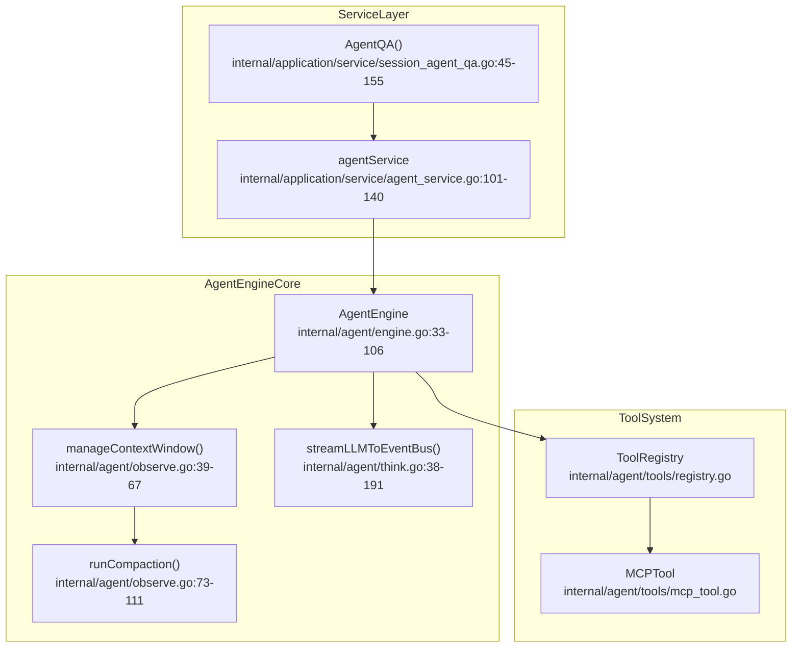
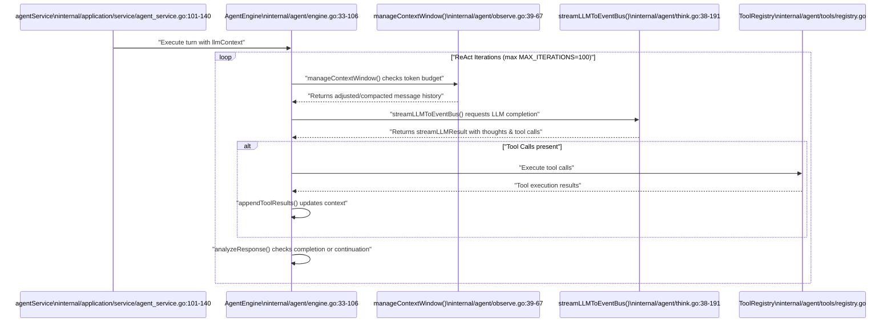

<!-- source: DeepWiki mcp.deepwiki.com · repo Tencent/WeKnora · page 3.3 Agent System and ReAct Engine · fetched 2026-10-29 -->

# Agent System and ReAct Engine

Relevant source files

The following files were used as context for generating this wiki page:

- [internal/agent/const.go](internal/agent/const.go)
- [internal/agent/const_test.go](internal/agent/const_test.go)
- [internal/agent/engine.go](internal/agent/engine.go)
- [internal/agent/engine_test.go](internal/agent/engine_test.go)
- [internal/agent/finalize.go](internal/agent/finalize.go)
- [internal/agent/observe.go](internal/agent/observe.go)
- [internal/agent/observe_test.go](internal/agent/observe_test.go)
- [internal/agent/operations/catalog.go](internal/agent/operations/catalog.go)
- [internal/agent/operations/catalog_test.go](internal/agent/operations/catalog_test.go)
- [internal/agent/operations/spec.go](internal/agent/operations/spec.go)
- [internal/agent/operations/spec_test.go](internal/agent/operations/spec_test.go)
- [internal/agent/prompts.go](internal/agent/prompts.go)
- [internal/agent/think.go](internal/agent/think.go)
- [internal/agent/tools/operations.go](internal/agent/tools/operations.go)
- [internal/agent/tools/operations_test.go](internal/agent/tools/operations_test.go)
- [internal/application/service/agent_history.go](internal/application/service/agent_history.go)
- [internal/application/service/agent_history_test.go](internal/application/service/agent_history_test.go)
- [internal/application/service/agent_service.go](internal/application/service/agent_service.go)
- [internal/application/service/session_agent_qa.go](internal/application/service/session_agent_qa.go)
- [internal/handler/swagger_bodies.go](internal/handler/swagger_bodies.go)
- [internal/models/api/anthropicmessages/anthropicmessages_test.go](internal/models/api/anthropicmessages/anthropicmessages_test.go)
- [internal/models/api/anthropicmessages/request.go](internal/models/api/anthropicmessages/request.go)
- [internal/models/api/compat_settings.go](internal/models/api/compat_settings.go)
- [internal/types/agent.go](internal/types/agent.go)
- [internal/types/chat.go](internal/types/chat.go)
- [internal/types/custom_agent.go](internal/types/custom_agent.go)

## Purpose and Scope

This document explains WeKnora's Agent System and its implementation of the ReAct (Reasoning + Acting) pattern for intelligent question answering. The agent system enables multi-step reasoning, tool usage, and iterative refinement to provide comprehensive answers across knowledge bases, databases, and external APIs.

For information about the normal RAG pipeline without agents, see [RAG Pipeline Architecture](3.2). For tool-specific integrations including MCP (Model Context Protocol) servers, see [MCP Tool Integration](5.5). For the chat interface that displays agent reasoning, see [Chat Interface and Agent Display](7.3).

Sources: `[internal/agent/engine.go:33-106]()`, `[internal/types/agent.go:102-130]()`, `[internal/application/service/agent_service.go:30-36]()`

---

## Overview

### ReAct Pattern

WeKnora implements the ReAct (Reasoning + Acting) pattern, which alternates between:

- **Reasoning**: The LLM generates reasoning content (including `thinking` response chunks and separated `reasoning_content`) to decide the next action. Prompts are constructed dynamically with stateful memory and knowledge embeddings (`AgentEngine`, `streamLLMResult`) `[internal/agent/engine.go:33-106]`, `[internal/agent/think.go:22-34]()`.
- **Acting**: The LLM uses the tool registry to select and invoke tools corresponding to discrete functions like knowledge retrieval, document reading, web searching, or skill execution `[internal/agent/tools/registry.go:1-25]()`.
- **Observing**: The engine processes tool results, adjusts the conversation context by running context window compaction (`manageContextWindow`) or trimming large results, and updates the runtime state for further reasoning loops `[internal/agent/observe.go:39-67]()`.

This iterative loop continues until a final answer is emitted or the iteration count reaches `MAX_ITERATIONS` (default `100`) to prevent infinite loops or runaway LLM calls `[internal/application/service/agent_service.go:30-36]()`.

Sources: `[internal/application/service/agent_service.go:30-184]()`, `[internal/agent/engine.go:33-106]()`, `[internal/agent/think.go:22-34]()`, `[internal/agent/observe.go:39-67]()`

### Agent Execution Model

The core execution logic is encapsulated in the `AgentEngine` struct and orchestrated by `agentService`:

- The `AgentEngine` manages the agent's conversation state for one turn, including injected user-selected documents, pinned MCP services, skills, and original question origin metadata `[internal/agent/engine.go:36-106]()`.
- The engine is stateless across turns; the entire conversation history is loaded from persistent storage and passed into the engine each turn `[internal/application/service/session_agent_qa.go:45-155]()`.
- Tool execution requests go through a centralized tool registry for schema validation, argument normalization, and safe execution.
- Window management is crucial for long conversations, handled by compaction to summarize history and trimming to limit tool result sizes `[internal/agent/observe.go:39-67]()`.

| Component       | Code Entity                                 | Role                                                   |
|-----------------|---------------------------------------------|--------------------------------------------------------|
| Service Wrapper | `agentService`                              | Business logic, agent lifecycle, config loading        |
| Engine Core     | `AgentEngine`                              | Orchestrates the ReAct loop, model interaction          |
| Tool Registry   | `agenttools.ToolRegistry`                   | Tool registration and invocation, argument validation  |
| Context Manager | `compaction.Compactor`, `manageContextWindow` | Context summarization and trimming                      |

Sources: `[internal/application/service/agent_service.go:94-188]()`, `[internal/application/service/session_agent_qa.go:45-155]()`, `[internal/agent/engine.go:36-106]()`, `[internal/agent/observe.go:39-67]()`

---

## Architecture Components

### System Architecture and Code Mapping

This diagram maps natural language system concepts to concrete code entities across the service layer, the core agent engine, and the tool subsystem:

Sources: `[internal/application/service/agent_service.go:101-140]`, `[internal/application/service/session_agent_qa.go:45-155]`, `[internal/agent/engine.go:33-106]`, `[internal/agent/observe.go:39-111]`, `[internal/agent/think.go:38-191]`, `[internal/agent/tools/mcp_tool.go:1-50]`

### Core Components Detail

#### AgentEngine

- The `AgentEngine` struct manages the execution flow of a single agent turn `[internal/agent/engine.go:33-106]()`.
- It is constructed with agent configuration, the chat LLM instance (`chat.Chat`), tool registry (`agenttools.ToolRegistry`), and initial context like pinned documents and knowledge bases `[internal/agent/engine.go:118-139]()`.
- It runs the ReAct execution loop where:
  - Context window management (`manageContextWindow`) ensures the token budget is respected by summarization or trimming `[internal/agent/observe.go:39-67]()`.
  - LLM responses are streamed (`streamLLMToEventBus`), buffering reasoning and answer content `[internal/agent/think.go:38-191]()`.
  - Detected tool calls are executed and their results are appended back into the message sequence.
- Emits events through an `event.EventBus` for real-time streaming UI and logging.

Sources: `[internal/agent/engine.go:33-139]`, `[internal/agent/observe.go:39-67]`, `[internal/agent/think.go:38-191]`

#### ToolRegistry

- Keeps a catalog of available tools and their corresponding JSON schemas for arguments.
- Validates and normalizes LLM-invoked tool call arguments before execution.
- Integrates specialized tool wrappers such as `MCPTool` for dynamic Model Context Protocol servers with optional approval gates `[internal/agent/tools/mcp_tool.go:1-100]()`.

Sources: `[internal/agent/tools/mcp_tool.go:1-100]`

---

## Agent Execution Flow

### Iterative Reasoning and Acting (ReAct Loop)

The agent execution cycle consists of several steps repeated iteratively, bounded by iteration limits and contextual memory:

Sources: `[internal/application/service/agent_service.go:30-140]`, `[internal/agent/engine.go:33-106]`, `[internal/agent/observe.go:39-67]`, `[internal/agent/think.go:38-191]`

### Streaming and Watchdog Protection

- The agent's call to the chat model is proxied via `streamLLMToEventBus`, which processes streamed tokens:
  - Maintains separate buffers for reasoning (`ResponseTypeThinking`) and answer content (`ResponseTypeAnswer`) `[internal/agent/think.go:22-34]`, `[internal/agent/think.go:112-145]()`.
  - Decodes tool calls from the stream and collects metadata.
- A stall-detection watchdog (`watchStreamStall`) cancels the call if no tokens arrive within the timeout threshold (`defaultLLMStallTimeout`), allowing recovery and retries `[internal/agent/think.go:67-77]`, `[internal/agent/const.go:31-38]()`.
- Finalized reasoning and answer content are returned alongside accumulated tool calls.

Sources: `[internal/agent/think.go:22-191]`, `[internal/agent/const.go:31-38]`

---

## Tool System and Registry

WeKnora supports multiple types of tools registered dynamically:
- **Built-in Knowledge Tools**: Knowledge search, grep chunks, list chunks, and document reading.
- **Data Analyst Tools**: DuckDB-powered SQL data analysis and schema inspection.
- **Wiki Tools**: Knowledge graph and wiki page traversal.
- **External MCP Tools**: Wrapped via `MCPTool` enforcing tenant scoping, name sanitation, and human-in-the-loop authorization gates (`approval.MCPApproval`).
- **Timeouts**: Individual tool execution timeouts are governed by `toolExecutionTimeout()`, supporting customized limits for long-running tools like `shell_exec` (10 minutes) or `web_fetch` `[internal/agent/const.go:41-54]`, `[internal/agent/const.go:101-124]()`.

Sources: `[internal/agent/const.go:41-124]`, `[internal/agent/tools/mcp_tool.go:1-150]`

---

## Agent Configuration and Prompts

### AgentConfig Structure

The `AgentConfig` (`types.AgentConfig`) governs agent runtime behavior:

- `MaxIterations`: Maximum ReAct loop rounds, default `20` (capped at `MAX_ITERATIONS` = `100`), negative value means unlimited `[internal/types/agent.go:95-108]`, `[internal/application/service/agent_service.go:30-36]()`.
- `AllowedTools`: List of permissible tool names for the agent `[internal/types/agent.go:107-109]()`.
- `Temperature`: Sampling temperature for LLM outputs `[internal/types/agent.go:108-110]()`.
- `KnowledgeBases` and `KnowledgeIDs`: Sets the retrieval scope to specific KBs or individual documents `[internal/types/agent.go:109-112]()`.
- `WebSearchEnabled`: Enables web search capabilities `[internal/types/agent.go:117-119]()`.
- `MCPSelectionMode`, `MCPServices`: Controls which MCP services are accessible during the turn `[internal/types/agent.go:124-127]()`.
- `MultiTurnEnabled`: Enables multi-turn conversational memory `[internal/types/agent.go:120-122]()`.

Sources: `[internal/types/agent.go:95-130]`, `[internal/application/service/agent_service.go:30-36]()`

---

## Context Management and Token Control

### Context Window Management

To handle lengthy conversations, WeKnora manages the token count using:

- **Threshold Checking**: When the token count crosses a configured threshold, compaction is triggered via `manageContextWindow` `[internal/agent/observe.go:39-45]()`.
- **Compaction**: Uses summarization techniques (`runCompaction`) to collapse older turns into a condensed form while retaining context fidelity (`compaction.Compactor`) `[internal/agent/observe.go:73-111]()`.
- **Tool Result Trimming**: If compaction is insufficient, large tool call outputs are truncated or partially dropped (`trimToolResults`) to stay within token limits (`minToolResultTokens` / `maxToolResultTokens`) `[internal/agent/observe.go:65-67]`, `[internal/agent/observe.go:22-31]()`.

Sources: `[internal/agent/observe.go:22-143]`

---

# Summary

The Agent System in WeKnora is a powerful orchestration of iterative reasoning and action powered by the ReAct pattern. At its core sits the `AgentEngine` which manages interaction with the LLM, execution of diverse tools through the tool registry, and careful management of conversational token context to stay within model limits. The entire flow integrates tightly with the wider codebase through the service layer and event bus, allowing multi-tenant usage, rich prompt customization, and streaming interaction visible in the frontend chat interface.

Sources:  
- `[internal/application/service/agent_service.go:30-184]()`  
- `[internal/application/service/session_agent_qa.go:45-155]()`  
- `[internal/agent/engine.go:33-139]()`  
- `[internal/agent/observe.go:22-143]()`  
- `[internal/agent/think.go:22-191]()`  
- `[internal/types/agent.go:95-130]()`  
- `[internal/agent/const.go:31-124]()`

---

