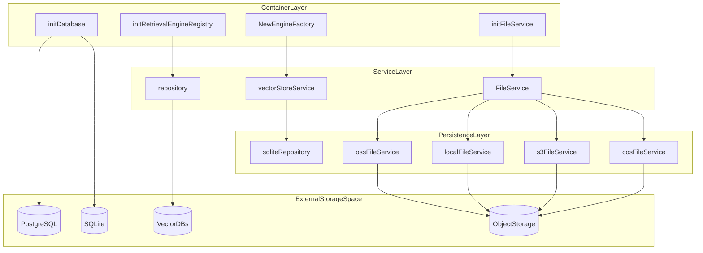
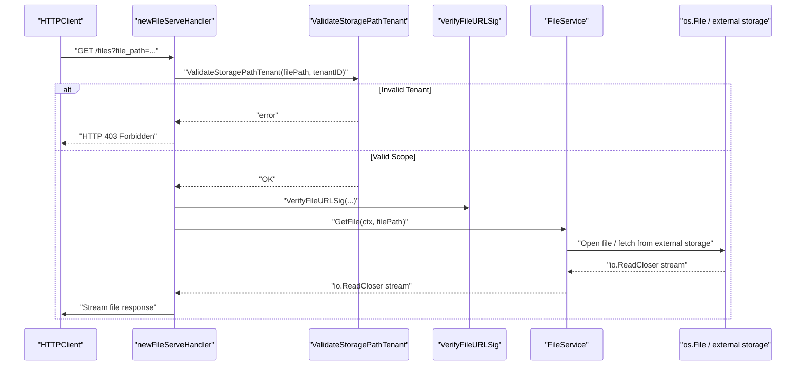

<!-- source: DeepWiki mcp.deepwiki.com · repo Tencent/WeKnora · page 3.4 Storage and Database Layer · fetched 2026-10-29 -->

# Storage and Database Layer

Relevant source files

The following files were used as context for generating this wiki page:

- [internal/application/repository/retriever/tencentvectordb/repository.go](internal/application/repository/retriever/tencentvectordb/repository.go)
- [internal/application/repository/retriever/tencentvectordb/repository_test.go](internal/application/repository/retriever/tencentvectordb/repository_test.go)
- [internal/application/repository/retriever/tencentvectordb/structs.go](internal/application/repository/retriever/tencentvectordb/structs.go)
- [internal/application/repository/vectorstore.go](internal/application/repository/vectorstore.go)
- [internal/application/service/file/backend_scoped.go](internal/application/service/file/backend_scoped.go)
- [internal/application/service/file/canonical_path_parse_test.go](internal/application/service/file/canonical_path_parse_test.go)
- [internal/application/service/file/cos.go](internal/application/service/file/cos.go)
- [internal/application/service/file/dummy.go](internal/application/service/file/dummy.go)
- [internal/application/service/file/ks3.go](internal/application/service/file/ks3.go)
- [internal/application/service/file/ks3_redirect_test.go](internal/application/service/file/ks3_redirect_test.go)
- [internal/application/service/file/local.go](internal/application/service/file/local.go)
- [internal/application/service/file/local_test.go](internal/application/service/file/local_test.go)
- [internal/application/service/file/minio.go](internal/application/service/file/minio.go)
- [internal/application/service/file/obs.go](internal/application/service/file/obs.go)
- [internal/application/service/file/obs_test.go](internal/application/service/file/obs_test.go)
- [internal/application/service/file/oss.go](internal/application/service/file/oss.go)
- [internal/application/service/file/oss_test.go](internal/application/service/file/oss_test.go)
- [internal/application/service/file/s3.go](internal/application/service/file/s3.go)
- [internal/application/service/file/s3_test.go](internal/application/service/file/s3_test.go)
- [internal/application/service/file/tos.go](internal/application/service/file/tos.go)
- [internal/application/service/knowledgebase_pr3_test.go](internal/application/service/knowledgebase_pr3_test.go)
- [internal/application/service/vectorstore.go](internal/application/service/vectorstore.go)
- [internal/application/service/vectorstore_healthcheck.go](internal/application/service/vectorstore_healthcheck.go)
- [internal/application/service/vectorstore_test.go](internal/application/service/vectorstore_test.go)
- [internal/container/engine_factory.go](internal/container/engine_factory.go)
- [internal/container/engine_factory_test.go](internal/container/engine_factory_test.go)
- [internal/types/interfaces/file.go](internal/types/interfaces/file.go)
- [internal/types/interfaces/vectorstore.go](internal/types/interfaces/vectorstore.go)
- [internal/types/vectorstore.go](internal/types/vectorstore.go)
- [internal/types/vectorstore_test.go](internal/types/vectorstore_test.go)
- [internal/utils/presign.go](internal/utils/presign.go)
- [internal/utils/presign_test.go](internal/utils/presign_test.go)
- [migrations/sqlite/000000_init.down.sql](migrations/sqlite/000000_init.down.sql)
- [migrations/sqlite/000000_init.up.sql](migrations/sqlite/000000_init.up.sql)
- [migrations/versioned/000032_vector_stores.down.sql](migrations/versioned/000032_vector_stores.down.sql)
- [migrations/versioned/000032_vector_stores.up.sql](migrations/versioned/000032_vector_stores.up.sql)

This page documents the multi-database architecture of WeKnora, including how various databases are initialized, the multi-tenant storage configuration, file storage and proxy mechanisms, and the dynamic selection of retrieval engines. WeKnora utilizes a diverse set of storage backends to handle relational data, vector embeddings, document files, graph entities, and analytical queries.

For how chunks are written into these stores during document ingestion, see [4.4 Chunk Management and Vector Indexing](). For retrieval configuration parameters such as top-k and thresholds, see [8.5 Retrieval Engine Configuration](). For how the dependency injection container wires these stores together, see [3.6 Dependency Injection and Service Layer]().

---

## Storage Backends at a Glance

WeKnora uses several distinct storage systems, each serving a different purpose.

| Backend | Role | Required | Config key |
| :--- | :--- | :--- | :--- |
| PostgreSQL | Relational data + optional pgvector | Yes | `DB_DRIVER=postgres` |
| SQLite | Lightweight alternative to PostgreSQL | Optional | `DB_DRIVER=sqlite` |
| Redis | Session context, async task queue | Optional | `REDIS_ADDR` |
| Local filesystem | File storage default | Default | `STORAGE_TYPE=local` |
| MinIO / S3 | S3-compatible object storage | Optional | `STORAGE_TYPE=minio` or `s3` |
| Aliyun OSS | Alibaba Cloud Object Storage | Optional | `STORAGE_TYPE=oss` |
| Tencent COS | Tencent Cloud Object Storage | Optional | `STORAGE_TYPE=cos` |
| Qdrant | Dedicated vector database | Optional | `RETRIEVE_DRIVER=qdrant` |
| Milvus | Dedicated vector database | Optional | `RETRIEVE_DRIVER=milvus` |
| Elasticsearch v7/v8 | Keyword + vector search | Optional | `RETRIEVE_DRIVER=elasticsearch_v7` or `_v8` |
| Weaviate | Vector search with `gse` tokenization | Optional | `RETRIEVE_DRIVER=weaviate` |
| Tencent VectorDB | Dedicated vector database | Optional | `RETRIEVE_DRIVER=tencent_vectordb` |
| Doris | OLAP database with vector capabilities | Optional | `RETRIEVE_DRIVER=doris` |
| Neo4j | Knowledge graph (GraphRAG) | Optional | `NEO4J_ENABLE=true` |
| DuckDB | In-memory analytics (data table tool) | Bundled | Always started |

Sources: [internal/types/vectorstore.go:87-95](), [internal/application/service/file/local.go:24-25](), [internal/application/service/file/oss.go:33-33]()

---

## Architecture Diagrams

The following diagrams bridge the Natural Language Space to the Code Entity Space by mapping system roles and architectural components directly to their implementing classes and functions.

### Storage Initialization and Component Mapping

Title: Storage Initialization and Component Mapping

Sources: [internal/types/vectorstore.go:39-56](), [internal/application/service/vectorstore.go:20-51](), [internal/application/service/file/oss.go:25-31](), [internal/application/service/file/local.go:19-22]()

### File Storage and Proxy Authorization Flow

Title: File Storage and Proxy Authorization Flow

Sources: [internal/utils/presign.go:88-107](), [internal/application/service/file/local.go:111-132](), [internal/application/service/file/oss.go:136-144]()

---

## PostgreSQL & SQLite — Relational Stores

### Schema Definition and Core Entities

The relational database stores core entity metadata and is initialized through versioned migrations (`migrations/sqlite/000000_init.up.sql`).
- **Tenants**: Organization-level configurations, storage quotas, `retriever_engines`, and agent settings [migrations/sqlite/000000_init.up.sql:3-25]().
- **Models**: Records configuration of AI models including LLMs, Embedding, and Rerank models [migrations/sqlite/000000_init.up.sql:29-45]().
- **Knowledge Bases**: Contains metadata linking documents to embedding models and their chunking configurations [migrations/sqlite/000000_init.up.sql:52-80]().
- **Knowledges**: Document metadata including parsing status (`unprocessed`, `processing`, `completed`) and file details [migrations/sqlite/000000_init.up.sql:90-118]().
- **Sessions**: Stores chat session metadata, including retrieval threshold values and model references [migrations/sqlite/000000_init.up.sql:127-155]().
- **Messages**: Stores chat messages, including message content, knowledge references, and agent execution steps [migrations/sqlite/000000_init.up.sql:163-169]().

### Connection and Features

- PostgreSQL acts as the default relational store and supports extensions like `pgvector` for vector embeddings.
- SQLite is implemented supporting both full-text search and vector capabilities via schema definitions [migrations/sqlite/000000_init.up.sql:1-25]().

Sources: [migrations/sqlite/000000_init.up.sql:1-169]()

---

## File Storage Layer

WeKnora abstracts file storage through a unified `interfaces.FileService` interface supporting multiple backend implementations that safely handle document binary data, proxy access, and presigned URL generation.

### Supported Backends and Implementations

- **Local FS**: Implemented by `localFileService`, storing files under `baseDir/{tenantID}/{knowledgeID}/` with path traversal protections using `secutils.SafePathUnderBase` [internal/application/service/file/local.go:19-63]().
- **Tencent COS**: Implemented by `cosFileService` using the Tencent Cloud COS SDK (`cos-go-sdk-v5`) and `newCOSHTTPClient` [internal/application/service/file/cos.go:22-47]().
- **Aliyun OSS**: Implemented by `ossFileService` using the official Aliyun OSS SDK v2 with automatic bucket checks and multipart upload support for files >10MB [internal/application/service/file/oss.go:23-206]().
- **AWS S3 / MinIO**: Implemented by `s3FileService` using AWS SDK v2, supporting automatic path-style addressing inference via `s3UsePathStyle` and static/default credential chains [internal/application/service/file/s3.go:27-108]().

### Presigned URLs and Security

- File URLs can be signed using HMAC-SHA256 signatures via `SignFileURL` based on deployment keys (`SYSTEM_AES_KEY` or `SYSTEM_SIGNING_KEY`) [internal/utils/presign.go:25-84]().
- Presigned URLs have strict expirations (default 2 hours) and are verified using `VerifyFileURLSig` [internal/utils/presign.go:86-107]().
- Path tenancy validation is enforced via `ValidateStoragePathTenant` and `ValidateKBScopedStoragePath` to prevent unauthorized access across tenants [internal/utils/presign.go:119-143]().

Sources: [internal/application/service/file/local.go:19-174](), [internal/application/service/file/cos.go:22-128](), [internal/application/service/file/oss.go:25-206](), [internal/application/service/file/s3.go:25-185](), [internal/utils/presign.go:25-143]()

---

## Vector Store & Retrieval Layer

WeKnora features a pluggable architecture to integrate multiple vector retrieval engines supporting semantic search and hybrid retrieval strategies.

### VectorStore Model

- Represented by `types.VectorStore`, each persistent vector database is registered with unique metadata including `ID`, `TenantID`, `Name`, `EngineType`, and `ConnectionConfig` [internal/types/vectorstore.go:39-56]().
- Connection credentials such as passwords or API keys are encrypted at rest using AES-GCM [internal/types/vectorstore.go:48-49]().
- Valid managed engine types are defined in `validEngineTypes` (including Elasticsearch, Qdrant, Milvus, Weaviate, Doris, Tencent VectorDB, and OpenSearch) [internal/types/vectorstore.go:87-95]().
- Environment virtual stores can be dynamically configured via environment variables with IDs prefixed by `__env_` [internal/types/vectorstore.go:19-30]().

### Retrieval Engine Implementations

- **Elasticsearch**: Supports keyword and vector search with automatic field mapping.
- **Qdrant**: Manages collections dynamically according to vector dimensions and supports payload filters.
- **Tencent VectorDB**: Implemented in `NewTencentVectorDBRetrieveEngineRepository`, handling sparse vectors, BM25 encoding, and upsert workflows [internal/application/repository/retriever/tencentvectordb/repository.go:25-47]().
- **Doris**: OLAP support includes batch streaming load APIs optimized for large-scale vector indexing.

Sources: [internal/types/vectorstore.go:19-95](), [internal/types/vectorstore_test.go:44-50](), [internal/application/repository/retriever/tencentvectordb/repository.go:25-47]()

---

## Storage Size Estimation

WeKnora estimates the storage footprint of indexed document chunks per engine to assess vector and metadata overhead.

| Engine | Estimation Logic (per chunk) |
| :--- | :--- |
| **PostgreSQL** | `content_size + (dim * 2 bytes) + 200 bytes metadata overhead` |
| **SQLite** | `content_size + 200 bytes metadata overhead` |
| **Elasticsearch** | `content_size + (dim * 4 bytes) + 250 bytes + overhead` |
| **Qdrant** | `content_size + (dim * 4 bytes) + metadata overhead` |
| **Tencent VectorDB** | `content_size + (dim * 4 bytes) + (content_size * 2 bytes)` sparse vector overhead [internal/application/repository/retriever/tencentvectordb/repository.go:121-132]() |

Sources: [internal/application/repository/retriever/tencentvectordb/repository.go:121-132]()

---

# Summary

The Storage and Database Layer of WeKnora is designed for extensibility, multi-tenancy, and performance. It incorporates traditional relational databases with specialized vector stores and flexible file object storage. Each component is implemented with robust tenancy and security checks, compatible with cloud object storage backends and advanced retrieval engines, enabling scalable knowledge ingestion, storage, and retrieval.

Sources:
- [internal/application/service/file/oss.go:1-206]()
- [internal/application/service/file/local.go:1-174]()
- [internal/application/service/file/cos.go:1-182]()
- [internal/application/service/file/s3.go:1-185]()
- [internal/utils/presign.go:1-143]()
- [internal/types/vectorstore.go:19-95]()
- [internal/types/vectorstore_test.go:44-50]()
- [internal/application/repository/retriever/tencentvectordb/repository.go:25-47]()
- [migrations/sqlite/000000_init.up.sql:1-169]()

---

