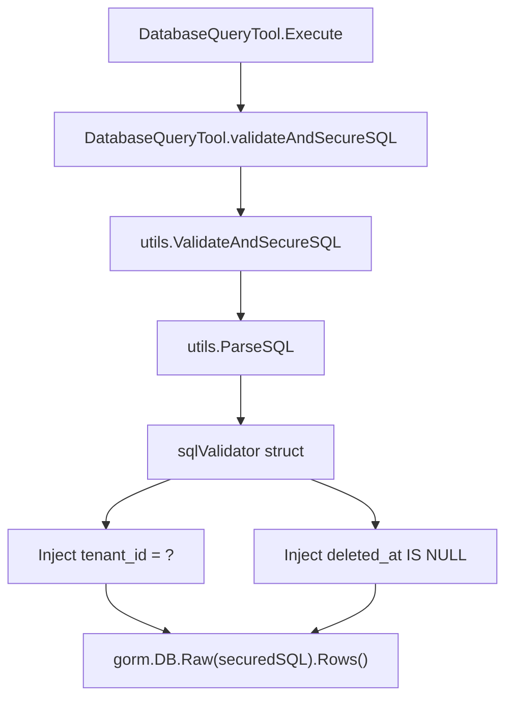
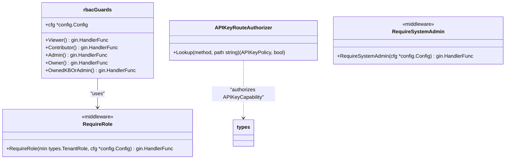

<!-- source: DeepWiki mcp.deepwiki.com · repo Tencent/WeKnora · page 3.5 Security and Multi-Tenancy · fetched 2026-10-29 -->

# Security and Multi-Tenancy

Relevant source files

The following files were used as context for generating this wiki page:

- [frontend/src/components/Input-field.agent-switch.test.mjs](frontend/src/components/Input-field.agent-switch.test.mjs)
- [frontend/src/views/chat/components/deepThink.vue](frontend/src/views/chat/components/deepThink.vue)
- [frontend/src/views/chat/components/docInfo.vue](frontend/src/views/chat/components/docInfo.vue)
- [frontend/src/views/chat/components/tool-results/KnowledgeBaseList.vue](frontend/src/views/chat/components/tool-results/KnowledgeBaseList.vue)
- [internal/agent/tools/web_fetch.go](internal/agent/tools/web_fetch.go)
- [internal/agent/tools/web_fetch_test.go](internal/agent/tools/web_fetch_test.go)
- [internal/agent/tools/web_pages_test.go](internal/agent/tools/web_pages_test.go)
- [internal/agent/tools/web_search.go](internal/agent/tools/web_search.go)
- [internal/agent/tools/web_search_test.go](internal/agent/tools/web_search_test.go)
- [internal/application/repository/tenant_api_key.go](internal/application/repository/tenant_api_key.go)
- [internal/application/repository/tenant_api_key_test.go](internal/application/repository/tenant_api_key_test.go)
- [internal/application/service/knowledge_delete_test.go](internal/application/service/knowledge_delete_test.go)
- [internal/application/service/knowledge_owner_chain_test.go](internal/application/service/knowledge_owner_chain_test.go)
- [internal/application/service/tenant.go](internal/application/service/tenant.go)
- [internal/application/service/tenant_api_key.go](internal/application/service/tenant_api_key.go)
- [internal/application/service/tenant_api_key_test.go](internal/application/service/tenant_api_key_test.go)
- [internal/application/service/web_search.go](internal/application/service/web_search.go)
- [internal/errors/errors.go](internal/errors/errors.go)
- [internal/handler/rbac_lookups.go](internal/handler/rbac_lookups.go)
- [internal/handler/rbac_lookups_test.go](internal/handler/rbac_lookups_test.go)
- [internal/handler/session/temporary_document.go](internal/handler/session/temporary_document.go)
- [internal/handler/task_progress_auth.go](internal/handler/task_progress_auth.go)
- [internal/handler/task_progress_auth_test.go](internal/handler/task_progress_auth_test.go)
- [internal/infrastructure/web_fetch/fetcher.go](internal/infrastructure/web_fetch/fetcher.go)
- [internal/infrastructure/web_fetch/fetcher_charset_test.go](internal/infrastructure/web_fetch/fetcher_charset_test.go)
- [internal/infrastructure/web_fetch/fetcher_test.go](internal/infrastructure/web_fetch/fetcher_test.go)
- [internal/middleware/kb_access.go](internal/middleware/kb_access.go)
- [internal/middleware/kb_access_test.go](internal/middleware/kb_access_test.go)
- [internal/middleware/rbac.go](internal/middleware/rbac.go)
- [internal/middleware/rbac_test.go](internal/middleware/rbac_test.go)
- [internal/router/rbac.go](internal/router/rbac.go)
- [internal/router/router_wiki_test.go](internal/router/router_wiki_test.go)
- [internal/types/agent_share_source.go](internal/types/agent_share_source.go)
- [internal/types/interfaces/tenant.go](internal/types/interfaces/tenant.go)
- [internal/utils/security.go](internal/utils/security.go)
- [internal/utils/security_dial_timeout_test.go](internal/utils/security_dial_timeout_test.go)
- [website-docs/01-getting-started/04-configuration.md](website-docs/01-getting-started/04-configuration.md)
- [website-docs/02-architecture/02-backend-design.md](website-docs/02-architecture/02-backend-design.md)
- [website-docs/03-features/03-document-parsing.md](website-docs/03-features/03-document-parsing.md)
- [website-docs/03-features/07-agent.md](website-docs/03-features/07-agent.md)
- [website-docs/03-features/11-web-search.md](website-docs/03-features/11-web-search.md)
- [website-docs/03-features/16-observability.md](website-docs/03-features/16-observability.md)

## Purpose and Scope
This document explains the security architecture, tenant isolation mechanisms, Role-Based Access Control (RBAC), organization sharing, and infrastructure defenses (such as SSRF protection, XSS mitigation, and path traversal validation) implemented across the WeKnora backend and frontend codebases.

Sources: [internal/utils/security.go:1-250](), [internal/router/rbac.go:1-151](), [internal/middleware/rbac.go:1-112]()

---

## Multi-Tenancy Model and Database Isolation

WeKnora uses a tenant-per-deployment schema strategy coupled with logical tenant scoping across all repository queries and agent tools. Users belong to a primary home tenant (`TenantID`) but can participate across multiple tenants via `TenantMember` relationships. All persistent resources—such as knowledge bases, chunks, chat sessions, and custom agents—carry a `tenant_id` field and are filtered by it.

Tenant creation and profile updates are managed by `tenantService` (`internal/application/service/tenant.go`), which ensures workspace uniqueness, validates storage buckets, and binds default storage backends [internal/application/service/tenant.go:35-102]().

### Automatic Tenant and Soft-Delete Injection in SQL

When agents execute SQL queries through the database tool, or when system queries are validated, WeKnora uses a SQL parsing and modification engine. The query validator intercepts queries to automatically inject tenant isolation clauses (`tenant_id = ?`) and soft-delete filters (`deleted_at IS NULL`), preventing cross-tenant data leakage even when AI-generated queries omit them.

#### Tenant SQL Isolation and Query Pipeline (Code Entity Space)

Sources: [internal/utils/security.go:1-250](), [internal/application/service/tenant.go:35-102]()

---

## Role-Based Access Control (RBAC) and API Key Authorization

WeKnora implements a fine-grained RBAC matrix distinguishing tenant-wide infrastructure roles and per-resource ownership. Centralized in the `rbacGuards` struct (`internal/router/rbac.go`), guards provide middleware handlers encapsulating authorization logic [internal/router/rbac.go:113-150]().

### Tenant Roles and Guard Selection

There are four key tenant roles:
- **Viewer** — Read-only access in the tenant.
- **Contributor** — Can create new owned resources (knowledge bases, agents) and modify resources they own.
- **Admin** — Tenant administrators who can manage tenant-wide infrastructure (models, vector stores, IM channels).
- **Owner** — Full administrative authority for the tenant.

The RBAC middleware (`internal/middleware/rbac.go`) distinguishes two core axes when selecting guards for each route:
1. **Resource Ownership**: Resources stamped with `creator_id` (knowledge bases, agents, documents) are protected by ownership guards (`OwnedXxxOrAdmin`) allowing creators and `Admin+` roles; tenant-wide infrastructure resources use an `Admin` guard [internal/router/rbac.go:19-46]().
2. **Action Scope**: Actions changing shared state or exposing resources beyond a user’s own require stricter guards. Private user actions require only `Contributor` [internal/router/rbac.go:54-70]().

### API Key Capabilities

Machine principals use API keys restricted by capability policies enforced by `APIKeyRouteAuthorizer`. Unlike JWT principals, API keys are authorized solely based on declared capabilities (e.g., `APIKeyCapabilityChat`, `APIKeyCapabilityManageAgents`) regardless of tenant roles [internal/middleware/rbac.go:71-78](), [internal/router/rbac.go:145-150]().

#### RBAC and API Key Authorization Architecture (Code Entity Space)

Sources: [internal/router/rbac.go:113-150](), [internal/middleware/rbac.go:48-112]()

---

## Knowledge Base Access and Organization Sharing

WeKnora allows resource sharing across tenant organizations with strict access control enforced through the `RequireKBAccess` middleware guard (`internal/middleware/kb_access.go`) [internal/middleware/kb_access.go:158-169]().

### Access Resolution Mechanism

Access to a Knowledge Base (`KB`) is resolved in layers:
1. **Direct Ownership**: The KB’s tenant ID matches the caller’s tenant, granting full rights.
2. **Organization Sharing**: The KB is shared with an organization that the tenant is a member of; permission is verified via shared KB permission checks.
3. **Agent Sharing**: A shared `CustomAgent` may grant access to a KB via agent-based sharing.

The guard collects these checks and stores the final `KBAccess` information under `KBAccessContextKey`, rewriting the request context with the authoritative tenant ID for downstream user-code resource scoping [internal/middleware/kb_access.go:20-36](), [internal/middleware/kb_access.go:158-169]().

Sources: [internal/middleware/kb_access.go:1-169]()

---

## Core Security Protections and Best Practices

### Input Sanitization and XSS Protection

Backend input validation utilities (`internal/utils/security.go`) enforce syntactic correctness and prevent Cross-Site Scripting (XSS) risks:
- **SanitizeHTML**: Inspects input strings against compiled regular expressions matching common XSS attack vectors (`<script>`, `<iframe>`, event handlers like `onload=`, and protocol handlers like `javascript:`), escaping strings into safe HTML if any malicious pattern is detected [internal/utils/security.go:28-72]().
- **ValidateInput**: Checks for control characters, valid UTF-8, and runs XSS pattern checks to reject unsafe user inputs outright [internal/utils/security.go:82-116]().

### Path Traversal Prevention

Filesystem and object storage operations rigorously enforce path restrictions using path cleaning and base directory assertions:
- **SafePathUnderBase** and **SafeJoinUnderBase**: Calculate absolute, canonical paths and verify that they remain inside designated base directories, rejecting absolute paths, parent-directory references (`../`), or escape attempts [internal/utils/security.go:118-156]().
- **SafeFileName**: Extracts and validates file basenames, rejecting empty names, dot-only names, or traversal sequences [internal/utils/security.go:158-175]().
- **SafeObjectKey**: Validates object storage keys for COS, MinIO, or S3 to disallow traversal tokens (`..`) [internal/utils/security.go:177-186]().

### SSRF and Network Request Protection

Outbound web fetching and HTTP clients protect against Server-Side Request Forgery (SSRF) via `internal/infrastructure/web_fetch/fetcher.go` and `internal/utils/security.go`:
- The **restrictedHostnames** list blocks requests to internal endpoints: `localhost`, loopback IPs (`127.0.0.1`, `::1`), cloud metadata services (`metadata.google.internal`, `metadata.tencentyun.com`), and Docker/Kubernetes internal hosts [internal/utils/security.go:226-244]().
- The **restrictedHostSuffixes** list blocks suffixes like `.local`, `.internal`, and `.svc.cluster.local` [internal/utils/security.go:245-250]().
- The `Fetcher` struct wraps an HTTP client with an SSRF-safe transport (`NewSSRFSafeTransport`) that applies these hostname/IP checks and limits redirects [internal/infrastructure/web_fetch/fetcher.go:119-174]().

Sources: [internal/utils/security.go:28-250](), [internal/infrastructure/web_fetch/fetcher.go:119-174]()

---

