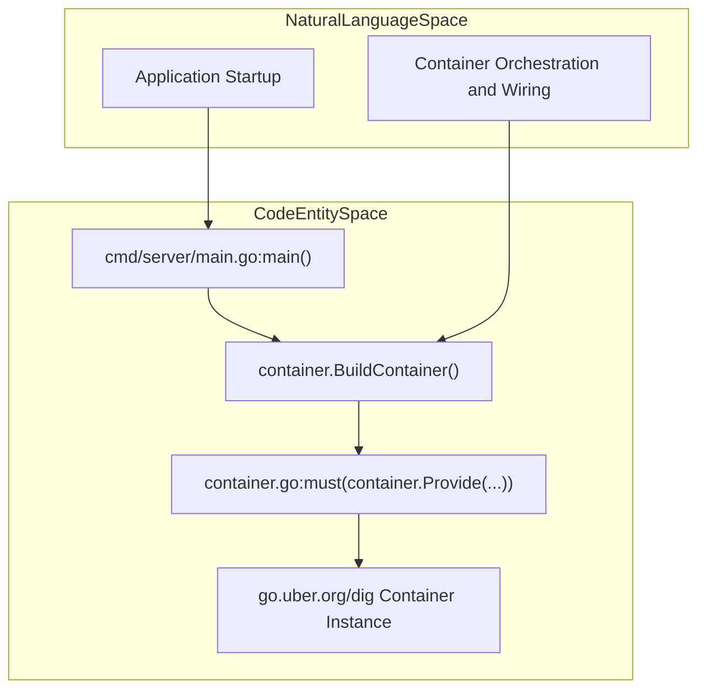
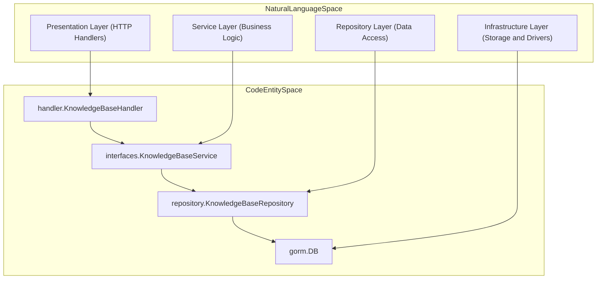

<!-- source: DeepWiki mcp.deepwiki.com · repo Tencent/WeKnora · page 3.6 Dependency Injection and Service Layer · fetched 2026-10-29 -->

# Dependency Injection and Service Layer

<details>
<summary>Relevant source files</summary>

The following files were used as context for generating this wiki page:

- [.air.toml](.air.toml)
- [.env.example](.env.example)
- [cmd/desktop/app.go](cmd/desktop/app.go)
- [cmd/desktop/main.go](cmd/desktop/main.go)
- [cmd/desktop/prefs.go](cmd/desktop/prefs.go)
- [cmd/server/main.go](cmd/server/main.go)
- [config/config.yaml](config/config.yaml)
- [docker-compose.dev.yml](docker-compose.dev.yml)
- [docker-compose.yml](docker-compose.yml)
- [docreader/README.md](docreader/README.md)
- [docreader/config.py](docreader/config.py)
- [docreader/parser/docx_parser.py](docreader/parser/docx_parser.py)
- [docreader/parser/image_preprocess.py](docreader/parser/image_preprocess.py)
- [docreader/preprocess.py](docreader/preprocess.py)
- [docreader/preprocess_worker.py](docreader/preprocess_worker.py)
- [docreader/tests/test_config.py](docreader/tests/test_config.py)
- [docreader/tests/test_docx_tables.py](docreader/tests/test_docx_tables.py)
- [docreader/tests/test_preprocess_runner.py](docreader/tests/test_preprocess_runner.py)
- [docs/LITE.md](docs/LITE.md)
- [frontend/src/wailsjs/go/main/App.d.ts](frontend/src/wailsjs/go/main/App.d.ts)
- [frontend/src/wailsjs/go/main/App.js](frontend/src/wailsjs/go/main/App.js)
- [go.mod](go.mod)
- [go.sum](go.sum)
- [internal/common/redis_tls.go](internal/common/redis_tls.go)
- [internal/common/redis_tls_test.go](internal/common/redis_tls_test.go)
- [internal/config/auth_legacy_env_test.go](internal/config/auth_legacy_env_test.go)
- [internal/config/config.go](internal/config/config.go)
- [internal/container/container.go](internal/container/container.go)
- [internal/middleware/recovery.go](internal/middleware/recovery.go)
- [internal/runtime/startup.go](internal/runtime/startup.go)
- [scripts/dev.sh](scripts/dev.sh)
- [website-docs/01-getting-started/05-troubleshooting.md](website-docs/01-getting-started/05-troubleshooting.md)

</details>


## Purpose and Scope

The purpose of this page is to document the wiring, configuration, and structural patterns used in WeKnora's backend architecture. This includes the initialization sequence in the `container` package, service registration mechanisms, interface bindings, struct-based dependency injection via `dig.In`, and the layered architecture enforcing clean boundaries between HTTP handlers, business services, and data repositories [internal/container/container.go:1-141]().

Sources: [internal/container/container.go:1-141]()

---

## Overview

WeKnora uses Uber's `dig` library (`go.uber.org/dig`) to build a dependency injection container that manages component lifecycle and ensures clean dependency resolution [internal/container/container.go:33,78](). The DI container is constructed at application startup by the `container.BuildContainer()` function, which registers services, repositories, handlers, and infrastructure components [internal/container/container.go:113-142]().

Key container responsibilities include:

- **Component Registration**: Registering core configuration loaders (`config.LoadConfig`), database initializers (`initDatabase`), Redis clients, file services, retrieval registries, and business logic services [internal/container/container.go:133-137]().
- **Dependency Resolution**: Constructors and router parameter structs declare their dependencies using `dig.In`, allowing `dig` to recursively resolve and inject them [internal/container/container.go:33]().
- **Lifecycle Management**: Registering cleanup hooks for resources like database connections, goroutine pools (`ants.Pool`), and observability clients (`initLangfuse`) to ensure graceful shutdown [internal/container/container.go:30,131-136]().
- **Layered Architecture Enforced**: Clear structural separation between HTTP handlers (`handler.*`), business services (`interfaces.*`), and data repositories (`repository.*`).

Sources: [internal/container/container.go:1-142](), [cmd/server/main.go:58-60]()

---

## Container Architecture and Struct-Based Injection

### Container Initialization and Code Mapping

The following diagram bridges the natural language concept of application startup and container orchestration to the actual code entities in `cmd/server/main.go` and `internal/container/container.go`.

**Title: Natural Language Space to Code Entity Space Mapping (Container Initialization)**

Sources: [internal/container/container.go:113-142](), [cmd/server/main.go:58-60]()

### Struct Injection with `dig.In`

WeKnora extensively uses `dig.In` embedded structs to organize complex dependency lists, particularly for HTTP routing and handler wiring. For example, router parameter structs gather required service and handler instances into a single parameter struct passed to routers [internal/container/container.go:33]().

Sources: [internal/container/container.go:33]()

---

## Service Layer Architecture

WeKnora adheres to a strict layered architecture with clearly separated concerns. Each layer depends only on the layer directly below it, communicating exclusively via interfaces.

### Layered Dependency Flow and Code Mapping

The diagram below maps high-level architectural concepts to specific interface and struct names in WeKnora, linking the Presentation layer, Service layer, Repository layer, and Infrastructure layer.

**Title: Natural Language Space to Code Entity Space Mapping (Layered Architecture)**

Sources: [internal/container/container.go:35-54](), [internal/router/router.go:29-97]()

### Dependency Rules and Interface Usage

- **Handlers** depend only on **Services** through interfaces defined in `internal/types/interfaces`, isolating controllers from business logic changes [internal/types/interfaces]() (referenced in [internal/container/container.go:105]()).
- **Services** depend on **Repositories** and infrastructure clients (e.g., `redis.Client`, `gorm.DB`) [internal/container/container.go:32,37]().
- **Repositories** interact directly with database drivers and ORMs [internal/container/container.go:35-37]().

Sources: [internal/container/container.go:32-54]()

---

## Component Registration Patterns

### Interface Binding with `dig.As`

WeKnora registers implementations against interfaces using `container.Provide` combined with `dig.As`. This allows the container to resolve dependencies by interface type rather than concrete struct type [internal/container/container.go:131]():

```go
must(container.Provide(NewResourceCleaner, dig.As(new(interfaces.ResourceCleaner))))
```

Sources: [internal/container/container.go:131]()

### Infrastructure Component Registration

| Category            | Registration Function       | Implementation Detail                           |
|---------------------|-----------------------------|-----------------------------------------------|
| Relational Database  | `initDatabase`              | GORM DB connection (`gorm.DB`, Postgres/SQLite) [internal/container/container.go:35-37,137]() |
| Vector Search Engines| `initRetrieveEngineRegistry`| Registry for vector stores (Qdrant, Milvus, etc.) [internal/container/container.go:44-53]() |
| Redis Client         | `initRedisClient`           | Redis client (`redis.Client`) for caching [internal/container/container.go:32]() |
| Goroutine Pool       | `initAntsPool`              | Worker pool (`ants.Pool`) initialization [internal/container/container.go:30]() |

Sources: [internal/container/container.go:30-53,137]()

---

## Lifecycle Management and Cleanup

To ensure graceful resource deallocation during application termination, WeKnora uses a centralized `ResourceCleaner` that aggregates cleanup handlers [internal/container/container.go:131](). 

- Observability tools like Langfuse register flush handlers (`registerLangfuseCleanup`) [internal/container/container.go:103,136]().
- Concurrency pools and database handles release resources via registered cleanup callbacks during server shutdown [cmd/server/main.go:123-132]().

Sources: [internal/container/container.go:103,131-136](), [cmd/server/main.go:123-132]()

---

# Summary

WeKnora's backend architecture relies on Uber's `dig` container to manage dependency wiring, struct injection (`dig.In`), and interface binding (`dig.As`) [internal/container/container.go:33,131](). A strict layered structure separates presentation handlers, business services, and data repositories, while a centralized `ResourceCleaner` handles shutdown lifecycle tasks [internal/container/container.go:131](), [cmd/server/main.go:123-132]().

Sources: [internal/container/container.go:1-142](), [cmd/server/main.go:58-145]()

---

