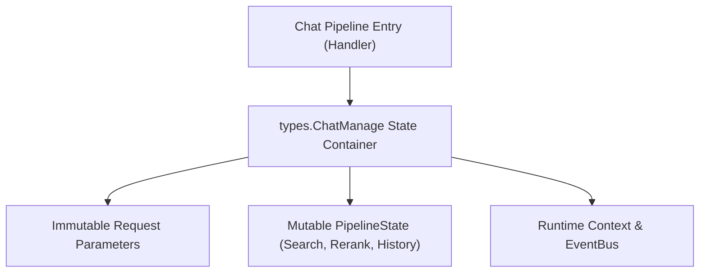
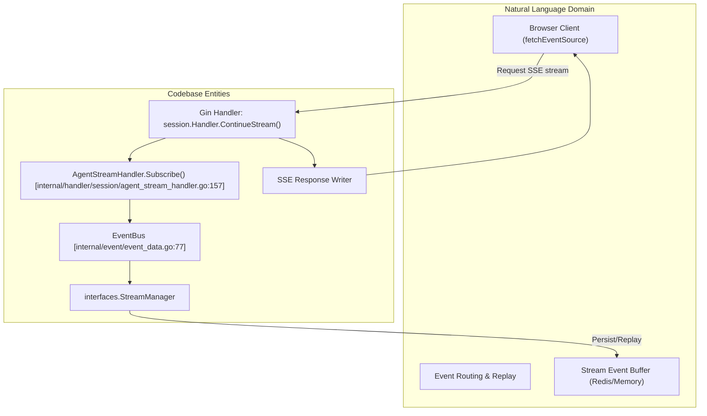
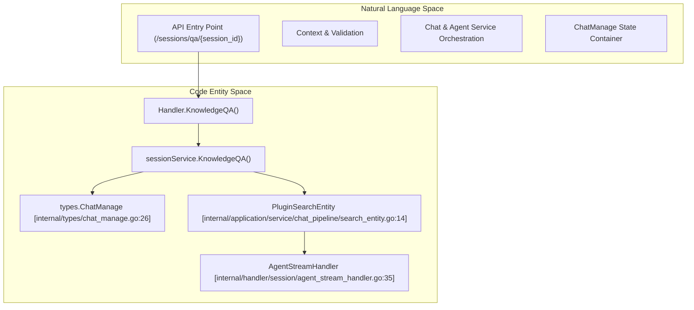
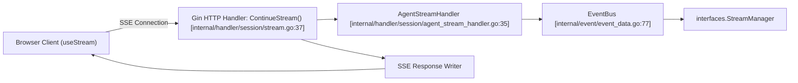

<!-- source: DeepWiki mcp.deepwiki.com · repo Tencent/WeKnora · page 3.7 Event-Driven Architecture and Chat Pipeline · fetched 2026-10-29 -->

# Event-Driven Architecture and Chat Pipeline

Relevant source files

The following files were used as context for generating this wiki page:

- [internal/application/service/chat_pipeline/search_entity.go](internal/application/service/chat_pipeline/search_entity.go)
- [internal/application/service/chat_pipeline/search_entity_metadata_test.go](internal/application/service/chat_pipeline/search_entity_metadata_test.go)
- [internal/application/service/knowledgebase_search_results.go](internal/application/service/knowledgebase_search_results.go)
- [internal/event/event.go](internal/event/event.go)
- [internal/event/event_data.go](internal/event/event_data.go)
- [internal/handler/chunk.go](internal/handler/chunk.go)
- [internal/handler/evaluation.go](internal/handler/evaluation.go)
- [internal/handler/message.go](internal/handler/message.go)
- [internal/handler/message_limit_cap_test.go](internal/handler/message_limit_cap_test.go)
- [internal/handler/message_session_not_found_test.go](internal/handler/message_session_not_found_test.go)
- [internal/handler/session/agent_stream_handler.go](internal/handler/session/agent_stream_handler.go)
- [internal/handler/session/helpers.go](internal/handler/session/helpers.go)
- [internal/handler/session/helpers_test.go](internal/handler/session/helpers_test.go)
- [internal/handler/session/resource_urls.go](internal/handler/session/resource_urls.go)
- [internal/handler/session/stream.go](internal/handler/session/stream.go)
- [internal/models/utils/ollama/ollama.go](internal/models/utils/ollama/ollama.go)
- [internal/storageurl/mode.go](internal/storageurl/mode.go)
- [internal/storageurl/storageurl.go](internal/storageurl/storageurl.go)
- [internal/storageurl/stream.go](internal/storageurl/stream.go)
- [internal/storageurl/stream_test.go](internal/storageurl/stream_test.go)
- [internal/types/search.go](internal/types/search.go)

This page details the event-driven architecture underpinning WeKnora's chat system, focusing on the centralized event bus, the plugin-based chat pipeline, the Server-Sent Events (SSE) streaming mechanism, and the various event types employed to coordinate components and provide real-time response updates.

---

## 1. Event Bus System

WeKnora decouples application logic and communication protocols using a centralized **`EventBus`** abstraction. This pub-sub system supports distributed event dispatching for asynchronous and streaming workflows, particularly within the agent execution and chat pipeline stages.

### Core Concepts and Implementation

- **EventBus**: Implemented as a central publish-subscribe mechanism that allows emitting, subscribing, and handling of events asynchronously (`[internal/event/event_data.go:73-80]()`).
- **Subscription Model**: Each chat interaction or agent request constructs an isolated `EventBus` instance to which components can subscribe.
- **EventManager**: Manages event plugins in the chat pipeline, dispatching events to active plugins registered to listen for specific event types (`[internal/application/service/chat_pipeline/search_entity.go:21-34]()`).

### EventBus Usage

Within the chat pipeline and agent loops, events such as agent thoughts, tool calls, tool results, knowledge references, and final agent answers are emitted on the `EventBus`. This enables:

- Streaming partial content to clients via `AgentStreamHandler.Subscribe()` (`[internal/handler/session/agent_stream_handler.go:157-172]()`).
- Updating intermediate pipeline state.
- Allowing plugins and handlers to react and augment processing.
- Coordinating lifecycle transitions.

### Relevant Code Entities and Files

- `Event` creation and metadata helper methods are defined at `[internal/event/event_data.go:73-104]()`.
- `EventManager` integration is present in chat pipeline plugins like `PluginSearchEntity` (`[internal/application/service/chat_pipeline/search_entity.go:21-34]()`).
- Events and types such as `EventAgentThought`, `EventAgentToolCall`, `EventAgentReferences`, `EventAgentFinalAnswer` are subscribed to and handled in `[internal/handler/session/agent_stream_handler.go:157-172]()`.

### Defined Event Types

Key event types handled and emitted during chat interactions and agent executions include:

| Event Type | Description | Reference Location |
|---|---|---|
| `IntentKBSearch` | User query indicates knowledge base retrieval | `[internal/types/chat_manage.go:87]()` |
| `IntentWebSearch` | User query indicates web search intent | `[internal/types/chat_manage.go:88]()` |
| `EventAgentThought` | Agent is generating thoughts/output fragments | `[internal/handler/session/agent_stream_handler.go:159]()` |
| `EventAgentToolCall` | Agent invokes a tool/plugin | `[internal/handler/session/agent_stream_handler.go:161]()` |
| `EventAgentToolResult` | Tool/plugin returns result | `[internal/handler/session/agent_stream_handler.go:162]()` |
| `EventAgentReferences` | References to knowledge base chunks emitted | `[internal/handler/session/agent_stream_handler.go:164]()` |
| `EventAgentFinalAnswer` | Agent completes generation with final answer | `[internal/handler/session/agent_stream_handler.go:168]()` |
| `EventAgentComplete` | Agent round or action is completed | `[internal/handler/session/agent_stream_handler.go:172]()` |
| `EventError` | Errors encountered in pipeline/agent | `[internal/handler/session/agent_stream_handler.go:170]()` |
| `EventSessionTitle` | Generated session title event | `[internal/handler/session/agent_stream_handler.go:171]()` |

Sources:
- `[internal/event/event_data.go:73-104]()`
- `[internal/application/service/chat_pipeline/search_entity.go:21-34]()`
- `[internal/handler/session/agent_stream_handler.go:157-172]()`
- `[internal/types/chat_manage.go:83-100]()`

---

## 2. Chat Pipeline Plugins and Pipeline State

The chat functionality is architected as a **plugin-based pipeline** where each plugin listens for specific event types and manipulates or observes `ChatManage` state accordingly.

### `ChatManage` Object

The `ChatManage` struct represents the canonical state container for the chat pipeline during a single chat request. It includes:

- **Pipeline Request Parameters**: Immutable input parameters including session and user identifiers, query text, knowledge base targets (`SearchTargets`), and model IDs (`[internal/types/chat_manage.go:1-154]()`).
- **Pipeline State**: Mutable state updated by pipeline plugins, including rewritten queries (`RewrittenQuery`), intent classifications, search results (`SearchResult`), history, and rerank results (`[internal/types/chat_manage.go:50-120]()`).
- **Runtime Context**: Handles such as the per-request `EventBus` interface, assistant message IDs, and tracing metadata (`[internal/types/chat_manage.go:120-154]()`).

### Chat Pipeline Flow

1. **Query & Context Initialization**: The request is parsed from the HTTP API controller into a `ChatManage` object with resolved parameters and session state (`[internal/handler/session/helpers.go:18-100]()`).
2. **Plugin Registration**: Plugins such as `PluginSearchEntity` register with an `EventManager`, declaring which event types they handle via `ActivationEvents()` (`[internal/application/service/chat_pipeline/search_entity.go:36-39]()`).
3. **Execution Lifecycle**: The pipeline executes stages sequentially: query understanding and rewriting, graph or vector search (`[internal/application/service/chat_pipeline/search_entity.go:68-128]()`), message preparation, and LLM generation with options.
4. **Event Emission & Streaming**: Plugins and handlers emit intermediate result events on the `EventBus`, streaming updates to clients asynchronously via SSE (`[internal/handler/session/agent_stream_handler.go:157-172]()`).

### Example Plugin: `PluginSearchEntity`

- Listens to the `ENTITY_SEARCH` event type via `ActivationEvents()` (`[internal/application/service/chat_pipeline/search_entity.go:36-39]()`).
- Performs concurrent graph node searches across multiple knowledge bases and individual knowledge files (`[internal/application/service/chat_pipeline/search_entity.go:61-128]()`).
- Enriches search results with chunk metadata and image information (`[internal/application/service/chat_pipeline/search_entity.go:187-190]()`).
- Updates `chatManage.SearchResult` and proceeds or terminates via `next()` (`[internal/application/service/chat_pipeline/search_entity.go:188-201]()`).

### Pipeline Internal State Diagram

Title: "Chat Pipeline State Structure"

Sources:
- `[internal/types/chat_manage.go:1-154]()`
- `[internal/application/service/chat_pipeline/search_entity.go:21-203]()`

---

## 3. Streaming Architecture and SSE

WeKnora employs **Server-Sent Events (SSE)** to stream incremental chat responses (thoughts, search results, tool calls, and partial answers) from backend services to the frontend client.

### SSE Handling and Buffering

- **Endpoint**: The HTTP streaming endpoints serve SSE streams for ongoing responses (`[internal/handler/session/stream.go:156-173]()`).
- **Event Replay & Stream Management**: `AgentStreamHandler` subscribes to all agent events on a dedicated per-request `EventBus` (`[internal/handler/session/agent_stream_handler.go:157-172]()`).
- **SSE Headers**: Standard HTTP headers (`Content-Type: text/event-stream`, `Cache-Control: no-cache`, `Connection: keep-alive`) are set for SSE compliance (`[internal/handler/session/helpers.go:182-188]()`).
- **Event Construction**: Backend streaming events are formatted as `types.StreamResponse` objects via `buildStreamResponse` (`[internal/handler/session/helpers.go:191-222]()`).
- **Frontend Stream Handling**: The client uses streaming hooks to process incremental chunks, merge tool call arguments, and track active assistant messages.

### Flow Diagram: Streaming Data Flow from Agent to Client

Title: "Streaming Data Flow Architecture"

Sources:
- `[internal/handler/session/stream.go:156-173]()`
- `[internal/handler/session/helpers.go:182-222]()`
- `[internal/handler/session/agent_stream_handler.go:157-172]()`
- `[internal/event/event_data.go:77-83]()`

---

## 4. Example: Knowledge QA Event Flow

The core chat request execution demonstrates the tight integration of the event-driven architecture and the chat pipeline:

1. **Request Parsing & State Initialization**: The user query and attachments are validated and converted into a `ChatManage` state container (`[internal/handler/session/helpers.go:18-100]()`).
2. **Model & Prompt Preparation**: Retrieves model options such as temperature, reasoning effort, and thinking parameters.
3. **History & System Prompt Construction**: Builds the final message array combining system instructions, history rounds, user queries, and vision attachments.
4. **Event Bus Initialization**: A dedicated `EventBus` is spun up for the request context, allowing background plugins and steps to emit events.
5. **Execution & Finalization**: Plugins execute sequentially (e.g., query rewriting, entity search, reranking), emitting progress events until completion.

Sources:
- `[internal/handler/session/helpers.go:18-100]()`

---

## 5. Event Type Summary for Chat Pipeline

| Event Category | Event Type | Description |
|---|---|---|
| **Intent Classifiers** | `IntentKBSearch` | User query classified as knowledge retrieval |
| | `IntentWebSearch` | User query classified as web retrieval |
| **Agent Progress** | `EventAgentThought` | Agent emits a thought or partial answer fragment |
| | `EventAgentToolCall` | Agent invokes external tool |
| | `EventAgentToolResult` | Tool returns result |
| | `EventAgentReferences` | Knowledge references included |
| | `EventAgentFinalAnswer` | Final answer completion |
| | `EventAgentComplete` | Agent process round complete |
| **Errors & Admin** | `EventError` | Pipeline or agent error |
| | `EventSessionTitle` | Session title generated event |

Sources:
- `[internal/handler/session/agent_stream_handler.go:157-172]()`
- `[internal/types/chat_manage.go:83-100]()`

---

## Additional Diagrams

### Chat Pipeline Logic to Code Entity Mapping

Title: "Chat Pipeline to Code Mapping"

Sources:
- `[internal/application/service/chat_pipeline/search_entity.go:14-34]()`
- `[internal/handler/session/agent_stream_handler.go:35-73]()`
- `[internal/types/chat_manage.go:26-50]()`

### Streaming Event Architecture Mapping

Title: "Streaming Event Mapping"

Sources:
- `[internal/handler/session/stream.go:37-45]()`
- `[internal/handler/session/agent_stream_handler.go:35-73]()`
- `[internal/event/event_data.go:77-83]()`

---

