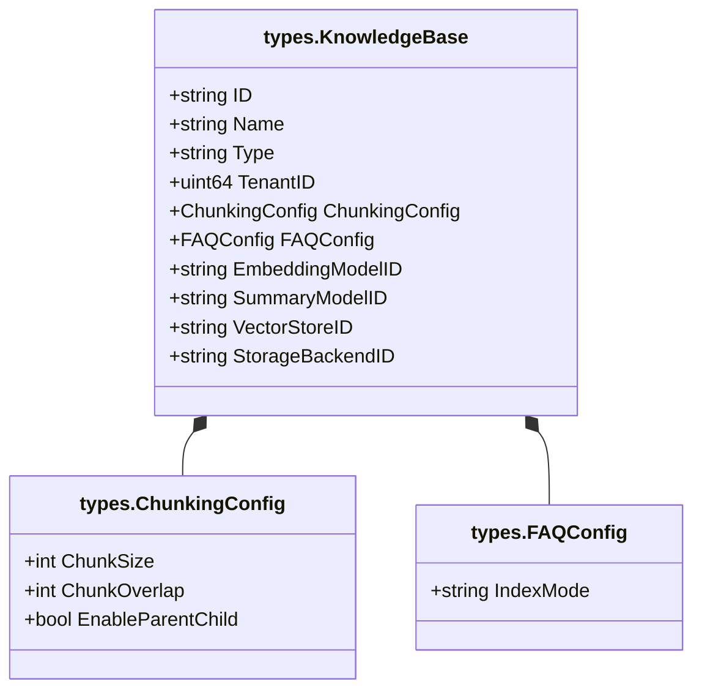

<!-- source: DeepWiki mcp.deepwiki.com · repo Tencent/WeKnora · page 4 Knowledge Base Management · fetched 2026-10-29 -->

# Knowledge Base Management

<details>
<summary>Relevant source files</summary>

The following files were used as context for generating this wiki page:

- [client/retrieval.go](client/retrieval.go)
- [internal/agent/tools/search_knowledge.go](internal/agent/tools/search_knowledge.go)
- [internal/agent/tools/search_knowledge_rerank_test.go](internal/agent/tools/search_knowledge_rerank_test.go)
- [internal/agent/tools/search_knowledge_test.go](internal/agent/tools/search_knowledge_test.go)
- [internal/application/repository/knowledgebase.go](internal/application/repository/knowledgebase.go)
- [internal/application/service/chat_pipeline/merge_history.go](internal/application/service/chat_pipeline/merge_history.go)
- [internal/application/service/chat_pipeline/search.go](internal/application/service/chat_pipeline/search.go)
- [internal/application/service/chat_pipeline/search_error_test.go](internal/application/service/chat_pipeline/search_error_test.go)
- [internal/application/service/knowledgebase.go](internal/application/service/knowledgebase.go)
- [internal/application/service/knowledgebase_search.go](internal/application/service/knowledgebase_search.go)
- [internal/application/service/knowledgebase_search_embedding_dimension_test.go](internal/application/service/knowledgebase_search_embedding_dimension_test.go)
- [internal/handler/knowledgebase.go](internal/handler/knowledgebase.go)
- [internal/types/interfaces/knowledgebase.go](internal/types/interfaces/knowledgebase.go)
- [internal/types/knowledgebase.go](internal/types/knowledgebase.go)

</details>


This page provides a high-level overview of knowledge base (KB) management in WeKnora, serving as the LLM-powered RAG framework's foundational unit for organizing and indexing unstructured and structured documents. Knowledge bases govern chunking strategies, embedding models, vector store bindings, and storage backends.

This page acts as a parent page linking to detailed child pages:
- For creating and configuring knowledge bases, parsers, and embedding models, see [Knowledge Base Creation and Configuration](#4.1).
- For document upload, parsing selection, and asynchronous processing, see [Document Upload and Processing](#4.2).
- For FAQ knowledge base creation and entry management, see [FAQ Management](#4.3).
- For chunking strategies (parent-child), metadata, and vector indexing, see [Chunk Management and Vector Indexing](#4.4).
- For tag systems, folder trees, and filtering, see [Tag Management and Organization](#4.5).

Sources: [internal/types/interfaces/knowledgebase.go:16-77](), [internal/application/service/knowledgebase.go:33-55]()

---

## What Is a Knowledge Base?

A Knowledge Base is a tenant-scoped container that groups knowledge entries, governs their chunking, embedding, and indexing, and defines the AI models and storage backends involved. Queries in retrieval-augmented generation (RAG) modes target one or more knowledge bases.

The core data structure is defined as `types.KnowledgeBase` [internal/types/knowledgebase.go:58-114](). Key attributes include identification (`ID`), tenant ownership (`TenantID`), chunking configurations (`ChunkingConfig`), vector store references (`VectorStoreID`), and model settings [internal/application/service/knowledgebase.go:121-163]().

Sources: [internal/types/knowledgebase.go:58-114](), [internal/application/service/knowledgebase.go:121-163]()

---

## Knowledge Base Types

WeKnora supports multiple knowledge base types to handle different data modalities:
- **Document Knowledge Bases (`types.KnowledgeBaseTypeDocument`):** Consist of files, URLs, or manual text entries that are parsed, chunked, and embedded for hybrid search [internal/types/knowledgebase.go:30-33](). For details, see [Document Upload and Processing](#4.2).
- **FAQ Knowledge Bases (`types.KnowledgeBaseTypeFAQ`):** Manage question-answer pairs with specialized indexing strategies [internal/types/knowledgebase.go:34](). For details, see [FAQ Management](#4.3).
- **Wiki Knowledge Bases (`types.KnowledgeBaseTypeWiki`):** Support auto-wiki generation, folder trees, and knowledge graph extraction [internal/types/knowledgebase.go:35](). For details, see [Tag Management and Organization](#4.5).

Sources: [internal/types/knowledgebase.go:30-36]()

---

## Core Data Model & Code Mapping

This diagram correlates natural language management concepts for knowledge bases to the key structs in the codebase (`types.KnowledgeBase`).

### Knowledge Base Configuration to Code Entities



Sources: [internal/types/knowledgebase.go:58-114]()

---

## Service Layer Architecture & Component Mapping

Knowledge base operations are coordinated by `knowledgeBaseService` [internal/application/service/knowledgebase.go:33-55](), handling business logic, validation, and invoking `knowledgeBaseRepository` [internal/application/repository/knowledgebase.go:15-23]() and HTTP handlers [internal/handler/knowledgebase.go:33-51]().

### Service Layer to Code Entities

```mermaid
flowchart TD
    Handler[""KnowledgeBaseHandler"\n(internal/handler/knowledgebase.go)"]
    Svc[""knowledgeBaseService"\n(internal/application/service/knowledgebase.go)"]
    Repo[""knowledgeBaseRepository"\n(internal/application/repository/knowledgebase.go)"]

    Handler -->|"Calls CreateKnowledgeBase"| Svc
    Svc -->|"Persistence via CreateKnowledgeBase"| Repo
    
    subgraph "Persistence Layer"
        Repo --- DB[("gorm.DB")]
    end
```

Sources: [internal/application/service/knowledgebase.go:33-113](), [internal/handler/knowledgebase.go:33-51](), [internal/application/repository/knowledgebase.go:15-28]()

---

## Sub-Topics and Child Pages

- [Knowledge Base Creation and Configuration](#4.1) — Configuring parsers, chunking strategies, embedding models, and storage providers.
- [Document Upload and Processing](#4.2) — File upload validation, parser engines, async task queue integration.
- [FAQ Management](#4.3) — FAQ entry management, import/export, and indexing.
- [Chunk Management and Vector Indexing](#4.4) — Parent-child chunking, metadata, vector generation.
- [Tag Management and Organization](#4.5) — Tag system, folder trees, and filtering.

Sources: [internal/types/interfaces/knowledgebase.go:16-143]()

---

