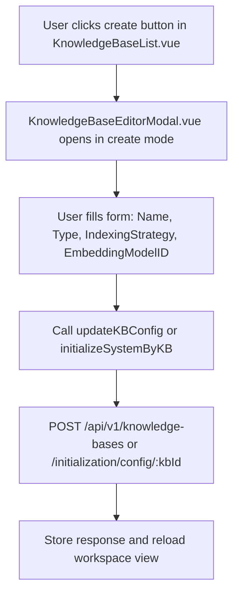
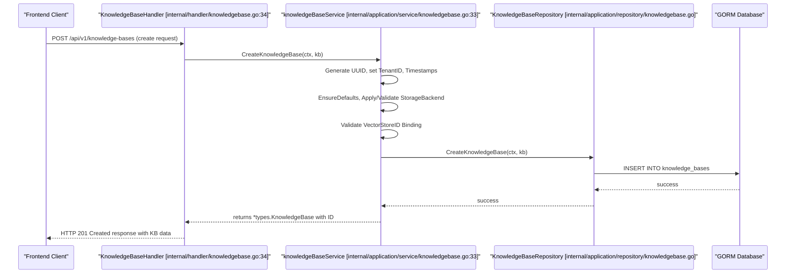
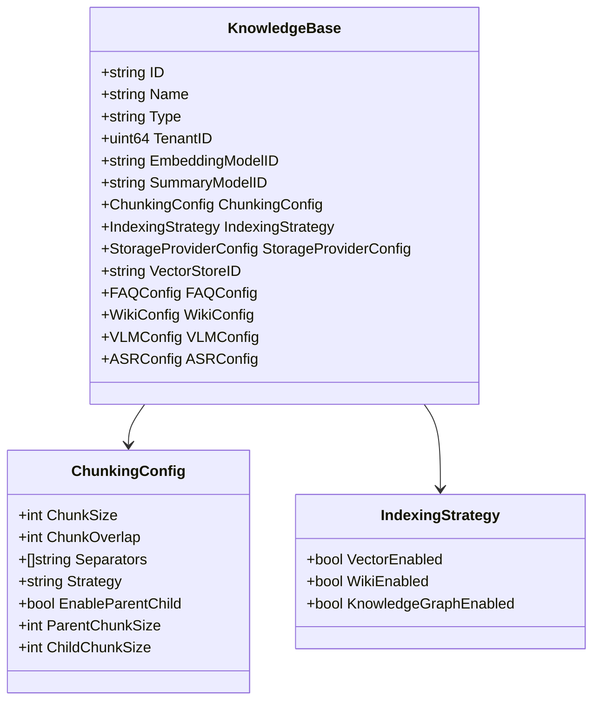
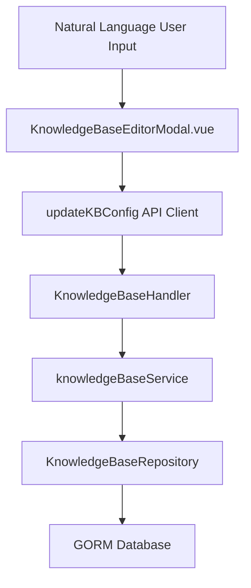
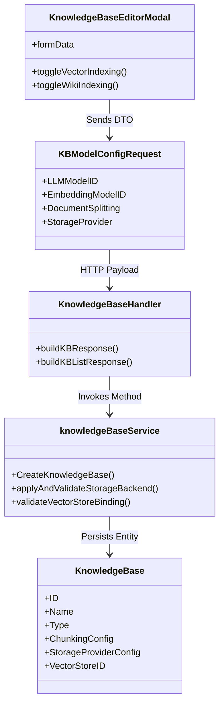

<!-- source: DeepWiki mcp.deepwiki.com · repo Tencent/WeKnora · page 4.1 Knowledge Base Creation and Configuration · fetched 2026-10-29 -->

# Knowledge Base Creation and Configuration

Relevant source files

The following files were used as context for generating this wiki page:

- [client/retrieval.go](client/retrieval.go)
- [frontend/src/api/initialization/index.ts](frontend/src/api/initialization/index.ts)
- [frontend/src/api/model/index.ts](frontend/src/api/model/index.ts)
- [frontend/src/components/ModelEditorDialog.vue](frontend/src/components/ModelEditorDialog.vue)
- [frontend/src/components/VectorStoreBadge.vue](frontend/src/components/VectorStoreBadge.vue)
- [frontend/src/components/modelSelectorClearability.test.ts](frontend/src/components/modelSelectorClearability.test.ts)
- [frontend/src/views/knowledge/KnowledgeBaseEditorModal.vue](frontend/src/views/knowledge/KnowledgeBaseEditorModal.vue)
- [frontend/src/views/knowledge/settings/GraphSettings.vue](frontend/src/views/knowledge/settings/GraphSettings.vue)
- [frontend/src/views/knowledge/settings/KBAdvancedSettings.vue](frontend/src/views/knowledge/settings/KBAdvancedSettings.vue)
- [frontend/src/views/knowledge/settings/KBChunkingSettings.vue](frontend/src/views/knowledge/settings/KBChunkingSettings.vue)
- [frontend/src/views/knowledge/settings/KBModelConfig.vue](frontend/src/views/knowledge/settings/KBModelConfig.vue)
- [frontend/src/views/knowledge/settings/KBStorageSettings.vue](frontend/src/views/knowledge/settings/KBStorageSettings.vue)
- [frontend/src/views/knowledge/settings/KBVectorStoreSettings.vue](frontend/src/views/knowledge/settings/KBVectorStoreSettings.vue)
- [frontend/src/views/settings/McpSettings.vue](frontend/src/views/settings/McpSettings.vue)
- [frontend/src/views/settings/ModelSettings.vue](frontend/src/views/settings/ModelSettings.vue)
- [frontend/src/views/settings/VectorStoreSettings.vue](frontend/src/views/settings/VectorStoreSettings.vue)
- [frontend/src/views/settings/WebSearchSettings.vue](frontend/src/views/settings/WebSearchSettings.vue)
- [internal/agent/tools/search_knowledge.go](internal/agent/tools/search_knowledge.go)
- [internal/agent/tools/search_knowledge_rerank_test.go](internal/agent/tools/search_knowledge_rerank_test.go)
- [internal/agent/tools/search_knowledge_test.go](internal/agent/tools/search_knowledge_test.go)
- [internal/application/repository/knowledgebase.go](internal/application/repository/knowledgebase.go)
- [internal/application/service/chat_pipeline/merge_history.go](internal/application/service/chat_pipeline/merge_history.go)
- [internal/application/service/chat_pipeline/search.go](internal/application/service/chat_pipeline/search.go)
- [internal/application/service/chat_pipeline/search_error_test.go](internal/application/service/chat_pipeline/search_error_test.go)
- [internal/application/service/knowledgebase.go](internal/application/service/knowledgebase.go)
- [internal/application/service/knowledgebase_search.go](internal/application/service/knowledgebase_search.go)
- [internal/application/service/knowledgebase_search_embedding_dimension_test.go](internal/application/service/knowledgebase_search_embedding_dimension_test.go)
- [internal/application/service/model.go](internal/application/service/model.go)
- [internal/application/service/weknoracloud.go](internal/application/service/weknoracloud.go)
- [internal/handler/initialization.go](internal/handler/initialization.go)
- [internal/handler/knowledgebase.go](internal/handler/knowledgebase.go)
- [internal/handler/model.go](internal/handler/model.go)
- [internal/types/interfaces/knowledgebase.go](internal/types/interfaces/knowledgebase.go)
- [internal/types/knowledgebase.go](internal/types/knowledgebase.go)
- [internal/types/model.go](internal/types/model.go)
- [internal/types/weknoracloud.go](internal/types/weknoracloud.go)

## Purpose and Scope

This document details the creation and configuration of knowledge bases within WeKnora. Knowledge bases serve as logical containers for organizing, chunking, parsing, and retrieving knowledge entities such as documents, FAQ items, and Wiki pages. This page explains the underlying data models, creation workflows, chunking strategies, parser rule engines, embedding model associations, and storage provider bindings.

For information about document ingestion, see [Document Upload and Processing](). For FAQ-specific workflows, see [FAQ Management](). For indexing and vector operations, see [Chunk Management and Vector Indexing]().

Sources: [internal/types/knowledgebase.go:30-36](), [internal/application/service/knowledgebase.go:121-180]()

---

## Knowledge Base Types

WeKnora supports three primary knowledge base types, defined in `internal/types/knowledgebase.go`:

| Type      | Identifier | Use Case                                                  | Storage Model                                                      |
|-----------|------------|-----------------------------------------------------------|-------------------------------------------------------------------|
| **Document** | `document` | General document collections (`.pdf`, `.docx`, `.txt`, etc.) | File-based with hierarchical chunking, vector embeddings, and optional graph extraction |
| **FAQ**      | `faq`      | Question-answer pairs with priority matching             | Direct structured chunk storage without file intermediaries       |
| **Wiki**     | `wiki`     | Structured technical documentation and cross-linked content | Specialized wiki generation pipeline and auto-link generation      |

- **Document Knowledge Bases** (`KnowledgeBaseTypeDocument`) manage unstructured files that undergo parsing, chunking, and vectorization.  
- **FAQ Knowledge Bases** (`KnowledgeBaseTypeFAQ`) manage structured Q&A entries optimized for fast matching.  
- **Wiki Knowledge Bases** (`KnowledgeBaseTypeWiki`) coordinate auto-wiki generation and hierarchical page storage.

Sources: [internal/types/knowledgebase.go:30-36]()

---

## Knowledge Base Creation Workflow

### Frontend Creation Flow

The creation of a knowledge base begins at the frontend within the `KnowledgeBaseEditorModal.vue` component, where users input key parameters such as the knowledge base name, type (document or FAQ), and indexing strategies including embedding model selection and wiki indexing options [frontend/src/views/knowledge/KnowledgeBaseEditorModal.vue:1-134]().

Once configured, these settings are submitted via API calls encapsulated in `updateKBConfig` or `initializeSystemByKB` methods within `frontend/src/api/initialization/index.ts` [frontend/src/api/initialization/index.ts:167-194](). This triggers backend initialization for the new knowledge base's configuration.

**Frontend Knowledge Base Creation and Configuration Sequence:**

Sources: [frontend/src/views/knowledge/KnowledgeBaseEditorModal.vue:1-134](), [frontend/src/api/initialization/index.ts:166-194]()

---

### Backend Creation and Persistence

On the server side, the `KnowledgeBaseHandler` (defined in `internal/handler/knowledgebase.go`) accepts the HTTP request and delegates actual creation to the `knowledgeBaseService.CreateKnowledgeBase` method (from `internal/application/service/knowledgebase.go`). This service method:

- Generates a unique UUID for the knowledge base (if not specified).  
- Enforces tenant-scoping by extracting tenant ID from the context (RBAC enforced globally).  
- Records the user as the creator if not a synthetic system identity.  
- Applies default storage provider configurations and validates vector store bindings.  
- Persists the knowledge base entity through the repository layer.

**Backend Knowledge Base Creation Architecture and Code Entity Mapping:**

Sources: [internal/handler/knowledgebase.go:34-80](), [internal/application/service/knowledgebase.go:33-180](), [internal/application/repository/knowledgebase.go]()

**Key Implementation Notes**:  
- Tenant and ownership enforcement ensures multi-tenancy isolation and RBAC compatibility.  
- Vector store binding, if specified, must be confirmed against tenant permissions to avoid unauthorized store access.  
- Storage backend defaults (e.g., Local, MinIO, COS) are automatically applied based on tenant environment and user choice.

Sources: [internal/handler/knowledgebase.go:34-80](), [internal/application/service/knowledgebase.go:33-180]()

---

## Configuration Architecture

### Knowledge Base Data Model

The core configuration and state schema for knowledge bases is defined in the `types.KnowledgeBase` struct (`internal/types/knowledgebase.go`). It encapsulates:

- Identification, type, name, and tenant ownership  
- Chunking and document splitting parameters  
- Embedding model IDs for vector representation  
- Multi-modal model configurations (e.g., VLM, ASR)  
- Storage backend and provider configuration  
- Indexing strategies (vector search, keyword/wiki enabled, knowledge graph extraction)  
- FAQ and Wiki specific settings  
- Auto-tagging and profile-generation options  

**Knowledge Base Configuration Schema and Substructures:**

Sources: [internal/types/knowledgebase.go:58-122]()

---

### Chunking and Parser Configuration

WeKnora supports flexible document chunking controlled by parameters specified in the `KBModelConfigRequest` struct (`internal/handler/initialization.go`). These settings are applied to the knowledge base's chunking configuration.

| Parameter              | Type           | Description                                                                                   |
|------------------------|----------------|-----------------------------------------------------------------------------------------------|
| `chunkSize`            | `int`          | Target size (in characters) of text chunks for indexing                                      |
| `chunkOverlap`         | `int`          | Number of characters chunks overlap to enhance context continuity                            |
| `separators`           | `[]string`     | List of string delimiters used to split text for chunking                                   |
| `parserEngineRules`    | `[]ParserEngineRule` | Customizable mapping of file types (e.g., `.docx`) to specific parser engines             |
| `enableParentChild`    | `bool`         | Enables hierarchical chunking with parent and child chunks                                   |
| `parentChunkSize`      | `int`          | Size for parent chunks when hierarchical chunking enabled                                   |
| `childChunkSize`       | `int`          | Size for child chunks when hierarchical chunking enabled                                    |
| `strategy`             | `*string`      | Chunking strategy (e.g., "legacy", "auto", "heading", "heuristic")                         |
| `tokenLimit`           | `*int`         | Optional max token count per chunk, allowing dynamic chunking based on tokenizer output      |
| `languages`            | `*[]string`    | Optional list of language hints affecting heuristic chunking patterns                        |
| `tableMetadataInstructions` | `*string`  | Optional instructions for processing table metadata (e.g., for Excel files)                |

This chunking config enables WeKnora to handle diverse document structures and formats robustly.

Sources: [internal/handler/initialization.go:98-123](), [internal/types/knowledgebase.go:78-80]()

---

### Embedding Models Configuration

Knowledge bases specify embedding and LLM models for vector representation and generation.

- The embedding model ID (`embeddingModelID`) binds to a particular embedding model instance.  
- LLM model configuration (chat, summarization) is stored separately in model configurations linked to knowledge bases.  
- Multi-modal model configs such as Visual Language Models (VLM) and ASR models are encapsulated in `VLMConfig` and `ASRConfig` structs within the knowledge base.  
- Model parameters, including source, endpoint, and credentials, are managed externally and linked via IDs.

These settings are updated during KB initialization or configuration update via API.

Sources: [internal/types/knowledgebase.go:82-90](), [internal/handler/initialization.go:98-150]()

---

### Storage Providers and Vector Store Binding

Knowledge base file storage and indexing depend on storage and vector store providers:

- **Storage Provider Selection**: Indicated by `storageProvider` and `storageBackendId` fields which specify the backend location (e.g., local disk, MinIO, COS) responsible for storing uploaded original documents and images [internal/handler/initialization.go:131-133](), [internal/types/knowledgebase.go:90-95]().  
- **Vector Store Binding**: The `VectorStoreID` field binds the knowledge base to a configured vector store (such as pgvector, Qdrant, Milvus, etc). This binding is immutable once set, ensuring consistency of vector indexing.  
- The backend service validates tenant permission for vector store use on creation.  
- APIs enrich knowledge base responses with vector store metadata and visibility status, preventing leakage of sensitive vector store identifiers across tenants [internal/handler/knowledgebase.go:115-147]().

Sources: [internal/handler/initialization.go:131-133](), [internal/types/knowledgebase.go:97-103](), [internal/handler/knowledgebase.go:115-147]()

---

## Data Flow: From Natural Language Space to Code Entity Space

### Overview Diagram: Knowledge Base Creation Data Flow

Shows the roles of frontend, HTTP handler, service, repository, and database in the creation lifecycle.

Sources: [frontend/src/views/knowledge/KnowledgeBaseEditorModal.vue:1-134](), [internal/handler/knowledgebase.go:34-80](), [internal/application/service/knowledgebase.go:121-180](), [internal/application/repository/knowledgebase.go]()

---

### Component to Code Entity Bridge: Configuration Mapping

Matches logical entities to their main code definitions.

Sources: [frontend/src/views/knowledge/KnowledgeBaseEditorModal.vue:1-134](), [internal/handler/initialization.go:98-150](), [internal/handler/knowledgebase.go:34-80](), [internal/application/service/knowledgebase.go:33-180](), [internal/types/knowledgebase.go:58-122]()

---

## Summary

WeKnora's knowledge base creation and configuration is a tightly integrated sequence spanning multiple layers:

- **Frontend UI**: An advanced, user-friendly editor supports configuration of KB type, chunking rules, indexing strategies, and model bindings.  
- **Backend API**: Typed DTOs deserialize frontend payloads and route operations through handlers enforcing RBAC, multi-tenancy, and data validation layers.  
- **Service Layer**: Implements the core creation logic with defaults, validations, and persistence, ensuring correct multi-tenant enforcement and resource binding.  
- **Data Model**: Encompasses detailed chunking and indexing strategies, storage and embedding model references, and specialized FAQ/wiki options.  
- **Storage and Vector Backend**: Bindings to external or integrated storage backends and vector stores are validated and managed to provide consistent query performance and security.  

This modular design allows flexibility in configuring KBs to meet diverse user scenarios from flat document repositories to structured FAQ or wiki-based knowledge systems.

Sources: [internal/types/knowledgebase.go:30-122](), [internal/application/service/knowledgebase.go:121-180](), [internal/handler/knowledgebase.go:34-80](), [frontend/src/views/knowledge/KnowledgeBaseEditorModal.vue:1-134](), [frontend/src/api/initialization/index.ts:166-194]()

---

