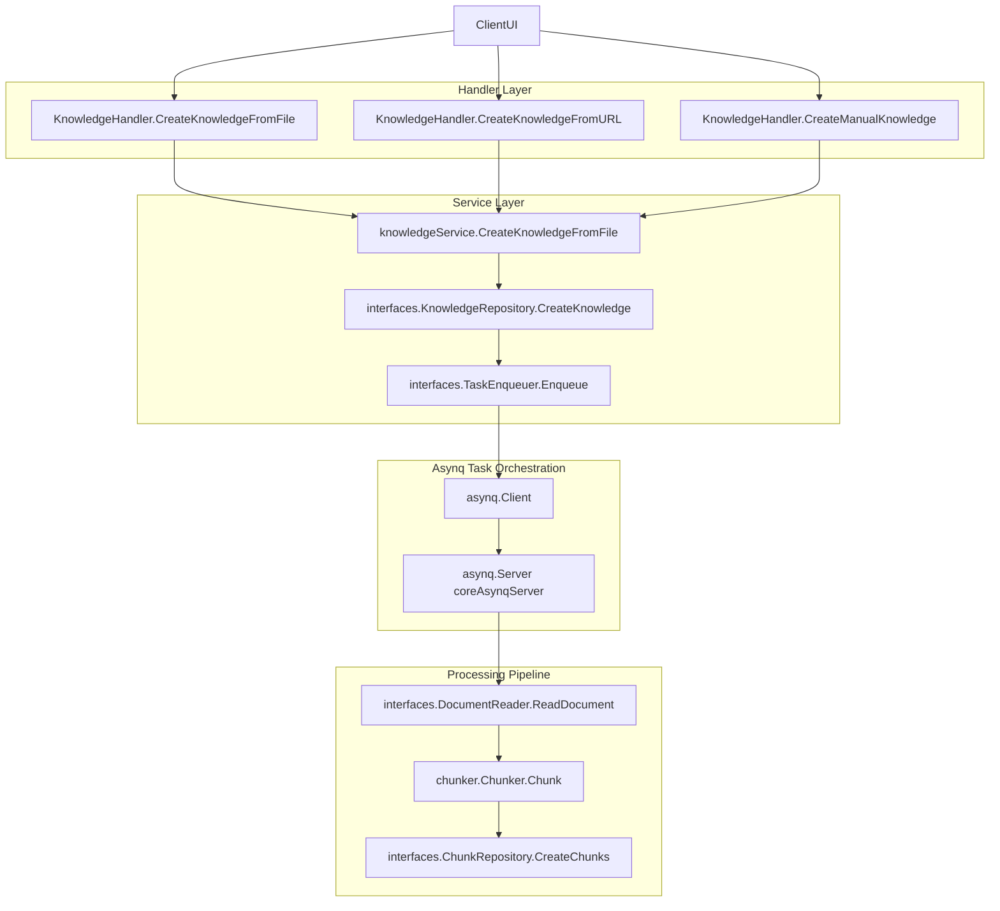
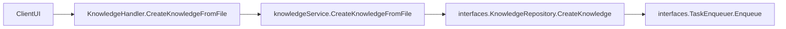
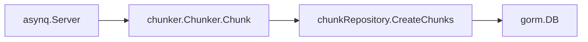

<!-- source: DeepWiki mcp.deepwiki.com · repo Tencent/WeKnora · page 4.2 Document Upload and Processing · fetched 2026-10-29 -->

# Document Upload and Processing

Relevant source files

The following files were used as context for generating this wiki page:

- [client/faq.go](client/faq.go)
- [frontend/src/api/knowledge-base/index.ts](frontend/src/api/knowledge-base/index.ts)
- [frontend/src/components/UploadConfirmHost.vue](frontend/src/components/UploadConfirmHost.vue)
- [frontend/src/stores/uploadConfirm.ts](frontend/src/stores/uploadConfirm.ts)
- [frontend/src/types/knowledgeProcess.ts](frontend/src/types/knowledgeProcess.ts)
- [frontend/src/views/knowledge/components/UploadConfirmDialog.test.ts](frontend/src/views/knowledge/components/UploadConfirmDialog.test.ts)
- [frontend/src/views/knowledge/components/UploadConfirmDialog.vue](frontend/src/views/knowledge/components/UploadConfirmDialog.vue)
- [internal/application/repository/chunk.go](internal/application/repository/chunk.go)
- [internal/application/service/chunk.go](internal/application/service/chunk.go)
- [internal/application/service/knowledge.go](internal/application/service/knowledge.go)
- [internal/application/service/knowledge_clone_image_test.go](internal/application/service/knowledge_clone_image_test.go)
- [internal/application/service/knowledge_clone_move.go](internal/application/service/knowledge_clone_move.go)
- [internal/application/service/knowledge_clone_rollback_test.go](internal/application/service/knowledge_clone_rollback_test.go)
- [internal/application/service/knowledge_create.go](internal/application/service/knowledge_create.go)
- [internal/application/service/knowledge_create_test.go](internal/application/service/knowledge_create_test.go)
- [internal/application/service/knowledge_delete.go](internal/application/service/knowledge_delete.go)
- [internal/application/service/knowledge_faq.go](internal/application/service/knowledge_faq.go)
- [internal/application/service/knowledge_faq_import.go](internal/application/service/knowledge_faq_import.go)
- [internal/application/service/knowledge_process.go](internal/application/service/knowledge_process.go)
- [internal/application/service/knowledge_process_config.go](internal/application/service/knowledge_process_config.go)
- [internal/application/service/knowledge_process_config_test.go](internal/application/service/knowledge_process_config_test.go)
- [internal/handler/faq.go](internal/handler/faq.go)
- [internal/handler/knowledge.go](internal/handler/knowledge.go)
- [internal/router/router.go](internal/router/router.go)
- [internal/types/faq.go](internal/types/faq.go)
- [internal/types/interfaces/chunk.go](internal/types/interfaces/chunk.go)
- [internal/types/interfaces/knowledge.go](internal/types/interfaces/knowledge.go)
- [internal/types/knowledge_process.go](internal/types/knowledge_process.go)

## Purpose and Scope

This document details the process of uploading and processing knowledge documents in WeKnora. It covers the lifecycle of document ingestion including file upload (`CreateKnowledgeFromFile`), URL import (`CreateKnowledgeFromURL`), text passage ingestion (`CreateKnowledgeFromPassage`), and manual markdown entry (`CreateKnowledgeFromManual`). The page further describes format validation, parser engine selection, asynchronous background processing via task queues (`asynq`), and fine-grained status tracking for parsing operations (`pending`, `processing`, `completed`, `failed`, `finalizing`, `cancelled`, `draft`), linking these stages to key code entities in the service and handler layers.

The information here serves as a technical reference for developers working on or extending the document ingestion and processing subsystem in WeKnora.

Sources:  
`[internal/handler/knowledge.go:30-38]()`  
`[internal/application/service/knowledge_create.go:25-78]()`  
`[internal/application/service/knowledge_process.go:154-200]()`  
`[internal/types/interfaces/knowledge.go:13-55]()`  

---

## Document Ingestion Overview

WeKnora supports four primary ingestion methods for importing knowledge content:

| Ingestion Method    | API Route                                                | Handler / Service Interface                                                     | Processing Mode          | Typical Use Case                                  |
|--------------------|----------------------------------------------------------|---------------------------------------------------------------------------------|--------------------------|--------------------------------------------------|
| File Upload        | POST `/api/v1/knowledge-bases/:id/knowledge/file`        | `KnowledgeHandler.CreateKnowledgeFromFile` / `interfaces.KnowledgeService.CreateKnowledgeFromFile` | Async via Asynq          | Upload binary or text files (pdf, docx, txt, md) |
| URL Import         | POST `/api/v1/knowledge-bases/:id/knowledge/url`         | `KnowledgeHandler.CreateKnowledgeFromURL` / `interfaces.KnowledgeService.CreateKnowledgeFromURL`  | Async via Asynq          | Import files or web pages by downloading URL     |
| Text Passages      | Internal API                                              | `interfaces.KnowledgeService.CreateKnowledgeFromPassage` / `processDocumentFromPassage`          | Async via Asynq          | Programmatic ingestion of text passages          |
| Manual Markdown    | POST `/api/v1/knowledge-bases/:id/knowledge/manual`      | `KnowledgeHandler.CreateManualKnowledge` / `interfaces.KnowledgeService.CreateManualKnowledge` | Sync; Draft state        | User-edited markdown entered manually            |

All ingestion methods first create a `types.Knowledge` record with initial `parse_status = "pending"` in the database (via `interfaces.KnowledgeRepository.CreateKnowledge`) and then enqueue asynchronous processing tasks using `asynq`.

Sources:  
`[internal/handler/knowledge.go:30-60]()`  
`[internal/types/interfaces/knowledge.go:13-55]()`  
`[internal/application/repository/chunk.go:42-69]()`  

---

## High-Level Document Processing Architecture

This diagram illustrates how document upload and processing flows from the client UI through handlers, service layers, async task queues, and finally into persistent chunk storage and vector indexing, bridging Natural Language Space to Code Entity Space.

Title: "Document Upload and Processing Flow Architecture"

Sources:  
`[internal/handler/knowledge.go:30-60]()`  
`[internal/application/service/knowledge_create.go:25-187]()`  
`[internal/router/router.go:1-50]()`  
`[internal/application/repository/chunk.go:42-69]()`  

---

## File Upload Pipeline

### API Endpoint and Handler Validation

File uploads are performed via multipart HTTP POST to `POST /api/v1/knowledge-bases/{id}/knowledge/file`. The handler method `KnowledgeHandler.CreateKnowledgeFromFile` validates tenant permissions and access to the target knowledge base. The client submits the file as a `*multipart.FileHeader` alongside optional `process_overrides` for parser/chunking configuration, metadata, and tag IDs.

Sources:  
`[internal/handler/knowledge.go:30-105]()`  
`[internal/application/service/knowledge_create.go:25-45]()`  

### File Type Validation and Deduplication

Before storage, the file extension is validated against supported types by `isValidFileType()`:
- Supported formats include document types (pdf, doc, docx, txt, md, json), spreadsheets (xlsx, csv), images (png, jpg, gif), and audio (mp3, wav).
- Video file uploads are explicitly rejected with a bad request error.

The file's content MD5 hash is calculated by `calculateFileHash()` to detect duplicates within the tenant's knowledge base. Duplicate entries are checked via `CheckKnowledgeExists()` in the repository layer.

Sources:  
`[internal/application/service/knowledge_create.go:48-122]()`  

### Configuration Resolution and Parser Engine Selection

The effective parsing and chunking configuration is resolved by merging knowledge base defaults with per-upload `processOverrides`. The resolved configuration specifies chunk sizes, parser engine selection rules by file type (e.g., `"builtin"` or `"mineru"`), multimodal enablement, VLM and ASR models, and question generation toggles.

Sources:  
`[internal/application/service/knowledge_create.go:160-165]()`  

### File Storage and Knowledge Record Creation

The uploaded file is saved to storage via `FileService.SaveFile()`, and its path is stored in a new `types.Knowledge` record. The record is persisted with `CreateKnowledge()` and an asynchronous parsing task is enqueued.

Sources:  
`[internal/application/service/knowledge_create.go:167-187]()`  
`[internal/types/interfaces/knowledge.go:13-26]()`  

### Document Parsing and Chunking

Parsing executes asynchronously via background task handlers running on Asynq worker pools:
- Text content is extracted and chunked using `chunker.Chunker.Chunk()` and `processDocumentFromPassage()`.
- Chunks are persisted using `interfaces.ChunkRepository.CreateChunks()`.
- Embedding vectors are generated and indexed into the vector database.

Sources:  
`[internal/application/service/knowledge_process.go:165-200]()`  
`[internal/application/repository/chunk.go:55-96]()`  

---

## Status Tracking and Parse Lifecycle

Knowledge entries maintain detailed parse status states tracked in the database and surfaced through frontend interfaces:

| Parse Status        | Constant                             | Meaning                                                      |
|---------------------|------------------------------------|--------------------------------------------------------------|
| `pending`           | `types.ParseStatusPending`         | Initial state; waiting to start parsing                       |
| `processing`        | `types.ParseStatusProcessing`      | Parsing underway, or async enrichment subtasks ongoing       |
| `completed`         | `types.ParseStatusCompleted`       | Parse, chunking, embedding, and indexing finished successfully|
| `failed`            | `types.ParseStatusFailed`          | Unrecoverable error during parsing                            |
| `finalizing`        | `types.ParseStatusFinalizing`      | Primary ingestion done; background postprocessing underway    |
| `cancelled`         | `types.ParseStatusCancelled`       | User-requested cancellation; parse aborted                    |
| `draft`             | `types.ParseStatusDraft`           | Manual markdown saved as a draft, not yet published          |

Sources:  
`[internal/application/service/knowledge_process.go:168-174]()`  
`[internal/types/interfaces/knowledge.go:120-133]()`  

---

## Summary Diagrams

### Code Entity Mapping: Ingestion Initiation

Title: "Ingestion Initiation Code Mapping"

Sources:  
`[internal/handler/knowledge.go:30-105]()`  
`[internal/application/service/knowledge_create.go:25-187]()`  

### Code Entity Mapping: Chunk Repository & Storage

Title: "Chunk Repository Code Mapping"

Sources:  
`[internal/application/repository/chunk.go:55-96]()`  
`[internal/types/interfaces/chunk.go:16-65]()`  

---

This document covers the full technical pipeline of document upload and processing, including file validation, storage, parser engine selection, async processing orchestration via Asynq, chunk and embedding management, and parse status tracking, as implemented in WeKnora.

---

