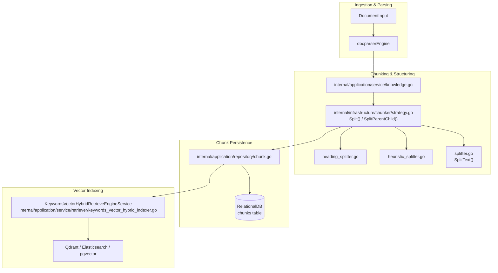
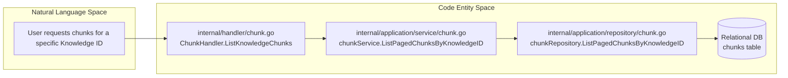
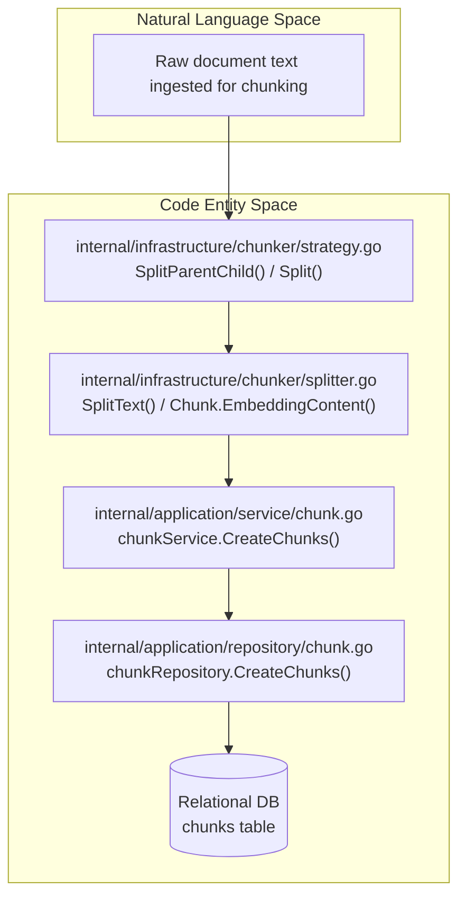

<!-- source: DeepWiki mcp.deepwiki.com · repo Tencent/WeKnora · page 4.4 Chunk Management and Vector Indexing · fetched 2026-10-29 -->

# Chunk Management and Vector Indexing

<details>
<summary>Relevant source files</summary>

The following files were used as context for generating this wiki page:

- [frontend/src/api/chunker/index.ts](frontend/src/api/chunker/index.ts)
- [frontend/src/types/chunker.ts](frontend/src/types/chunker.ts)
- [frontend/src/views/knowledge/settings/KBChunkingDebug.vue](frontend/src/views/knowledge/settings/KBChunkingDebug.vue)
- [internal/application/repository/chunk_insert_test.go](internal/application/repository/chunk_insert_test.go)
- [internal/application/repository/chunk_sqlite_test.go](internal/application/repository/chunk_sqlite_test.go)
- [internal/application/service/knowledge_faq_import_enabled_test.go](internal/application/service/knowledge_faq_import_enabled_test.go)
- [internal/application/service/knowledge_multimodal_slot_release_test.go](internal/application/service/knowledge_multimodal_slot_release_test.go)
- [internal/application/service/knowledge_post_process_summary_test.go](internal/application/service/knowledge_post_process_summary_test.go)
- [internal/application/service/knowledge_process_embedding_failure_test.go](internal/application/service/knowledge_process_embedding_failure_test.go)
- [internal/application/service/knowledge_process_index_retry_test.go](internal/application/service/knowledge_process_index_retry_test.go)
- [internal/application/service/knowledge_process_parent_child_test.go](internal/application/service/knowledge_process_parent_child_test.go)
- [internal/handler/chunker_debug.go](internal/handler/chunker_debug.go)
- [internal/handler/chunker_debug_test.go](internal/handler/chunker_debug_test.go)
- [internal/infrastructure/chunker/fenced_code.go](internal/infrastructure/chunker/fenced_code.go)
- [internal/infrastructure/chunker/fenced_code_test.go](internal/infrastructure/chunker/fenced_code_test.go)
- [internal/infrastructure/chunker/header_tracker.go](internal/infrastructure/chunker/header_tracker.go)
- [internal/infrastructure/chunker/heading_splitter.go](internal/infrastructure/chunker/heading_splitter.go)
- [internal/infrastructure/chunker/heading_splitter_test.go](internal/infrastructure/chunker/heading_splitter_test.go)
- [internal/infrastructure/chunker/heuristic_splitter.go](internal/infrastructure/chunker/heuristic_splitter.go)
- [internal/infrastructure/chunker/heuristic_splitter_test.go](internal/infrastructure/chunker/heuristic_splitter_test.go)
- [internal/infrastructure/chunker/parent_child_offsets_test.go](internal/infrastructure/chunker/parent_child_offsets_test.go)
- [internal/infrastructure/chunker/profiler.go](internal/infrastructure/chunker/profiler.go)
- [internal/infrastructure/chunker/protected_spans_order_test.go](internal/infrastructure/chunker/protected_spans_order_test.go)
- [internal/infrastructure/chunker/splitter.go](internal/infrastructure/chunker/splitter.go)
- [internal/infrastructure/chunker/splitter_test.go](internal/infrastructure/chunker/splitter_test.go)
- [internal/infrastructure/chunker/strategy.go](internal/infrastructure/chunker/strategy.go)
- [internal/infrastructure/chunker/strategy_diagnostics_test.go](internal/infrastructure/chunker/strategy_diagnostics_test.go)
- [internal/infrastructure/chunker/strategy_test.go](internal/infrastructure/chunker/strategy_test.go)
- [internal/infrastructure/docparser/builtin_converter.go](internal/infrastructure/docparser/builtin_converter.go)
- [internal/infrastructure/docparser/csv_converter_test.go](internal/infrastructure/docparser/csv_converter_test.go)
- [internal/types/chunk.go](internal/types/chunk.go)
- [internal/types/docparser.go](internal/types/docparser.go)
- [internal/types/tag.go](internal/types/tag.go)

</details>


## Purpose and Scope
This page details WeKnora's chunk management and vector indexing subsystem, which transforms raw document content into structurally sound, vectorized chunks stored and indexed across multiple retrieval engines (PostgreSQL/pgvector, Qdrant, Elasticsearch, and others). It covers adaptive chunking strategies (parent-child, heading-based, heuristic, and recursive), chunk metadata invariants, vector generation with backoff handling, and indexing engine repositories.

**Scope**: This page focuses on chunk splitting, adaptive strategies, data models, embedding pipelines, and storage engine repositories. For document upload and parser selection, see [4.2 Document Upload and Processing](); for FAQ-specific processing, see [4.3 FAQ Management]().

---

## 1. Chunk Lifecycle and Data Invariants

The lifecycle of a chunk spans raw document parsing, adaptive tier-based splitting, database persistence, and vector indexing. 

**Chunk Lifecycle and Indexing Architecture**

Sources: [internal/infrastructure/chunker/strategy.go:34-58](), [internal/infrastructure/chunker/splitter.go:14-32](), [internal/application/repository/knowledge.go:56-61]()

### Chunk Data Structure & Position Invariants
The `Chunk` struct tracks precise rune boundaries within the source document. This invariant is relied upon by document reconstruction paths (such as summary generation and UI highlighting) [internal/infrastructure/chunker/splitter.go:14-32](), [internal/types/chunk.go:132-180]().

```go
type Chunk struct {
	Content       string
	ContextHeader string
	Seq           int
	Start         int
	End           int
}
```

- **Position Invariant**: `End - Start == utf8.RuneCountInString(Content)` and `runes[Start:End] == Content` [internal/infrastructure/chunker/splitter.go:16-19]().
- **ContextHeader**: A Markdown heading breadcrumb tracked separately from `Content`. It is prepended at embedding/retrieval time via `EmbeddingContent()` without altering the raw rune position invariant [internal/infrastructure/chunker/splitter.go:21-49]().
- **Repository Management**: `chunkRepository` implements chunk persistence, revision snapshots (`CreateChunkRevision`), and querying (`ListPagedChunksByKnowledgeID`) [internal/types/chunk.go:132-180]().

Sources: [internal/infrastructure/chunker/splitter.go:14-49](), [internal/types/chunk.go:132-180]()

---

## 2. Adaptive Chunking Strategies and Sizing

WeKnora implements an adaptive chunking system managed by `SplitterConfig` and resolved through strategy tiers in `internal/infrastructure/chunker/strategy.go` [internal/infrastructure/chunker/splitter.go:59-74](), [internal/infrastructure/chunker/strategy.go:34-58]().

### Default Sizing Constants
- `DefaultChunkSize = 512` characters (approx. 100-130 English tokens, ~300 Chinese tokens) [internal/infrastructure/chunker/splitter.go:102-104]().
- `DefaultChunkOverlap = 80` characters (approx. 15% of chunk size) [internal/infrastructure/chunker/splitter.go:104-104]().

### Strategy Tiers
1. **`StrategyHeading` (`heading`)**: Splits Markdown documents at heading boundaries (`#`, `##`, etc.) and manages breadcrumbs via `internal/infrastructure/chunker/heading_splitter.go` [internal/infrastructure/chunker/strategy.go:18-24](), [internal/infrastructure/chunker/heading_splitter.go:1-16]().
2. **`StrategyHeuristic` (`heuristic`)**: Scans for structural markers (form feeds, chapter headers, bullet lists) while protecting atomic content blocks (LaTeX blocks, code fences, inline code, table rows) using `protectedSpansRune` [internal/infrastructure/chunker/splitter.go:116-126](), [internal/infrastructure/chunker/profiler.go:1-46]().
3. **`StrategyRecursive` / `StrategyLegacy` (`legacy`)**: Iteratively splits text using prioritized separators (`\n\n`, `\n`, `。`) [internal/infrastructure/chunker/splitter.go:112-114]().
4. **Parent-Child Chunking**: `SplitParentChild` splits documents into large parent chunks (broad context) and sub-divides them into smaller child chunks linked to the parent index [internal/infrastructure/chunker/strategy.go:135-186](). Frontend configuration for these strategies is handled via `KBChunkingDebug.vue` [frontend/src/views/knowledge/settings/KBChunkingDebug.vue:1-60]().

Sources: [internal/infrastructure/chunker/splitter.go:59-126](), [internal/infrastructure/chunker/strategy.go:18-186](), [internal/infrastructure/chunker/heading_splitter.go:1-16](), [internal/infrastructure/chunker/profiler.go:1-46](), [frontend/src/views/knowledge/settings/KBChunkingDebug.vue:1-60]()

---

## 3. Chunk Metadata and FAQ Mapping

Chunks can store extended metadata structures depending on their type, such as `DocumentChunkMetadata` for AI-generated questions or `FAQChunkMetadata` for structured QA items [internal/types/chunk.go:132-180]().

- **Document Metadata**: Tracks generated questions linked to chunk content revisions to improve retrieval recall without breaking base text invariants [internal/types/chunk.go:132-180]().
- **FAQ Metadata**: Manages standard questions, similar questions, negative questions, and answers with normalization functions to ensure consistent hashing and duplicate detection [internal/types/chunk.go:132-180]().
- **Service & Handler Integration**: `ChunkHandler` exposes batch operations and retrieval queries (`ListKnowledgeChunks`) [internal/handler/chunk.go:85-152]().

Sources: [internal/types/chunk.go:132-180](), [internal/handler/chunk.go:85-152]()

---

## 4. Natural Language to Code Entity Mapping

The following sections bridge user-facing queries and UI operations to underlying code symbols.

### Natural Language Space to Code Entity Space: Chunk Listing Flow

Sources: [internal/handler/chunk.go:85-152](), [internal/application/repository/knowledge.go:56-61]()

### Natural Language Space to Code Entity Space: Adaptive Chunking & Persistence Flow

Sources: [internal/infrastructure/chunker/strategy.go:34-186](), [internal/infrastructure/chunker/splitter.go:14-49]()

---

