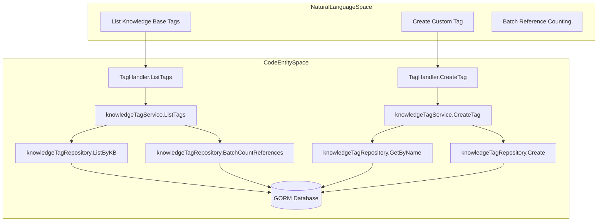
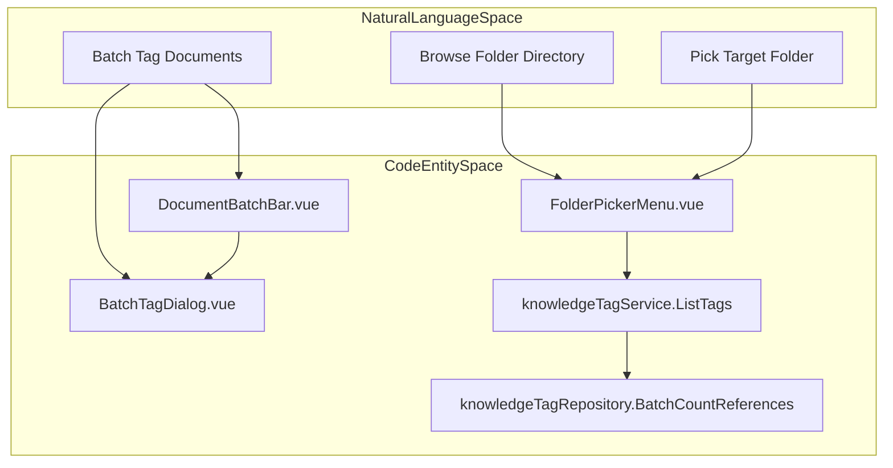

<!-- source: DeepWiki mcp.deepwiki.com · repo Tencent/WeKnora · page 4.5 Tag Management and Organization · fetched 2026-10-29 -->

# Tag Management and Organization

Relevant source files

The following files were used as context for generating this wiki page:

- [client/tag.go](client/tag.go)
- [frontend/src/views/knowledge/components/BatchTagDialog.test.ts](frontend/src/views/knowledge/components/BatchTagDialog.test.ts)
- [frontend/src/views/knowledge/components/BatchTagDialog.vue](frontend/src/views/knowledge/components/BatchTagDialog.vue)
- [frontend/src/views/knowledge/components/DocumentBatchBar.vue](frontend/src/views/knowledge/components/DocumentBatchBar.vue)
- [frontend/src/views/knowledge/components/DocumentCardView.vue](frontend/src/views/knowledge/components/DocumentCardView.vue)
- [frontend/src/views/knowledge/components/DocumentListView.vue](frontend/src/views/knowledge/components/DocumentListView.vue)
- [frontend/src/views/knowledge/components/KbFolderTree.test.ts](frontend/src/views/knowledge/components/KbFolderTree.test.ts)
- [frontend/src/views/knowledge/components/KbFolderTree.vue](frontend/src/views/knowledge/components/KbFolderTree.vue)
- [frontend/src/views/knowledge/folderTree.test.ts](frontend/src/views/knowledge/folderTree.test.ts)
- [frontend/src/views/knowledge/folderTree.ts](frontend/src/views/knowledge/folderTree.ts)
- [internal/application/repository/tag.go](internal/application/repository/tag.go)
- [internal/application/service/tag.go](internal/application/service/tag.go)
- [internal/handler/tag.go](internal/handler/tag.go)
- [internal/types/interfaces/tag.go](internal/types/interfaces/tag.go)

## Purpose and Scope
This page documents the tag management system, folder hierarchies, document list and card views, batch operations, and tag-based filtering within WeKnora. It bridges the backend persistent storage layer (`[internal/application/repository/tag.go:1-204]()` and `[internal/application/service/tag.go:1-183]`) with the frontend UI layout components (`[frontend/src/views/knowledge/components/KbFolderTree.vue:1-174]`, `[frontend/src/views/knowledge/components/DocumentListView.vue:38-85]`, and `[frontend/src/views/knowledge/components/DocumentCardView.vue:40-84]`).

Sources: `[internal/types/interfaces/tag.go:10-65]()`, `[frontend/src/views/knowledge/components/DocumentListView.vue:1-68]()`

---

## 1. Tag Data Model and Persistence

The tag subsystem revolves around the `KnowledgeTag` entity, which represents categories scoped to specific knowledge bases and tenants `[internal/types/interfaces/tag.go:10-26]()`. Each tag maintains a unique UUID `ID` for internal routing, an auto-incrementing integer `SeqID` for external APIs, color designations, and sorting weights `[internal/application/repository/tag.go:33-80]()`.

### Extended Statistics (`KnowledgeTagWithStats`)
To display usage indicators across documents and FAQ chunks without N+1 query penalties, tags are enriched with reference metrics via `BatchCountReferences()` `[internal/application/service/tag.go:107-128]()`. The underlying repository computes these counts in batched SQL queries joining `knowledge_tag_relations` and `chunks` `[internal/application/repository/tag.go:175-207]()`.

Sources: `[internal/types/interfaces/tag.go:10-65]()`, `[internal/application/repository/tag.go:33-207]()`, `[internal/application/service/tag.go:107-128]()`

---

## 2. Tag Lifecycle and Backend Service Architecture

The backend implements CRUD workflows, bulk counting, and asynchronous index updates when tags or associated chunks are mutated `[internal/application/service/tag.go:65-231]()`. API requests pass through `[internal/handler/tag.go:18-43]()`, which handles parameter binding, logging sanitization, and `seq_id` resolution `[internal/handler/tag.go:45-65]()`.

### Natural Language Space to Code Entity Space: Tag Backend Operations

Title: "Tag Backend Service Data Flow"

Sources: `[internal/handler/tag.go:87-157]()`, `[internal/application/service/tag.go:65-183]()`, `[internal/application/repository/tag.go:94-136]()`

---

## 3. Folder Trees and Document Organization

Knowledge base folders are structured hierarchically using pure frontend helper utilities and rendered by components like `[frontend/src/views/knowledge/components/KbFolderTree.vue:1-134]()` and `[frontend/src/views/knowledge/components/DocumentListView.vue:38-85]()`.

### Core Folder Concepts
* **Root Folder Path**: Represented by an empty string `ROOT_FOLDER_PATH = ''`, which points to the base level of the knowledge base `[frontend/src/views/knowledge/folderTree.ts:11-12]()`.
* **Folder Picker Integration**: The `FolderPickerMenu.vue` component provides inline nesting, creation of subfolders on the fly, and depth calculation `[frontend/src/views/knowledge/folderTree.ts:13-18]()`.
* **Ancestor Expansion**: Ensures parent paths are automatically expanded when navigating deeply nested folders `[frontend/src/views/knowledge/folderTree.ts:99-105]()`.

### Natural Language Space to Code Entity Space: Folder Navigation and Tag Assignment

Title: "Folder Navigation and Batch Tagging Flow"

Sources: `[frontend/src/views/knowledge/folderTree.ts:1-198]()`, `[frontend/src/views/knowledge/components/KbFolderTree.vue:1-174]()`, `[frontend/src/views/knowledge/components/DocumentBatchBar.vue:82-95]()`

---

## 4. Document Views, Card Layouts, and Batch Management

Documents and items within a folder or tag filter can be viewed via `[frontend/src/views/knowledge/components/DocumentListView.vue:38-85]()` or `[frontend/src/views/knowledge/components/DocumentCardView.vue:40-84]()`, with batch actions managed via `[frontend/src/views/knowledge/components/DocumentBatchBar.vue:6-30]()` and `[frontend/src/views/knowledge/components/DocumentActionMenu.vue:1-31]()`.

### Batch Operations and UI Triggers
* **`DocumentBatchBar.vue`**: Allows multi-selection of documents for batch downloading, re-parsing, tagging, folder migration, and deletion `[frontend/src/views/knowledge/components/DocumentBatchBar.vue:53-106]()`.
* **`BatchTagDialog.vue`**: Integrates `KnowledgeTagPicker` to apply or remove tags across selected items in bulk `[frontend/src/views/knowledge/components/BatchTagDialog.vue:33-63]()`.
* **`DocumentActionMenu.vue`**: Renders individual row/card actions including downloading raw files, moving items between folders or knowledge bases, viewing traces, and managing parsing status.

Sources: `[frontend/src/views/knowledge/components/DocumentListView.vue:38-85]()`, `[frontend/src/views/knowledge/components/DocumentCardView.vue:40-84]()`, `[frontend/src/views/knowledge/components/DocumentBatchBar.vue:6-106]()`, `[frontend/src/views/knowledge/components/BatchTagDialog.vue:33-63]()`

---

## 5. Tag-Based Filtering and Retrieval Search

The system distinguishes between browsing direct folder contents and running tag-based filters across the knowledge base using repository constraints `[internal/application/repository/tag.go:94-136]()`. 

When `tagIds` or keywords are supplied, repository queries extend constraints to fetch matching items recursively from paths and join relation tables like `knowledge_tag_relations` `[internal/application/repository/tag.go:152-166]()`.

Sources: `[internal/application/repository/tag.go:94-204]()`, `[internal/application/service/tag.go:65-130]()`

---

