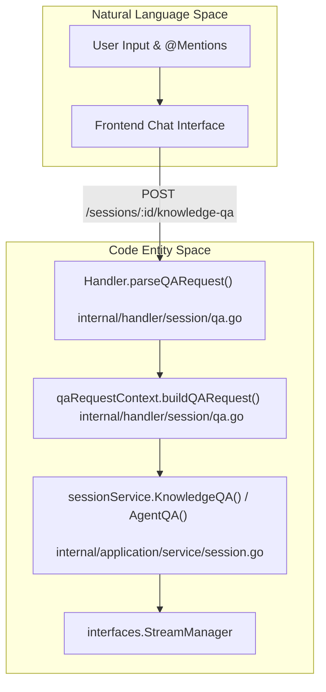
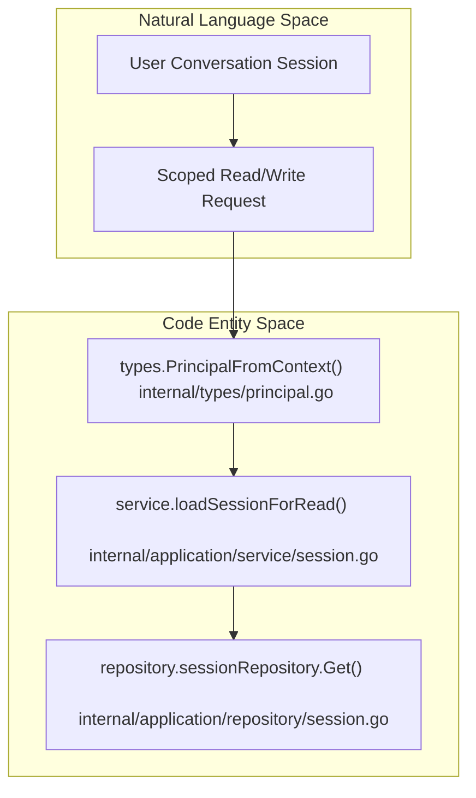

<!-- source: DeepWiki mcp.deepwiki.com · repo Tencent/WeKnora · page 5 Chat and Query System · fetched 2026-10-29 -->

# Chat and Query System

Relevant source files

The following files were used as context for generating this wiki page:

- [frontend/src/components/sessionGrouping.test.ts](frontend/src/components/sessionGrouping.test.ts)
- [frontend/src/components/sessionGrouping.ts](frontend/src/components/sessionGrouping.ts)
- [internal/application/repository/session.go](internal/application/repository/session.go)
- [internal/application/repository/session_test.go](internal/application/repository/session_test.go)
- [internal/application/service/session.go](internal/application/service/session.go)
- [internal/application/service/session_user_scope_test.go](internal/application/service/session_user_scope_test.go)
- [internal/handler/message_suggestion.go](internal/handler/message_suggestion.go)
- [internal/handler/message_suggestion_test.go](internal/handler/message_suggestion_test.go)
- [internal/handler/session/handler.go](internal/handler/session/handler.go)
- [internal/handler/session/qa.go](internal/handler/session/qa.go)
- [internal/types/interfaces/session.go](internal/types/interfaces/session.go)
- [internal/types/principal.go](internal/types/principal.go)
- [internal/types/session.go](internal/types/session.go)
- [internal/types/session_access_test.go](internal/types/session_access_test.go)

## Purpose and Scope

The Chat and Query System is WeKnora's conversational AI engine that coordinates natural language interaction, knowledge retrieval, autonomous agent execution, and real-time streaming over Server-Sent Events (SSE). It bridges client interfaces with backend retrieval pipelines, tool registries, and long-term memory systems [internal/handler/session/qa.go:34-133](), [internal/application/service/session.go:141-167]().

This page provides a high-level architectural overview of the chat and query subsystems. For detailed technical specifications, implementation details, and configuration, refer to the following child pages:
- [Chat Interface and User Experience](#5.1) — UI components, input features, streaming responses, and agent visualization.
- [Knowledge QA Mode](#5.2) — Normal RAG QA mode, query rewriting, retrieval strategies, and context formatting.
- [Agent Mode and Tool Integration](#5.3) — ReAct loop execution, tool registration, invocation, and skill sandboxes.
- [Session Management and Context](#5.4) — Session lifecycles, Redis context storage, history management, and auto-title generation.
- [MCP Tool Integration](#5.5) — Model Context Protocol tool registration, proxying, and agent usage.
- [Web Search Integration](#5.6) — Web search providers, web fetching, and tool workflow integration.
- [Embedded Chat Channels](#5.7) — Embeddable chat widgets, public session security, and external site embedding.

Sources:
- [internal/handler/session/qa.go:34-133]()
- [internal/application/service/session.go:141-167]()

---

## Architecture Overview

Conversational flows are initiated via REST endpoints handled by `Handler` [internal/handler/session/handler.go:23-84](), structured into `qaRequestContext` [internal/handler/session/qa.go:42-108](), and passed to `sessionService` implementing `interfaces.SessionService` [internal/application/service/session.go:141-167](), [internal/types/interfaces/session.go:12-78]().

### Chat Request Pipeline Architecture

Sources:
- [internal/handler/session/qa.go:34-160]()
- [internal/application/service/session.go:141-167]()
- [internal/types/interfaces/session.go:59-78]()

---

## Core Sub-Topics

### 5.1 Chat Interface and User Experience

The chat interface manages rich user interactions including Markdown rendering, multimodal image uploads, `@mention` tracking, and real-time streaming indicators. Client requests are dispatched using streaming clients, backed by message suggestion handlers (`MessageSuggestionHandler`) that asynchronously provide follow-up questions [internal/handler/message_suggestion.go:17-26]().

For detailed component breakdown, UI state handling, and rendering rules, see [Chat Interface and User Experience](#5.1).

Sources:
- [internal/handler/session/qa.go:135-163]()
- [internal/handler/message_suggestion.go:17-75]()

---

### 5.2 Knowledge QA Mode

Knowledge QA mode executes standard Retrieval-Augmented Generation (RAG). Queries are analyzed, optionally rewritten using query understanding models, matched against vector and keyword indexes, reranked, and injected into the LLM context via `KnowledgeQA` [internal/types/interfaces/session.go:59-61]().

For query rewriting, retrieval strategies, and prompt formatting, see [Knowledge QA Mode](#5.2).

Sources:
- [internal/types/interfaces/session.go:59-61]()

---

### 5.3 Agent Mode and Tool Integration

When agent mode is enabled via `AgentQA` [internal/types/interfaces/session.go:76-78](), execution transitions from static RAG to the ReAct (Reasoning and Acting) framework. The agent evaluates goals iteratively, invokes tools via event handlers, and manages intermediate thoughts, tool calls, and final answers.

For details on the ReAct loop, tool registration, and skill execution, see [Agent Mode and Tool Integration](#5.3).

Sources:
- [internal/application/service/session.go:141-167]()
- [internal/types/interfaces/session.go:76-78]()

---

### 5.4 Session Management and Context

Conversation sessions provide the container for message histories, metadata, and user scopes. Sessions are managed by `sessionService` and persisted via `SessionRepository` [internal/application/service/session.go:141-167](), [internal/types/interfaces/session.go:80-111](). Access control and isolation are enforced using principal context resolution (`types.PrincipalFromContext`) and scoped readers like `loadSessionForRead` [internal/application/service/session.go:95-134](), [internal/types/principal.go:85-96](). Furthermore, `SessionLastRequestState` persists input-bar configurations (such as model and agent parameters) in `sessions.agent_config` to enable exact UI state restoration [internal/types/session.go:115-121]().

### Session Scope and Context Resolution

Sources:
- [internal/application/service/session.go:95-134]()
- [internal/types/principal.go:85-96]()
- [internal/types/session.go:115-121]()
- [internal/application/repository/session.go:51-65]()

For session lifecycles, history loading, and Redis context storage, see [Session Management and Context](#5.4).

Sources:
- [internal/application/service/session.go:94-145]()
- [internal/types/interfaces/session.go:11-40]()
- [internal/application/repository/session.go:51-65]()

---

### 5.5 MCP Tool Integration

WeKnora supports the Model Context Protocol (MCP), enabling external tool services to be discovered, registered, and invoked dynamically during agent execution. MCP services can be selected per-request via `@mentions` or bound at the agent configuration level.

For MCP server registration, configuration, and agent invocation protocols, see [MCP Tool Integration](#5.5).

Sources:
- [internal/application/service/session.go:141-167]()

---

### 5.6 Web Search Integration

Web search capabilities allow agents and RAG queries to augment local knowledge bases with live internet results. When search parameters are enabled on the request or agent configuration, queries route through configured search providers, optionally triggering automated full-page web fetches for reranking.

For web search provider setup, tool configurations, and agent workflow integration, see [Web Search Integration](#5.6).

Sources:
- [internal/handler/session/qa.go:60-62]()

---

### 5.7 Embedded Chat Channels

Embedded chat channels allow WeKnora chat interfaces to be deployed as embeddable widgets on external websites. This subsystem manages channel configurations, the UI components, secure public session flows, and script injection utilizing principal types such as `PrincipalEmbedSession` [internal/types/principal.go:126-131]().

For embed configuration, widget UI structures, and authentication protocols, see [Embedded Chat Channels](#5.7).

Sources:
- [internal/application/service/session.go:78-88]()
- [internal/types/principal.go:126-131]()

---

