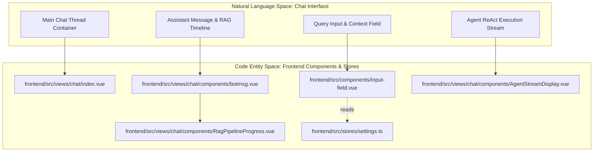
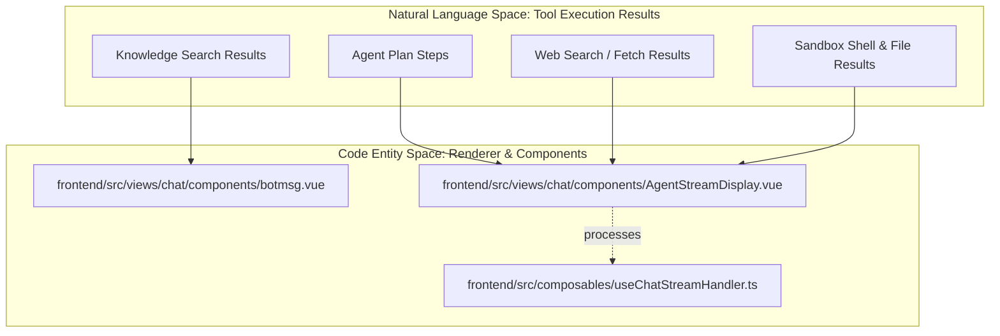

<!-- source: DeepWiki mcp.deepwiki.com · repo Tencent/WeKnora · page 5.1 Chat Interface and User Experience · fetched 2026-10-29 -->

# Chat Interface and User Experience

Relevant source files

The following files were used as context for generating this wiki page:

- [frontend/src/components/AgentSelector.vue](frontend/src/components/AgentSelector.vue)
- [frontend/src/components/Input-field.vue](frontend/src/components/Input-field.vue)
- [frontend/src/components/doc-content.vue](frontend/src/components/doc-content.vue)
- [frontend/src/components/knowledge-processing-timeline.vue](frontend/src/components/knowledge-processing-timeline.vue)
- [frontend/src/composables/useChatStreamHandler.test.mjs](frontend/src/composables/useChatStreamHandler.test.mjs)
- [frontend/src/composables/useChatStreamHandler.ts](frontend/src/composables/useChatStreamHandler.ts)
- [frontend/src/composables/useEmbedChatSession.ts](frontend/src/composables/useEmbedChatSession.ts)
- [frontend/src/composables/useStickyBottomOnResize.test.ts](frontend/src/composables/useStickyBottomOnResize.test.ts)
- [frontend/src/composables/useStickyBottomOnResize.ts](frontend/src/composables/useStickyBottomOnResize.ts)
- [frontend/src/composables/useTypewriter.test.ts](frontend/src/composables/useTypewriter.test.ts)
- [frontend/src/composables/useTypewriter.ts](frontend/src/composables/useTypewriter.ts)
- [frontend/src/hooks/useKnowledgeBase.ts](frontend/src/hooks/useKnowledgeBase.ts)
- [frontend/src/utils/agent-readiness.test.mjs](frontend/src/utils/agent-readiness.test.mjs)
- [frontend/src/utils/agent-readiness.ts](frontend/src/utils/agent-readiness.ts)
- [frontend/src/utils/knowledgeTrace.test.ts](frontend/src/utils/knowledgeTrace.test.ts)
- [frontend/src/utils/knowledgeTrace.ts](frontend/src/utils/knowledgeTrace.ts)
- [frontend/src/utils/shellExecResult.test.ts](frontend/src/utils/shellExecResult.test.ts)
- [frontend/src/utils/shellExecResult.ts](frontend/src/utils/shellExecResult.ts)
- [frontend/src/views/chat/components/AgentStreamDisplay.vue](frontend/src/views/chat/components/AgentStreamDisplay.vue)
- [frontend/src/views/chat/components/botmsg.vue](frontend/src/views/chat/components/botmsg.vue)
- [frontend/src/views/chat/components/usermsg.vue](frontend/src/views/chat/components/usermsg.vue)
- [frontend/src/views/chat/index.vue](frontend/src/views/chat/index.vue)
- [frontend/src/views/platform/index.vue](frontend/src/views/platform/index.vue)
- [internal/agent/tools/persist.go](internal/agent/tools/persist.go)
- [internal/agent/tools/persist_test.go](internal/agent/tools/persist_test.go)
- [internal/application/service/knowledge_post_process_trace_test.go](internal/application/service/knowledge_post_process_trace_test.go)

This page documents the chat interface components, user interaction patterns, streaming response mechanisms, message attachments, tool result rendering, and agent visualization in WeKnora. It covers the frontend UI/UX layer of the chat system, including the input composer, message history layout, RAG pipeline progress, real-time streaming via Server-Sent Events (SSE), and tool output handling.

For backend query processing logic, see [Knowledge QA Mode](5.2) and [Agent Mode and Tool Integration](5.3). For session lifecycle management, see [Session Management and Context](5.4).

---

## Architecture Overview

The chat interface is built with Vue.js and Pinia stores, consisting of primary containers for conversation history, user query entry with context selection (`[frontend/src/components/Input-field.vue:1-61]()`), assistant response rendering (`[frontend/src/views/chat/components/botmsg.vue:1-35]()`), and agent execution stream visualization (`[frontend/src/views/chat/components/AgentStreamDisplay.vue:1-30]()`). Messages are delivered via SSE and organized inside the main view container (`[frontend/src/views/chat/index.vue:1-107]()`).

Title: "Chat Interface Component Relationship"

Sources: `[frontend/src/views/chat/index.vue:1-107]`, `[frontend/src/components/Input-field.vue:1-61]`, `[frontend/src/views/chat/components/botmsg.vue:1-35]`, `[frontend/src/views/chat/components/AgentStreamDisplay.vue:1-30]`

---

## Input Field Component and User Messages

The input field (`[frontend/src/components/Input-field.vue:1-61]()`) serves as the primary user interaction point for context selection, agent configuration, and query submission. User messages (`[frontend/src/views/chat/components/usermsg.vue:1-76]()`) display the submitted text, mentioned items, uploaded images, and file attachments.

### Multimodal Input and Attachments
- **Images:** Supported via drag-and-drop or file selection, validated against size/type constraints (`[frontend/src/components/Input-field.vue:86-155]()`), and rendered as thumbnails with click-to-preview via `picturePreview` (`[frontend/src/views/chat/components/usermsg.vue:16-19]()`).
- **Attachments:** Managed by `AttachmentUpload.vue` and represented on user messages as file cards displaying file extension, size formatting, and preview drawers (`[frontend/src/views/chat/components/usermsg.vue:21-42]()`).
- **File Drops:** Global file drop events (`weknora:chat-file-drop`) are caught and dispatched into the input composer (`[frontend/src/components/Input-field.vue:119-124]()`).

Sources: `[frontend/src/components/Input-field.vue:1-181]`, `[frontend/src/views/chat/components/usermsg.vue:1-76]`

---

## Assistant Message Rendering and RAG Pipeline Progress

Assistant messages (`[frontend/src/views/chat/components/botmsg.vue:1-114]()`) manage the display of RAG pipelines, mentioned knowledge items, thinking blocks, markdown content, and action toolbars.

### RAG Pipeline Progress Timeline
The `RagPipelineProgress.vue` component renders retrieval steps (such as search queries, document fetching, and reranking) in a collapsible timeline (`[frontend/src/views/chat/components/botmsg.vue:17-26]()`).
- **Pre-pipeline Wait & Model Waiting:** Displays pending states while awaiting model connection or response generation.
- **Collapsed Root View:** After the answer arrives, the retrieval timeline collapses into a summary header with expansion toggles.
- **Memory Row Integration:** Manages conversation memories via specialized step components.

### Answer Toolbar & Artifacts
The answer toolbar provides copy actions, bookmarking into knowledge bases, fallback indicators, and skill artifact drawers. When a skill execution generates files, the `answer-toolbar__artifact` indicator appears with an animated badge displaying the file count (`[frontend/src/views/chat/components/botmsg.vue:56-101]()`).

Sources: `[frontend/src/views/chat/components/botmsg.vue:1-114]`, `[frontend/src/views/chat/components/usermsg.vue:1-159]`

---

## Tool Result Rendering System

Tool executions within agents produce structured results that are rendered by specialized sub-components.

Title: "Tool Result Display Mapping Data Flow"

Sources: `[frontend/src/views/chat/components/botmsg.vue:1-114]`, `[frontend/src/views/chat/components/AgentStreamDisplay.vue:1-123]`, `[frontend/src/composables/useChatStreamHandler.ts:1-76]`

---

## Streaming Response and Agent Visualization

In Agent Mode, `AgentStreamDisplay.vue` visualizes the agent's ReAct loop execution as a tree of intermediate events (`[frontend/src/views/chat/components/AgentStreamDisplay.vue:1-116]()`).

- **Event Types:** Supports `plan_task_change`, `context_compacted`, `thinking`, `tool_call`, and collaboration sub-tasks (`[frontend/src/views/chat/components/AgentStreamDisplay.vue:33-116]()`).
- **Human-in-the-Loop Approval:** Renders prompt cards via stream handlers like `pendingPromptEvents` for pending actions requiring explicit user grant or denial (`[frontend/src/composables/useChatStreamHandler.ts:70-137]()`).

Sources: `[frontend/src/views/chat/components/AgentStreamDisplay.vue:1-116]`, `[frontend/src/composables/useChatStreamHandler.ts:1-137]`

---

