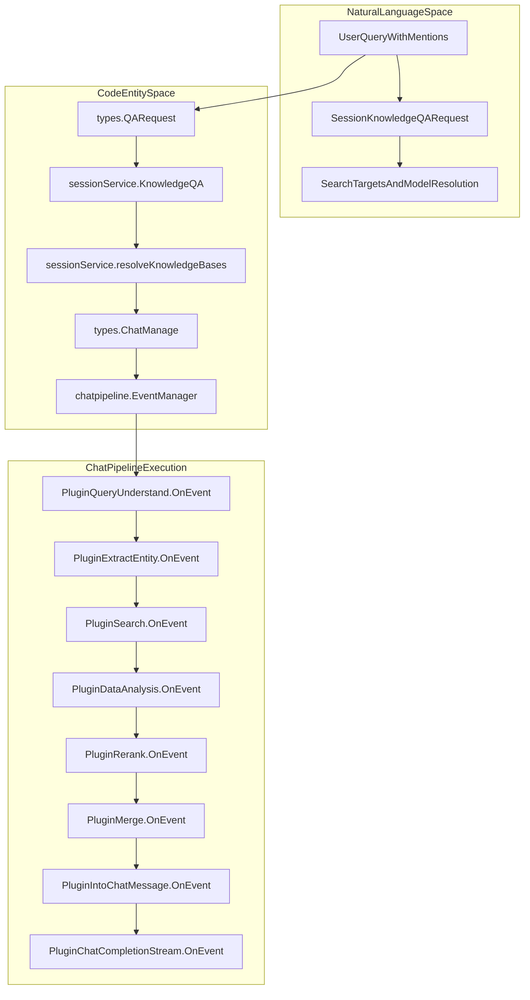
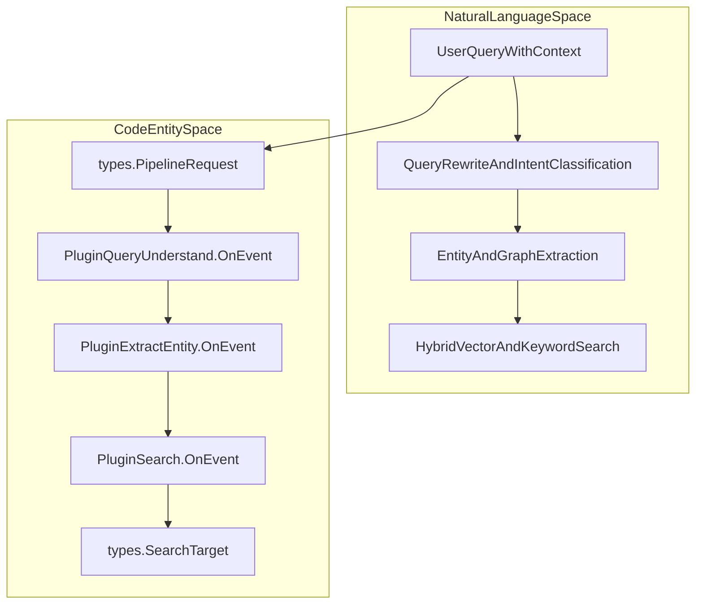
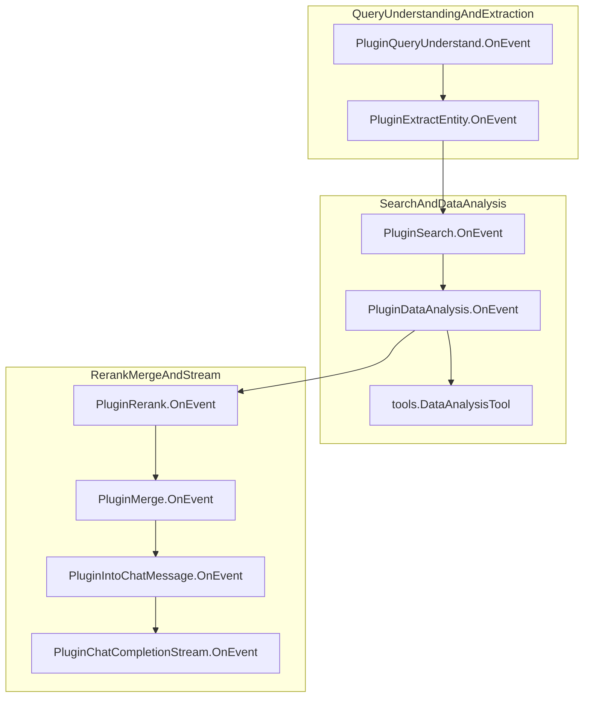

<!-- source: DeepWiki mcp.deepwiki.com · repo Tencent/WeKnora · page 5.2 Knowledge QA Mode · fetched 2026-10-29 -->

# Knowledge QA Mode

Relevant source files

The following files were used as context for generating this wiki page:

- [cmd/download/duckdb/duckdb.go](cmd/download/duckdb/duckdb.go)
- [config/prompt_templates/context_template.yaml](config/prompt_templates/context_template.yaml)
- [config/prompt_templates/fallback.yaml](config/prompt_templates/fallback.yaml)
- [config/prompt_templates/intent_prompts.yaml](config/prompt_templates/intent_prompts.yaml)
- [config/prompt_templates/rewrite.yaml](config/prompt_templates/rewrite.yaml)
- [config/prompt_templates/system_prompt.yaml](config/prompt_templates/system_prompt.yaml)
- [internal/agent/tools/data_analysis.go](internal/agent/tools/data_analysis.go)
- [internal/agent/tools/data_analysis_legacy_xls_test.go](internal/agent/tools/data_analysis_legacy_xls_test.go)
- [internal/agent/tools/data_analysis_storage_test.go](internal/agent/tools/data_analysis_storage_test.go)
- [internal/agent/tools/data_analysis_test.go](internal/agent/tools/data_analysis_test.go)
- [internal/agent/tools/param_cast.go](internal/agent/tools/param_cast.go)
- [internal/agent/tools/param_cast_preserve_test.go](internal/agent/tools/param_cast_preserve_test.go)
- [internal/agent/tools/param_cast_test.go](internal/agent/tools/param_cast_test.go)
- [internal/agent/tools/sequentialthinking.go](internal/agent/tools/sequentialthinking.go)
- [internal/agent/tools/todo_write.go](internal/agent/tools/todo_write.go)
- [internal/application/service/chat_pipeline/common.go](internal/application/service/chat_pipeline/common.go)
- [internal/application/service/chat_pipeline/data_analysis.go](internal/application/service/chat_pipeline/data_analysis.go)
- [internal/application/service/chat_pipeline/data_analysis_storage_test.go](internal/application/service/chat_pipeline/data_analysis_storage_test.go)
- [internal/application/service/chat_pipeline/extract_entity.go](internal/application/service/chat_pipeline/extract_entity.go)
- [internal/application/service/chat_pipeline/extract_entity_test.go](internal/application/service/chat_pipeline/extract_entity_test.go)
- [internal/application/service/chat_pipeline/query_understand.go](internal/application/service/chat_pipeline/query_understand.go)
- [internal/application/service/chat_pipeline/query_understand_test.go](internal/application/service/chat_pipeline/query_understand_test.go)
- [internal/application/service/chat_pipeline/shared_chat_model_test.go](internal/application/service/chat_pipeline/shared_chat_model_test.go)
- [internal/application/service/extract.go](internal/application/service/extract.go)
- [internal/application/service/extract_graph_declined_test.go](internal/application/service/extract_graph_declined_test.go)
- [internal/application/service/session_knowledge_qa.go](internal/application/service/session_knowledge_qa.go)
- [internal/application/service/session_knowledge_qa_test.go](internal/application/service/session_knowledge_qa_test.go)
- [internal/application/service/session_model_requirement_test.go](internal/application/service/session_model_requirement_test.go)
- [internal/application/service/session_qa_helpers.go](internal/application/service/session_qa_helpers.go)
- [internal/application/service/session_shared_chat_model_test.go](internal/application/service/session_shared_chat_model_test.go)
- [internal/handler/initialization_extract_relations_test.go](internal/handler/initialization_extract_relations_test.go)
- [internal/models/chat/ollama.go](internal/models/chat/ollama.go)
- [internal/models/chat/ollama_test.go](internal/models/chat/ollama_test.go)
- [internal/types/chat_manage.go](internal/types/chat_manage.go)

## Purpose and Scope

Knowledge QA Mode is WeKnora's standard retrieval-augmented generation (RAG) mode for answering user queries using knowledge base content. It implements a linear, event-driven pipeline that retrieves relevant document chunks, runs query understanding and optional data analysis, reranks candidates, formats context, and streams LLM responses. This mode prioritizes accuracy through structured retrieval stages rather than iterative agentic reasoning.

For autonomous tool-using agents with ReAct loops, see [Agent Mode and Tool Integration](#5.3). For session lifecycle management, see [Session Management and Context](#5.4).

Sources:
- [internal/application/service/session_knowledge_qa.go:21-28]()
- [internal/types/chat_manage.go:10-89]()

---

## Architecture Overview

Knowledge QA Mode executes as a single-pass pipeline with discrete, sequential processing stages managed by `sessionService.KnowledgeQA`. Each stage is implemented as a plugin responding to specific event types via an event bus.

### System Components and Data Flow

**Title:** "KnowledgeQADataFlowAndCodeEntities"
**Sources:**
- [internal/application/service/session_knowledge_qa.go:24-174]()
- [internal/types/chat_manage.go:10-89]()
- [internal/application/service/chat_pipeline/query_understand.go:61-68]()
- [internal/application/service/chat_pipeline/extract_entity.go:55-70]()

### Code Entity Mapping

| Natural Language | Code Entity | File Location |
|-----------------|-------------|---------------|
| QA Orchestrator | `sessionService.KnowledgeQA` | [internal/application/service/session_knowledge_qa.go:24-28]() |
| Request Context | `types.QARequest` | [internal/application/service/session_knowledge_qa.go:26-26]() |
| KB Resolver | `sessionService.resolveKnowledgeBases` | [internal/application/service/session_qa_helpers.go:36-84]() |
| Model Resolver | `sessionService.resolveChatModelID` | [internal/application/service/session_qa_helpers.go:138-164]() |
| Context Object | `types.ChatManage` | [internal/types/chat_manage.go:10-89]() |
| Search Target Builder | `sessionService.buildSearchTargets` | [internal/application/service/session_knowledge_qa.go:113-116]() |
| Query Understanding | `PluginQueryUnderstand` | [internal/application/service/chat_pipeline/query_understand.go:19-24]() |
| Entity Extractor | `PluginExtractEntity` | [internal/application/service/chat_pipeline/extract_entity.go:19-27]() |
| Data Analysis | `PluginDataAnalysis` | [internal/application/service/chat_pipeline/data_analysis.go:19-28]() |

Sources:
- [internal/application/service/session_knowledge_qa.go:24-174]()
- [internal/types/chat_manage.go:10-89]()
- [internal/application/service/session_qa_helpers.go:36-84]()
- [internal/application/service/chat_pipeline/query_understand.go:19-24]()
- [internal/application/service/chat_pipeline/extract_entity.go:19-27]()
- [internal/application/service/chat_pipeline/data_analysis.go:19-28]()

---

## Retrieval Strategy and Query Understanding

The Knowledge QA mode utilizes a hybrid retrieval strategy combining vector similarity, BM25 keyword matching, and graph/entity extraction.

### Search Targets, Scoping, and Query Understanding

**Title:** "NaturalLanguageToCodeEntityRetrieval"
**Sources:**
- [internal/types/chat_manage.go:10-89]()
- [internal/application/service/chat_pipeline/query_understand.go:61-167]()
- [internal/application/service/chat_pipeline/extract_entity.go:55-164]()
- [config/prompt_templates/rewrite.yaml:23-68]()

1. **Query Rewriting and Intent Classification (`PluginQueryUnderstand`):** Resolves coreferences and ellipsis against conversation history, generating a standalone `RewriteQuery` [internal/application/service/chat_pipeline/query_understand.go:64-67]() based on prompt templates [config/prompt_templates/rewrite.yaml:23-39](). It also classifies intent into categories such as `kb_search`, `web_search`, `greeting`, `chitchat`, `follow_up`, `image_only`, `doc_only`, `summarize`, or `clarification` [internal/types/chat_manage.go:108-118]() using prioritization rules [config/prompt_templates/rewrite.yaml:40-54]().
2. **Entity Extraction (`PluginExtractEntity`):** When Neo4j graph indexing is enabled, it extracts key nodes from the rewritten query to seed graph-based relationship lookups (`chatManage.Entity`) [internal/application/service/chat_pipeline/extract_entity.go:60-70, 151-162](). If the query intent does not require retrieval (e.g., `greeting`), this step is bypassed [internal/application/service/chat_pipeline/extract_entity.go:67-70]().
3. **Knowledge Base Resolution & Hybrid Search:** `sessionService.resolveKnowledgeBases` evaluates explicit `@mentions`, agent configurations (`RetrieveKBOnlyWhenMentioned`), and tenant API key scopes [internal/application/service/session_qa_helpers.go:36-84](). `PluginSearch` then executes vector and keyword searches across targets [internal/application/service/chat_pipeline/search.go:62-122]().

Sources:
- [internal/types/chat_manage.go:10-118]()
- [internal/application/service/session_qa_helpers.go:36-84]()
- [internal/application/service/chat_pipeline/query_understand.go:61-167]()
- [internal/application/service/chat_pipeline/extract_entity.go:55-164]()
- [config/prompt_templates/rewrite.yaml:23-68]()

---

## Pipeline Plugins and Data Analysis

### Pipeline Execution Mapping to Code Entities

**Title:** "PipelinePluginCodeMapping"
**Sources:**
- [internal/application/service/chat_pipeline/query_understand.go:61-167]()
- [internal/application/service/chat_pipeline/extract_entity.go:55-164]()
- [internal/application/service/chat_pipeline/data_analysis.go:59-148]()

### 1. Data Analysis Plugin (`chatpipeline.PluginDataAnalysis`)
When retrieved chunks contain CSV or Excel files (`isDataFile`), `PluginDataAnalysis` optionally invokes an integrated DuckDB query runner [internal/agent/tools/data_analysis.go:24-44]().
- **Loading:** Loads spreadsheet sheets into a temporary physical view named `dataset` [internal/agent/tools/data_analysis.go:24-40]().
- **Planning & Execution:** Asks the model to formulate a read-only SQL `SELECT` statement over `dataset` based on table schemas, runs validation, and injects statistical analysis results directly into `chatManage.MergeResult` [internal/application/service/chat_pipeline/data_analysis.go:83-146]().

### 2. Reranking, Merging, and Context Formatting
- **Reranking (`PluginRerank`):** Filters and scores retrieved chunks using cross-encoder models based on `RerankTopK` and `RerankThreshold` [internal/types/chat_manage.go:31-33]().
- **Merging (`PluginMerge`):** Deduplicates and orders passages, recording `RetrievalTruncation` metrics if candidate lists are cut [internal/types/chat_manage.go:136-161]().
- **Message Preparation (`PluginIntoChatMessage`):** Injects formatted context templates, history messages, and memory prompts into the final system/user payload [internal/application/service/chat_pipeline/common.go:72-105]().

Sources:
- [internal/types/chat_manage.go:31-33, 136-161]()
- [internal/agent/tools/data_analysis.go:24-44]()
- [internal/application/service/chat_pipeline/data_analysis.go:59-148]()
- [internal/application/service/chat_pipeline/common.go:72-105]()

---

## Context Formatting and Fallback

### Context Preparation and Templating
The prompt renderer combines system prompts, retrieved chunks (`RenderedContexts`), user queries, language settings, and long-term memory blocks [internal/application/service/chat_pipeline/common.go:77-87](). Vision-capable models also receive image URLs when attachments or context images are present [internal/application/service/chat_pipeline/common.go:96-101]().

### Fallback Mechanism
If retrieval yields no matches, the system evaluates `types.FallbackStrategy` [internal/application/service/session_knowledge_qa.go:89-93]().
- **Fixed Strategy (`types.FallbackStrategyFixed`):** Returns a static fallback response message [internal/application/service/session_knowledge_qa.go:89-93]().
- **Model Fallback:** Invokes the chat model using a `FallbackPrompt` that preserves conversation history, enabling the model to address the user question using internal knowledge [internal/application/service/session_knowledge_qa.go:80-93](), [internal/application/service/session_knowledge_qa_test.go:142-187]().

Sources:
- [internal/application/service/chat_pipeline/common.go:72-105]()
- [internal/application/service/session_knowledge_qa.go:80-93]()
- [internal/application/service/session_knowledge_qa_test.go:142-187]()

---

