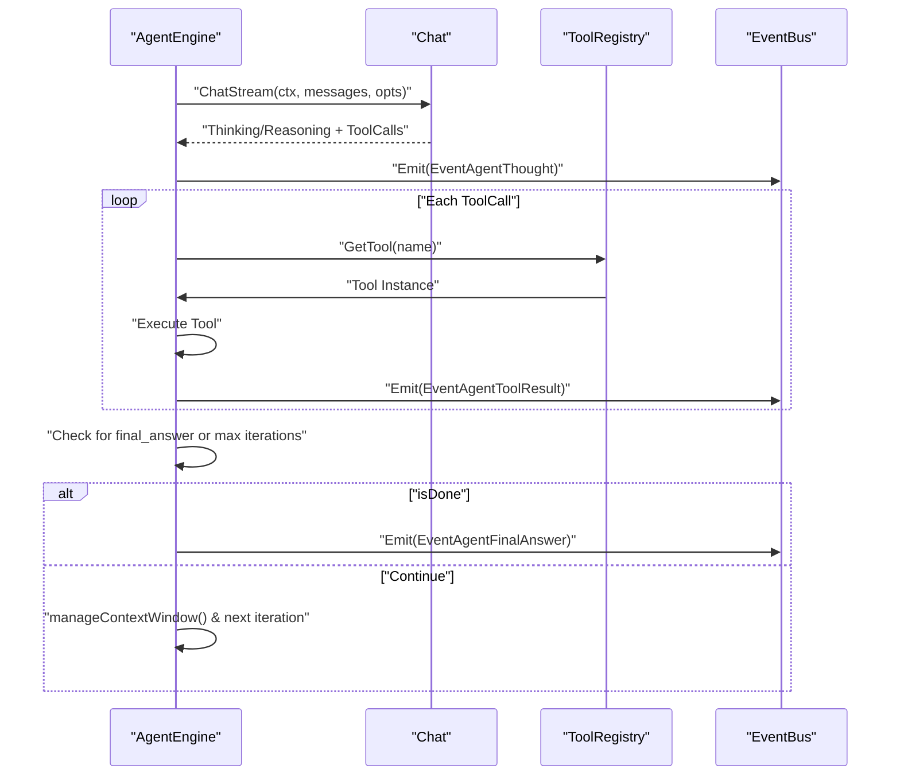
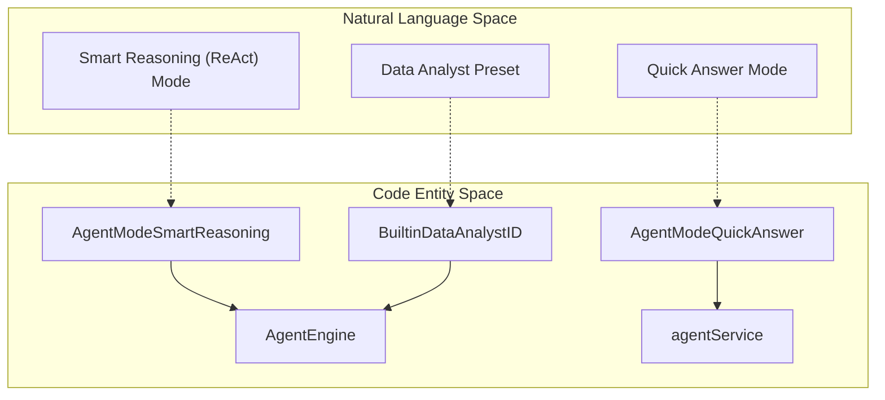
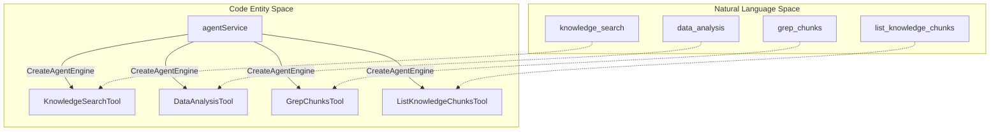
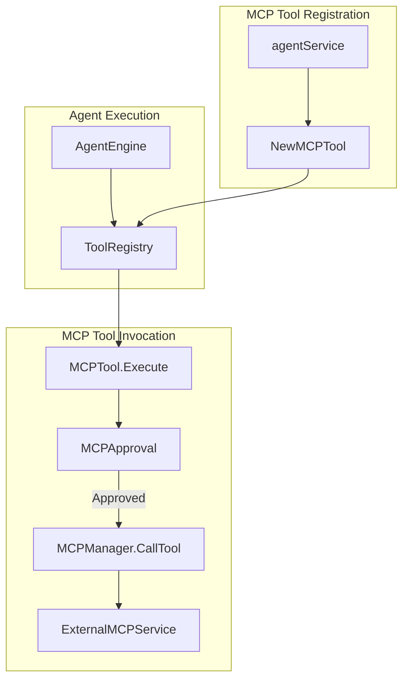

<!-- source: DeepWiki mcp.deepwiki.com · repo Tencent/WeKnora · page 5.3 Agent Mode and Tool Integration · fetched 2026-10-29 -->

# Agent Mode and Tool Integration

Relevant source files

The following files were used as context for generating this wiki page:

- [frontend/src/views/creatChat/creatChat.vue](frontend/src/views/creatChat/creatChat.vue)
- [internal/agent/const.go](internal/agent/const.go)
- [internal/agent/const_test.go](internal/agent/const_test.go)
- [internal/agent/engine.go](internal/agent/engine.go)
- [internal/agent/engine_test.go](internal/agent/engine_test.go)
- [internal/agent/finalize.go](internal/agent/finalize.go)
- [internal/agent/observe.go](internal/agent/observe.go)
- [internal/agent/observe_test.go](internal/agent/observe_test.go)
- [internal/agent/prompts.go](internal/agent/prompts.go)
- [internal/agent/think.go](internal/agent/think.go)
- [internal/application/repository/custom_agent.go](internal/application/repository/custom_agent.go)
- [internal/application/service/agent_history.go](internal/application/service/agent_history.go)
- [internal/application/service/agent_history_test.go](internal/application/service/agent_history_test.go)
- [internal/application/service/agent_service.go](internal/application/service/agent_service.go)
- [internal/application/service/custom_agent.go](internal/application/service/custom_agent.go)
- [internal/application/service/model_delete_test.go](internal/application/service/model_delete_test.go)
- [internal/application/service/session_agent_qa.go](internal/application/service/session_agent_qa.go)
- [internal/handler/custom_agent.go](internal/handler/custom_agent.go)
- [internal/models/api/anthropicmessages/anthropicmessages_test.go](internal/models/api/anthropicmessages/anthropicmessages_test.go)
- [internal/models/api/anthropicmessages/request.go](internal/models/api/anthropicmessages/request.go)
- [internal/models/api/compat_settings.go](internal/models/api/compat_settings.go)
- [internal/types/agent.go](internal/types/agent.go)
- [internal/types/chat.go](internal/types/chat.go)
- [internal/types/custom_agent.go](internal/types/custom_agent.go)
- [internal/types/interfaces/custom_agent.go](internal/types/interfaces/custom_agent.go)

This page details the **smart-reasoning (ReAct) agent mode** in WeKnora, explaining the agent engine operation, ReAct loop execution, tool registration and invocation, prompt templates, and agent skills integration.

---

## Agent Modes and Architecture

WeKnora supports a sophisticated agent system primarily driven by `AgentEngine` [internal/agent/engine.go:33-106]() and orchestrated by `agentService` [internal/application/service/agent_service.go:101-140](). Unlike standard RAG, Agent mode enables the model to reason iteratively about tool selection and information retrieval.

The `AgentEngine` is stateless across turns; conversation history is rebuilt from the database once per turn by the caller via `LoadAgentHistory` and passed into `Execute` as `llmContext` [internal/agent/engine.go:33-39](), [internal/application/service/session_agent_qa.go:45-106]().

### Agent Modes and Presets
The system defines running modes and agent type presets in `internal/types/custom_agent.go`:
*   **Quick Answer (`AgentModeQuickAnswer`)**: A standard RAG mode for fast, single-turn Q&A [internal/types/custom_agent.go:70-76]().
*   **Smart Reasoning (`AgentModeSmartReasoning`)**: A ReAct mode for multi-step reasoning and tool invocation [internal/types/custom_agent.go:70-76]().
*   **Agent Types (`AgentTypeRAGQA`, `AgentTypeWikiQA`, `AgentTypeHybridRAGWiki`, `AgentTypeDataAnalysis`, `AgentTypeCustom`)**: Presets under smart-reasoning mode that bundle recommended system prompt templates, tool allowlists, and KB compatibility [internal/types/custom_agent.go:78-97]().

Sources: [internal/agent/engine.go:33-106](), [internal/application/service/agent_service.go:101-140](), [internal/types/custom_agent.go:13-97](), [internal/application/service/session_agent_qa.go:45-106]()

### ReAct Loop Architecture
The engine implements a **Reason-Act** loop capped by `MAX_ITERATIONS` (default 100) [internal/application/service/agent_service.go:36-37](). In each iteration, the LLM generates reasoning content and optional tool calls; the engine executes these tools and feeds results back into the context until a final answer is produced.

#### ReAct Loop Execution Flow

Sources: [internal/agent/engine.go:33-106](), [internal/application/service/agent_service.go:30-37](), [internal/application/service/session_agent_qa.go:45-169]()

### Natural Language Space to Code Entity Mapping: Agent Modes

Sources: [internal/types/custom_agent.go:13-76](), [internal/agent/engine.go:33-106](), [internal/application/service/agent_service.go:101-140]()

---

## Tool Registration and Catalog

The `agentService` constructs a `ToolRegistry` for every request, populating it with tools allowed by the `AgentConfig` [internal/types/agent.go:102-125]().

### Core Retrieval & Data Analysis Tools

| Tool Name | Implementation | Description |
|---|---|---|
| `knowledge_search` | `KnowledgeSearchTool` | Semantic/vector search for retrieving knowledge by conceptual relevance, utilizing embeddings and rerankers. |
| `data_analysis` | `DataAnalysisTool` | Loads CSV/Excel files into DuckDB and executes read-only SQL queries against a unified dataset table view. |
| `grep_chunks` | `GrepChunksTool` | Regex-based literal search applied directly in the database using POSIX operators. |
| `list_knowledge_chunks` | `ListKnowledgeChunksTool` | Retrieves full chunk content for a document or a single FAQ entry by ID. |

Sources: [internal/types/agent.go:102-125]()

### Tool Integration Mapping

Sources: [internal/application/service/agent_service.go:101-140]()

---

## MCP Tool Integration

WeKnora integrates with external services via the Model Context Protocol (MCP). MCP tools are dynamically discovered and registered into the agent's tool catalog based on tenant configuration and per-turn `@mention` pinning [internal/agent/engine.go:33-106]().

### MCP Approval Gate
Sensitive MCP tools are governed by a human approval gate implemented via `approval.MCPApproval`, pausing execution until user consent is granted [internal/application/service/agent_service.go:122]().

Sources: [internal/application/service/agent_service.go:122](), [internal/agent/engine.go:33-106]()

---

## Agent Skills and Progressive Disclosure

WeKnora implements a **Progressive Disclosure** pattern for skills to avoid polluting the system prompt with excessive static instructions [internal/agent/engine.go:57]().

1.  **Discovery**: The skills subsystem scans available skill bundles and libraries.
2.  **Prompt Injection**: Lightweight metadata about available skills is formatted into the system prompt, enabling the LLM to understand what capabilities exist without loading full implementations [internal/agent/prompts.go:161-165]().
3.  **Pinned Mentions**: Per-request `@mentions` force-include specific skills in the engine's active tool scope [internal/agent/engine.go:49]().

Sources: [internal/agent/engine.go:43-57](), [internal/agent/prompts.go:161-165]()

---

## Advanced Execution Features

### Context Window Management and Compaction
When conversation history or tool outputs push token counts past configured thresholds, `AgentEngine.manageContextWindow` and `runCompaction` summarize older history or trim oversized tool outputs [internal/agent/observe.go:39-67]().

### Watchdog and Stream Stalls
During LLM output generation, `streamLLMToEventBus` uses `watchStreamStall` to monitor stream responsiveness against configured stall timeouts, preventing hung connections from blocking execution threads indefinitely [internal/agent/think.go:38-78]().

### VLM Image Analysis in Tools
When tool responses contain image artifacts, `AgentEngine` can leverage an injected image describer function (`ImageDescriberFunc`) to generate inline text descriptions for downstream reasoning [internal/agent/engine.go:59-60]().

Sources: [internal/agent/observe.go:39-67](), [internal/agent/think.go:38-78](), [internal/agent/engine.go:59-60]()

---

## Prompting and Context

### System Prompt Templates
Default system prompts are loaded from templates, supporting multi-language localization and role specialization [internal/types/custom_agent.go:13-36]().

### Runtime Context Injection
The engine injects structured context blocks into the user message turn to ground the agent:
*   **Knowledge Base Info**: Descriptions, types, and retrieval capabilities of bound KBs [internal/agent/prompts.go:167-186]().
*   **Selected Documents**: Metadata for individual documents referenced via `@` mentions [internal/agent/prompts.go:48-56]().
*   **Pinned Mentions**: Scope definitions for explicitly requested MCP services and skills [internal/agent/prompts.go:152-165]().

Sources: [internal/types/custom_agent.go:13-36](), [internal/agent/prompts.go:48-56](), [internal/agent/prompts.go:152-186]()

---

