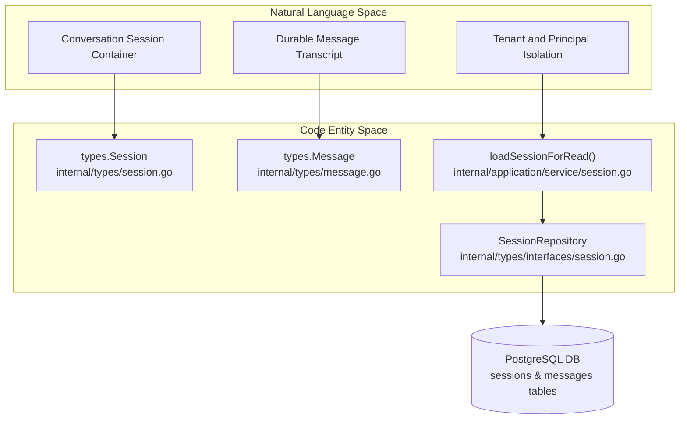
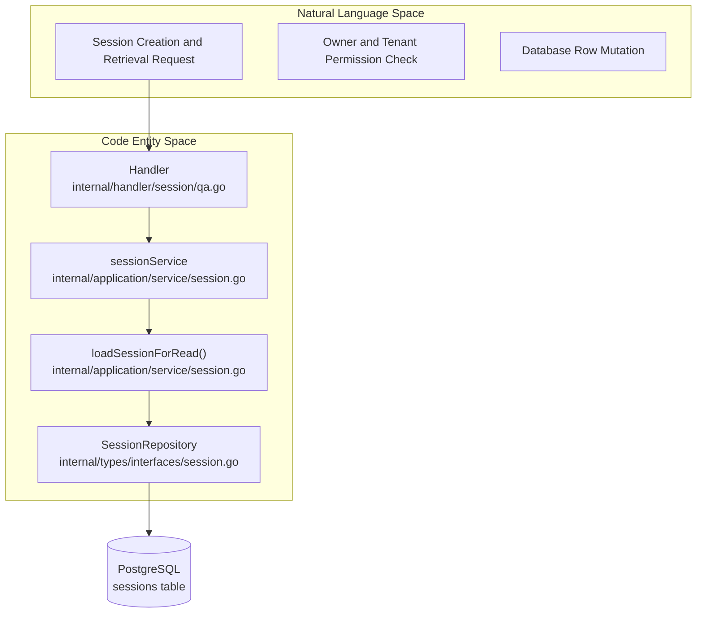

<!-- source: DeepWiki mcp.deepwiki.com · repo Tencent/WeKnora · page 5.4 Session Management and Context · fetched 2026-10-29 -->

# Session Management and Context

Relevant source files

The following files were used as context for generating this wiki page:

- [frontend/src/components/sessionGrouping.test.ts](frontend/src/components/sessionGrouping.test.ts)
- [frontend/src/components/sessionGrouping.ts](frontend/src/components/sessionGrouping.ts)
- [internal/application/repository/message.go](internal/application/repository/message.go)
- [internal/application/repository/session.go](internal/application/repository/session.go)
- [internal/application/repository/session_test.go](internal/application/repository/session_test.go)
- [internal/application/service/message.go](internal/application/service/message.go)
- [internal/application/service/session.go](internal/application/service/session.go)
- [internal/application/service/session_user_scope_test.go](internal/application/service/session_user_scope_test.go)
- [internal/handler/message_suggestion.go](internal/handler/message_suggestion.go)
- [internal/handler/message_suggestion_test.go](internal/handler/message_suggestion_test.go)
- [internal/handler/session/handler.go](internal/handler/session/handler.go)
- [internal/handler/session/qa.go](internal/handler/session/qa.go)
- [internal/types/interfaces/message.go](internal/types/interfaces/message.go)
- [internal/types/interfaces/session.go](internal/types/interfaces/session.go)
- [internal/types/principal.go](internal/types/principal.go)
- [internal/types/session.go](internal/types/session.go)
- [internal/types/session_access_test.go](internal/types/session_access_test.go)

## Purpose and Scope

The session and context management subsystem in WeKnora handles conversation lifecycle management, state isolation, message persistence, context windowing, and automatic title generation across multi-turn interactions. Sessions act as persistent containers for chat transcripts, binding configuration state (such as selected knowledge bases, agents, and model choices) to user queries [internal/types/interfaces/session.go:12-78]().

The scope of this subsystem includes:
- **Session Lifecycle & Scoping**: Creating, loading, updating, and deleting conversation rows with multi-tenant isolation and principal-based scoping (`PrincipalIMUser`, `PrincipalAPITenant`, `PrincipalEmbedSession`) [internal/application/service/session.go:22-101]().
- **Conversation History Management**: Storing and retrieving user and assistant utterances via `messageService` and the `messages` table [internal/application/service/message.go:20-52]().
- **Context Storage and Windowing**: Managing intermediate pipeline configurations and mutable state structures (`SessionLastRequestState`, `ContextConfig`) to handle token limits and sliding windows [internal/types/session.go:63-75]().
- **Title Generation**: Deriving concise conversation titles synchronously (`GenerateTitle`) or asynchronously (`GenerateTitleAsync`) via background execution and event bus propagation [internal/types/interfaces/session.go:52-58]().

Sources: [internal/application/service/session.go:22-101](), [internal/application/service/message.go:20-52](), [internal/types/session.go:63-75](), [internal/types/interfaces/session.go:12-78]()

---

## Session Data Architecture and Principal Scoping

Sessions are persisted in PostgreSQL using the `sessions` table and linked to dialogue utterances in the `messages` table [internal/application/repository/session.go:33-58](). Access control is governed by workspace tenant IDs and user owner scopes evaluated during read and write paths [internal/application/service/session.go:22-101]().

| Data Structure / Component | Storage Layer / Role | Purpose & Scope |
|----------------------------|----------------------|-----------------|
| `types.Session` | PostgreSQL (`sessions`) | Stores session metadata, title, pinning status, and UI state restoration settings [internal/types/session.go:89-122]() |
| `types.Message` | PostgreSQL (`messages`) | Durable storage of user/assistant utterances, token counts, and file attachments [internal/application/repository/message.go:27-41]() |
| `Principal` | Runtime Context | Identifies the caller (`PrincipalIMUser`, `PrincipalAPITenant`, `PrincipalEmbedSession`) to enforce scoping rules [internal/types/principal.go:10-19]() |

Title for Diagram: Session Data Architecture Mapping (Natural Language to Code Entities)

Sources: [internal/application/service/session.go:22-101](), [internal/application/repository/session.go:33-58](), [internal/types/session.go:89-122](), [internal/types/principal.go:10-19]()

---

## Session Lifecycle and Repository Operations

Sessions transition through creation, active querying, updating, and cleanup phases managed by `sessionService` [internal/application/service/session.go:141-167]() and enforced by `sessionRepository` [internal/application/repository/session.go:16-32]().

### Creation and Scoping
When a session is initialized, `sessionUserIDFromContext` extracts the owner ID from the request context [internal/application/service/session.go:23-25](). Write endpoints enforce strict owner scoping via `GetOwnedSession` to prevent tenant admins from modifying API-key or embedded sessions they are only permitted to read [internal/types/interfaces/session.go:19-22]().

### Retrieval and Tenant Isolation
Repository methods like `Get` and `GetByTenantID` enforce workspace `tenant_id` and `user_id` matching [internal/application/repository/session.go:52-65](). Non-admin callers attempting to access channel-managed sessions are restricted unless validated by `runtimeMayBypassAdminConsoleRead` [internal/application/service/session.go:59-88]().

Title for Diagram: Session Lifecycle and Scoping Enforcement (Natural Language to Code Entities)

Sources: [internal/application/service/session.go:22-134](), [internal/application/repository/session.go:33-112](), [internal/types/interfaces/session.go:12-38]()

---

## Conversation History and Message Management

Conversation turns are stored as individual `types.Message` records linked by `session_id` and managed through `messageService` [internal/application/service/message.go:21-33]().

### Message Retrieval Functions
- `GetMessagesBySession`: Retrieves paginated message lists ordered chronologically for UI rendering [internal/application/service/message.go:133-160]().
- `GetRecentMessagesBySession`: Fetches a limited window of recent messages for context injection during agent execution [internal/application/service/message.go:162-173]().
- `CreateMessage`: Persists user utterances and assistant answers after validating session existence [internal/application/service/message.go:79-103]().
- `ListMessagesBySessionAfterCursor` / `ListMessagesBySessionBeforeCursor`: Uses stable time-and-ID composite cursors (`MemoryMessageCursor`) for lossless paging during background distillation and history traversal [internal/application/repository/message.go:176-199]().

Sources: [internal/application/service/message.go:21-173](), [internal/application/repository/message.go:176-199]()

---

## Context Management and Request State

To maintain conversation context across multi-turn exchanges while adhering to token limits, WeKnora manages request parameters and compression parameters via `ContextConfig` [internal/types/session.go:63-75]().

### Context Representation Structures
- `ContextConfig`: Configures LLM context parameters including `MaxTokens`, `CompressionStrategy` (`ContextCompressionSlidingWindow` or `ContextCompressionSmart`), `RecentMessageCount`, and `SummarizeThreshold` [internal/types/session.go:63-75]().
- `SessionLastRequestState`: Persists the input-bar configuration used during the most recent request (agent, model, KB scope, web search flags, MCP services) in the legacy `agent_config` JSONB column of `sessions` so the chat UI can restore state upon reopening [internal/types/session.go:115-121]().

Sources: [internal/types/session.go:63-75](), [internal/types/session.go:115-121]()

---

## Title Generation

New sessions are initialized without descriptive titles. Titles are generated automatically from initial conversation content.

### Implementation and Asynchronous Execution
- `GenerateTitle`: Invokes an active chat model to condense dialogue turns into a short title string [internal/types/interfaces/session.go:52-54]().
- `GenerateTitleAsync`: Executes title generation asynchronously in a background goroutine and emits workspace events via the event bus [internal/types/interfaces/session.go:55-58]().
- Event Propagation: Handlers subscribe to title generation events to stream updated metadata back to connected clients [internal/handler/session/handler.go:22-84]().

Sources: [internal/types/interfaces/session.go:52-58](), [internal/handler/session/handler.go:22-84]()

---

