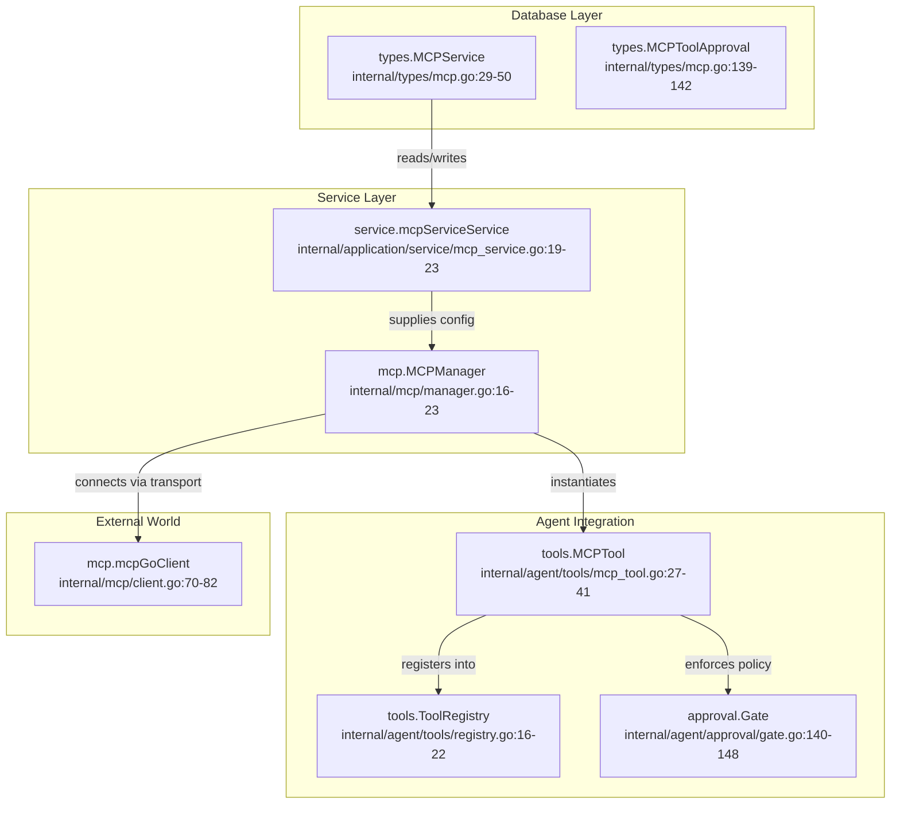
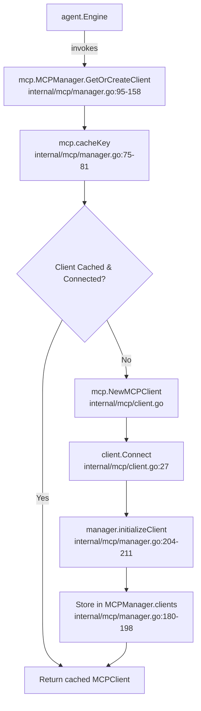

<!-- source: DeepWiki mcp.deepwiki.com · repo Tencent/WeKnora · page 5.5 MCP Tool Integration · fetched 2026-10-29 -->

# MCP Tool Integration

Relevant source files

The following files were used as context for generating this wiki page:

- [frontend/src/api/mcp-service.ts](frontend/src/api/mcp-service.ts)
- [frontend/src/views/settings/components/McpServiceDialog.test.ts](frontend/src/views/settings/components/McpServiceDialog.test.ts)
- [frontend/src/views/settings/components/McpServiceDialog.vue](frontend/src/views/settings/components/McpServiceDialog.vue)
- [internal/agent/approval/gate.go](internal/agent/approval/gate.go)
- [internal/agent/approval/gate_test.go](internal/agent/approval/gate_test.go)
- [internal/agent/operations/infra_test.go](internal/agent/operations/infra_test.go)
- [internal/agent/tools/mcp_call_retry_test.go](internal/agent/tools/mcp_call_retry_test.go)
- [internal/agent/tools/mcp_oauth.go](internal/agent/tools/mcp_oauth.go)
- [internal/agent/tools/mcp_tool.go](internal/agent/tools/mcp_tool.go)
- [internal/application/repository/mcp_service_create_test.go](internal/application/repository/mcp_service_create_test.go)
- [internal/application/service/mcp_service.go](internal/application/service/mcp_service.go)
- [internal/application/service/mcp_service_test.go](internal/application/service/mcp_service_test.go)
- [internal/handler/mcp_service.go](internal/handler/mcp_service.go)
- [internal/handler/mcp_service_create_test.go](internal/handler/mcp_service_create_test.go)
- [internal/mcp/client.go](internal/mcp/client.go)
- [internal/mcp/client_call_error_test.go](internal/mcp/client_call_error_test.go)
- [internal/mcp/errors.go](internal/mcp/errors.go)
- [internal/mcp/errors_test.go](internal/mcp/errors_test.go)
- [internal/mcp/manager.go](internal/mcp/manager.go)
- [internal/mcp/manager_closeall_test.go](internal/mcp/manager_closeall_test.go)
- [internal/mcp/manager_disconnect_test.go](internal/mcp/manager_disconnect_test.go)
- [internal/mcpserver/server_test.go](internal/mcpserver/server_test.go)
- [internal/router/routes_mcp_endpoint_test.go](internal/router/routes_mcp_endpoint_test.go)
- [internal/types/interfaces/mcp_service.go](internal/types/interfaces/mcp_service.go)
- [internal/types/mcp.go](internal/types/mcp.go)
- [website-docs/03-features/08-mcp.md](website-docs/03-features/08-mcp.md)

## Purpose and Scope

This page documents the Model Context Protocol (MCP) tool integration subsystem within WeKnora. MCP provides a standardized protocol for external services to expose tools and resources that agents can dynamically discover and execute during reasoning loops.

**Topics covered:**
- MCP service configuration, SSRF protection, and separation of secrets via dedicated subresources (`types.MCPService`, `internal/types/mcp.go`).
- Client connection management, principal-scoped OAuth caching, and lifecycle handshakes (`mcp.MCPManager`, `mcp.MCPClient`).
- Tool wrapper implementation, name sanitization, first-wins collision defense, and timeout extensions (`tools.MCPTool`, `tools.ToolRegistry`).
- Human-in-the-loop (HITL) approval gating and OAuth runtime authorization (`approval.Gate`, `OAuthRequiredError`).

Sources: `[internal/agent/tools/mcp_tool.go:27-56]`, `[internal/mcp/client.go:24-52]`, `[internal/types/mcp.go:29-50]`

---

## MCP Architecture and Data Flow

The MCP subsystem bridges external tool servers with internal agent execution loops. The architecture relies on persistent service definitions stored in PostgreSQL, managed by `service.mcpServiceService`, instantiated through `mcp.MCPManager`, and exposed to agents via `tools.MCPTool` registered in `tools.ToolRegistry`.

Title: "MCPDataFlowArchitecture"

Sources: `[internal/types/mcp.go:29-142]`, `[internal/application/service/mcp_service.go:19-23]`, `[internal/mcp/manager.go:16-23]`, `[internal/agent/tools/mcp_tool.go:27-41]`, `[internal/agent/tools/registry.go:16-22]`

---

## Service Configuration, Auth, and Security Constraints

MCP services are defined by the `types.MCPService` struct `[internal/types/mcp.go:29-50]`, which stores transport types, endpoints, custom headers, and authentication profiles.

### Transport Protocols and SSRF Protection
WeKnora supports Server-Sent Events (`sse`) and HTTP Streamable (`http-streamable`) transports `[internal/types/mcp.go:16-23]`. 

- **Stdio Ban:** The `stdio` transport is strictly disabled in both the service layer `[internal/application/service/mcp_service.go:40-43]` and manager `[internal/mcp/manager.go:104-107]` to prevent local command execution vulnerabilities on host environments.
- **SSRF Validation:** All outbound service URLs are validated against Server-Side Request Forgery (SSRF) rules via `mcp.ValidateServiceOutboundURLs` during creation `[internal/application/service/mcp_service.go:44-46]` and client creation `[internal/mcp/client.go]`.

### Authentication Strategies and Credential Separation
The `types.MCPAuthConfig` struct `[internal/types/mcp.go:80-121]` manages credentials. The `applyAuthHeaders` function `[internal/mcp/client.go:133-164]` injects authentication headers based on the selected `AuthType` (`api_key`, `bearer`, or `oauth`) while applying tenant-specific `CustomHeaders`. 

Secrets (`api_key`, `token`) are isolated behind a dedicated `/credentials` subresource handled by credential handlers and are omitted from the main resource responses via `dto.MCPServiceResponse` `[internal/application/service/mcp_service.go:67-71]`.

Sources: `[internal/types/mcp.go:16-121]`, `[internal/application/service/mcp_service.go:40-71]`, `[internal/mcp/manager.go:104-107]`, `[internal/mcp/client.go:133-164]`

---

## Client Connection Lifecycle and `MCPManager`

The `mcp.MCPManager` struct `[internal/mcp/manager.go:16-23]` caches and coordinates active `mcp.MCPClient` connections. For OAuth-enabled services, connections are keyed per user principal (`cacheKey` `[internal/mcp/manager.go:75-81]`) to maintain isolated tokens across principals.

Title: "MCPClientConnectionLifecycle"

- **Connection Reuse:** Connections persist across agent turns unless `service.UpdatedAt` changes, which triggers a graceful disconnect and reconnect cycle `[internal/mcp/manager.go:122-135]`.
- **Initialization Timeout:** Client initialization enforces a strict timeout bounded by `AdvancedConfig.Timeout` (capped at 60 seconds) `[internal/mcp/manager.go:208-211]`.

Sources: `[internal/mcp/manager.go:16-211]`, `[internal/mcp/client.go:27]`

---

## Tool Wrapper, Registry, and Execution

Discovered tools from an MCP server are wrapped by `tools.MCPTool` `[internal/agent/tools/mcp_tool.go:27-41]` to satisfy the internal agent `types.Tool` interface.

### Name Sanitization, First-Wins, and Security Prefixing
- **Function Names:** The `Name()` method `[internal/agent/tools/mcp_tool.go:67-93]` formats tool names as `mcp_{service_name}_{tool_name}`. It sanitizes special characters and truncates strings to adhere to LLM provider function naming constraints (maximum 64 characters).
- **First-Wins Collision Policy:** The `ToolRegistry.RegisterTool` method implements first-wins semantics to reject duplicate registrations and prevent tool execution hijacking (`GHSA-67q9-58vj-32qx`) `[internal/agent/tools/registry.go]`.
- **Security Prefixing:** The `Description()` method `[internal/agent/tools/mcp_tool.go:95-103]` injects a mandatory `[MCP Service: ... (external)]` prefix to mitigate indirect prompt injection attacks.
- **Execution Timeouts:** Tool execution honors `AdvancedConfig.Timeout`. Through `callToolTimeout()`, the engine's default tool budget (60s) is extended when the service specifies a longer timeout value (`#3135`) `[internal/agent/tools/mcp_tool.go:135-143]`.

Sources: `[internal/agent/tools/mcp_tool.go:27-143]`, `[internal/agent/tools/registry.go]`

---

## Human-in-the-Loop Approval and OAuth Gating

When executing tools, `tools.MCPTool.Execute` `[internal/agent/tools/mcp_tool.go:146-185]` enforces runtime security policies and user interaction flows.

### Approval Gates
If a tool is configured to require human supervision (`MCPToolApproval`), execution suspends via `approval.Gate.RequestAndWait` (issue #1173). The execution thread blocks until the user approves or rejects the action in the frontend UI.

### OAuth Authorization Errors
When an MCP server returns an unauthorized response accompanied by RFC 9728 protected-resource metadata, the client raises an `OAuthRequiredError` `[internal/mcp/client.go:171-183]`, prompting the user to complete the OAuth2 authorization-code flow rather than failing with a generic error code.

Sources: `[internal/agent/tools/mcp_tool.go:146-185]`, `[internal/mcp/client.go:171-183]`

---

