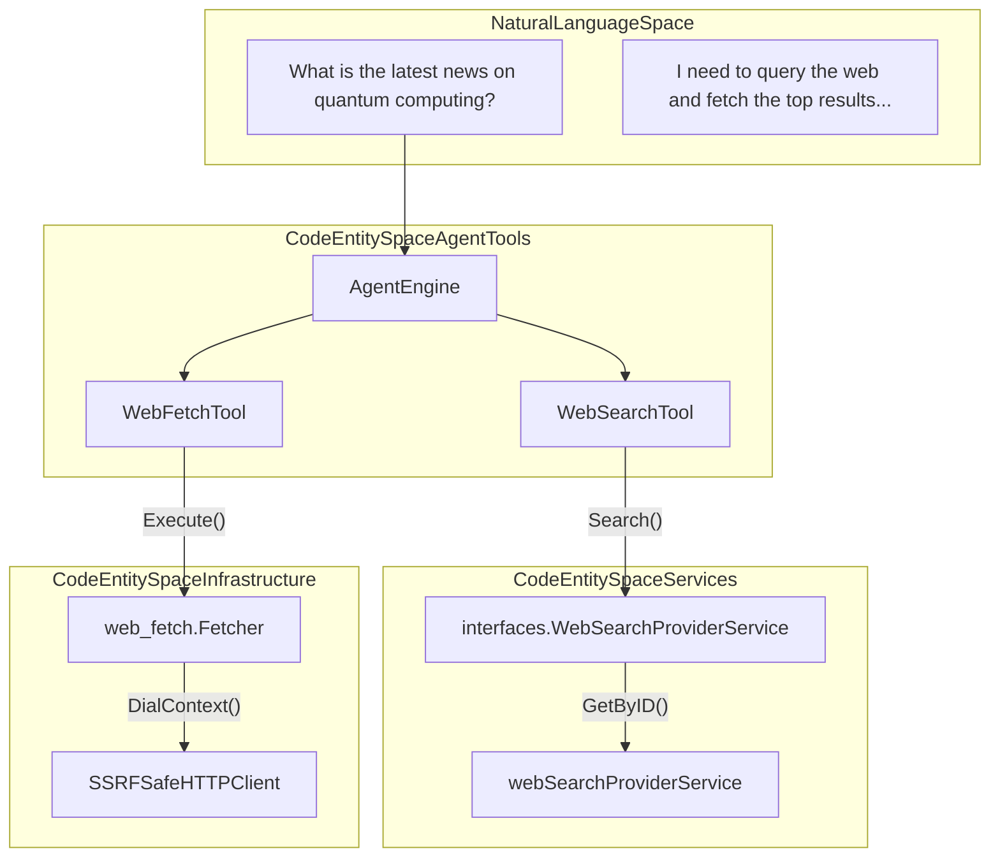
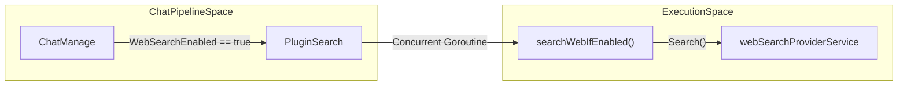

<!-- source: DeepWiki mcp.deepwiki.com · repo Tencent/WeKnora · page 5.6 Web Search Integration · fetched 2026-10-29 -->

# Web Search Integration

Relevant source files

The following files were used as context for generating this wiki page:

- [frontend/src/api/web-search-provider.ts](frontend/src/api/web-search-provider.ts)
- [frontend/src/views/chat/components/deepThink.vue](frontend/src/views/chat/components/deepThink.vue)
- [frontend/src/views/chat/components/docInfo.vue](frontend/src/views/chat/components/docInfo.vue)
- [frontend/src/views/chat/components/tool-results/KnowledgeBaseList.vue](frontend/src/views/chat/components/tool-results/KnowledgeBaseList.vue)
- [internal/agent/tools/web_fetch.go](internal/agent/tools/web_fetch.go)
- [internal/agent/tools/web_fetch_test.go](internal/agent/tools/web_fetch_test.go)
- [internal/agent/tools/web_pages_test.go](internal/agent/tools/web_pages_test.go)
- [internal/agent/tools/web_search.go](internal/agent/tools/web_search.go)
- [internal/agent/tools/web_search_test.go](internal/agent/tools/web_search_test.go)
- [internal/application/service/web_search.go](internal/application/service/web_search.go)
- [internal/application/service/web_search_provider.go](internal/application/service/web_search_provider.go)
- [internal/application/service/web_search_provider_test.go](internal/application/service/web_search_provider_test.go)
- [internal/infrastructure/web_fetch/fetcher.go](internal/infrastructure/web_fetch/fetcher.go)
- [internal/infrastructure/web_fetch/fetcher_charset_test.go](internal/infrastructure/web_fetch/fetcher_charset_test.go)
- [internal/infrastructure/web_fetch/fetcher_test.go](internal/infrastructure/web_fetch/fetcher_test.go)
- [internal/types/web_search_provider.go](internal/types/web_search_provider.go)
- [internal/types/web_search_provider_test.go](internal/types/web_search_provider_test.go)
- [internal/utils/security.go](internal/utils/security.go)
- [internal/utils/security_dial_timeout_test.go](internal/utils/security_dial_timeout_test.go)
- [website-docs/01-getting-started/04-configuration.md](website-docs/01-getting-started/04-configuration.md)
- [website-docs/02-architecture/02-backend-design.md](website-docs/02-architecture/02-backend-design.md)
- [website-docs/03-features/03-document-parsing.md](website-docs/03-features/03-document-parsing.md)
- [website-docs/03-features/07-agent.md](website-docs/03-features/07-agent.md)
- [website-docs/03-features/11-web-search.md](website-docs/03-features/11-web-search.md)
- [website-docs/03-features/16-observability.md](website-docs/03-features/16-observability.md)

## Purpose and Scope

This page documents the web search integration capabilities within WeKnora, covering the pluggable search provider architecture, dynamic tenant configuration, the web fetch tooling (`WebFetchTool`), model context registry mapping, security safeguards (such as SSRF protection and AES-GCM encrypted credentials), and execution workflows within agents and the chat pipeline. Supported search providers include Brave, Bing, Google, DuckDuckGo, Tavily, Ollama, Baidu, Searxng, Keenable, Zhipu, Metaso, Exa, Bocha, and Serply `[internal/types/web_search_provider.go:17-33]`.

Sources: `[internal/types/web_search_provider.go:17-33]()`

---

## Architecture and Entity Space

The integration bridges high-level agent tool calls and chat pipeline events to external search APIs and web fetchers through a layered service architecture.

### Code Entity Mapping: Agent Workflow

This diagram illustrates how a natural language request triggers search and fetch tools within the agentic ReAct loop and interacts with the provider infrastructure and fetcher components.

Sources: `[internal/application/service/web_search_provider.go:14-22]`, `[internal/types/web_search_provider.go:39-58]`, `[internal/agent/tools/web_fetch.go:65-74]`, `[internal/infrastructure/web_fetch/fetcher.go:92-102]()`

### Code Entity Mapping: Chat Pipeline

The chat pipeline handles web search integration when enabled in standard Knowledge QA mode through asynchronous query execution and runner functions.

Sources: `[internal/application/service/web_search_provider.go:14-22]`, `[internal/types/web_search_provider.go:14-33]()`

---

## Provider Configuration

WeKnora uses a CRUD-based entity model for search providers, allowing tenants to manage multiple credentials via the frontend settings UI `[internal/types/web_search_provider.go:35-38]`.

### WebSearchProviderEntity

The `WebSearchProviderEntity` stores configuration in the `web_search_providers` table `[internal/types/web_search_provider.go:39-58]`. API keys are encrypted at rest using AES-GCM via GORM hooks `[internal/types/web_search_provider.go:96-105]`.

| Field | Type | Description |
|-------|------|-------------|
| `ID` | `string` | Unique UUID generated in `BeforeCreate` `[internal/types/web_search_provider.go:41]`, `[internal/types/web_search_provider.go:65-72]` |
| `Provider` | `WebSearchProviderType` | Enum: `brave`, `bing`, `google`, `duckduckgo`, `tavily`, `ollama`, `baidu`, `searxng`, `keenable`, `zhipu`, `exa`, `metaso`, `bocha`, `serply` `[internal/types/web_search_provider.go:18-33]` |
| `Parameters` | `WebSearchProviderParameters` | JSON containing `APIKey`, `EngineID`, `BaseURL`, and `ProxyURL` `[internal/types/web_search_provider.go:81-94]` |
| `IsDefault` | `bool` | Fallback provider for the workspace `[internal/types/web_search_provider.go:53]` |

Sources: `[internal/types/web_search_provider.go:35-58]`, `[internal/application/service/web_search_provider.go:20-46]()`

### Supported Providers and Validation

Each provider has specific validation logic implemented in the application service layer `[internal/application/service/web_search_provider.go:152-193]`.

| Provider ID | Implementation / Type | Key Requirement | Config Fields / Notes |
|-------------|----------------------|-----------------|-----------------------|
| `duckduckgo`| `WebSearchProviderTypeDuckDuckGo` | None `[internal/application/service/web_search_provider.go:132-150]` | - |
| `google`    | `WebSearchProviderTypeGoogle`     | `APIKey` + `EngineID` `[internal/application/service/web_search_provider.go:167-173]` | Custom Search Engine ID required |
| `searxng`   | `WebSearchProviderTypeSearxng`    | `BaseURL` `[internal/types/web_search_provider.go:143-144]` | Self-hosted instance URL |
| `serply`    | `WebSearchProviderTypeSerply`     | `APIKey` `[internal/application/service/web_search_provider.go:159-162]` | Serply API key required |
| `exa`       | `WebSearchProviderTypeExa`        | `APIKey` `[internal/application/service/web_search_provider.go:186-189]` | Exa neural search |
| `zhipu`     | `WebSearchProviderTypeZhipu`      | Validated via `ValidateZhipuParameters` `[internal/application/service/web_search_provider.go:190-193]` | Zhipu web search parameters |

Sources: `[internal/application/service/web_search_provider.go:131-193]`, `[internal/types/web_search_provider.go:129-153]()`

---

## Web Fetch Tooling (`web_fetch`)

The `WebFetchTool` enables agents to read public web pages as Markdown, preserving headings, links, tables, and code structures `[internal/agent/tools/web_fetch.go:24-41]`.

### Key Features of `web_fetch`
- **Batch Processing**: Accepts up to 8 items per call with character offset pagination (`offset` and `limit`, default/max 8000 characters) `[internal/agent/tools/web_fetch.go:31-32]`.
- **Caching & Inflight Deduplication**: Caches retrieved pages for the duration of the Agent run (up to 8 pages) and deduplicates concurrent fetches using `pageFlight` coordination `[internal/agent/tools/web_fetch.go:21]`, `[internal/agent/tools/web_fetch.go:70-74]`, `[internal/agent/tools/web_fetch.go:119-128]`.
- **SSRF Protection & Chromium Fallback**: Powered by `internal/infrastructure/web_fetch.Fetcher` which validates URLs against SSRF policies, pins IP addresses during dialing, and falls back to headless Chromium rendering for dynamic JavaScript-heavy pages `[internal/infrastructure/web_fetch/fetcher.go:92-146]`, `[internal/infrastructure/web_fetch/fetcher.go:184-195]`.

Sources: `[internal/agent/tools/web_fetch.go:19-74]`, `[internal/infrastructure/web_fetch/fetcher.go:92-147]()`

---

## Security and Data Privacy

### Credential Management
The system enforces strict security boundaries for sensitive credentials like API keys.
- **Encryption**: API keys are encrypted using a system-level AES key before database insertion via `WebSearchProviderParameters.Value` `[internal/types/web_search_provider.go:96-105]`. Decryption occurs in `Scan` `[internal/types/web_search_provider.go:107-127]`.
- **Subresource Pattern**: Credentials are managed via a dedicated `/credentials` subresource (`PUT /api/v1/web-search-providers/:id/credentials`) handled by `webSearchProviderService.UpdateProviderCredentials` `[internal/application/service/web_search_provider.go:78-97]`, `[frontend/src/api/web-search-provider.ts:99-105]`.
- **Response Masking**: The standard provider response DTO omits the `api_key` field; the frontend only receives configuration status `[internal/types/web_search_provider.go:77-80]`, `[frontend/src/api/web-search-provider.ts:21-22]`.

### SSRF Protection
- **URL Validation**: Both `BaseURL` (for SearXNG) and `ProxyURL` are validated using `utils.ValidateURLForSSRF` `[internal/types/web_search_provider.go:86-91]`.
- **Restricted Hostnames**: Built-in blocklists in `internal/utils/security.go` prevent access to loopback, link-local, and cloud metadata services (`metadata.google.internal`, `metadata.tencentyun.com`, etc.) `[internal/utils/security.go:226-244]`.

Sources: `[internal/types/web_search_provider.go:74-127]`, `[internal/application/service/web_search_provider.go:75-123]`, `[frontend/src/api/web-search-provider.ts:99-112]`, `[internal/utils/security.go:226-244]()`

---

## Frontend Integration

The frontend dynamically adapts to the metadata provided by the backend for each search provider type.

### Dynamic Form Rendering
The `WebSearchProviderTypeInfo` structure allows the frontend to render appropriate input fields based on provider capabilities `[internal/types/web_search_provider.go:129-153]`.
- **Config Fields**: Supports complex field types like `select` with predefined options `[internal/types/web_search_provider.go:151-153]`, `[frontend/src/api/web-search-provider.ts:42-52]`.
- **Documentation Links**: Includes `docs_url` to guide users in obtaining API keys for specific providers `[internal/types/web_search_provider.go:148-150]`.

### API Client
The frontend interacts with providers via `frontend/src/api/web-search-provider.ts`:
- `listWebSearchProviderTypes()`: Fetches metadata for available provider types `[frontend/src/api/web-search-provider.ts:80-87]`.
- `testWebSearchProvider()`: Tests a provider configuration, supporting both existing IDs and raw unsaved parameters `[frontend/src/api/web-search-provider.ts:117-122]`.

Sources: `[frontend/src/api/web-search-provider.ts:4-52]`, `[frontend/src/api/web-search-provider.ts:80-122]`, `[internal/types/web_search_provider.go:129-153]()`

---

